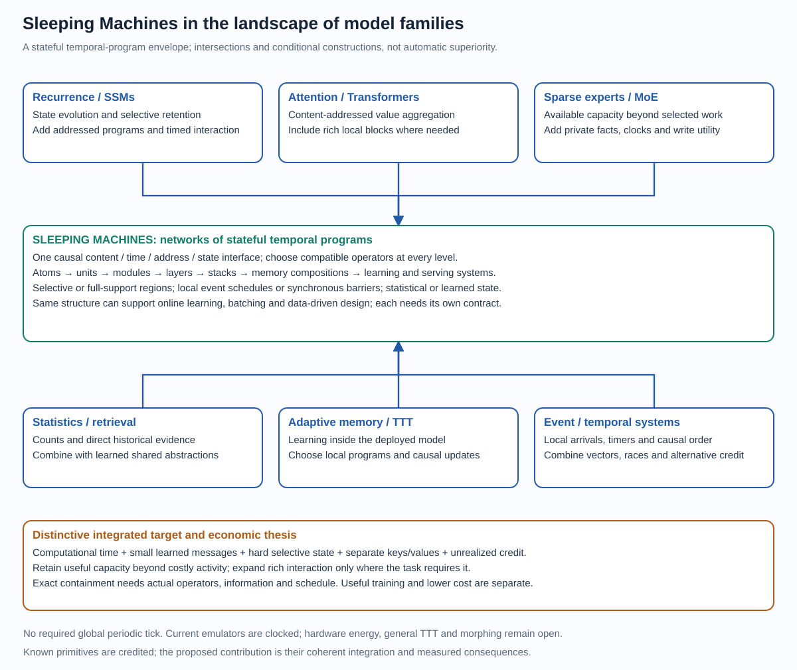
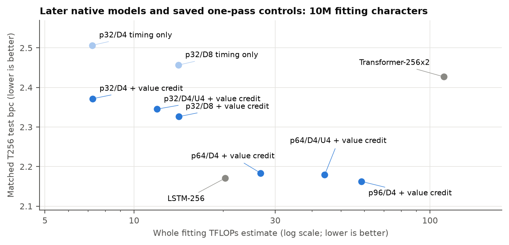
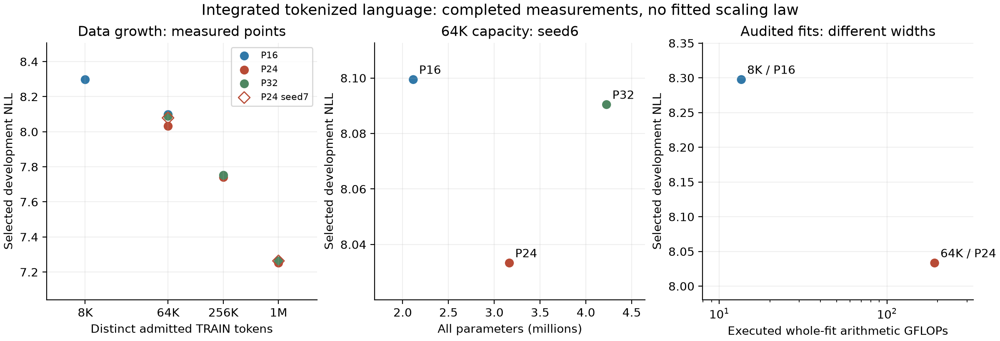
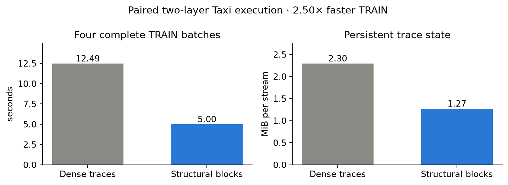

# Sleeping Machines

A universal trainable computing substrate that computes through time

Tero Keski-Valkama and Karoliina Salminen · Research report · 12 October 2026

## Public benchmark record — 9 October 2026

Sealed tests on the official splits, scored once per run; losses and pending verdicts in the same table. Own numbers are computed from the result files in the source-bound packet [public_wins_headline_evidence_20261010_v4.json](report/public_wins_headline_evidence_20261010_v4.json). The reader-facing account of these results, their mechanisms and theory is [Part I](report/I_SCIENCE.md); the appendices below are the experiment record. Earlier versions of this report are in git history.

| Benchmark | Ours (sealed test) | Best published | Verdict and cost |
| --- | --- | --- | --- |
| EasyTPP Taxi (nats/event, higher better) | 0.5250 ± 0.0010 | 0.522 (S2P2) | Win, 5 of 5 seeds; 1/12 of S2P2 parameters and compute; reproduced on separate hardware |
| EasyTPP Taobao | 1.3991 ± 0.0025 | 1.318 (IFTPP) | Win, 5 of 5; +0.081 at 0.92× S2P2 compute |
| EasyTPP StackOverflow | -2.1525 ± 0.0045 | −2.163 (S2P2) | Win at matched size and compute, 5 of 5 |
| EasyTPP Retweet | -6.3262 ± 0.0009 | −6.348 (NHP) | Win, 5 of 5; 1/15 of S2P2 parameters and compute |
| EasyTPP Amazon | 0.8028 ± 0.0007 | 0.781 (S2P2) | Win, 5 of 5; 0.29× S2P2 compute |
| EasyTPP, one configuration for all five | 0.526 / 1.397 / -2.144 / -6.324 / 0.802 (Taxi / Taobao / SO / Retweet / Amazon) | as above | Win on all five without per-dataset tuning; 24 of 25 seeds ahead (pre-registered) |
| P19 sepsis (ICU records) | AUPRC 0.639 ± 0.039; AUROC 0.916 | 0.583 / 0.903 (MTM) | Win, five official splits; 62,681 parameters |
| PAM wearable activity | accuracy 0.978 ± 0.007; F1 0.980 | 0.975 / 0.976 (MTM) | Win, 4 of 5 splits ahead; 46,316 vs 873K parameters |
| TGB tgbn-trade (node affinity, NDCG@10) | 0.8680 ± 0.0005 | 0.863 (NAVIS, ICLR 2026) | Win, 3 of 3 pre-registered seeds; 2,107 parameters |
| TGB tgbl-wiki (link prediction, MRR) | 0.8353 ± 0.0003 | 0.827 (TPNet) | Win, 3 of 3 pre-registered seeds; 7,995 parameters |
| P12 mortality (ICU records) | AUROC 0.871; AUPRC 0.585 | 0.880 / 0.586 (MTM) | Behind on AUROC, level on AUPRC |
| Bosser & Ben Taieb Wikipedia (NLL/sequence, lower better) | 11421.66 ± 11699.23 SE; time 11394.01; marks 27.65 | bar −122.62 (best time −267.41 + best marks 144.79); best single model −2.67 | Loss of frozen configuration after the guarded split-0 rerun (two TEST sequences with exploding hazards); splits 1–4 average −277.54; marks far ahead (mark memory copies repeated and unseen pages) |
| Bosser & Ben Taieb MOOC (NLL/sequence, lower better) | -226.85 ± 2.83 SE | bar −239.7 (pre-registered); best single model −233.8 | Loss of frozen one-configuration model; five fixed splits |
| Bosser & Ben Taieb Stack Overflow (NLL/sequence) | 12.714 ± 0.874 SE; time -91.598; marks 104.312 | bar 11.9; best single model 12.1; time −91.1; marks 103.0 | Loss of frozen configuration; time component ahead, marks carry the gap; five fixed splits |
| Bosser & Ben Taieb Github (NLL/sequence) | -270.62 ± 48.69 SE | bar −272.9; best single model −269.7 | Loss by 2.28 of frozen configuration (splits 1–4 guarded reruns); below every single published total; time ahead, marks carry the gap |
| Bosser & Ben Taieb MIMIC2 (NLL/sequence) | 7.01 ± 0.25 SE | bar 2.42; best single model 3.1 | Loss of frozen configuration; time and marks behind |
| Bosser & Ben Taieb LastFM (NLL/sequence) | -774.64 ± 48.38 SE; time -1380.05; marks 605.41 | bar −849.65; best single model −697.5; time −1363.78; marks 514.13 | Loss of frozen configuration; below every single published total; time ahead, marks carry the gap |
| Bosser & Ben Taieb Retweets (NLL/sequence) | -515.16 ± 3.24 SE; time -598.81; marks 83.65 | bar −538.70; best single model −536.17; time −621.33; marks 82.63 | Loss of frozen configuration; marks level, timing carries the gap (1-s grid, 4% zero gaps) |
| FAS v2 (anonymous interleaved logs) | sealed TEST 0.70366 (3 seeds) | time-encoded Transformer 0.70432 (3 seeds) | TIE; mean gap -0.00066; seed-averaged-rank bootstrap 95% [-0.00834, 0.00747] |

## The model family and its place in the landscape — 4 October 2026

**Sleeping Machines is a family of causal networks of stateful temporal
programs.** Content, computational time, addresses and persistent evidence
jointly determine computation. One interface supports different local programs
and heterogeneous compositions; the fitted native model is one member. The
integrated target combines computational delays and races, hard selective state
updates, small learned messages, separate keys and values, and credit to
unrealized alternatives, with capacity beyond costly activity.

The family spans recurrence and SSMs, attention and Transformers, sparse
experts, statistical and historical memory, test-time training and event-driven
temporal systems. Its contribution is their coherent temporal and selective
integration, and the quality, learning and resource behavior that follows.

Selective and dense regions coexist in one model. Synchronous barriers are
local schedules; the general semantics need no global periodic update tick.
Rich interaction goes where a task requires it, and other regions stay
economical. Online learning and batching use the same structure, and so do the
next targets: native test-time training, structural adaptation, shared-world
multimodal learning and clockless hardware.

**Read in order:** [overview](report/model_family_overview.md) →
[formal core](report/model_family_specification.md) →
[complete contrasting members](report/model_family_members.md) →
[design choices](report/model_family_design.md) and
[composition rules](report/model_family_composition.md).
The [visual atlas](report/architecture_atlas.html),
[implementation review](report/architecture_review.md) and
[claim/evidence map](report/architecture_evidence.md) supply detail.
Computational power and work, representation and trainability are reviewed from
atoms to complete systems.

The [opportunity register](report/model_family_opportunities.md) covers direct
irregular inputs, adaptive asynchronous codecs, task-oriented communication,
learned memory policies and embodied/cognitive transfer, each with its
precedents and first proof condition.

## Appendix A. Deep event recognition

The strongest completed speech result in the model family is **79.69%** on 512 private held-speaker utterances (selected single six-block prefix; trained with twelve blocks). Published official-test results below use a different partition; they are reference targets.

| Ours: private development configuration | Correct | Accuracy ↑ |
| --- | --- | --- |
| Original eight-layer parent | 370/512 | 72.27% |
| Parent + six-block residual; pass 3 | 408/512 | 79.69% |
| Single six-block temporal encoder; pass 0 | 406/512 | 79.30% |
| Calibrated six-block continuation | 400/512 | 78.12% |
| Bounded twelve-block encoder | 400/512 | 78.12% |
| Directional twelve-block encoder | 401/512 | 78.32% |
| Selected single six-block prefix; trained with twelve blocks | 408/512 | 79.69% |

A six-block width-128 temporal encoder learns corrections while the inherited eight-layer parent stays frozen. It adds 395,814 parameters to the parent's 53,296. Signed modal states, nonlinear gates and residual vectors learn from all source identities and original event times before causal pooling. This is a larger parallel model, not fourteen sequential layers; completed-utterance supervision does not yet teach calibrated early answers. On 657 disjoint utterances from the same held speakers, accuracy improves from 70.47% to 77.63%.

| Published reference; official-test protocol | Reported accuracy ↑ |
| --- | --- |
| Ours: full official SHD comparison | Pending |
| EventSSM: asynchronous learned state-space layers | 95.9% |
| S7: input-dependent temporal state | 96.3% |

Our private sample uses training-file speakers 3/6; official test accuracy is unmeasured. The temporal residual uses three passes and a fresh optimizer; its larger capacity and budget are not a matched single-factor comparison. Its listed score selects the best private-development epoch; the curve shows all three. The original parent was fitted on 4,096 examples. Continuation timers exclude loading; the residual timer includes it. Both include evaluation and are not energy measurements. One seed. References: [EventSSM](https://arxiv.org/html/2404.18508v2), [S7](https://arxiv.org/html/2410.03464v1). These published scores were checked against the original papers; they are targets for a full official-test comparison, not scores on our private split.

## Appendix A (continued). Learned timing and transfer

**Learned delays contribute to the answer.** Restoring the hidden clocks to their initial values, with source vectors, state/value maps and the trained classifier retained, loses 13 correct answers. Timing changes the temporal interactions used by the representation; it performs computation.

| Ours: same trained readout; subsystem reset | Correct | Accuracy ↑ |
| --- | --- | --- |
| All learned parameters retained | 408/512 | 79.69% |
| Only hidden clocks reset | 395/512 | 77.15% |
| Only source vectors reset | 373/512 | 72.85% |
| Only state stack reset | 358/512 | 69.92% |
| Only decay/frequency parameters reset | 407/512 | 79.49% |

The temporal stack and source vectors also learn useful coordinated representations. Resetting the stack loses 50 correct answers; resetting sources loses 35. Decay/frequency resets change one decision. These changes depend on the fitted solution's coordination; their effects cannot be added or treated as a matched comparison of retrained architectures.

The 657-utterance audit is disjoint from fitting and the development sample and uses the selected checkpoint unchanged. It gains 62 correct answers and loses 15, for a net improvement of 47. Both samples use the same two held training speakers. Official-test and additional-speaker generalization are the next evaluation targets.

### A stronger mathematical account of routing

An affine packet summary can preserve both the final state and the average of raw temporal states, including their teachers. This permits richer pooling before expensive nonlinear maps. A second derivation shows why many almost-equal delays may offer little usable choice: their effects point in nearly the same direction. Diverse payloads and temporal modes, sufficient delay spread and downstream visibility determine useful route reserve.

One exploratory run: 449,110 total parameters, inherited parent plus a trained six-block encoder. Three passes use about 33 minutes including preparation/evaluation and 1.79 GiB peak RSS; the guarded host retains at least 10,361 MiB sampled available memory. Complete physical work and joules remain unmeasured. Formal statements and numerical contracts are in THEORY §§226–236.

## Appendix A (continued). One temporal encoder

A six-block temporal encoder retains nearly all the combined model's development accuracy through one ordinary query head. Deployment removes the frozen parent: 395,814 parameters replace 449,110. Modal states, gated vector messages and winning delays remain. Its weights inherit earlier encoder training; combined teacher predictions are used only to initialize the head.

| Ours: private development configuration | Correct | Accuracy ↑ | NLL ↓ |
| --- | --- | --- | --- |
| Combined model: parent + temporal correction | 408/512 | 79.69% | 0.684 |
| Single encoder: clean head, before continuation | 374/512 | 73.05% | 0.818 |
| Single encoder: paired head, selected pass zero | 406/512 | 79.30% | 0.631 |
| Single encoder: selected trained prefix | 408/512 | 79.69% | 0.625 |

Fitting the head on clean and transformed speech improves held accuracy by 32 answers with the temporal features frozen. Its covariance penalty suppresses class-visible nuisance variation. The right panel compares the heads on the same features; the left shows all subsequent unrestricted encoder passes. The selected trained prefix reaches 518/657 (78.84%) versus 510/657 (77.63%) for the combined model on the reused disjoint audit. Audit labels do not choose the checkpoint.

Training the directional twelve-block extension, then selecting its six-block prefix on development, retains the combined model's 408 correct answers with lower NLL and 395,814 deployed parameters. The extra training blocks are removed after their learned contributions reduce held accuracy. Selecting the six-block prefix improves deployment quality/work.

Seed 6, private train-file speakers 3/6; official-test parity remains unmeasured. Head fitting uses 6,144 unique fitting utterances: one clean view for the first arm, clean plus one transformed view for the paired arm. The arms also change regularization and use three/two encoder passes respectively, so total budgets are not matched. All continuation epochs are plotted; selection uses development accuracy, then NLL. Extra teacher/cache/head work and inherited fitting must be charged. Modal/vector maps are locally dense; no empty ticks or event-pair attention are added. The selected prefix additionally inherits the full twelve-block fitting pass; pruning does not erase that training cost. Prefix/full choice is post-hoc private-development selection. Formulae and numerical checks: THEORY §§237–264. One CPU forward evaluation takes 11.90 s for the selected prefix versus 23.71 s for the combined model. Packing/query included, loading excluded; one timing observation, not joules.

## Appendix A (continued). Making depth useful

Identity growth preserves the classifier and old teachers while added output maps receive label credit. They must also change useful features. A tightly bounded twelve-block extension learns weights but changes no audit decisions when its six appended blocks are removed.

| Ours: one matched fitting pass | Parameters | Fit accuracy ↑ | Private accuracy ↑ | NLL ↓ |
| --- | --- | --- | --- | --- |
| Six-block control | 395,814 | 90.72% | 78.12% | 0.639 |
| Twelve blocks: bounded outputs | 696,888 | 90.72% | 78.12% | 0.639 |
| Twelve blocks: directional units | 696,120 | 90.77% | 78.32% | 0.644 |

Directional conditioning normalizes temporal-state features before their output map. An invertible coordinate change rescales classifier-sensitive directions and preserves hidden null directions for later computation. The fixed transform folds into an ordinary map at deployment. Initial outputs and old teachers remain exact; fitting replays verify the actual proposed update.

The directional model reaches 509/657 on the reused audit. Removing its six appended blocks changes 11 predictions: 0 are correct only with the blocks and 9 only without them. This measures fitted contribution with the trained prefix/head retained; it is not a retrained architecture comparison.

All arms inherit the paired-head checkpoint and use 6,144 fitting utterances, the same order, channel/time transformations and one encoder pass. Old-group LR is 0.0000203125; directional new groups use 0.0001953125 from fitting-only replay. Changed normalization and update coordinates form one intervention. New blocks initially add 36 ms latency; labels supervise completed untimed utterances. Audit reuse is explicit; official-test parity remains unmeasured. CPU points are one warmed observation per model, packing/query included and loading excluded; energy is unmeasured. Weight-coordinate folding, all source work and added depth must be charged during training. Local maps remain dense, with no empty ticks or event-pair attention. Theory §§249–264.

## Appendix B. Breadth of the common implementation

These small development screens test one implementation across tasks. Text and market variants include separately fitted statistical evidence. Ours denotes Sleeping Machines; TF is the saved Transformer. Accuracy improves upward; prediction loss and FLOPs improve downward.

| Task / quality direction | Ours: quality | TF: quality | Ours: inference MFLOPs ↓ | TF: inference MFLOPs ↓ |
| --- | --- | --- | --- | --- |
| Text8 bpc ↓ | 2.915 bpc | 3.729 bpc | 1.26 | 1.84 |
| Market event prediction nats/event ↓ | 3.823 nats/event | 4.208 nats/event | 1.26 | 1.84 |
| Temporal composition accuracy ↑ | 97.3% | 90.2% | 0.29 | 0.38 |
| MNIST accuracy ↑ | 75.8% | 69.9% | 1.66 | 2.57 |
| Event-camera gestures accuracy ↑ | 59.1% | 15.9% | 23.99 | 124.23 |

Ours uses eight layers and TF two, both width 32, with the same neural-fitting examples, encoding, objective and eight epochs. Inference counts maps/scans (ours) and maps/attention (TF): two FLOPs per multiply-add, excluding padding, scalar nonlinearities and expert preparation. Training includes backward, clipping, Adam and our evidence/calibration; its ledger follows.

**Lower core inference work in every screen.** Gestures use **5.18× less** with 59.1% versus 15.9% accuracy. That 44-query screen has an underfitting TF control; a general vision claim requires complete benchmarks and stronger references.

**Why training can cost more:** the race core evaluates all three candidate vector payloads during training, versus only the winner during inference. Its eight layers also exceed the reference's two. With short contexts, that work outweighs the saved attention cost; these rows do not show a training efficiency advantage. On the longer event-camera prefixes, the common model's estimated total uses 49.0% of the reference training arithmetic, including calibration.

Seed 6; neural fit/development counts: text 2,048/256, market 512/256, temporal 1,024/256, MNIST 1,024/256, gestures 88/44. The common text model also has a separately fitted 32,768-character evidence bank; market evidence is fitted on a prior day. The references have no such bank. MNIST uses pooled training-set images; gestures use first-second prefixes and disjoint users. Batch 16, or four for gestures. No official real-data test. Market fixed evidence: 3.670 nats/event.

## Appendix B (continued). Total training cost

The ledger estimates the entire completed fitting budget for each reported model. It includes prediction and loss, backpropagation, gradient clipping and Adam across all eight epochs. The common model also pays for its evidence bank and initial readout calibration. These models were trained from initialization; there is no inherited neural fitting to omit.

| Model/task | Forward + loss | Backward | Clip | Adam | Evidence + calibration | Total |
| --- | --- | --- | --- | --- | --- | --- |
| Language: Ours | 62.633 | 130.873 | 0.165 | 0.658 | 2.930 | 197.26 |
| Language: TF | 31.246 | 63.990 | 0.083 | 0.334 | 0 | 95.65 |
| Market: Ours | 15.657 | 32.716 | 0.041 | 0.164 | 0.733 | 49.31 |
| Market: TF | 7.811 | 15.996 | 0.020 | 0.081 | 0 | 23.91 |
| Temporal: Ours | 7.725 | 16.546 | 0.081 | 0.324 | 0.364 | 25.04 |
| Temporal: TF | 4.773 | 9.540 | 0.041 | 0.162 | 0 | 14.52 |
| Mnist: Ours | 40.394 | 84.376 | 0.083 | 0.333 | 1.886 | 127.07 |
| Mnist: TF | 33.026 | 68.489 | 0.049 | 0.197 | 0 | 101.76 |
| Dvs: Ours | 51.580 | 107.386 | 0.028 | 0.112 | 2.404 | 161.51 |
| Dvs: TF | 99.023 | 230.261 | 0.014 | 0.057 | 0 | 329.35 |

All table values are estimated GFLOPs for the whole fitting run, not per query. A multiply-add counts as two operations. Forward/loss and backward use the saved E172 four-query operator trace scaled by recorded map/scan work. Ours uses its logged candidate-map/scan counts. Reference padding is reconstructed from all fitting prefix lengths, the original shuffle seed and batch sizes, including fused attention products. Clipping and Adam are charged once per original step. Other arithmetic and the small calibration eigensolver are estimates.

Event-target arithmetic excludes padding and simulator dispatch/allocation; required candidate maps, losing-value teaching, scans and learning remain charged. References use the same FLOP convention. Evaluation, search, encoding, special functions, integer/index work, comparisons and memory traffic are outside these totals. These single-seed screens have different depths/quality and do not measure event hardware, matched-quality cost or energy. Ledger: [estimate_training_work.py](experiments/estimate_training_work.py).

## Appendix B (continued). Completed language references

The Transformer and LSTM benchmarks have already been run. Their completed result files remain in the repository and are reused as reference targets for the full learned-event benchmark. Lower bits per character (bpc) means better prediction.

| Model | Fitting characters / passes | Test bpc ↓ | Full training FLOPs ↓ |
| --- | --- | --- | --- |
| Ours: learned event-state model (planned) | 10M / four passes | Pending | Pending |
| LSTM; width 512, one recurrent layer | 10M / six passes | 1.799 | 432.59T |
| Transformer; width 256, four layers | 10M / four passes | 1.908 | 888.78T |
| LSTM; width 512, one recurrent layer | 90M / 6 passes | 1.661 | 3.89P |
| Transformer; width 256, four layers | 90M / 4 passes | 1.604 | 8.00P |

The 10M references score exactly the same 999,999 text8 targets in [95M,96M), with frozen validation-selected weights and cold initial context. The 90M LSTM uses the same test interval and its saved recurrent scoring protocol. All use the historical 27-character alphabet and 200,000-character validation selection; data budgets, capacities and fitting passes differ.

Training estimates include every fitting step, forward/loss, backpropagation, gradient clipping and Adam. Backward is approximated as twice forward; multiply-add counts as two FLOPs. G/T/P mean billion/trillion/quadrillion. Validation/test evaluation, memory traffic and runtime are outside these arithmetic totals.

### Ours: learned-language benchmark status

The planned comparison uses 10M fitting characters, four passes, 200,000 validation characters and the same 1M test interval. Priority is the integrated sparse/timed architecture documented in the next appendix. Completed dense-carrier fits remain diagnostic controls; their quality does not establish sparse-model performance. Numerical contracts and progressively larger integrated development fits precede promotion. The aligned full-test result and its fitting work remain pending. The preserved 28,403-parameter pilot's 3.351 development bpc uses a smaller fitting budget and different split; it is not a comparable test result.

Earlier 1M-character references also remain saved: LSTM **2.179** and Transformer **2.367 test bpc**, each with twenty fitting passes. The separate count/copy baseline and the cross-task Transformer/retrieval LSTM comparisons remain in their labeled sections and Appendix B.

Saved evidence: [10M LSTM aligned result](experiments/results/e174/aligned_lstm_10m_20260930.json); [10M Transformer aligned result](experiments/results/e174/aligned_tf_10m_20260930.json); [90M LSTM saved result](experiments/results/aws_20260929/aws_e64_lstm_D90M_baseline_20260929/lstm_D90000000_s512_p6_dr0.1_v.json); [90M TF saved result](experiments/results/aws_20260929/aws_e64_tf_D90M_baseline_rss6g_20260930/tf_D90000000_s256_L4_p4_dr0.1_v.json). An earlier 90M Transformer attempt was interrupted by its RSS watchdog before producing a completed test result; its provenance is preserved.

## Appendix B. New completed AWS language evidence

The six-block sparse receiver model reaches 3.106 development bpc on 32K fitting characters. It learns meaningful prediction, but this is the older single-head, observed-character-pool variant, not the newer eight-block native/content-gated reception model. The large dense controls are completed reference targets with much better held-out quality and much larger fitting budgets.

| Model | Fit chars / passes | Dev bpc ↓ | Test bpc ↓ | Whole fit GFLOPs ↓ | Fit MFLOPs / target ↓ |
| --- | --- | --- | --- | --- | --- |
| Ours sparse d32/L6 | 32,768/4 | 3.106 | Not scored | 114.25 | 0.872 |
| LSTM512 | 90M/6 | 1.616 | 1.661 | 3,893,396.04 | 7.210 |
| Transformer256/L4 | 90M/4 | 1.580 | 1.604 | 8,000,253.35 | 22.223 |

| Model | Parameters | Guarded wall h | Peak RSS MiB | Infer MFLOPs / char ↓ |
| --- | --- | --- | --- | --- |
| Ours sparse | 1,388,871 | 0.39 | 558.4 | 0.0885 |
| LSTM512 | 1,199,323 | 10.64 | 2246.9 | 2.4024 |
| Transformer256/L4 | 3,238,427 | 31.18 | 3822.5 | 14.8104 |

All rows use the same units and whole-fit/per-target denominators within each column. Sparse work is a representative full-step arithmetic estimate with unit-weight special functions; dense work uses shapes and backward = twice forward, including clipping/Adam. Both exclude evaluation and traffic. Dense inference uses the saved shape convention, including Transformer window overlap; sparse inference is a winner-only trace. Guarded wall and RSS include different simulator/runtime overheads and are not energy measurements.

The sparse development set has 8,191 targets; dense selection uses 200,000 validation characters and the saved 1M test interval. Neither their development scores nor their fitting budgets are matched. Raw resource gaps cannot establish comparable-quality or iso-FLOP supremacy. The interrupted Transformer attempt remains preserved; only its completed retry appears as a quality point. All completed points, including the 90M Transformer, are retained in the common quality/work and inference figures.

## Appendix B. AWS hierarchy depth: a useful constraint

These are older race-network diagnostics on the fixed depth-three Random Hierarchy Model. They test composition and depth, not the newer integrated language/event construction. Every shown model uses width 200, 64K fitting examples, ten passes, architecture seed 0 and rule seed 0.

| Model | Depth | Final held-out accuracy | Guarded wall s | Peak RSS MiB |
| --- | --- | --- | --- | --- |
| Ours plain race | 1 | 70.12% | 70.4 | 129.3 |
| Ours plain race | 2 | 83.72% | 227.4 | 202.4 |
| Ours plain race | 3 | 85.06% | 382.2 | 249.7 |
| Ours plain race | 4 | 84.12% | 536.5 | 252.1 |
| Ours residual-2 | 2 | 72.72% | 266.1 | 217.4 |
| Ours residual-2 | 3 | 74.54% | 610.4 | 369.3 |
| Ours residual-2 | 4 | 72.56% | 1094.7 | 574.0 |

Plain depth 1/2/3/4 gives 70.12/83.72/85.06/84.12%: depth helps to three blocks, then regresses slightly. The completed residual-2 depth 2/3/4 variants give 72.72/74.54/72.56%, below their plain counterparts. Depth-four residual accuracy rises throughout its ten passes; its longer-budget convergence is untested. This constrains the tested implementation and budget, not all residual paths.

Only completed provenance files produce rows. Plain and residual depth-four runs are distinct. Final epoch is reported; evaluation curves are visible throughout fitting, so this is exploratory held-out evidence, not independent confirmation. Single rule/model seed; no 64K matched dense-control or complete FLOP/energy supremacy is inferred.

## Appendix B. AWS early temporal mechanism screen

Small completed integrated pilots from the committed fast matrix. These answer mechanism questions before larger scaling; their development budgets differ from the saved main language and native512-target results. Contracts and accounting smokes are excluded.

| Model | Fit / passes / dev | Dev quality | Whole fit GFLOPs | Fit MFLOPs / target | Infer MFLOPs / target |
| --- | --- | --- | --- | --- | --- |
| Ours timing full | 128/4/64 | 78.12% | 0.265 | 0.518 | 0.1101 |
| Ours timing rank | 128/4/64 | 79.69% | 0.265 | 0.518 | 0.1100 |
| Ours order full | 128/4/64 | 51.56% | 0.265 | 0.518 | 0.1104 |
| Ours order pathwise | 128/4/64 | 51.56% | 0.263 | 0.514 | 0.1104 |

| Model | Parameters | Receivers/commits/matches per event | Wall s | Seed |
| --- | --- | --- | --- | --- |
| Ours timing full | 42,898 | 128/16/32 | 791.8 | 6 |
| Ours timing rank | 42,898 | 128/16/32 | 799.8 | 6 |
| Ours order full | 42,932 | 128/16/32 | 789.3 | 6 |
| Ours order pathwise | 42,932 | 128/16/32 | 768.4 | 6 |

FLOPs count MAC as two and special functions once; all losing-value credit and Adam are charged. Temporal inference per query includes intervening input events; language per target is per character. Capacity/activity counts are per event, not per query. CPU simulation/audit overhead, RNG, traffic and physical energy are separate; AWS wall observations may include authorized CPU concurrency. Temporal tasks and altered source counts are explicitly named; different tasks do not form a single accuracy scaling curve. Single-seed development evidence, not supremacy. Paired independent seeds and frozen held-out confirmation precede benchmark promotion.

Interpretation: observed-time accuracy 78.12% versus refitted rank-time 79.69% does not yet demonstrate an elapsed-time advantage. State-clearing and stretched-gap probes are diagnostic interventions, not refitted controls.

Next experimental questions: state clearing and stretched silent gaps damage order predictions; private source rules lose training exposure as capacity grows. The next integrated battery tests protected memory, shared rules with private state, and paired timing whose labels cannot be inferred from rank alone.

## Appendix B. AWS early temporal mechanism screen

Small completed integrated pilots from the committed fast matrix. These answer mechanism questions before larger scaling; their development budgets differ from the saved main language and native512-target results. Contracts and accounting smokes are excluded.

| Model | Fit / passes / dev | Dev quality | Whole fit GFLOPs | Fit MFLOPs / target | Infer MFLOPs / target |
| --- | --- | --- | --- | --- | --- |
| Ours order sources16 | 128/4/64 | 48.44% | 0.280 | 0.548 | 0.1103 |
| Ours order sources64 | 128/4/64 | 32.81% | 0.341 | 0.666 | 0.1104 |
| Ours order shallow control | 128/4/64 | 51.56% | 0.134 | 0.262 | 0.0569 |

| Model | Parameters | Receivers/commits/matches per event | Wall s | Seed |
| --- | --- | --- | --- | --- |
| Ours order sources16 | 157,940 | 512/16/32 | 829.1 | 6 |
| Ours order sources64 | 617,972 | 2048/16/32 | 980.5 | 6 |
| Ours order shallow control | 21,684 | 64/8/16 | 403.3 | 6 |

FLOPs count MAC as two and special functions once; all losing-value credit and Adam are charged. Temporal inference per query includes intervening input events; language per target is per character. Capacity/activity counts are per event, not per query. CPU simulation/audit overhead, RNG, traffic and physical energy are separate; AWS wall observations may include authorized CPU concurrency. Temporal tasks and altered source counts are explicitly named; different tasks do not form a single accuracy scaling curve. Single-seed development evidence, not supremacy. Paired independent seeds and frozen held-out confirmation precede benchmark promotion.

Capacity interpretation: commits and matches remain fixed while available state grows, but fixed queries reduce per-source training exposure. The 64-source development set has one population; its collapsed bootstrap interval is not useful uncertainty.

## Appendix B. AWS early language mechanism screen

Small completed integrated pilots from the committed fast matrix. These answer mechanism questions before larger scaling; their development budgets differ from the saved main language and native512-target results. Contracts and accounting smokes are excluded.

| Model | Fit / passes / dev | Dev quality | Whole fit GFLOPs | Fit MFLOPs / target | Infer MFLOPs / target |
| --- | --- | --- | --- | --- | --- |
| Ours native | 512/4/1023 | 4.2003 | 0.290 | 0.142 | 0.0301 |
| Ours reception | 512/4/1023 | 4.1949 | 0.325 | 0.159 | 0.0348 |
| Ours late | 512/4/1023 | 4.1962 | 0.319 | 0.156 | 0.0341 |
| Ours waiting | 512/4/1023 | 4.1955 | 0.304 | 0.149 | 0.0318 |

| Model | Parameters | Receivers/commits/matches per event | Wall s | Seed |
| --- | --- | --- | --- | --- |
| Ours native | 14,971 | 32/16/32 | 166.1 | 6 |
| Ours reception | 16,123 | 32/16/32 | 239.2 | 6 |
| Ours late | 16,123 | 32/16/32 | 205.1 | 6 |
| Ours waiting | 16,123 | 32/16/32 | 207.6 | 6 |

FLOPs count MAC as two and special functions once; all losing-value credit and Adam are charged. Temporal inference per query includes intervening input events; language per target is per character. Capacity/activity counts are per event, not per query. CPU simulation/audit overhead, RNG, traffic and physical energy are separate; AWS wall observations may include authorized CPU concurrency. Temporal tasks and altered source counts are explicitly named; different tasks do not form a single accuracy scaling curve. Single-seed development evidence, not supremacy. Paired independent seeds and frozen held-out confirmation precede benchmark promotion.

## Appendix B. Protected state/shared rules: order

Completed integrated pilots only. Protected modes retain information during silence; temporal modes still evolve. Shared learned rules retain private addressed state and remove private source embeddings. Paired timing keeps marks/order identical while labels differ; rank-only prediction has an exact 50% paired ceiling under coupled noise.

| Construction | Dev accuracy% | Dev NLL | Whole fit GFLOPs | Fit MFLOPs/query | Infer MFLOPs/query |
| --- | --- | --- | --- | --- | --- |
| Ours S64 private/P0/observed/s6 | 95.02 | 0.1889 | 1.364 | 0.666 | 0.110 |
| Ours S64 private/P0/observed/s7 | 98.34 | 0.0558 | 1.364 | 0.666 | 0.110 |
| Ours S64 private/P0/observed/s8 | 98.83 | 0.0430 | 1.364 | 0.666 | 0.110 |
| Ours S64 shared/P0/observed/s6 | 99.90 | 0.0279 | 1.054 | 0.515 | 0.110 |
| Ours S64 shared/P0/observed/s7 | 99.90 | 0.0869 | 1.054 | 0.515 | 0.110 |

| Construction | Fit/dev/passes | Parameters | State slots | Updates/scores per event |
| --- | --- | --- | --- | --- |
| Ours S64 private/P0/observed/s6 | 512/1024/4 | 616,964 | 2048 | 16/32 |
| Ours S64 private/P0/observed/s7 | 512/1024/4 | 616,964 | 2048 | 16/32 |
| Ours S64 private/P0/observed/s8 | 512/1024/4 | 616,964 | 2048 | 16/32 |
| Ours S64 shared/P0/observed/s6 | 512/1024/4 | 14,180 | 2048 | 16/32 |
| Ours S64 shared/P0/observed/s7 | 512/1024/4 | 14,180 | 2048 | 16/32 |

Exact full fitting includes producer graphs, losing proposals, backward, clipping and Adam; specials have unit weight. Independent population/pair uncertainty is distinct from seed uncertainty. Protected-prefix initialization also removes faster initial temporal modes; any timing change is not isolated spectral evidence. Scope remains synthetic pilot quality, not physical energy.

## Appendix B. Protected state/shared rules: order

Completed integrated pilots only. Protected modes retain information during silence; temporal modes still evolve. Shared learned rules retain private addressed state and remove private source embeddings. Paired timing keeps marks/order identical while labels differ; rank-only prediction has an exact 50% paired ceiling under coupled noise.

| Construction | Dev accuracy% | Dev NLL | Whole fit GFLOPs | Fit MFLOPs/query | Infer MFLOPs/query |
| --- | --- | --- | --- | --- | --- |
| Ours S64 shared/P0/observed/s8 | 97.95 | 0.0723 | 1.054 | 0.515 | 0.110 |
| Ours S16 shared/P0/observed/s7 | 44.53 | 1.3721 | 0.262 | 0.511 | 0.110 |
| Ours S16 shared/P0/observed/s8 | 70.31 | 0.8630 | 0.262 | 0.512 | 0.110 |
| Ours S16 shared/P2/observed/s7 | 26.17 | 1.3999 | 0.253 | 0.494 | 0.107 |
| Ours S16 shared/P2/observed/s8 | 51.56 | 1.0933 | 0.253 | 0.494 | 0.107 |

| Construction | Fit/dev/passes | Parameters | State slots | Updates/scores per event |
| --- | --- | --- | --- | --- |
| Ours S64 shared/P0/observed/s8 | 512/1024/4 | 14,180 | 2048 | 16/32 |
| Ours S16 shared/P0/observed/s7 | 128/256/4 | 14,180 | 512 | 16/32 |
| Ours S16 shared/P0/observed/s8 | 128/256/4 | 14,180 | 512 | 16/32 |
| Ours S16 shared/P2/observed/s7 | 128/256/4 | 13,988 | 512 | 16/32 |
| Ours S16 shared/P2/observed/s8 | 128/256/4 | 13,988 | 512 | 16/32 |

Exact full fitting includes producer graphs, losing proposals, backward, clipping and Adam; specials have unit weight. Independent population/pair uncertainty is distinct from seed uncertainty. Protected-prefix initialization also removes faster initial temporal modes; any timing change is not isolated spectral evidence. Scope remains synthetic pilot quality, not physical energy.

## Appendix B. Protected state/shared rules: order

Completed integrated pilots only. Protected modes retain information during silence; temporal modes still evolve. Shared learned rules retain private addressed state and remove private source embeddings. Paired timing keeps marks/order identical while labels differ; rank-only prediction has an exact 50% paired ceiling under coupled noise.

| Construction | Dev accuracy% | Dev NLL | Whole fit GFLOPs | Fit MFLOPs/query | Infer MFLOPs/query |
| --- | --- | --- | --- | --- | --- |
| Ours S16 private/P0/observed/s7 | 25.78 | 1.4432 | 0.280 | 0.548 | 0.110 |
| Ours S16 private/P0/observed/s8 | 42.97 | 1.3150 | 0.281 | 0.548 | 0.110 |
| Ours S16 private/P0/observed/s6 | 75.39 | 0.7592 | 0.280 | 0.548 | 0.110 |
| Ours S16 private/P0/observed/s7 | 51.17 | 1.0313 | 0.280 | 0.548 | 0.110 |
| Ours S16 private/P0/observed/s8 | 69.14 | 0.8689 | 0.280 | 0.548 | 0.110 |

| Construction | Fit/dev/passes | Parameters | State slots | Updates/scores per event |
| --- | --- | --- | --- | --- |
| Ours S16 private/P0/observed/s7 | 128/256/4 | 157,940 | 512 | 16/32 |
| Ours S16 private/P0/observed/s8 | 128/256/4 | 157,940 | 512 | 16/32 |
| Ours S16 private/P0/observed/s6 | 128/256/4 | 157,700 | 512 | 16/32 |
| Ours S16 private/P0/observed/s7 | 128/256/4 | 157,700 | 512 | 16/32 |
| Ours S16 private/P0/observed/s8 | 128/256/4 | 157,700 | 512 | 16/32 |

Exact full fitting includes producer graphs, losing proposals, backward, clipping and Adam; specials have unit weight. Independent population/pair uncertainty is distinct from seed uncertainty. Protected-prefix initialization also removes faster initial temporal modes; any timing change is not isolated spectral evidence. Scope remains synthetic pilot quality, not physical energy.

## Appendix B. Protected state/shared rules: order

Completed integrated pilots only. Protected modes retain information during silence; temporal modes still evolve. Shared learned rules retain private addressed state and remove private source embeddings. Paired timing keeps marks/order identical while labels differ; rank-only prediction has an exact 50% paired ceiling under coupled noise.

| Construction | Dev accuracy% | Dev NLL | Whole fit GFLOPs | Fit MFLOPs/query | Infer MFLOPs/query |
| --- | --- | --- | --- | --- | --- |
| Ours S16 shared/P0/observed/s6 | 40.23 | 1.2576 | 0.262 | 0.512 | 0.110 |
| Ours S16 shared/P0/observed/s7 | 32.03 | 1.4567 | 0.262 | 0.512 | 0.110 |
| Ours S16 shared/P0/observed/s8 | 25.00 | 1.5001 | 0.262 | 0.512 | 0.110 |
| Ours S16 private/P0/observed/s6 | 44.14 | 1.1194 | 0.280 | 0.548 | 0.110 |
| Ours S16 private/P2/observed/s6 | 44.92 | 1.2147 | 0.271 | 0.529 | 0.107 |

| Construction | Fit/dev/passes | Parameters | State slots | Updates/scores per event |
| --- | --- | --- | --- | --- |
| Ours S16 shared/P0/observed/s6 | 128/256/4 | 14,420 | 512 | 16/32 |
| Ours S16 shared/P0/observed/s7 | 128/256/4 | 14,420 | 512 | 16/32 |
| Ours S16 shared/P0/observed/s8 | 128/256/4 | 14,420 | 512 | 16/32 |
| Ours S16 private/P0/observed/s6 | 128/256/4 | 157,940 | 512 | 16/32 |
| Ours S16 private/P2/observed/s6 | 128/256/4 | 155,828 | 512 | 16/32 |

Exact full fitting includes producer graphs, losing proposals, backward, clipping and Adam; specials have unit weight. Independent population/pair uncertainty is distinct from seed uncertainty. Protected-prefix initialization also removes faster initial temporal modes; any timing change is not isolated spectral evidence. Scope remains synthetic pilot quality, not physical energy.

## Appendix B. Protected state/shared rules: order

Completed integrated pilots only. Protected modes retain information during silence; temporal modes still evolve. Shared learned rules retain private addressed state and remove private source embeddings. Paired timing keeps marks/order identical while labels differ; rank-only prediction has an exact 50% paired ceiling under coupled noise.

| Construction | Dev accuracy% | Dev NLL | Whole fit GFLOPs | Fit MFLOPs/query | Infer MFLOPs/query |
| --- | --- | --- | --- | --- | --- |
| Ours S16 shared/P0/observed/s6 | 75.39 | 0.8327 | 0.262 | 0.511 | 0.110 |
| Ours S16 shared/P2/observed/s6 | 56.25 | 1.0359 | 0.253 | 0.494 | 0.107 |
| Ours S4 private/P0/observed/s6 | 54.30 | 0.9787 | 0.265 | 0.518 | 0.110 |
| Ours S4 private/P2/observed/s6 | 47.27 | 1.1060 | 0.256 | 0.500 | 0.107 |
| Ours S4 shared/P0/observed/s6 | 70.70 | 0.8556 | 0.261 | 0.511 | 0.110 |

| Construction | Fit/dev/passes | Parameters | State slots | Updates/scores per event |
| --- | --- | --- | --- | --- |
| Ours S16 shared/P0/observed/s6 | 128/256/4 | 14,180 | 512 | 16/32 |
| Ours S16 shared/P2/observed/s6 | 128/256/4 | 13,988 | 512 | 16/32 |
| Ours S4 private/P0/observed/s6 | 128/256/4 | 42,932 | 128 | 16/32 |
| Ours S4 private/P2/observed/s6 | 128/256/4 | 42,356 | 128 | 16/32 |
| Ours S4 shared/P0/observed/s6 | 128/256/4 | 14,180 | 128 | 16/32 |

Exact full fitting includes producer graphs, losing proposals, backward, clipping and Adam; specials have unit weight. Independent population/pair uncertainty is distinct from seed uncertainty. Protected-prefix initialization also removes faster initial temporal modes; any timing change is not isolated spectral evidence. Scope remains synthetic pilot quality, not physical energy.

## Appendix B. Protected state/shared rules: order

Completed integrated pilots only. Protected modes retain information during silence; temporal modes still evolve. Shared learned rules retain private addressed state and remove private source embeddings. Paired timing keeps marks/order identical while labels differ; rank-only prediction has an exact 50% paired ceiling under coupled noise.

| Construction | Dev accuracy% | Dev NLL | Whole fit GFLOPs | Fit MFLOPs/query | Infer MFLOPs/query |
| --- | --- | --- | --- | --- | --- |
| Ours S4 shared/P2/observed/s6 | 56.64 | 1.0367 | 0.252 | 0.493 | 0.107 |

| Construction | Fit/dev/passes | Parameters | State slots | Updates/scores per event |
| --- | --- | --- | --- | --- |
| Ours S4 shared/P2/observed/s6 | 128/256/4 | 13,988 | 128 | 16/32 |

Exact full fitting includes producer graphs, losing proposals, backward, clipping and Adam; specials have unit weight. Independent population/pair uncertainty is distinct from seed uncertainty. Protected-prefix initialization also removes faster initial temporal modes; any timing change is not isolated spectral evidence. Scope remains synthetic pilot quality, not physical energy.

## Appendix B. Protected state/shared rules: paired_timing

Completed integrated pilots only. Protected modes retain information during silence; temporal modes still evolve. Shared learned rules retain private addressed state and remove private source embeddings. Paired timing keeps marks/order identical while labels differ; rank-only prediction has an exact 50% paired ceiling under coupled noise.

| Construction | Dev accuracy% | Dev NLL | Whole fit GFLOPs | Fit MFLOPs/query | Infer MFLOPs/query |
| --- | --- | --- | --- | --- | --- |
| Ours S4 private/P0/observed/s7 | 90.23 | 0.3483 | 0.265 | 0.518 | 0.110 |
| Ours S4 private/P0/observed/s8 | 91.80 | 0.1989 | 0.265 | 0.518 | 0.110 |
| Ours S4 private/P0/rank/s7 | 50.00 | 0.7153 | 0.265 | 0.518 | 0.110 |
| Ours S4 private/P0/rank/s8 | 50.00 | 0.7151 | 0.265 | 0.518 | 0.110 |
| Ours S4 private/P0/observed/s6 | 95.31 | 0.1850 | 0.265 | 0.518 | 0.110 |

| Construction | Fit/dev/passes | Parameters | State slots | Updates/scores per event |
| --- | --- | --- | --- | --- |
| Ours S4 private/P0/observed/s7 | 128/256/4 | 42,898 | 128 | 16/32 |
| Ours S4 private/P0/observed/s8 | 128/256/4 | 42,898 | 128 | 16/32 |
| Ours S4 private/P0/rank/s7 | 128/256/4 | 42,898 | 128 | 16/32 |
| Ours S4 private/P0/rank/s8 | 128/256/4 | 42,898 | 128 | 16/32 |
| Ours S4 private/P0/observed/s6 | 128/256/4 | 42,898 | 128 | 16/32 |

Exact full fitting includes producer graphs, losing proposals, backward, clipping and Adam; specials have unit weight. Independent population/pair uncertainty is distinct from seed uncertainty. Protected-prefix initialization also removes faster initial temporal modes; any timing change is not isolated spectral evidence. Scope remains synthetic pilot quality, not physical energy.

## Appendix B. Protected state/shared rules: paired_timing

Completed integrated pilots only. Protected modes retain information during silence; temporal modes still evolve. Shared learned rules retain private addressed state and remove private source embeddings. Paired timing keeps marks/order identical while labels differ; rank-only prediction has an exact 50% paired ceiling under coupled noise.

| Construction | Dev accuracy% | Dev NLL | Whole fit GFLOPs | Fit MFLOPs/query | Infer MFLOPs/query |
| --- | --- | --- | --- | --- | --- |
| Ours S4 private/P0/rank/s6 | 50.00 | 0.7035 | 0.265 | 0.518 | 0.110 |
| Ours S4 private/P2/observed/s6 | 82.42 | 0.5131 | 0.256 | 0.500 | 0.106 |

| Construction | Fit/dev/passes | Parameters | State slots | Updates/scores per event |
| --- | --- | --- | --- | --- |
| Ours S4 private/P0/rank/s6 | 128/256/4 | 42,898 | 128 | 16/32 |
| Ours S4 private/P2/observed/s6 | 128/256/4 | 42,322 | 128 | 16/32 |

Exact full fitting includes producer graphs, losing proposals, backward, clipping and Adam; specials have unit weight. Independent population/pair uncertainty is distinct from seed uncertainty. Protected-prefix initialization also removes faster initial temporal modes; any timing change is not isolated spectral evidence. Scope remains synthetic pilot quality, not physical energy.

## Appendix B. Native replication scope

Shared S16/P0 order replications: seed7: 44.53%, seed8: 70.31%. The original seed6 screen was75.39%; training-seed variation remains material. Private S16 replication controls and fresh-population confirmation are required for the paired sharing claim; a completed shared-only score cannot pass that gate.

Observed-time paired replications: seed7: 90.23%, seed8: 91.80%. Original seed6 was95.31%, with the exact rank-only paired ceiling50%. These reuse the development distribution and were chosen after seed6; they are training-seed evidence, not independent confirmation.

8 of8 reserved replication pilots are complete in this checkout. Every completed seed is listed in the preceding common-unit tables; pending cells carry no score. The frozen AWS replication/confirmation chain owns the remaining work; no local duplicates.

## Appendix B. Native frozen confirmation

Completed 1,024-query synthetic holdout evaluations only. All fitted seeds and matched controls remain visible; selected checkpoints use development NLL before confirmation. Existing seed6 and AWS-replication weights are reused with their original whole fitting work charged.

| Construction | Dev accuracy % | Holdout accuracy % | Holdout NLL | Whole fit GFLOPs | Fitting lineage |
| --- | --- | --- | --- | --- | --- |
| Ours: paired timing observed/seed 6 | 95.31 | 93.07 | 0.2230 | 0.265 | Reused; charged |
| Ours: paired timing observed/seed 7 | 90.23 | 86.52 | 0.3979 | 0.265 | Reused; charged |
| Ours: paired timing observed/seed 8 | 91.80 | 86.04 | 0.3296 | 0.265 | Reused; charged |
| Ours: paired timing rank/seed 6 | 50.00 | 50.00 | 0.7039 | 0.265 | Reused; charged |
| Ours: paired timing rank/seed 7 | 50.00 | 50.00 | 0.7162 | 0.265 | Reused; charged |
| Ours: paired timing rank/seed 8 | 50.00 | 50.00 | 0.7140 | 0.265 | Reused; charged |

Primary gains require the complete three-seed crossed population/pair analysis with correction across two contrasts. Partial scores cannot pass a gate. Synthetic mechanism confirmation is distinct from time-aware dense controls, real-data supremacy and physical energy.

## Appendix B. Native frozen confirmation

Completed 1,024-query synthetic holdout evaluations only. All fitted seeds and matched controls remain visible; selected checkpoints use development NLL before confirmation. Existing seed6 and AWS-replication weights are reused with their original whole fitting work charged.

| Construction | Dev accuracy % | Holdout accuracy % | Holdout NLL | Whole fit GFLOPs | Fitting lineage |
| --- | --- | --- | --- | --- | --- |
| Ours: order S16 shared/seed 6 | 75.39 | 79.59 | 0.8253 | 0.262 | Reused; charged |
| Ours: order S16 shared/seed 7 | 44.53 | 41.80 | 1.3791 | 0.262 | Reused; charged |
| Ours: order S16 shared/seed 8 | 70.31 | 70.80 | 0.8565 | 0.262 | Reused; charged |
| Ours: order S16 private/seed 6 | 44.14 | 47.75 | 1.1264 | 0.280 | Reused; charged |
| Ours: order S16 private/seed 7 | 25.78 | 31.15 | 1.4322 | 0.280 | New fit |
| Ours: order S16 private/seed 8 | 42.97 | 35.84 | 1.3393 | 0.281 | New fit |

Primary gains require the complete three-seed crossed population/pair analysis with correction across two contrasts. Partial scores cannot pass a gate. Synthetic mechanism confirmation is distinct from time-aware dense controls, real-data supremacy and physical energy.

## Appendix B. Persistent-write credit diagnosis

A frozen selected native checkpoint is replayed with alternative delivered content, alternative persistent write, and both. The exact four-corner decomposition separates those effects from their interaction and the current message-linearization residual. The forward architecture and fitted weights remain unchanged.

| Ours: frozen audit component | Mean absolute loss effect |
| --- | --- |
| Full alternative branch | 0.020980 |
| Persistent-write effect | 0.012694 |
| Delivered-value linearization residual | 0.000288 |
| Delivery/write interaction | 0.000066 |

The two opposed directions in the earlier audit are explained by persistent writes: at event0/block4 the value-only change is +0.001504 but the write-only change is −0.016749; at event7/block7 they are −0.001280 and +0.033918. The route chooses a memory address as well as a message. Training must teach that future state effect.

Twelve fixed probes, one population/address/noise seed, fixed selected-node time. Mean absolute write effect 0.012694 versus value residual 0.000288; these absolute summaries are not additive percentages. Hybrids are diagnostic interventions, not legal proposed routes. Value residual includes nonlinear response and downstream route switches. This is conditional fidelity evidence, not an expected-gradient failure rate.

Charged replay counts:48 forwards,12 backwards,12,288 races; 7.107s wall, 390.3MiB peak RSS. Arithmetic is uninstrumented. Checkpoint weights and outer RNG are preserved. Any new state-aware teacher needs integrated contracts, full accounting and a matched small fit.

Source: [completed factorial audit](experiments/results/diagnostics/aws_route_write_decomposition_20261001T235000Z.json); [joint state/time theory](experiments/theory/57_full_state_and_joint_clock_credit.md).

## Appendix B. Ours and boosted trees: banknote

Independent feature-ID rows, state reset between rows, train-only scaling and duplicate-feature group isolation. Ours uses eight native event blocks with parallel heads and content/state mixing; R2 adds temporal reception. Static processing coordinates are not physical asynchronous samples.

| Model | Fit/dev rows | Dev NLL / RMSE ↓ | Dev accuracy / MAE | Whole fit GFLOPs | Fit MFLOPs/row | Infer MFLOPs/row |
| --- | --- | --- | --- | --- | --- | --- |
| Ours R0 | 128/128 | 0.1553 | 0.9531 | 0.335 | 0.655 | 0.139 |
| Ours R2 | 128/128 | 0.2700 | 0.8906 | 0.379 | 0.740 | 0.163 |
| Boosted trees | 128/128 | 0.2319 | 0.9297 | Not counted | Not counted | Not counted |

| Model | All fit wall s | Peak RSS MiB | Tree nodes / bytes |
| --- | --- | --- | --- |
| Ours R0 | 981.79 | 445.8 | Not applicable |
| Ours R2 | 1452.02 | 453.7 | Not applicable |
| Boosted trees | 0.09 | 404.0 | 890/49,840 |

Four development checkpoints or four separately fitted tree candidates; all candidate tree fitting wall time is charged. Neural fit arithmetic is an actual forward/loss/backward/clipping/Adam trace, with specials counted once; preprocessing, evaluation and RNG are separate. Tree FLOPs are unavailable and are not manufactured. Neural wall time includes CPU simulation/audit instrumentation. These are small exploratory development results; reserved test labels are not scored. Strong tabular/frontier superiority requires larger frozen protocols and independent seeds.

Reception ablation: ours R2 reaches89.06% accuracy /0.270 NLL versus native R0 95.31% /0.155. Whole fitting work increases from0.335 to0.379 GFLOPs. The added reception capacity has not earned its cost in this single-seed static-data screen.

Confirmation protocol: native checkpoint reuse plus seeds7/8, original trees, CatBoost and logistic regression; four development selection opportunities per family, then frozen reserved-test scoring. See experiments/AWS_BANKNOTE_CONFIRMATION.md. No pending test score is reported.

## Appendix B. Ours and boosted trees: wine_red

Independent feature-ID rows, state reset between rows, train-only scaling and duplicate-feature group isolation. Ours uses eight native event blocks with parallel heads and content/state mixing; R2 adds temporal reception. Static processing coordinates are not physical asynchronous samples.

| Model | Fit/dev rows | Dev NLL / RMSE ↓ | Dev accuracy / MAE | Whole fit GFLOPs | Fit MFLOPs/row | Infer MFLOPs/row |
| --- | --- | --- | --- | --- | --- | --- |
| Ours R0 | 128/128 | 0.8238 | 0.6422 | 0.816 | 1.594 | 0.341 |
| Ours R2 | 128/128 | 0.7579 | 0.6205 | 0.919 | 1.795 | 0.398 |
| Boosted trees | 128/128 | 0.6489 | 0.4890 | Not counted | Not counted | Not counted |

| Model | All fit wall s | Peak RSS MiB | Tree nodes / bytes |
| --- | --- | --- | --- |
| Ours R0 | 2553.48 | 468.1 | Not applicable |
| Ours R2 | 3547.22 | 485.4 | Not applicable |
| Boosted trees | 0.11 | 404.3 | 464/25,984 |

Four development checkpoints or four separately fitted tree candidates; all candidate tree fitting wall time is charged. Neural fit arithmetic is an actual forward/loss/backward/clipping/Adam trace, with specials counted once; preprocessing, evaluation and RNG are separate. Tree FLOPs are unavailable and are not manufactured. Neural wall time includes CPU simulation/audit instrumentation. These are small exploratory development results; reserved test labels are not scored. Strong tabular/frontier superiority requires larger frozen protocols and independent seeds.

Reception helps this regression pilot: ours R2 RMSE0.758 versus R0 0.824 (8.0% lower), for0.919 versus0.816 whole-fit GFLOPs (12.6% more). Trees retain lower RMSE0.649. This positive within-model effect contrasts with banknote/language reception failures; it is not a cross-family win.

## Appendix B. Addressed-state write credit

Completed integrated pilots only: private S4/P0, eight blocks, two independent heads, d8/pool2, 128 fitting queries per pass/four passes,256 development queries, seed6. Both retain hard temporal races and winner-only inference. The zero-credit model exactly nests the parent; added memory/time credit is a local surrogate, not an arbitrary unbiased sequence-gradient estimator.

| Model | Accuracy % | NLL | Whole fit GFLOPs | Fit MFLOPs/query | Infer MFLOPs/query |
| --- | --- | --- | --- | --- | --- |
| Ours: write credit | 55.08 | 0.9778 | 0.277 | 0.542 | 0.110 |
| Ours: baseline | 54.30 | 0.9787 | 0.265 | 0.518 | 0.110 |

| Model | Fit/dev/passes | Parameters | State slots | Updates/scores per event |
| --- | --- | --- | --- | --- |
| Ours: write credit | 128/256/4 | 42,932 | 128 | 16/32 |
| Ours: baseline | 128/256/4 | 42,932 | 128 | 16/32 |

All fitting forward/loss/backward/normalization/clipping/Adam and losing proposals are charged. Special functions have unit weight beside arithmetic; integer discovery/traffic/energy remain separate. Training-only auxiliary state views and whole-process RSS are recorded in each result. Numerical/optimizer prerequisites and accounting smokes are excluded from benchmark plots. Matched gains: 0.78 percentage points / 0.00091 NLL, at 1.045× fitting work. The predeclared larger-fit gate (5 points/.02 NLL/at most2× work) fails. This reuses exploratory development populations; independent seeds and fresh confirmation remain required.

## Appendix B. Learned history and credit reach

Frozen checkpoint audit on32 fixed development positions. Both learned models depend on history; the native predictions change even when identical16-character suffixes receive the same race noise. The native model is therefore not strictly a bigram predictor. Equal average loss to a count model calibrates predictive quality; it does not identify learned features or context dependence.

| Saved model | Layers with gradients | Layer norm range | Replay tokens | Backwards |
| --- | --- | --- | --- | --- |
| Ours: carrier,131K | 6 | 0.419–0.692 | 3120 | 1 |
| Ours: native,8K | 8 | 1.027–3.487 | 3120 | 1 |

The actual current count-composition logit gradient matches responsibility-weighted cross entropy to1.9e-09; all six carrier layers receive gradients. Mean responsibility is3.43% on this64-target initialization probe. This supports investigating attenuated task signal and conditioning, rather than assuming a general gradient disconnect.

No optimizer steps, weight changes or official-test access. History controls reset state and replay the retained suffix at its absolute positions; per-position native noise is coupled. This32-position slice is not the full saved development quality or a matched-data model comparison. Gradient norms aggregate different parameter groups; they show reach, not superior conditioning or unbiased hard-route credit. The64-character history is not uniformly better than16 on this slice; useful long-range/semantic features remain open. All replays/backwards are counted; arithmetic is uninstrumented. Wall33.21s, peakRSS325.5MiB. See experiments/LANGUAGE_LEARNING_DIAGNOSIS_20261002.md.

## Appendix B. Credit horizon with fixed context

Completed frozen native8K/H2/d16/depth8 diagnostic. All three arms retain the same128-token development context, score the same last16 targets and receive identical per-position race noise. Only graph reach changes:16,32 or64 tokens. Predictions match exactly; the gradient changes, separating retained information from the credit used to learn how to retain it.

| Graph horizon | Slice bpc | Gradient norm | Graph tokens | Replay tokens |
| --- | --- | --- | --- | --- |
| 16 | 4.016190 | 7.0827 | 16 | 128 |
| 32 | 4.016190 | 6.3785 | 32 | 128 |
| 64 | 4.016190 | 6.6635 | 64 | 128 |

| Short/long credit | Difference norm | Relative difference % | Gradient cosine |
| --- | --- | --- | --- |
| 16 versus 32 | 1.7577 | 27.56 | 0.9713 |
| 16 versus 64 | 2.0581 | 30.89 | 0.9570 |
| 32 versus 64 | 1.0092 | 15.15 | 0.9890 |

The16-versus64 gradient difference has norm30.89% of the64-token gradient, with cosine0.9570. The32-versus64 difference is15.15%. Every layer receives credit, and short-credit norms can be larger because omitted contributions can cancel retained ones. Credit truncation materially changes the gradient on this probe. The next test refits matched models at each credit horizon.

Frozen weights; zero optimizer steps and no official-test access. One16-target slice,384 replay tokens,112 graph tokens,3 backwards. Wall11.08s, peakRSS518.0MiB. Arithmetic is uninstrumented. Native hard-route credit is a surrogate;64 tokens is a comparison, not an all-history unbiased reference. Relative difference divides the norm of the gradient difference by the longer-credit gradient norm, not a percentage of predictive quality or retained features.

## Appendix B. Banknote: no confirmed advantage

Competitive accuracy, no confirmed advantage: the three-seed reserved test does not sustain the development lead. Ours averages 91.8% versus 94.0% for the original trees. Logistic regression has lower test log loss. The full four-family confirmation remains incomplete. The reserved-test accuracy point estimates are close, but no equivalence margin was specified. Parity is therefore a descriptive reading, not a proven equivalence claim.

| Model | Completed seeds | Mean test accuracy % | Mean test NLL |
| --- | --- | --- | --- |
| Ours native | 3 | 91.81 | 0.2353 |
| Boosted trees | 3 | 93.95 | 0.2065 |
| CatBoost | 2/3 | Pending | Pending |
| Logistic | 3 | 94.66 | 0.0906 |

For the completed ours/tree comparison, the paired accuracy difference is −2.14 percentage points (descriptive95% crossed seed/feature-group interval −6.90 to +2.43). The control-minus-ours NLL difference is −0.0287 (98.33% interval −0.1738 to +0.1277). Logistic regression improves NLL by0.1447 (98.33% interval0.0338 to0.2660). These three-seed intervals are approximate and share one test split.

Partial analysis: local_banknote_partial_confirmation_20261002T013000Z.json;11/12 final cells, 4000 bootstrap draws,270 feature groups, three seeds. NLL intervals allow for three control comparisons; accuracy intervals are descriptive. This does not replace the incomplete full four-family gate. The original95.3% versus93.0% development screen and all per-seed work remain below.

## Appendix B. Frozen banknote confirmation

Completed test scores only. Checkpoints/candidates were selected on128 development rows after fitting 128 rows. Reserved feature groups were scored after choices were frozen; all rows start with cold state. The per-seed ledger preserves completed scores; the summary identifies families with all three seeds.

| Model/seed | Dev NLL | Test NLL | Test accuracy% | Whole fit GFLOPs | Fit MFLOPs/row | Infer MFLOPs/row |
| --- | --- | --- | --- | --- | --- | --- |
| Ours native/s6 | 0.1553 | 0.1426 | 94.31 | 0.335 | 0.655 | 0.139 |
| Ours native/s7 | 0.2594 | 0.2494 | 90.75 | 0.335 | 0.655 | 0.139 |
| Ours native/s8 | 0.3270 | 0.3138 | 90.39 | 0.335 | 0.655 | 0.139 |
| Boosted trees/s6 | 0.2319 | 0.2065 | 93.95 | Not counted | Not counted | Not counted |
| Boosted trees/s7 | 0.2319 | 0.2065 | 93.95 | Not counted | Not counted | Not counted |
| Boosted trees/s8 | 0.2319 | 0.2065 | 93.95 | Not counted | Not counted | Not counted |

| Model/seed | Charged fit wall s | Test wall s | Peak RSS MiB | Fit provenance |
| --- | --- | --- | --- | --- |
| Ours native/s6 | 981.79 | 4.54 | 334.3 | Historical fit reused |
| Ours native/s7 | 976.56 | 4.65 | 447.0 | New fit |
| Ours native/s8 | 989.25 | 4.61 | 447.0 | New fit |
| Boosted trees/s6 | 0.09 | 0.00 | 434.3 | New fit |
| Boosted trees/s7 | 0.09 | 0.00 | 434.9 | New fit |
| Boosted trees/s8 | 0.09 | 0.00 | 434.9 | New fit |

Native forward/loss/backward/clipping/Adam are traced. Seed6 reuse retains its original full fitting charge; it adds no optimizer steps. Control fitting includes all four independent candidates. Their FLOPs are unavailable. Audit instrumentation, preprocessing and physical energy are separate. Repeated seeds share test rows and must not be pooled as independent observations. Paired seed/feature-group analysis and all three prespecified seeds are required for the confirmation claim.

## Appendix B. Frozen banknote confirmation

Completed test scores only. Checkpoints/candidates were selected on128 development rows after fitting 128 rows. Reserved feature groups were scored after choices were frozen; all rows start with cold state. The per-seed ledger preserves completed scores; the summary identifies families with all three seeds.

| Model/seed | Dev NLL | Test NLL | Test accuracy% | Whole fit GFLOPs | Fit MFLOPs/row | Infer MFLOPs/row |
| --- | --- | --- | --- | --- | --- | --- |
| CatBoost/s6 | 0.1023 | 0.1207 | 93.95 | Not counted | Not counted | Not counted |
| CatBoost/s7 | 0.1042 | 0.1078 | 95.37 | Not counted | Not counted | Not counted |
| Logistic/s6 | 0.0832 | 0.0906 | 94.66 | Not counted | Not counted | Not counted |
| Logistic/s7 | 0.0832 | 0.0906 | 94.66 | Not counted | Not counted | Not counted |
| Logistic/s8 | 0.0832 | 0.0906 | 94.66 | Not counted | Not counted | Not counted |

| Model/seed | Charged fit wall s | Test wall s | Peak RSS MiB | Fit provenance |
| --- | --- | --- | --- | --- |
| CatBoost/s6 | 0.35 | 0.00 | 461.6 | New fit |
| CatBoost/s7 | 0.35 | 0.00 | 460.8 | New fit |
| Logistic/s6 | 0.01 | 0.00 | 429.6 | New fit |
| Logistic/s7 | 0.01 | 0.00 | 429.7 | New fit |
| Logistic/s8 | 0.01 | 0.00 | 429.9 | New fit |

Native forward/loss/backward/clipping/Adam are traced. Seed6 reuse retains its original full fitting charge; it adds no optimizer steps. Control fitting includes all four independent candidates. Their FLOPs are unavailable. Audit instrumentation, preprocessing and physical energy are separate. Repeated seeds share test rows and must not be pooled as independent observations. Paired seed/feature-group analysis and all three prespecified seeds are required for the confirmation claim.

## Appendix B (continued). Ours: language work as scaling develops

This ledger updates from completed integrated-model stages. It shows the emerging work advantage alongside its quality and data budget. Per-target fitting work removes the difference in the number of presentations. Quality and data budgets are shown alongside work for each row.

| Model | Fit / passes | bpc / split ↓ | Whole fit GFLOPs ↓ | Fitting MFLOPs / target ↓ | Forward MFLOPs / position ↓ |
| --- | --- | --- | --- | --- | --- |
| Ours / d32 / p2 | 32,768 / 4 | 3.106 / dev | 114.247 | 0.872 | 0.089 |
| Ours / d16 / p2 | 32,768 / 4 | 3.121 / dev | 31.053 | 0.237 | 0.026 |
| Ours / d16 / p2 | 8,192 / 4 | 3.398 / dev | 7.788 | 0.238 | 0.025 |
| Ours / d16 / p4 | 8,192 / 4 | 3.426 / dev | 14.721 | 0.449 | 0.032 |
| LSTM / width 512 | 10M / six | 1.799 / test | 432,592.997 | 7.210 | 2.402 |
| Transformer / width 256 | 10M / four | 1.908 / test | 888,775.443 | 22.223 | 7.405 |

Compare within a column: whole-fit totals use GFLOPs for every model; per-target and forward work use MFLOPs for every model. One GFLOP is 1,000 MFLOPs. Whole-fit totals also depend on the number of training presentations; the per-target column divides that out.

All table values, figures and ratios use arithmetic plus one operation per special function, matching the historical neural estimate convention. This is not a physical energy cost. Ours arithmetic-only whole-fit totals (GFLOPs): 32,768 / pool 2: 110.088; 32,768 / pool 2: 29.883; 8,192 / pool 2: 7.492; 8,192 / pool 4: 14.152. Separate special-function counts are preserved in each result.

**The raw work gap is substantial.** The completed 32,768-character integrated stage's representative forward estimate is **84× smaller** than the larger saved Transformer estimate; fitting work per target is **25× smaller**. These are configuration-level work ratios. Our development score and the reference official test score use different targets and data budgets. The gap is not a matched-quality supremacy claim.

Ours: d denotes payload width and p pool size; fixed character pools and event depths. Each result records its validation interval and credit horizon. References: width-512 LSTM or four width-256 Transformer layers, 256-position fitting chunks and 999,999 aligned official test targets. Ours uses representative operator traces including counterfactual credit, backward, clipping and Adam; neural references use shape formulas and backward ≈ twice forward. RNG, indexing, memory traffic and evaluation passes are additional. Same-quality and iso-FLOP conclusions await comparable completed runs.

## Appendix B (continued). Ours and neural controls: accuracy versus FLOPs

Each point is a completed model, not a projected scaling law. Left: ours on cold development characters, with integrated models and earlier carrier controls labelled separately. The new 2K screens score 2,047 development targets; the earlier ladders score 8,191. Right: saved neural test results INCLUDING the later segment-batched native width, depth, pool and credit models (purple diamonds, NB labels). Lower bpc means better prediction; lower fitting work means fewer estimated operations. No curve is drawn between different model families or scoring splits.

| Model type | Fitting budget | bpc / split ↓ | Whole fit GFLOPs ↓ | Fitting MFLOPs / target ↓ |
| --- | --- | --- | --- | --- |
| Ours: integrated d32/p2 | 32,768 / 4 passes | 3.106 / dev | 114.247 | 0.872 |
| Ours: batched native p96/d4 + route credit, 6 passes | 10,000,000 / 6 passes | 1.888 / test | 352,078.096 | 5.868 |
| Ours: carrier w128g | 1,048,576 / 4 passes | 2.210 / dev | 8,373.302 | 1.996 |
| LSTM: 512 | 90,000,000 / 6 passes | 1.661 / test | 3,893,396.042 | 7.210 |
| Transformer: 256x4 | 90,000,000 / 4 passes | 1.604 / test | 8,000,253.349 | 22.223 |

The table selects the largest fitting budget currently completed for each family; the best score breaks ties. Point numbers refer to the following variant ledger, which lists all plotted variants. Variant labels: I = ours integrated payload/pool/data; IKV adds per-position race memory (S uses the content index); NB = later batched native, T128/T256 evaluation shown; C = ours carrier width/data (g means content gates); L = LSTM width/data; T = Transformer width x layers/data; s denotes seed. K is 1,024 characters in ours labels; M is decimal million in neural labels.

Estimates include learning, clipping and Adam, with unit-weight special functions. Ours uses representative operator traces; neural controls use shape formulas and backward approximately twice forward. Scoring splits, data, passes, capacity and credit differ; these panels are evidence inventories, not an iso-FLOP or equal-quality benchmark.

## Appendix B (continued). Later native language: quality versus fitting work

Focused view of the later credited width/depth/capacity models. Same completed T256 scores as the common inventory; nominal10M fitting characters, one pass and saved one-pass controls. Blue is alternative-value route credit; light blue is timing-only credit; gray is a dense control.

| Model | T256 test bpc | Whole fit TFLOPs est. | Fit MFLOPs / input position est. |
| --- | --- | --- | --- |
| p32/d4 + route credit | 2.3715 | 7.24 | 0.72 |
| p32/d4/pool4 + route credit | 2.3452 | 11.95 | 1.20 |
| p64/d4 + route credit | 2.1833 | 26.79 | 2.68 |
| p64/d4/pool4 + route credit | 2.1795 | 44.07 | 4.41 |
| p96/d4 + route credit | 2.1625 | 58.65 | 5.87 |
| LSTM-256 | 2.1706 | 20.31 | 2.03 |
| Transformer-256x2 | 2.4269 | 111.26 | 11.13 |
| Transformer-256x4, 4 passes | 1.9083 | 888.78 | 22.22 |
| LSTM-512, 6 passes | 1.7993 | 432.59 | 7.21 |

Native quality comes from the compiled training evaluator, fitting work from representative full-step traces; controls use shape estimates. Every column has the same units and denominator for ours and controls. Native random-segment fitting and evaluation tail coverage differ from controls. Single seeds; trained sparse-backend rescore and modern replications remain open. p96 now slightly exceeds LSTM quality with more fitting work. All13 later native fits, including timing-only/pool1/write-credit history, remain in the common graph and following ledger.

## Appendix B (continued). Accuracy versus inference FLOPs

Inference predicts with frozen weights: no backward pass, clipping or optimizer update. These are the same completed checkpoints, quality scores and point IDs as the fitting graph. Ours uses saved forward operator traces; the integrated models read only winning values. Later native NB points use emulator traces, charged for evaluated warm positions per scored target; winner-only estimates remain in the native appendix pending trained parity/rescore. LSTM and Transformer costs use shape estimates. Development and test evidence remain separate.

| Model type | bpc / split ↓ | Inference MFLOPs / character ↓ | Cost boundary |
| --- | --- | --- | --- |
| Ours: integrated d32/p2 | 3.106 / dev | 0.0885 | Winner-only inference trace |
| Ours: batched native p96/d4 + route credit, 6 passes | 1.888 / test | 3.8929 | Emulator trace × evaluated positions/scored targets |
| Ours: carrier w128g | 2.210 / dev | 0.6389 | Saved forward operator trace |
| LSTM: 512 | 1.661 / test | 2.4024 | Recurrent shape estimate |
| Transformer: 256x4 | 1.604 / test | 14.8104 | Overlapping-window shape estimate |

Solid Transformer points estimate its saved 256-position scorer: full windows advanced by 128 positions, approximately two forward positions per scored character (boundary/tail overhead omitted). Hollow points show a hypothetical one-step decode with cached keys/values and 256 available positions, using L(24d² + 4Td + 30d + 20T) + 54d + 135 unit-weight operations, T = 256. No cached decoder was run. Its plotted bpc belongs to the saved window scorer; learned positions reset between windows, so cache reuse has not been shown to preserve those scores.

Two FLOPs per multiply-add; special functions count as one operation. Ours traces include numerical clocks and loss scoring; neural elementwise overhead is approximate. Traces are representative warm-state costs, not full-stream measurements; growing KV candidate occupancy can change work. The separate KV pages also show projected event-architecture costs that remove numerical clock simulation. RNG, indexing, memory traffic and physical race energy are additional. These are work estimates, not latency or joules, and differing data, quality and evaluation protocols prevent a supremacy conclusion.

## Appendix B (continued). Completed language variants and work

| Variant | Params K | Fit / passes | bpc / split ↓ | Whole fit GFLOPs ↓ | Fit MFLOPs / target ↓ | Inference MFLOPs / char ↓ |
| --- | --- | --- | --- | --- | --- | --- |
| 1. Ours: AWS I32/p2/32K/s6 | 1,388.9 | 32,768 / 4 | 3.106 / dev | 114.247 | 0.872 | 0.0885 |
| 2. Ours: I16/p2/32K/s6 | 361.4 | 32,768 / 4 | 3.121 / dev | 31.053 | 0.237 | 0.0255 |
| 3. Ours: I16/p2/8K/s6 | 361.4 | 8,192 / 4 | 3.398 / dev | 7.788 | 0.238 | 0.0255 |
| 4. Ours: I16/p4/8K/s6 | 720.0 | 8,192 / 4 | 3.426 / dev | 14.721 | 0.449 | 0.0321 |
| 5. Ours: IHR2x32/b64/u64@0.002D8/2K/s6 | 3,819.5 | 2,048 / 4 | 3.740 / dev | 23.019 | 2.811 | 0.5060 |
| 6. Ours: IHR2x32D8/2K/s6 | 3,819.5 | 2,048 / 4 | 3.786 / dev | 27.731 | 3.387 | 0.5059 |
| 7. Ours: IHR2x32/u128@0.004D8/2K/s6 | 3,819.5 | 2,048 / 4 | 3.779 / dev | 19.999 | 2.442 | 0.5058 |
| 8. Ours: IHR2x32/u64@0.002D8/2K/s6 | 3,819.5 | 2,048 / 4 | 3.733 / dev | 22.753 | 2.779 | 0.5059 |
| 9. Ours: IHR2x32/u64@0.004D8/2K/s6 | 3,819.5 | 2,048 / 4 | 3.800 / dev | 22.750 | 2.779 | 0.5060 |
| 10. Ours: IHR2x32/u128@0.004D8/8K/s6 | 3,819.5 | 8,192 / 4 | 3.485 / dev | 79.953 | 2.440 | 0.5059 |
| 11. Ours: IHR2x32/u64@0.002D8/8K/s6 | 3,819.5 | 8,192 / 4 | 3.490 / dev | 89.999 | 2.747 | 0.5058 |
| 12. Ours: IHR4x32/u128@0.004D8/2K/s6 | 7,778.3 | 2,048 / 4 | 3.981 / dev | 48.431 | 5.915 | 1.2898 |

Each row retains its original architecture, fitting budget and score. The selected 10M LSTM/Transformer rows use the aligned 999,999-target scores; other neural rows retain their original E64 test scorers. The 90M LSTM uses its saved recurrent scoring protocol. Carrier and integrated development scores use frozen evaluation; integrated official scores appear only after their full test completes. Validation/test work, RNG and physical traffic are outside fitting totals. Sources: E64/E174, saved AWS E64 results and the completed parallel_language, episodic_language and language_batched JSON records. Later NB rows use T256 when completed (first v1 stays T128), actual fitting presentations and native window overlap charged per scored target; different tail coverage is retained. The global ledger uses emulator floating arithmetic consistently; fitting work per target divides by actual training target presentations. The separate KV page reports architectural projections. No new dense model was trained.

## Appendix B (continued). Completed language variants and work

| Variant | Params K | Fit / passes | bpc / split ↓ | Whole fit GFLOPs ↓ | Fit MFLOPs / target ↓ | Inference MFLOPs / char ↓ |
| --- | --- | --- | --- | --- | --- | --- |
| 13. Ours: IHR4x32/u128@0.004D8/8K/s6 | 7,778.3 | 8,192 / 4 | 3.543 / dev | 193.751 | 5.914 | 1.2882 |
| 14. Ours: IKV32D6/2K/s6 | 1,413.6 | 2,048 / 4 | 3.620 / dev | 9.035 | 1.103 | 0.1466 |
| 15. Ours: IKV32D8/2K/s6 | 1,883.9 | 2,048 / 4 | 3.539 / dev | 11.992 | 1.465 | 0.1941 |
| 16. Ours: IKVS32D8/2K/s6 | 1,883.9 | 2,048 / 4 | 3.554 / dev | 11.999 | 1.465 | 0.1968 |
| 17. Ours: IKVS32D8/8K/s6 | 1,883.9 | 8,192 / 4 | 3.357 / dev | 50.006 | 1.526 | 0.1969 |
| 18. Ours: I32D6/2K/s6 | 1,388.9 | 2,048 / 4 | 3.633 / dev | 7.207 | 0.880 | 0.0890 |
| 19. Ours: I32D8/2K/s6 | 1,850.9 | 2,048 / 4 | 3.542 / dev | 9.557 | 1.167 | 0.1173 |
| 20. Ours: I32D8/8K/s6 | 1,850.9 | 8,192 / 4 | 3.311 / dev | 40.243 | 1.228 | 0.1173 |
| 21. Ours: IHR2x32/m2/u128@0.004D8/2K/s6 | 3,819.5 | 2,048 / 4 | 3.820 / dev | 20.495 | 2.503 | 0.5165 |
| 22. Ours: IHR2x32/m4/u128@0.004D8/2K/s6 | 3,819.5 | 2,048 / 4 | 3.771 / dev | 20.914 | 2.554 | 0.5268 |
| 23. Ours: IHR2x32/wc0.25/u64@0.002D8/2K/s6 | 3,819.5 | 2,048 / 4 | 3.722 / dev | 23.469 | 2.866 | 0.5059 |
| 24. Ours: IHR2x32/wc1/u64@0.002D8/2K/s6 | 3,819.5 | 2,048 / 4 | 3.724 / dev | 23.464 | 2.866 | 0.5058 |

Each row retains its original architecture, fitting budget and score. The selected 10M LSTM/Transformer rows use the aligned 999,999-target scores; other neural rows retain their original E64 test scorers. The 90M LSTM uses its saved recurrent scoring protocol. Carrier and integrated development scores use frozen evaluation; integrated official scores appear only after their full test completes. Validation/test work, RNG and physical traffic are outside fitting totals. Sources: E64/E174, saved AWS E64 results and the completed parallel_language, episodic_language and language_batched JSON records. Later NB rows use T256 when completed (first v1 stays T128), actual fitting presentations and native window overlap charged per scored target; different tail coverage is retained. The global ledger uses emulator floating arithmetic consistently; fitting work per target divides by actual training target presentations. The separate KV page reports architectural projections. No new dense model was trained.

## Appendix B (continued). Completed language variants and work

| Variant | Params K | Fit / passes | bpc / split ↓ | Whole fit GFLOPs ↓ | Fit MFLOPs / target ↓ | Inference MFLOPs / char ↓ |
| --- | --- | --- | --- | --- | --- | --- |
| 25. Ours: Native H2d16/p2/2K/s6 | 54.9 | 2,048 / 4 | 3.765 / dev | 3.778 | 0.461 | 0.0974 |
| 26. Ours: Native H2d16/p2/8K/s6 | 54.9 | 8,192 / 4 | 3.557 / dev | 15.116 | 0.461 | 0.0974 |
| 27. Ours: R2/uniform/reception/2K/s6 | 57.1 | 2,048 / 4 | 3.796 / dev | 4.032 | 0.492 | 0.1056 |
| 28. Ours: R4/uniform/reception/2K/s6 | 59.3 | 2,048 / 4 | 3.795 / dev | 4.183 | 0.511 | 0.1109 |
| 29. Ours: R4/late/reception/2K/s6 | 57.1 | 2,048 / 4 | 3.795 / dev | 3.979 | 0.486 | 0.1041 |
| 30. Ours: R4/uniform/waiting/2K/s6 | 59.3 | 2,048 / 4 | 3.764 / dev | 3.897 | 0.476 | 0.1007 |
| 31. Ours: C128/128K | 308.0 | 131,072 / 4 | 2.643 / dev | 1,032.197 | 1.969 | 0.6296 |
| 32. Ours: C32/128K | 21.7 | 131,072 / 4 | 2.858 / dev | 77.197 | 0.147 | 0.0470 |
| 33. Ours: C64/128K | 80.3 | 131,072 / 4 | 2.727 / dev | 274.735 | 0.524 | 0.1675 |
| 34. Ours: C128g/128K | 309.6 | 131,072 / 4 | 2.587 / dev | 1,046.656 | 1.996 | 0.6389 |
| 35. Ours: C256g/128K | 1,208.9 | 131,072 / 4 | 2.572 / dev | 4,025.494 | 7.678 | 2.4571 |
| 36. Ours: C128g/1024K | 309.6 | 1,048,576 / 4 | 2.210 / dev | 8,373.302 | 1.996 | 0.6389 |

Each row retains its original architecture, fitting budget and score. The selected 10M LSTM/Transformer rows use the aligned 999,999-target scores; other neural rows retain their original E64 test scorers. The 90M LSTM uses its saved recurrent scoring protocol. Carrier and integrated development scores use frozen evaluation; integrated official scores appear only after their full test completes. Validation/test work, RNG and physical traffic are outside fitting totals. Sources: E64/E174, saved AWS E64 results and the completed parallel_language, episodic_language and language_batched JSON records. Later NB rows use T256 when completed (first v1 stays T128), actual fitting presentations and native window overlap charged per scored target; different tail coverage is retained. The global ledger uses emulator floating arithmetic consistently; fitting work per target divides by actual training target presentations. The separate KV page reports architectural projections. No new dense model was trained.

## Appendix B (continued). Completed language variants and work

| Variant | Params K | Fit / passes | bpc / split ↓ | Whole fit GFLOPs ↓ | Fit MFLOPs / target ↓ | Inference MFLOPs / char ↓ |
| --- | --- | --- | --- | --- | --- | --- |
| 37. L256/1M | 338.4 | 1,000,000 / 20 | 2.179 / test | 40,628.875 | 2.032 | 0.6770 |
| 38. L256/10M | 338.4 | 10,000,000 / 1 | 2.171 / test | 20,306.115 | 2.032 | 0.6770 |
| 39. L512/10M | 1,199.3 | 10,000,000 / 6 | 1.799 / test | 432,592.997 | 7.210 | 2.4024 |
| 40. T112x8/1M | 1,250.6 | 1,000,000 / 5 | 2.352 / test | 51,107.144 | 10.223 | 6.7999 |
| 41. T256x2/1M | 1,658.9 | 1,000,000 / 20 | 2.367 / test | 222,614.402 | 11.133 | 7.4192 |
| 42. T256x2/10M | 1,658.9 | 10,000,000 / 1 | 2.427 / test | 111,261.602 | 11.133 | 7.4192 |
| 43. T256x4/10M | 3,238.4 | 10,000,000 / 4 | 1.908 / test | 888,775.443 | 22.223 | 14.8104 |
| 44. L512/90M | 1,199.3 | 90,000,000 / 6 | 1.661 / test | 3,893,396.042 | 7.210 | 2.4024 |
| 45. T256x4/90M | 3,238.4 | 90,000,000 / 4 | 1.604 / test | 8,000,253.349 | 22.223 | 14.8104 |
| 46. Ours: NB p16/d8, v1 (610 updates)/T128 | 54.9 | 10,000,000 / 1 | 2.899 / test | 4,042.822 | 0.405 | 0.2629 |
| 47. Ours: NB p16/d8, skip2/T256 | 54.9 | 10,000,000 / 1 | 2.719 / test | 4,047.897 | 0.405 | 0.2629 |
| 48. Ours: NB p32/d4/T256 | 108.9 | 10,000,000 / 1 | 2.506 / test | 7,220.754 | 0.722 | 0.4792 |

Each row retains its original architecture, fitting budget and score. The selected 10M LSTM/Transformer rows use the aligned 999,999-target scores; other neural rows retain their original E64 test scorers. The 90M LSTM uses its saved recurrent scoring protocol. Carrier and integrated development scores use frozen evaluation; integrated official scores appear only after their full test completes. Validation/test work, RNG and physical traffic are outside fitting totals. Sources: E64/E174, saved AWS E64 results and the completed parallel_language, episodic_language and language_batched JSON records. Later NB rows use T256 when completed (first v1 stays T128), actual fitting presentations and native window overlap charged per scored target; different tail coverage is retained. The global ledger uses emulator floating arithmetic consistently; fitting work per target divides by actual training target presentations. The separate KV page reports architectural projections. No new dense model was trained.

## Appendix B (continued). Completed language variants and work

| Variant | Params K | Fit / passes | bpc / split ↓ | Whole fit GFLOPs ↓ | Fit MFLOPs / target ↓ | Inference MFLOPs / char ↓ |
| --- | --- | --- | --- | --- | --- | --- |
| 49. Ours: NB p32/d8, skip2/T256 | 210.0 | 10,000,000 / 1 | 2.456 / test | 14,107.373 | 1.412 | 0.9253 |
| 50. Ours: NB p32/d8/pool4, skip2/T256 | 346.3 | 10,000,000 / 1 | 2.498 / test | 23,603.624 | 2.362 | 1.5409 |
| 51. Ours: NB p32/d4/pool1 (control: no selection)/T256 | 74.8 | 10,000,000 / 1 | 2.439 / test | 4,878.223 | 0.488 | 0.3253 |
| 52. Ours: NB p32/d4 + route credit/T256 | 108.9 | 10,000,000 / 1 | 2.371 / test | 7,242.661 | 0.725 | 0.4792 |
| 53. Ours: NB p32/d4/pool4 + route credit/T256 | 177.0 | 10,000,000 / 1 | 2.345 / test | 11,949.789 | 1.196 | 0.7870 |
| 54. Ours: NB p32/d4 + read and write credit/T256 | 108.9 | 10,000,000 / 1 | 2.384 / test | 7,279.888 | 0.728 | 0.4792 |
| 55. Ours: NB p64/d4 + route credit/T256 | 422.5 | 10,000,000 / 1 | 2.183 / test | 26,787.462 | 2.680 | 1.7765 |
| 56. Ours: NB p32/d8, skip2 + route credit/T256 | 210.0 | 10,000,000 / 1 | 2.326 / test | 14,151.188 | 1.416 | 0.9253 |
| 57. Ours: NB p64/d4/pool4 + route credit/T256 | 689.8 | 10,000,000 / 1 | 2.179 / test | 44,073.829 | 4.410 | 2.9157 |
| 58. Ours: NB p96/d4 + route credit/T256 | 940.9 | 10,000,000 / 1 | 2.162 / test | 58,647.635 | 5.868 | 3.8929 |
| 59. Ours: NB p64/d4 + route credit, 4 passes/T256 | 422.5 | 10,000,000 / 4 | 1.955 / test | 107,193.761 | 2.680 | 1.7765 |
| 60. Ours: NB p96/d4 + route credit, 6 passes/T256 | 940.9 | 10,000,000 / 6 | 1.888 / test | 352,078.096 | 5.868 | 3.8929 |

Each row retains its original architecture, fitting budget and score. The selected 10M LSTM/Transformer rows use the aligned 999,999-target scores; other neural rows retain their original E64 test scorers. The 90M LSTM uses its saved recurrent scoring protocol. Carrier and integrated development scores use frozen evaluation; integrated official scores appear only after their full test completes. Validation/test work, RNG and physical traffic are outside fitting totals. Sources: E64/E174, saved AWS E64 results and the completed parallel_language, episodic_language and language_batched JSON records. Later NB rows use T256 when completed (first v1 stays T128), actual fitting presentations and native window overlap charged per scored target; different tail coverage is retained. The global ledger uses emulator floating arithmetic consistently; fitting work per target divides by actual training target presentations. The separate KV page reports architectural projections. No new dense model was trained.

## Appendix B (continued). Ours: per-position race KV memory

Both integrated models fit 2,048 characters for 4 passes, with payload 32, 6 sparse receiver depths, seed 6 and 2,047 identical cold development targets. The KV arm retains separate historical keys and values at every depth; learned queries select one value through time. Incoming content is retained and gated with the retrieved message. No dense carrier is added.

| Ours: memory | Dev bpc ↓ | Projected fit GFLOPs ↓ | CPU fit GFLOPs ↓ | Projected forward MFLOPs/char ↓ |
| --- | --- | --- | --- | --- |
| receiver | 3.633 | 7.206 | 7.207 | 0.0890 |
| kv | 3.620 | 9.034 | 9.035 | 0.1464 |

Completed KV improvement over receiver memory: +0.013 bpc (positive is better). The index admits up to 8 recent matching-character entries plus 4 recent positions. Older entries outside these tails cannot be addressed by this index. Duplicates are removed. Development averages 11.36 keys scored and one value delivered per retrieval query. All 12,282 entries remain stored (3.00 MiB raw keys/values); the oldest selected entry is 1,829 characters old. This bounds reads, not stored history.

Physical clock competition replaces explicit numerical rate exponentiation and noise/rate division plus the bounded-delay simulation in the projected ledger. Query/key/value maps, scored candidates, gated content, backward, counterfactual teaching, clipping and actual Adam remain charged. Counts are representative first/mature/partial traces; special functions have unit weight here and are separate in JSON. Physical rate setting, clock circuits, index/address operations, RNG and traffic need their own implementation costs; FLOPs do not certify energy.

Temporal races avoid the explicit normalizing reduction/division and deliver one value at inference; training reads all admitted values for route credit. The orange bar is an analytical same-shortlist aggregation comparison, not another trained model. Candidate coverage is approximate and does not guarantee full-bank attention equivalence. Random-hyperplane indexing is an established primitive (Charikar, STOC 2002); novelty is not claimed for this index. Historical activations are detached at the credit boundary and are not recomputed after parameter updates. One seed and a small data budget; no equal-quality Transformer or frontier claim.

## Appendix B (continued). Ours: per-position race KV memory

Both integrated models fit 2,048 characters for 4 passes, with payload 32, 8 sparse receiver depths, seed 6 and 2,047 identical cold development targets. The KV arm retains separate historical keys and values at every depth; learned queries select one value through time. Incoming content is retained and gated with the retrieved message. No dense carrier is added.

| Ours: memory | Dev bpc ↓ | Projected fit GFLOPs ↓ | CPU fit GFLOPs ↓ | Projected forward MFLOPs/char ↓ |
| --- | --- | --- | --- | --- |
| receiver | 3.542 | 9.556 | 9.557 | 0.1172 |
| kv | 3.539 | 11.990 | 11.992 | 0.1939 |

Completed KV improvement over receiver memory: +0.003 bpc (positive is better). The index admits up to 8 recent matching-character entries plus 4 recent positions. Older entries outside these tails cannot be addressed by this index. Duplicates are removed. Development averages 11.36 keys scored and one value delivered per retrieval query. All 16,376 entries remain stored (4.00 MiB raw keys/values); the oldest selected entry is 1,829 characters old. This bounds reads, not stored history.

Physical clock competition replaces explicit numerical rate exponentiation and noise/rate division plus the bounded-delay simulation in the projected ledger. Query/key/value maps, scored candidates, gated content, backward, counterfactual teaching, clipping and actual Adam remain charged. Counts are representative first/mature/partial traces; special functions have unit weight here and are separate in JSON. Physical rate setting, clock circuits, index/address operations, RNG and traffic need their own implementation costs; FLOPs do not certify energy.

Temporal races avoid the explicit normalizing reduction/division and deliver one value at inference; training reads all admitted values for route credit. The orange bar is an analytical same-shortlist aggregation comparison, not another trained model. Candidate coverage is approximate and does not guarantee full-bank attention equivalence. Random-hyperplane indexing is an established primitive (Charikar, STOC 2002); novelty is not claimed for this index. Historical activations are detached at the credit boundary and are not recomputed after parameter updates. One seed and a small data budget; no equal-quality Transformer or frontier claim.

## Appendix B (continued). Ours: per-position race KV memory

Both integrated models fit 2,048 characters for 4 passes, with payload 32, 8 sparse receiver depths, seed 6 and 2,047 identical cold development targets. The KV arm retains separate historical keys and values at every depth; learned queries select one value through time. Incoming content is retained and gated with the retrieved message. No dense carrier is added.

| Ours: memory | Dev bpc ↓ | Projected fit GFLOPs ↓ | CPU fit GFLOPs ↓ | Projected forward MFLOPs/char ↓ |
| --- | --- | --- | --- | --- |
| receiver | 3.542 | 9.556 | 9.557 | 0.1172 |
| kv | 3.554 | 11.997 | 11.999 | 0.1965 |

Completed KV improvement over receiver memory: -0.012 bpc (positive is better). The content index uses three random-hyperplane bits of learned keys/queries, with up to 8 recent/full-history samples in the query bucket and its one-bit neighbors, plus 4 recent positions. Duplicates are removed. Development averages 10.07 keys scored and one value delivered per retrieval query. All 16,376 entries remain stored (4.00 MiB raw keys/values); the oldest selected entry is 2,026 characters old. This bounds reads, not stored history.

Physical clock competition replaces explicit numerical rate exponentiation and noise/rate division plus the bounded-delay simulation in the projected ledger. Query/key/value maps, scored candidates, gated content, backward, counterfactual teaching, clipping and actual Adam remain charged. Counts are representative first/mature/partial traces; special functions have unit weight here and are separate in JSON. Physical rate setting, clock circuits, index/address operations, RNG and traffic need their own implementation costs; FLOPs do not certify energy.

Temporal races avoid the explicit normalizing reduction/division and deliver one value at inference; training reads all admitted values for route credit. The orange bar is an analytical same-shortlist aggregation comparison, not another trained model. Candidate coverage is approximate and does not guarantee full-bank attention equivalence. Random-hyperplane indexing is an established primitive (Charikar, STOC 2002); novelty is not claimed for this index. Historical activations are detached at the credit boundary and are not recomputed after parameter updates. One seed and a small data budget; no equal-quality Transformer or frontier claim.

## Appendix B (continued). Ours: per-position race KV memory

Both integrated models fit 8,192 characters for 4 passes, with payload 32, 8 sparse receiver depths, seed 6 and 8,191 identical cold development targets. The KV arm retains separate historical keys and values at every depth; learned queries select one value through time. Incoming content is retained and gated with the retrieved message. No dense carrier is added.

| Ours: memory | Dev bpc ↓ | Projected fit GFLOPs ↓ | CPU fit GFLOPs ↓ | Projected forward MFLOPs/char ↓ |
| --- | --- | --- | --- | --- |
| receiver | 3.311 | 40.241 | 40.243 | 0.1173 |
| kv | 3.357 | 49.998 | 50.006 | 0.1967 |

Completed KV improvement over receiver memory: -0.047 bpc (positive is better). The content index uses three random-hyperplane bits of learned keys/queries, with up to 8 recent/full-history samples in the query bucket and its one-bit neighbors, plus 4 recent positions. Duplicates are removed. Development averages 10.40 keys scored and one value delivered per retrieval query. All 65,528 entries remain stored (16.00 MiB raw keys/values); the oldest selected entry is 8,135 characters old. This bounds reads, not stored history.

Physical clock competition replaces explicit numerical rate exponentiation and noise/rate division plus the bounded-delay simulation in the projected ledger. Query/key/value maps, scored candidates, gated content, backward, counterfactual teaching, clipping and actual Adam remain charged. Counts are representative first/mature/partial traces; special functions have unit weight here and are separate in JSON. Physical rate setting, clock circuits, index/address operations, RNG and traffic need their own implementation costs; FLOPs do not certify energy.

Temporal races avoid the explicit normalizing reduction/division and deliver one value at inference; training reads all admitted values for route credit. The orange bar is an analytical same-shortlist aggregation comparison, not another trained model. Candidate coverage is approximate and does not guarantee full-bank attention equivalence. Random-hyperplane indexing is an established primitive (Charikar, STOC 2002); novelty is not claimed for this index. Historical activations are detached at the credit boundary and are not recomputed after parameter updates. One seed and a small data budget; no equal-quality Transformer or frontier claim.

## Appendix B (continued). Ours: cheaper learning updates

Credit still propagates over 16-character segments. Gradients are summed over U targets, normalized by their actual count, clipped once and used for one Adam update. All models here use two independent heads, payload 32/head, eight blocks, seed 6, four passes over 2,048 fitting characters and 8,191 frozen development targets.

| Ours: U / learning rate | Dev bpc ↓ | Whole fit GFLOPs ↓ | Fit MFLOPs / target ↓ | Adam + clip GFLOPs ↓ |
| --- | --- | --- | --- | --- |
| U16 / 0.001 | 3.786 | 27.731 | 3.387 | 10.521 |
| U64 / 0.002 | 3.733 | 22.753 | 2.779 | 5.225 |
| U64 / 0.004 | 3.800 | 22.750 | 2.779 | 5.225 |
| U128 / 0.004 | 3.779 | 19.999 | 2.442 | 2.645 |

The cheapest schedule within the declared 0.05 bpc tolerance of the best pilot uses U128, lr 0.004: 3.779 bpc and 27.9% less whole fitting work than reference. The best quality is 3.733 bpc. These completed results support optimizer amortization in this configuration, not language-model supremacy.

Learning rates and warmup differ across configurations, so this is not an isolated optimizer-interval ablation. Selected checkpoints minimize frozen development loss over the fixed four passes; all fitting work remains charged. Each result is one seed. Candidate scoring, losing-value credit, backward and gradient accumulation/normalization remain in the operator ledger. Larger-data and repeat-seed comparisons must establish transfer of the selected schedule.

## Appendix B (continued). Ours: shared-match temporal arrivals

2 independent spatial heads, payload 32/head, 8 blocks. All rows fit 2,048 characters for 4 passes and score 8,191 cold development targets. Each query forms its candidate matches once. Multiple temporal marks reuse those rates; only the winning emitter renews its clock. The receiver and each selected message evolve until the last local read, then the messages are averaged and gated.

Ours delivers 4 times as many historical winner messages for 4.57% additional whole fitting arithmetic in this completed screen. Quality changes from 3.779 to 3.771 bpc. The additional deliveries reuse the expensive match.

| Ours: arrivals / head | Dev bpc ↓ | Whole fit GFLOPs ↓ | Fit MFLOPs / target ↓ | Inference MFLOPs / char ↓ |
| --- | --- | --- | --- | --- |
| m=1 | 3.779 | 19.999 | 2.442 | 0.5058 |
| m=2 | 3.820 | 20.495 | 2.503 | 0.5165 |
| m=4 | 3.771 | 20.914 | 2.554 | 0.5268 |

Candidate discovery and independent Q/K/V projections are retained. Multiple marks reuse one rate setting within each query; trained scores and candidate trajectories can differ across runs. More marks can retrieve the same value; they do not create extra learned spatial heads or discover absent candidates. Training reads all admitted values once and aggregates the conserved per-arrival teacher in O(Cd + md). All delivered messages, temporal transports, backward, clipping and Adam remain charged.

Completed single-seed development screens; m=1 reuses the saved reference under exact nesting contracts. Unit-weight special functions are included; CPU minimum comparisons/RNG and memory traffic are separate counters. The bounded numerical time encoding is not a demonstrated homogeneous physical Poisson clock. This local counterfactual teacher is a declared surrogate, not an exact gradient through nonlinear route changes. No matched-quality dense-model, physical-energy or frontier superiority is inferred.

## Appendix B (continued). Ours: independent temporal heads

Each head has its own receiver pool, historical bank and query/key/value/gate matrices. A winning content vector evolves through learned rotation and decay until its channel is read. The next block reads at the latest parallel arrival, preserves each channel and learns their mix. Heads need not arrive simultaneously. This is implemented in the CPU emulator; execution there is serial.

| Ours: heads / update | Fit / passes | Dev bpc ↓ | Whole fit GFLOPs ↓ |
| --- | --- | --- | --- |
| H2 / U128 / lr 0.004 | 8,192 / 4 | 3.485 | 79.953 |
| H2 / U64 / lr 0.002 | 8,192 / 4 | 3.490 | 89.999 |
| H4 / U128 / lr 0.004 | 2,048 / 4 | 3.981 | 48.431 |
| H4 / U128 / lr 0.004 | 8,192 / 4 | 3.543 | 193.751 |

Payload 32 per head: H2 total width 64, H4 total width 128; eight blocks. More heads also increase capacity, and source/channel dynamics differ from the old single-head model. The baseline H2 pilot selects epoch 2 and overfits later; no head-count quality benefit is established. Adam interval U is separate from 16-character credit. Training reads admitted losing values and charges gradients, clipping and optimizer work. Contracts pass for causality, independent projections, evolving channels, all-head gradients and exact next-update recovery. All completed variants remain in the ledger; this table shows the latest four records.

## Appendix B (continued). Ours: completed head/data scaling

Fixed d32 per head, eight blocks, pool2, credit16, U128/lr.004, four fitting passes, seed6. Every point scores the same 8,191 frozen development targets. More data improves these configurations, while four heads increase both width/capacity and fitting cost.

| Ours: heads / fit | Dev bpc ↓ | Whole fit GFLOPs ↓ | Fit MFLOPs / target ↓ |
| --- | --- | --- | --- |
| H2 / 2,048 | 3.779 | 19.999 | 2.442 |
| H2 / 8,192 | 3.485 | 79.953 | 2.440 |
| H4 / 2,048 | 3.981 | 48.431 | 5.915 |
| H4 / 8,192 | 3.543 | 193.751 | 5.914 |

The earlier 8K single-head controls reach receiver 3.311 and indexed KV 3.357 bpc. The multihead construction also changes source/channel dynamics and total width, so this is not a pure head-count ablation. The completed parallel-head 8K results missed the declared 0.10 bpc tolerance of the indexed control; the campaign stopped before 32K/131K promotion. Route-credit fidelity, recurrent/channel conditioning, candidate coverage and optimization are diagnosis targets. These results constrain this implementation rather than the whole substrate.

One seed and small fitting budgets. Whole fitting includes all four passes, backward, admitted losing-value credit and optimizer work. Development selection uses the lowest full development loss over those passes. Logical FLOPs and unit-weight special functions do not measure wall time, physical traffic or energy; no language supremacy follows from these points.

## Appendix B (continued). Ours: longer temporal credit

Independent H2 heads, d32/head, 8 event blocks, pool2. 2,048 fitting characters / 4 passes; 8,191 frozen development targets, seed6. Adam uses U64 / lr0.002. Graphs remain live for 64 targets before detachment. Forward stored history and the inference architecture are retained.

| Ours: credit | Dev bpc ↓ | Whole fit GFLOPs ↓ | Fit MFLOPs / target ↓ | Inference MFLOPs / char ↓ |
| --- | --- | --- | --- | --- |
| 16 | 3.733 | 22.753 | 2.779 | 0.5059 |
| 64 | 3.740 | 23.019 | 2.811 | 0.5060 |

Sealed historical keys and values still affect predictions, but detachment removes later loss paths to their old producers. Longer credit restores those paths for more writes inside each optimizer window; it does not backpropagate through unlimited history. Temporal races, sparse receiver commits, separate Q/K/V and losing-route credit remain active.

Matched 16-credit records are shown when completed under identical settings. Additional backward/normalization/clip/Adam work is counted and peak memory is guarded. Inference traces average different representative spans; the operation definitions and inference architecture are the same. One seed, development selection, no frontier claim. Forward-partition equality and full 64-credit gradient/update contracts precede fitting.

## Appendix B (continued). What most reduces research uncertainty

The main direction now tests native content-and-time computation directly. Episodic race attention remains a preserved comparison. The next comparison fits native state computation and an attention scaffold at equal total work.

| Priority | Experiment | Doubt resolved |
| --- | --- | --- |
| 1 | Integrated order/time learning; refitted credit/time controls; three seeds | Can deep sparse temporal state learn useful representations? |
| 2 | Native-core text8 adapter and small-to-larger data ladder | Does the native construction learn economically without a KV attention bank? |
| 3 | Occupy 4, 16, 64 stream states at fixed event/query budgets | Does useful state grow without proportional per-event activity? |
| 4 | Chronological real streams and predict-before-update adaptation | Does the advantage survive real data and online change? |
| 5 | Timestamp-aware AWS controls, equal-budget/quality curves | Is the quality/resource advantage reproducible? |
| 6 | Whole-system FPGA/ASIC timing, traffic and energy measurement | Does the physical substrate deliver the projected savings? |

The first native branch uses eight event blocks, two independent receiver heads, observed source addresses, persistent content/state, analytic temporal evolution and counterfactual learning. It has no per-position KV attention. Other sources keep independent progress; source-local causal dependencies and internal joins remain charged.

The same native core receives token content for the language test. Sharing receiver maps across tokens changes capacity and parameter exposure; it is a whole-construction comparison, not an isolated attention-removal ablation. Persistent state is not a full-cache equivalence claim.

Contracts/smokes precede fixed-budget pilots, conditional capacity/data scaling and independent replication. Whole fitting, per-target work, inference, occupancy, memory and confidence intervals are published from completed files. Synthetic learning, real-data Pareto advantage and physical joules are separate milestones. The executable protocol, gates and current host limitations are documented in experiments/RESEARCH_VALUE_PLAN.md.

## Appendix B (continued). Ours: content-gated temporal reception

Native eight-block independent-head models reuse key/query matches for two/four additional scalar clock policies. Local rotating/decaying clock vectors gate content-dependent projections and compose the next message. The waiting control retains the same clocks and joins but removes temporal reception/readout. The native parent has no extra clock branch.

| Ours | Fit chars / passes | Dev bpc ↓ | CPU fit GFLOPs ↓ | Fit MFLOPs / target ↓ | Infer MFLOPs / char ↓ |
| --- | --- | --- | --- | --- | --- |
| Native | 2,048/4 | 3.765 | 3.778 | 0.461 | 0.0974 |
| R2 uniform | 2,048/4 | 3.796 | 4.032 | 0.492 | 0.1056 |
| R4 uniform | 2,048/4 | 3.795 | 4.183 | 0.511 | 0.1109 |
| R4 late | 2,048/4 | 3.795 | 3.979 | 0.486 | 0.1041 |
| R4 uniform wait | 2,048/4 | 3.764 | 3.897 | 0.476 | 0.1007 |

| Ours | Projected whole fit GFLOPs | Receivers / commits per token | Matches / clocks per token | Parameters |
| --- | --- | --- | --- | --- |
| Native | 3.777 | 32/16 | 32/16 | 54,907 |
| R2/uniform/on | 4.029 | 32/16 | 32/48 | 57,083 |
| R4/uniform/on | 4.178 | 32/16 | 32/80 | 59,259 |
| R4/late/on | 3.976 | 32/16 | 32/48 | 57,083 |
| R4/uniform/waiting | 3.891 | 32/16 | 32/80 | 59,259 |

Completed fits only; identical frozen 8,191-target development protocol, four passes, U64/lr.002/warm512, ordinary credit16. Different fitting sizes are explicitly marked. All scalar policies, projections, temporal bases, gates, counterfactual content teachers and actual Adam remain charged. Projected arithmetic removes only numeric clock simulation. Physical rate setting, clock circuits, traffic, precision and measured joules remain separate. Exploratory development results; these do not alone establish comparable-quality Transformer superiority.

Current matched-fit interpretation: best completed added-clock row is 0.0010 bpc better than native, with 3.13% more fitting work. Pending allocations and waiting controls cannot establish a benefit yet.

## Appendix B (continued). Ours: count-carrying native receivers

The unchanged native eight-block core supplies the base predictive; addressed context-suffix receivers of orders 1..K carry sufficient statistics and deliver by an escape-race cascade with learned discount and concentration (Theory §§376–380, 387). The escape-gate variant makes discount and concentration per-position functions of the native predictive and count evidence; the count-message variant adds the counts to the base logits (Theory §389). Fitting counts are leave-one-out; development counts are prequential persistent state with frozen weights. Count tables are capacity; each target touches K addresses.

| Model | Fit chars / passes | Dev bpc ↓ | Whole fit GFLOPs ↓ | Fit MFLOPs / target ↓ | Infer MFLOPs / char ↓ |
| --- | --- | --- | --- | --- | --- |
| Native alone 2,048 | 2,048/4 | 3.765 | 3.778 | 0.461 | 0.0974 |
| Count-carrying native K4 2,048 | 2,048/4 | 2.734 | 3.806 | 0.465 | 0.0982 |
| Same, untrained base 2,048 | 2,048/0 | 2.741 | Not trained | Not trained | 0.0982 |
| Count-carrying native K4 + count message 2,048 | 2,048/4 | 2.744 | 4.032 | 0.492 | 0.1102 |
| Count-carrying native K4 + escape gate 2,048 | 2,048/4 | 2.695 | 3.824 | 0.467 | 0.0993 |
| Count-carrying native K4 + escape gate [credit64] 2,048 | 2,048/4 | 2.694 | 3.843 | 0.469 | 0.0993 |
| Count-carrying native K4 + escape gate [minimal core p2/d1] 2,048 | 2,048/4 | 2.694 | 0.072 | 0.009 | 0.0031 |
| Count-carrying native K4 + escape gate [minimal core p2/d1] [credit64] 2,048 | 2,048/4 | 2.694 | 0.072 | 0.009 | 0.0031 |
| Count-carrying native K4 + gate + message 2,048 | 2,048/4 | 2.703 | 4.053 | 0.495 | 0.1113 |
| KN counts, frozen o4 | 2,048/1 | 3.615 | Not FLOPs | Not FLOPs | Not FLOPs |
| Calibration ceiling: adaptive interpolated KN o6 | 2,048/1 | 2.521 | Not FLOPs | Not FLOPs | Not FLOPs |
| Native alone 8,192 | 8,192/4 | 3.557 | 15.116 | 0.461 | 0.0974 |
| Count-carrying native K4 8,192 | 8,192/4 | 2.671 | 15.227 | 0.465 | 0.0982 |
| Same, untrained base 8,192 | 8,192/0 | 2.682 | Not trained | Not trained | 0.0982 |
| Count-carrying native K4 + escape gate 8,192 | 8,192/4 | 2.595 | 16.853 | 0.514 | 0.1155 |
| Count-carrying native K4 + escape gate 8,192 | 8,192/4 | 3.474 | 16.789 | 0.512 | 0.1155 |
| Count-carrying native K4 + escape gate 8,192 | 8,192/4 | 2.601 | 15.314 | 0.467 | 0.0993 |
| Count-carrying native K4 + escape gate [minimal core p16/d1] 8,192 | 8,192/4 | 2.592 | 4.181 | 0.128 | 0.0358 |
| Count-carrying native K4 + escape gate [minimal core p16/d1] 8,192 | 8,192/4 | 3.492 | 4.161 | 0.127 | 0.0358 |
| Count-carrying native K4 + escape gate [minimal core p2/d1] 8,192 | 8,192/4 | 2.588 | 0.288 | 0.009 | 0.0031 |
| Count-carrying native K4 + escape gate [minimal core p2/d1] 8,192 | 8,192/4 | 2.588 | 5.995 | 0.183 | 0.0632 |
| Count-carrying native K4 + escape gate [minimal core p2/d1] 8,192 | 8,192/4 | 2.593 | 1.744 | 0.053 | 0.0184 |
| Count-carrying native K4 + escape gate [minimal core p2/d1] 8,192 | 8,192/4 | 3.471 | 1.744 | 0.053 | 0.0184 |
| KN counts, frozen o4 | 8,192/1 | 3.081 | Not FLOPs | Not FLOPs | Not FLOPs |
| Calibration ceiling: adaptive interpolated KN o6 | 8,192/1 | 2.414 | Not FLOPs | Not FLOPs | Not FLOPs |
| Count-carrying native K4 32,768 | 32,768/4 | 2.560 | 60.790 | 0.464 | 0.0982 |
| Same, untrained base 32,768 | 32,768/0 | 2.593 | Not trained | Not trained | 0.0982 |
| Count-carrying native K4 + escape gate 32,768 | 32,768/4 | 2.447 | 60.790 | 0.464 | 0.0993 |
| Count-carrying native K4 + escape gate [minimal core p2/d1] 32,768 | 32,768/4 | 2.401 | 1.151 | 0.009 | 0.0031 |
| KN counts, frozen o5 | 32,768/1 | 2.704 | Not FLOPs | Not FLOPs | Not FLOPs |
| Calibration ceiling: adaptive interpolated KN o8 | 32,768/1 | 2.271 | Not FLOPs | Not FLOPs | Not FLOPs |

Same 8,191 development targets for every row; one seed. Count increments/lookups are integer table work reported in the result files, not FLOPs. The initialized-base/escape row measures whole-model fitting benefit; it does not isolate the native base. Count rows are dev-selected-order references, not neural controls. How to read these rows (Theory §§393–394): at a few thousand to tens of thousands of characters, smoothed counting is a near-optimal estimator, and no learner (Transformers included) is expected to exceed it. At 10M characters the repository's dense Transformer control is still .12 bpc worse than frozen counts (§381). The strongest such reference, stream-adaptive interpolated Kneser–Ney, scores 2.521 / 2.414 / 2.271 bpc at 2K / 8K / 32K and 2.101 at 131K (results/count_reference/curie_adaptive_kn_language_reference_20261002T131500Z.json). It is a calibration ceiling, not a competitor. Distances to it measure remaining smoothing, and the rows here are mechanism diagnostics, not a verdict on the architecture, whose claims are tested on tasks where learning matters (§394). Exploratory development evidence.

At 2,048 fitting characters, fitting the native base and escape parameters improves 0.0071 bpc over their untrained initialization. The complete composed predictor improves over native-alone, while this smaller learning contribution is the relevant comparison for the cost of fitting the base. The integer count path remains charged separately.

At 2,048 fitting characters, fitting the native base and escape parameters improves 0.0542 bpc over their untrained initialization. The complete composed predictor improves over native-alone, while this smaller learning contribution is the relevant comparison for the cost of fitting the base. The integer count path remains charged separately.

At 2,048 fitting characters, fitting the native base and escape parameters improves 0.0455 bpc over their untrained initialization. The complete composed predictor improves over native-alone, while this smaller learning contribution is the relevant comparison for the cost of fitting the base. The integer count path remains charged separately.

At 2,048 fitting characters, fitting the native base and escape parameters improves 0.0381 bpc over their untrained initialization. The complete composed predictor improves over native-alone, while this smaller learning contribution is the relevant comparison for the cost of fitting the base. The integer count path remains charged separately.

At 2,048 fitting characters, fitting the native base and escape parameters improves -0.0032 bpc over their untrained initialization. The complete composed predictor improves over native-alone, while this smaller learning contribution is the relevant comparison for the cost of fitting the base. The integer count path remains charged separately.

At 32,768 fitting characters, fitting the native base and escape parameters improves 0.0329 bpc over their untrained initialization. The complete composed predictor improves over native-alone, while this smaller learning contribution is the relevant comparison for the cost of fitting the base. The integer count path remains charged separately.

At 32,768 fitting characters, fitting the native base and escape parameters improves 0.1930 bpc over their untrained initialization. The complete composed predictor improves over native-alone, while this smaller learning contribution is the relevant comparison for the cost of fitting the base. The integer count path remains charged separately.

At 32,768 fitting characters, fitting the native base and escape parameters improves 0.1454 bpc over their untrained initialization. The complete composed predictor improves over native-alone, while this smaller learning contribution is the relevant comparison for the cost of fitting the base. The integer count path remains charged separately.

At 8,192 fitting characters, fitting the native base and escape parameters improves 0.0108 bpc over their untrained initialization. The complete composed predictor improves over native-alone, while this smaller learning contribution is the relevant comparison for the cost of fitting the base. The integer count path remains charged separately.

At 8,192 fitting characters, fitting the native base and escape parameters improves 0.0988 bpc over their untrained initialization. The complete composed predictor improves over native-alone, while this smaller learning contribution is the relevant comparison for the cost of fitting the base. The integer count path remains charged separately.

At 8,192 fitting characters, fitting the native base and escape parameters improves 0.0988 bpc over their untrained initialization. The complete composed predictor improves over native-alone, while this smaller learning contribution is the relevant comparison for the cost of fitting the base. The integer count path remains charged separately.

At 8,192 fitting characters, fitting the native base and escape parameters improves 0.0922 bpc over their untrained initialization. The complete composed predictor improves over native-alone, while this smaller learning contribution is the relevant comparison for the cost of fitting the base. The integer count path remains charged separately.

At 8,192 fitting characters, fitting the native base and escape parameters improves 0.0890 bpc over their untrained initialization. The complete composed predictor improves over native-alone, while this smaller learning contribution is the relevant comparison for the cost of fitting the base. The integer count path remains charged separately.

At 8,192 fitting characters, fitting the native base and escape parameters improves 0.0915 bpc over their untrained initialization. The complete composed predictor improves over native-alone, while this smaller learning contribution is the relevant comparison for the cost of fitting the base. The integer count path remains charged separately.

At 8,192 fitting characters, fitting the native base and escape parameters improves -0.2996 bpc over their untrained initialization. The complete composed predictor improves over native-alone, while this smaller learning contribution is the relevant comparison for the cost of fitting the base. The integer count path remains charged separately.

At 8,192 fitting characters, fitting the native base and escape parameters improves -0.2977 bpc over their untrained initialization. The complete composed predictor improves over native-alone, while this smaller learning contribution is the relevant comparison for the cost of fitting the base. The integer count path remains charged separately.

At 8,192 fitting characters, fitting the native base and escape parameters improves -0.3213 bpc over their untrained initialization. The complete composed predictor improves over native-alone, while this smaller learning contribution is the relevant comparison for the cost of fitting the base. The integer count path remains charged separately.

At 8,192 fitting characters, fitting the native base and escape parameters improves 0.0809 bpc over their untrained initialization. The complete composed predictor improves over native-alone, while this smaller learning contribution is the relevant comparison for the cost of fitting the base. The integer count path remains charged separately.

At 2,048 fitting characters, fitting the native base and escape parameters improves 0.0464 bpc over their untrained initialization. The complete composed predictor improves over native-alone, while this smaller learning contribution is the relevant comparison for the cost of fitting the base. The integer count path remains charged separately.

At 2,048 fitting characters, fitting the native base and escape parameters improves 0.0543 bpc over their untrained initialization. The complete composed predictor improves over native-alone, while this smaller learning contribution is the relevant comparison for the cost of fitting the base. The integer count path remains charged separately.

## Appendix B. Longer credit versus learned count smoothing

Completed four-arm integrated comparison, seed6: same2K fitting characters/four passes, 8,191 development targets, K4 escape gate, U64/lr.002/warmup512. Each fit processes8,188 targets and128 optimizer updates. Full H2/d16/depth8 and minimal H2/d2/depth1 each compare16 versus64 tokens of graph reach; persistent state and forward mechanisms remain unchanged within each core.

| Model/credit | Dev bpc | Whole fit GFLOPs | Fit MFLOPs/target | Infer MFLOPs/char |
| --- | --- | --- | --- | --- |
| Ours: full core /credit16 | 2.6951 | 3.824 | 0.467 | 0.0993 |
| Minimal core control /credit16 | 2.6938 | 0.072 | 0.009 | 0.0031 |
| Ours: full core /credit64 | 2.6943 | 3.843 | 0.469 | 0.0993 |
| Minimal core control /credit64 | 2.6937 | 0.072 | 0.009 | 0.0031 |

| Model/credit | Parameters | Core state slots | Updates/scores/teacher values per target |
| --- | --- | --- | --- |
| Ours: full core /credit16 | 54,955 | 32 | 16/32/32 |
| Minimal core control /credit16 | 467 | 4 | 2/4/4 |
| Ours: full core /credit64 | 54,955 | 32 | 16/32/32 |
| Minimal core control /credit64 | 467 | 4 | 2/4/4 |

Full-core longer-credit gain0.0008bpc; minimal-core gain0.0001bpc. Full versus minimal advantage at64:-0.0006bpc, with1.005× full-core fitting work versus16. The predeclared follow-up gate fails.

All neural fitting forward/loss/backward/normalization/clipping/Adam and admitted losing-value credit are charged in CPU emulator units; projected clockless work is a separate result ledger. Each target also looks up4 count addresses; integer counts, discovery, traffic and energy stay separate. This reuses development data and is a single-seed screen, not confirmation, semantic-feature proof or supremacy. Passing requires at least.02bpc full-core credit gain AND at least.02bpc advantage over the matched minimal64 core at no more than2× full-core fitting work. No automatic larger fit.

## Appendix B. Does the trained deep state contribute?

Frozen saved full/minimal64-credit models from the matched2K fits above. Same32 development targets at positions128–159, same race noise and causal count vectors. Erase stored content once at the slice start, retaining arrival times and absolute count cursor; state may rebuild. The learned escape gate responds to the changed neural base.

| Model/intervention | Composed bpc | Raw base bpc | Change in composed bpc |
| --- | --- | --- | --- |
| Full core/intact | 3.4541 | 4.9093 | +0.0000 |
| Full core/Erase source context | 3.4916 | 5.0308 | +0.0375 |
| Full core/Erase receiver content | 3.4495 | 4.9933 | -0.0046 |
| Full core/Erase all content | 3.5022 | 5.1477 | +0.0481 |
| Minimal control/intact | 3.4904 | 4.9638 | +0.0000 |
| Minimal control/Erase source context | 3.4885 | 4.9424 | -0.0018 |
| Minimal control/Erase receiver content | 3.4901 | 4.9649 | -0.0002 |
| Minimal control/Erase all content | 3.4882 | 4.9401 | -0.0022 |

Full-core stored content helps this slice by.0481bpc, mainly through the carried source context; erasing receiver content alone does not hurt. Useful recurrence is present, but this does not establish hierarchical semantics, generalization across slices, or a full-development lead. Per-layer receiver erasures are preserved in the diagnostic JSON.

| Model | Mean base responsibility | Median base responsibility | Dynamic/base-only gradient norm |
| --- | --- | --- | --- |
| Full core | 0.0717 | 0.0045 | 0.207 |
| Minimal control | 0.0571 | 0.0031 | 0.195 |

Credit diagnostic uses64 fitting targets at positions64–127. With gate values fixed, the exact base-logit derivative is responsibility × (q−onehot); numerical errors are below5e−9. Actual dynamic-gate gradients reach every layer. Responsibility suppression is correct mixture credit, not a demonstrated autograd bug; Adam can compensate for uniform scaling. The distribution and usefulness of the residual signal, information retention and retrieval remain hypotheses.

No optimizer steps or weight changes. Raw base is trained as a conditional residual, so its standalone bpc is diagnostic. Audit12.85s/522,736KiB; no FLOP or superiority claim. Source: local_deep_core_attribution_20261002T075000Z.json. The synthetic long-range queue was retired before launch after unsupported chance claims and credit/update confounding were found; repaired-driver contracts require matched optimizer windows and separately measured local controls.

## Appendix B. Integrated memory repair: accounting prerequisite

Completed short accounting smokes, not quality pilots. Unchanged full native core versus context-addressed outcome slots: H2/d16/depth8, same192 fitting characters/one pass,191 targets, three U64 Adam updates (partial63), c16/lr.002/no warmup, seed6, same core initialization and training race RNG. Frozen cold-state development has128 targets. Both zero-repair initial scores match exactly; every actual fitting operation is traced.

| Model | Smoke dev bpc | Whole fit GFLOPs | Fit MFLOPs/target | Infer MFLOPs/target |
| --- | --- | --- | --- | --- |
| native | 4.5432 | 0.08838 | 0.4627 | 0.0974 |
| addressed | 4.5384 | 0.08983 | 0.4703 | 0.1016 |

| Model | Core slots | Updates/keys/teacher values per target | Extra slots occupied/capacity | State tensor bytes |
| --- | --- | --- | --- | --- |
| native | 32 | 16/32/32 | 0/0 | 2,448 |
| addressed | 32 | 16/32/32 | 150/4096 | 21,648 |

Addressed whole-fitting work ratio1.0164×; observed smoke gain0.0047bpc. Three updates are insufficient to assess useful deeper features. Fixed hashed addresses test memory capacity and evidence paths; they do not implement learned context pooling or KV race attention. Native temporal races, evolving messages, receiver key/value separation and unrealized-route surrogate credit remain.

Full-shape addressed/tapped contracts pass exact zero forward/parent gradients, trained causality/chunk invariance, target-weighted normalization and serialized next-Adam predictions, parameters and moments. Context-slot and tap-buffer tensors are now counted and detached. Whole-driver recovery/selection and consistent warm-state comparisons remain admission gaps before long fits; no automatic scale-up.

CPU emulator, 2FLOPs/MAC plus unit-weight specials, all fitting forward/loss/backward/normalization/clipping/Adam; excludes development, RNG, hash/integer operations and traffic. Inference is one accounted target after127 warm tokens, not throughput. Activity columns are derived from fixed code/dimensions. Empty text filler-group NaN in original JSONs is undefined, not a score; preserved beside correction to null in the driver. Cold neural memory differs from fit-prefilled count references. Source: local_deep_feature_preflight_20261002T081500Z.json.

## Appendix B. Restoring addressed value credit: completed fits

Five matched integrated arms:1,024 fitting characters/four passes,4,092 targets/64 Adam updates,2,047 dev targets, H2/pool2/c16/U64/warm512/lr.002/seed6. Full native temporal core versus original projected-value slots, late-projected raw-feature slots and two shallow controls. Core initialization and race RNG are matched. Minimum cold dev bpc over fixed passes selects each checkpoint; frozen fit replay is secondary and never selects weights.

| Model | Cold dev bpc | Fit-replay dev bpc | Selected pass |
| --- | --- | --- | --- |
| Native full p16/L8 | 3.9681 | 3.9674 | 4 |
| Stored projection p16/L8 | 3.9030 | 3.8967 | 4 |
| Late projection p16/L8 | 3.9421 | 3.9809 | 4 |
| Late p16/L1 | 4.0862 | 4.0801 | 4 |
| Late p2/L1 | 4.5396 | 4.5274 | 4 |

Late-full gain over native:+0.0260bpc; over stored projection:-0.0391; over minimal:+0.5975; over same-width shallow:+0.1441. The predeclared nomination gate fails.

Late projection preserves fixed-weight computation by linearity and restores fixed-feature projection credit from old detached slots. It does not restore historical core-producer credit or add linear-reader expressivity. Fixed hash addresses are not learned pooling/KV race attention. The same-width shallow arm isolates depth better than the width-changing minimal control. Reused dev and one seed: exploratory quality/learning evidence, not semantic proof or supremacy.

## Appendix B. Value-credit resources and protocol boundaries

| Model | Whole fit GFLOPs est. | Fit MFLOPs/target est. | Cold infer MFLOPs/target | Replay GFLOPs est. | Warm infer MFLOPs/target |
| --- | --- | --- | --- | --- | --- |
| Native full p16/L8 | 1.893 | 0.463 | 0.0974 | 0.100 | 0.0974 |
| Stored projection p16/L8 | 1.924 | 0.470 | 0.1016 | 0.104 | 0.1016 |
| Late projection p16/L8 | 1.933 | 0.472 | 0.0999 | 0.104 | 0.1006 |
| Late p16/L1 | 0.348 | 0.085 | 0.0203 | 0.022 | 0.0210 |
| Late p2/L1 | 0.018 | 0.004 | 0.0012 | 0.001 | 0.0012 |

| Model | Core slots | Extra occupied/capacity | Updates/keys/teacher values per fit target | Context reads/writes per fit target |
| --- | --- | --- | --- | --- |
| Native full p16/L8 | 32 | 0/0 | 16/32/32 | 0.000/0.000 |
| Stored projection p16/L8 | 32 | 757/4096 | 16/32/32 | 1.000/0.999 |
| Late projection p16/L8 | 32 | 757/4096 | 16/32/32 | 1.000/0.999 |
| Late p16/L1 | 4 | 757/4096 | 2/4/4 | 1.000/0.999 |
| Late p2/L1 | 4 | 757/4096 | 2/4/4 | 1.000/0.999 |

Every column uses the same unit/denominator for all five models. Whole fitting costs are representative first/mature/partial-window estimates from actual forward/loss/backward/normalization/clipping/Adam audits, with admitted losing-value work charged.2FLOPs/MAC plus unit-weight specials; CPU emulator here. Projected clockless costs are separate in the completed JSON ledger. Variable retrieval occupancy and graph reach are not fully enumerated.

Warm evaluation replays all1,024 fit tokens with frozen selected weights, then carries predictive state/time into dev. Hash history and previous-address are cleared at the boundary to forbid an invented cross-split outcome. Dev race noise is coupled to cold scoring. Replay cost is extra work, estimated from first/last replay chunks; it is neither fitting FLOPs nor free access to historical data. Neural slots update causally during dev with frozen parameters.

Late/original full fitting work ratio:1.004×. All direct/core and additional memory work must earn predictive value. No automatic scale-up. The nomination gate requires at least.02bpc cold gains against all four controls and no more than2× original-full fitting work under this common estimate convention.

Hash/integer bookkeeping, RNG, traffic, Python metadata and physical energy remain separate. Cold/replay scores here use2,047 dev targets and cannot be directly juxtaposed with saved8,191-target count/dense references. Original-minimal projection contrast remains open; AWS integrated capacity/exposure work remains independent. Complete work/activity/storage and exact-source checkpoint provenance are retained in local_value_credit_analysis_20261002T090800Z.json.

## Appendix B. Fixed-feature credit and compiled inference

Frozen-reader compilation folds A=R_vW once and removes the unused W matrix. Coupled predictions and raw-slot state preserve the unfused construction within numerical tolerance. Under2FLOPs/MAC, fold2d³ replaces2d² per occupied read, breaking even after d occupied reads. This changes deployment work, not the fitting optimizer; compiled models refuse training.

| Late model | Unfused infer KFLOPs/target | Fused infer KFLOPs/target | Removed weights | Fold KFLOPs | Break-even occupied reads |
| --- | --- | --- | --- | --- | --- |
| late_full | 100.180 | 99.540 | 1024 | 65.536 | 32 |
| late_shallow | 20.562 | 19.922 | 1024 | 65.536 | 32 |
| late_minimal | 1.224 | 1.214 | 16 | 0.128 | 4 |

Inference samples include16 actual targets after128 warm tokens; the saved projection work equals2d² times observed occupied reads. Matrix-fold work is charged above; constructor initialization/copy/RNG are separate. This is arithmetic/weight reduction with frozen quality, not measured latency, energy or competitive superiority.

| Text-trained model | Prefix-pair KL, gap8 | Prefix-pair KL, gap32 | Prefix-pair KL, gap64 |
| --- | --- | --- | --- |
| native_full | 2.14e-04 | 1.84e-03 | 3.46e-04 |
| addressed_full | 1.94e-03 | 5.28e-04 | 1.10e-03 |
| late_full | 1.87e-03 | 4.80e-04 | 5.50e-04 |
| late_shallow | 1.88e-06 | 3.18e-07 | 2.90e-07 |
| late_minimal | 8.10e-14 | 0.00e+00 | 0.00e+00 |

Each parity diagnostic balances all four input bit pairs with identical noise/query suffix. Actual causal query count vectors are identical for orders1–8, but targets are opposite across paired prefixes. A predictor restricted to those suffix/count inputs has at least1bit target logloss; the full prefix determines parity exactly. Cue-free prefixes make the count contract explicit, replacing the retired synthetic all-orders independence assertion.

These frozen text checkpoints were never trained on parity. KL and top-context differences diagnose prefix dependence/retention, not parity learning or semantic abstraction. Zero optimizer steps, parameter fingerprints unchanged. A later task fit needs matched full/shallow controls, new-prefix generalization and complete prefix computation/credit accounting. Historical feature-producer credit, learned address pooling and KV races remain open. Source: local_value_credit_frozen_20261002T090800Z.json; theory63 records exact scope.

## Appendix B. Frozen feature geometry and matched count calibration

| Model | Frozen fit bpc | Cold dev bpc | Fit head gradient norm | Dev feature participation rank |
| --- | --- | --- | --- | --- |
| native_full | 3.6920 | 3.9681 | 0.597 | 2.31 |
| addressed_full | 3.6595 | 3.9030 | 0.536 | 1.95 |
| late_full | 3.7272 | 3.9421 | 0.637 | 1.60 |
| late_shallow | 3.8785 | 4.0862 | 0.249 | 4.53 |
| late_minimal | 4.5775 | 4.5396 | 0.323 | 1.21 |

At the selected weights, replay1,023 fitting and2,047 development targets from cold state with the primary evaluation RNG. Capture actual head inputs, then compute fixed-feature linear-head loss derivatives and covariance in float64. No head fitting, optimizer step or parameter changes. Frozen dev scores reproduce the primary results within1e−5bpc.

The participation rank is (trace C)²/trace(C²), a measure of feature geometry. Finite joint training need not make the final head stationary; its gradient norm and covariance rank alone do not identify a bug or semantic abstraction. Frozen fitting loss helps separate training fit from development generalization without using online training scores.

| Count order | Frozen KN bpc | Frozen WB bpc | Frozen AD bpc | Adaptive WB bpc | Adaptive AD bpc |
| --- | --- | --- | --- | --- | --- |
| 1 | 3.8263 | 3.8008 | 3.8692 | 3.4806 | 3.5024 |
| 2 | 3.7986 | 3.9596 | 3.9576 | 3.1259 | 3.1566 |
| 3 | 3.7530 | 4.1254 | 4.0371 | 3.0285 | 3.0271 |
| 4 | 3.7515 | 4.2123 | 4.0771 | 3.0873 | 3.0308 |

Same1,024 fit characters and2,047 dev targets, reused count-reference implementation, fixed discount.75, all orders/methods shown separately. Count construction uses one pass; learned models use four gradient passes. Counts are fit-prefilled; adaptive variants also update from observed dev outcomes after prediction. These state/history policies differ from cold neural scoring; frozen neural fit replay is reported separately above.

KN: interpolated Kneser–Ney; WB: Witten–Bell; AD: absolute discount. Integer represented count increments/lookups and measured construction/scoring wall time are in the completed audit, without conversion to neural FLOPs. Equal scalar loss calibrates prediction quality; it does not establish identical features or a same-quality compute advantage. No per-target order selection or official-test access. Full spectra, data/checkpoint hashes and diagnostic boundaries are retained in local_value_credit_frozen_20261002T090800Z.json.

## Appendix B. Beyond query counts: balanced joint learning

Each episode observes a bit followed by its complement, then another such pair, eight shared noise symbols and a unique query cue. The target is the relation between the earlier bits. All four bit combinations occur for each noise suffix. Observed symbol totals and actual order-0..8 query count vectors match; all 36 declared WB/AD controls score one bit.

| Integrated model | Dev bits/query | Dev accuracy | Selected pass |
| --- | --- | --- | --- |
| native_full | 0.9995 | 50.00% | 8 |
| tapped_full | 1.0002 | 48.44% | 14 |
| tapped_shallow | 1.0002 | 50.00% | 16 |

The native and learned-delay variants fail the predeclared 75%/.8-bit dependency gate. Eight fitting suffix groups give 32 targets/pass; 16 passes,512 target presentations,64 Adam updates,64 held-out dev targets. All arms have query-only binary supervision and full 15-event credit; the target is never an input. Noise couples the quartet and variants.

The one-bit bound restricts the predictor to query suffix/count inputs, including root marginals. It excludes arbitrary inspection of the full prefix or other count addresses. Counts should lead in their supported local regime; this test asks for useful nonlocal prediction. One selected seed/development set, not semantic language or supremacy.

## Appendix B. Balanced-core fitting and inference work

| Model | Whole fit GFLOPs est. | Fit MFLOPs/target est. | Inference MFLOPs/query | State tensor bytes |
| --- | --- | --- | --- | --- |
| native_full | 0.5603 | 1.0943 | 0.2424 | 720 |
| tapped_full | 0.6186 | 1.2081 | 0.2750 | 4560 |
| tapped_shallow | 0.1998 | 0.3903 | 0.0978 | 496 |

All rows use 512 query-target presentations as the fitting denominator. Inference includes all 15 episode inputs and query loss. Full prefix forward/backward, losing receiver values, normalization/clipping and Adam are charged. First/last complete optimizer windows supply the whole-fit estimates; routing occupancy is not exhaustively traced.2FLOPs/MAC plus unit specials, including declared delay-index rounding. Actual keys/commits/input events and wall/RSS are saved separately.

Delay taps add bounded per-layer input buffers, trainable delays and projections while retaining native temporal races and private persistent receivers. Zero taps exactly nest native prediction and parent gradients. Seven contracts include actual interrupted-driver and full-shape Adam recovery. The same-width shallow control retains these mechanisms but has fewer layers; initialization also changes, so this is an architecture comparison.

Memory traffic, integer/index bookkeeping, RNG, checkpoint I/O and hardware energy remain outside floating arithmetic. More retention capacity or a valid derivative is not a completed quality advantage. All unsuccessful arms and previous language evidence remain preserved; full source/data/result hashes are in the completed analysis JSON.

## Appendix B. Frozen retention versus interaction decoding

| Encoder / degree | Fit bits/query | Fresh bits/query | Fresh accuracy |
| --- | --- | --- | --- |
| native full selected / 1 | 0.994 | 1.063 | 50.78% |
| native full selected / 2 | 0.920 | 12.138 | 50.78% |
| native full initial / 1 | 0.999 | 1.026 | 50.00% |
| native full initial / 2 | 0.876 | 25.333 | 50.78% |
| tapped full selected / 1 | 0.999 | 1.011 | 49.22% |
| tapped full selected / 2 | 0.943 | 21.694 | 50.00% |
| tapped shallow selected / 1 | 1.000 | 1.011 | 50.00% |
| tapped shallow selected / 2 | 0.980 | 7.876 | 50.00% |

| Frozen encoder | First-bit probe accuracy | Second-bit probe accuracy |
| --- | --- | --- |
| native_full_selected | 50.78% | 51.56% |
| native_full_initial | 50.78% | 48.44% |
| tapped_full_selected | 50.78% | 53.12% |
| tapped_shallow_selected | 50.78% | 51.56% |

Freeze the selected encoders, plus native initial weights as a reservoir control. Fit zero-initialized affine or standard degree-2 polynomial residuals on actual query features. Fitting standardization only; four race-noise views of the same32 fitting episodes. Regularized full-batch L-BFGS, fixed lambda1e-5/100 iterations; reported derivatives do not establish convergence. New seed73001 has32 paired suffix groups/128 targets and never selects readout settings or weights.

Neither readout generalizes; polynomial heads become badly overconfident. Separate one-bit probes also remain near chance. They use extra bit supervision only for diagnosis; their outputs never enter the relation predictor. These failures motivate evidence-access tests rather than assuming a larger decoder solves the current model.

Zero core optimizer steps and encoder fingerprints preserved. Eight predeclared readout arms on one fresh synthetic distribution, not general confirmation or a semantic claim. Failed probes do not prove all information was erased or a universal learning ceiling.

## Appendix B. Complete frozen-readout pipeline resource boundary

| Encoder / degree | Total fitting GFLOPs est. | MFLOPs/distinct fit query | Inference MFLOPs/query est. |
| --- | --- | --- | --- |
| native full selected / 1 | 0.5918 | 18.495 | 0.2424 |
| native full selected / 2 | 0.6061 | 18.942 | 0.2428 |
| native full initial / 1 | 0.0315 | 0.985 | 0.2424 |
| native full initial / 2 | 0.0456 | 1.426 | 0.2428 |
| tapped full selected / 1 | 0.6543 | 20.447 | 0.2751 |
| tapped full selected / 2 | 0.6686 | 20.894 | 0.2755 |
| tapped shallow selected / 1 | 0.2129 | 6.654 | 0.0979 |
| tapped shallow selected / 2 | 0.2270 | 7.095 | 0.0983 |

Every total includes the entire earlier encoder fit, four-view feature-prefix replay and actual residual-head optimization/feature construction. Initial weights pay zero encoder fitting. The common denominator here is32 DISTINCT fitting queries for every row, rather than differing L-BFGS closure counts. This denominator differs explicitly from the presentation-based table above. Closure target evaluations and exact head work are saved separately. The same feature replay is charged once to each hypothetical standalone arm.

Every inference estimate includes processing the complete prefix plus the chosen query head. Encoder replay/inference estimates use coupled first-quartet operation audits; head construction, loss, backward and optimizer operations are traced directly. Separate retention-probe supervision/work is diagnostic overhead, not free parity training. Raw candidate/traffic/metadata/RNG costs and measured energy remain separate.

Local vector products are supporting primitives, not substitutes for the native temporal core or evidence of learned KV routing. Numerical contracts verify polynomial adjoints, regularized fixed-feature gradients, zero nesting, causal integrated prediction and restored head outputs. Preserve these negative results beside the subsequent protected-memory hypothesis; no favorable cell is inferred from unfinished training.

## Appendix B. Protected outcomes and joint terminal races

Each observed token writes its observed successor at its predecessor address, never a target-derived or hand-selected bit address. All occupied addresses are candidates. Two learned query/key exponential races deliver small interpreted symbol values to a generic bilinear query decoder. Native temporal computation, sparse vector receivers and earlier counterfactual learning remain. No XOR extraction enters prediction.

| Integrated arm | Selected dev bits | Reserved bits | Reserved accuracy | Selected pass |
| --- | --- | --- | --- | --- |
| joint_full | 0.077 | 0.102 | 96.09% | 16 |
| local_full | 0.933 | 0.750 | 78.12% | 13 |
| joint_shallow | 0.062 | 0.119 | 95.31% | 16 |

Reserved seed74001/32 groups/128 queries scores fixed selected weights after all fits; no retuning. Joint-minus-local loss improvement:+0.648 bits; full-minus-shallow improvement:+0.017 bits. The joint-credit gate passes; all arms remain visible.

One fitted seed and structured generator. Sixteen fit groups/64 queries,16 passes, U4/lr.01/p4/H2/pool2,fullL2/shallowL1. The one-bit bound applies to identical query suffix/count inputs including root marginals, not arbitrary inspection of other count addresses. No natural-language, dense-control or resource-supremacy claim.

## Appendix B. Joint-credit work, capacity and activity

| Arm | Whole fit GFLOPs est. | Fit MFLOPs/query est. | Inference MFLOPs/query |
| --- | --- | --- | --- |
| joint_full | 0.2379 | 0.2323 | 0.0534 |
| local_full | 0.2319 | 0.2265 | 0.0534 |
| joint_shallow | 0.1534 | 0.1498 | 0.0361 |

| Arm | Core / raw address capacity | Mean raw occupied | Core commits / raw writes per query | Terminal keys / values per query | Training loss pairs per query |
| --- | --- | --- | --- | --- | --- |
| joint_full | 8 / 27 | 10.56 | 60 / 14 | 21.12 / 2 | 112.06 |
| local_full | 8 / 27 | 10.56 | 60 / 14 | 21.12 / 2 | 0.00 |
| joint_shallow | 4 / 27 | 10.56 | 30 / 14 | 21.12 / 2 | 112.06 |

All fitting columns use1,024 query presentations,256 Adam updates and all15 observed prefix events per query. Whole-fit first/last-window estimates include native candidates, losing proposals, protected-state discovery, terminal decoder/loss, backward, clipping and Adam. Inference scores every occupied key and delivers only two values. Available addresses, occupied state, scored keys, commits, raw writes and value deliveries are distinct; sparse activity does not imply zero key or learning cost.

Joint training enumerates C² terminal losses and differentiates their categorical expected risk, giving exact conditional terminal content-choice credit. Local training uses a sampled pair and the existing value-linearized race surrogate. Their initial forward predictions and inference policy match; learning estimators differ. Earlier native route surrogates, raw fixed-address writes and downstream timing credit remain separate limitations. No exact whole-sequence gradient is claimed.

Joint/local whole-fitting work ratio:1.026. 2FLOPs/MAC plus unit specials; traffic, raw integer state, Python objects, RNG and energy separate. Five contracts and three accounting smokes precede fits. The same-width shallow comparison changes initialization too. A successful protected-state read does not prove learned context pooling, arbitrary-distance KV retrieval or useful deep producer credit.

## Appendix B. Fixed joint-credit confirmation

| Fit seed / credit | Selected dev bits | New suffix bits | New suffix accuracy | Pass | Zero-value accuracy |
| --- | --- | --- | --- | --- | --- |
| s7 / joint | 0.055 | 0.050 | 99.22% | 16 | 98.83% |
| s7 / local | 0.009 | 0.003 | 100.00% | 15 | 100.00% |
| s8 / joint | 0.000 | 0.000 | 100.00% | 16 | 75.00% |
| s8 / local | 0.001 | 0.004 | 100.00% | 16 | 99.22% |

| Fit seed | Joint improvement bits/query | Paired suffix interval | Joint/local fitting work |
| --- | --- | --- | --- |
| 7 | -0.046 | [-0.093, -0.016] | 1.025 |
| 8 | +0.003 | [+0.000, +0.008] | 1.026 |

Two additional fitted seeds7/8 use the unchanged full p4/L2 configuration and16 passes. All four declared fits are shown. Development seed72001 selects the minimum across fixed passes; seed75001/64 suffix groups/256 targets is reserved for fixed selected models. No parameter, learning rate, stopping rule or evaluation setting is retuned on this set.

0 of2 declared joint-versus-local gates pass. A seed must reach at least75%/.8bits and improve local credit by.05bits. Paired suffix bootstrap intervals are conditional on the fitted seed and synthetic generator; they are not a broad confidence interval over learning algorithms or tasks.

Initial predictions, race choices and probabilities match within each joint/local pair. Inference mechanisms are identical. The differing training risk/credit objectives therefore test this terminal learning intervention, while protecting all earlier negative evidence.

Zero-value evaluation removes delivered content while keeping native context, query/key races and contextual decoder. No fitting or model selection; every parameter is restored and verified afterwards. Three arms retain98.8–100% accuracy: native context has learned useful nonlocal prediction. Joint seed8 drops to75%. Value delivery is therefore not necessary in every selected fit; neither its training benefit nor a depth premium is isolated.

Query-suffix/count bound only. The protected bank has fixed observed predecessor addresses and no learned writes; the standard bilinear decoder and exact terminal content credit do not establish deep core learning, clock-gradient accuracy or natural-text gains.

## Appendix B. Confirmation fitting and inference resources

| Seed / credit | Whole fit GFLOPs est. | Fit MFLOPs/query est. | Inference MFLOPs/query | Fit wall seconds |
| --- | --- | --- | --- | --- |
| s7 / joint | 0.2373 | 0.2318 | 0.0534 | 302.3 |
| s7 / local | 0.2314 | 0.2260 | 0.0534 | 315.3 |
| s8 / joint | 0.2380 | 0.2324 | 0.0534 | 307.6 |
| s8 / local | 0.2320 | 0.2266 | 0.0534 | 309.0 |

Every row fits64 distinct queries for16 passes:1,024 target presentations and256 Adam updates, all15 prefix events per query. Whole-fit and per-target columns share that denominator. First/last complete optimizer-window estimates include prefix/native races, all terminal candidate values, joint pair losses where applicable, backward, normalization/clipping and Adam. Measured wall and RSS are separate from FLOPs.

All models have8 native receivers plus27 raw outcome addresses. Each query causes 60 native state commits and14 raw outcome writes. Terminal inference scores2C keys and delivers2 values. Joint training enumerates C² losses; both training arms inspect C candidate values. C depends on observed occupancy and is recorded in activity traces.

Additional counterfactual arithmetic buys prediction improvement only where completed results support it. A quality advantage at this budget is not an iso-quality compute advantage; shorter or better-controlled local fits have not been optimized. No measured energy, candidate-discovery latency or hardware throughput claim is inferred.

One guarded one-thread CPU job at a time, watchdog active,8GiB available-memory floor. Unique queues, checkpoints, source/data hashes and failed results preserved. This confirmation adds seed evidence for a small structured nonlocal relation, not architectural supremacy or superiority to an unrestricted count-memory algorithm.

## Appendix B. A terminal symmetry, not a learning impossibility

| Numerical contract | Completed result |
| --- | --- |
| Actual outcome bank | Uniform two-value law identical across second-bit alternatives |
| Fixed zero-context risk | 1.000000bits |
| Maximum decoder gradient | 6.939e-18 |
| Maximum policy gradient | 0.000e+00 |
| Analytic marker-policy witness | 6.921e-09expected bits |

At query time the four distinguished outcome addresses contain b1,b2,1−b2,n0. Their multiset is b1,0,1,n0. Remaining entries depend only on the shared noise suffix. Uniform independent value reads therefore have the same full joint distribution for both second-bit alternatives. If additional context also lacks that bit, no decoder of those values can predict the balanced relation better than one bit.

At zero residual, every candidate pair has the parent logit. Exact terminal key credit is initially zero. With fixed zero-logit uninformative context, uniform policies and balanced examples, decoder gradients are zero too. The actual bank and decoder contracts verify this conditional stationary point in float64 on four suffix groups. This is not a stationary-point proof for the whole trainable native core.

An explicit target-independent existence witness selects marker addresses24/25 and interprets symbols0/1 as signed values. A bilinear interaction can predict their relation with very small expected loss. The witness is analytic and never enters the fitted model or benchmark score. Finite score clamps leave a nonzero routing error floor, so unlimited decoder confidence need not reduce unconditional expected loss.

The useful solution and terminal symmetry coexist. Random key contrast may break the alias, which is compatible with late fitted transitions but does not prove their cause. A new controlled conditioning study must retain all seeds and mechanisms; these fixed confirmation fits are neither extended nor tuned after observation.

Theory70 states the information conditions and proof. Numerical result records source hashes, targets, wall and RSS. The obstruction concerns addressed value pooling and terminal initialization; it does not imply that all counting, temporal computation or architectural adaptation faces a mathematical ceiling.

## Appendix B. Practical headroom: a stronger joint-event table

| Fixed table evaluation | Queries | Accuracy | NLL | Maximum accuracy headroom |
| --- | --- | --- | --- | --- |
| development | 256 | 99.609% | 0.051632 | 0.391pp |
| confirmation | 1024 | 99.512% | 0.055258 | 0.488pp |

This control consumes observed timestamps as well as text. It retains the complete question string and the latest observed time for each of four marks. A generic fit learns one mark-age split per question: which mark, threshold, split direction and both leaf probabilities. The generator word/mark mapping and recency threshold are not supplied.

Same512 distinct fitting episodes/seed1301,one fitting pass,20 question strings; fit wall0.027026s,maxRSS67,940KiB. Fixed learner; dev2301/256 and confirmation3301/1,024 episodes do not tune it. Contracts verify label mutation, appended future observations and common clock shifts cannot change causal prediction features.

Less than half a percentage point of accuracy headroom remains. The proposed20-point learned-control advantage gate is impossible against this reference on these episodes, even for a perfect learner. A gain over the time-blind table would therefore measure extra supplied information rather than demonstrate the requested practical advantage.

The joint recency task remains a capability and mechanism diagnostic. Likelihood may still improve; neither saturated accuracy nor tiny fitting cost supports general supremacy. Strong real-stream calibration with causal common inputs takes priority. Old successful mechanism evidence and negative results are preserved.

Logical content inspections, timestamp writes, age subtraction, sorting comparisons, threshold candidates, count/probability work and wall are saved. They are not converted to neural FLOPs. Full question lookup is a task-specific conventional control, not a general language model or the integrated research architecture. Theory72 records scope.

## Appendix B. Real gesture practical calibration

A meaningful practical region:984 first-second fitting gestures from users1–19 and192 development gestures from users20–23. The common causal representation has4×4 spatial cells, two polarities and20 observed50ms count closures. No official test was opened.

| Control | Dev accuracy % | Dev NLL | Fit seconds | Dev inference seconds |
| --- | --- | --- | --- | --- |
| Calibrated counts | 58.85 | 1.3734 | 0.042 | 0.000 |
| linear_C0.1 | 61.46 | 1.2036 | 0.742 | 0.001 |
| linear_C1 | 59.38 | 1.5903 | 0.439 | 0.001 |
| linear_C10 | 57.81 | 2.4610 | 0.191 | 0.001 |
| rbf_C1_g0.25 | 67.19 | 0.8804 | 0.860 | 0.068 |
| rbf_C1_g1 | 74.48 | 0.7358 | 1.142 | 0.078 |
| rbf_C1_g4 | 73.44 | 0.8643 | 1.816 | 0.077 |
| rbf_C10_g0.25 | 68.23 | 0.8122 | 0.799 | 0.073 |
| rbf_C10_g1 | 73.44 | 0.7065 | 1.259 | 0.072 |
| rbf_C10_g4 | 72.40 | 0.8338 | 1.808 | 0.086 |

The lowest development-NLL control is rbf_C10_g1; its accuracy exceeds calibrated counts by14.58points. Maximum grid accuracy is74.48%, so this observation protocol has headroom rather than the99.5% saturation of the cheap recency table. This admits an integrated learning test, not a native advantage claim. The older weak dense gesture screens are not the practical ceiling.

All nine fixed learned cells are preserved. Linear/RBF controls use fitting-only log-count centering/scaling. Counts use all640 time bins and3-fold fitting-only alpha/temperature calibration; this avoids treating correlated camera events as independent label evidence. SVM probability calibration is included in measured fitting.

Common raw preprocessing costs123.976s. The complete control campaign takes15.926s with411.1MiB peak process RSS. Table inference uses the complete192-example batch. Third-party solver FLOPs are unmeasured, not zero; CPU wall, arithmetic, storage and energy are distinct. Development selection and one fitted seed are exploratory evidence, not independent confirmation.

## Appendix B. Integrated real-packet quality and work

| Model | Dev accuracy % | Dev NLL | Whole fit GFLOPs est. | Fit MFLOPs / target est. | Infer MFLOPs / prefix est. |
| --- | --- | --- | --- | --- | --- |
| Calibrated counts | 58.85 | 1.3734 | Unmeasured | Unmeasured | Unmeasured |
| linear_C0.1 | 61.46 | 1.2036 | Unmeasured | Unmeasured | Unmeasured |
| linear_C1 | 59.38 | 1.5903 | Unmeasured | Unmeasured | Unmeasured |
| linear_C10 | 57.81 | 2.4610 | Unmeasured | Unmeasured | Unmeasured |
| rbf_C1_g0.25 | 67.19 | 0.8804 | Unmeasured | Unmeasured | Unmeasured |
| rbf_C1_g1 | 74.48 | 0.7358 | Unmeasured | Unmeasured | Unmeasured |
| rbf_C1_g4 | 73.44 | 0.8643 | Unmeasured | Unmeasured | Unmeasured |
| rbf_C10_g0.25 | 68.23 | 0.8122 | Unmeasured | Unmeasured | Unmeasured |
| rbf_C10_g1 | 73.44 | 0.7065 | Unmeasured | Unmeasured | Unmeasured |
| rbf_C10_g4 | 72.40 | 0.8338 | Unmeasured | Unmeasured | Unmeasured |
| Ours p16/L2/H2 | 65.10 | 0.9632 | 20.075 | 2.550 | 0.592 |

Same984 distinct fitting gestures and192 subject-disjoint development targets. Ours fits eight fixed passes:7,872 target presentations and496 Adam updates,U16, lr.003, seed6. Conventional solvers have their own convergence/calibration policies; equal pass or fitting-work protocols are not claimed. Every learned baseline is retained.

Selected native pass8: accuracy difference versus minimum-NLL control-8.33points, NLL improvement -0.2567. Development quality dominance flag: False. Independent practical advantage remains unproved; no pending, best-seed or official-test prediction fills this table.

Native estimates include complete prefix/query forward/backward, all scored keys, candidate values, counterfactual value credit, normalization/clipping and Adam. First/last windows are sampled by actual16/8 target size;2FLOPs/MAC and unit-weight special functions. Solver arithmetic is unmeasured. Preprocessing, validation, traffic and measured CPU latency must be charged separately; isolated inference estimates cannot establish total resource or energy advantage.

## Appendix B. Real-packet learning, capacity and total workflow

| Completed native quantity | Value |
| --- | --- |
| Parameters / available receivers | 15,523 / 8 |
| Persistent state tensor bytes | 720 |
| Keys / selected updates / counterfactual values per fitting prefix | 168.0 / 84.0 / 168.0 |
| Fit plus nonfitting forward GFLOPs estimate | 21.256 |
| Native workflow / whole control grid seconds | 1557.590 / 15.926 |
| Common raw preprocessing seconds | 123.976 |
| Native / grid workflow plus preprocessing seconds | 1681.566 / 139.902 |
| Native peak process RSS MiB | 347.8 |

The unchanged native core computes through temporal races, separate keys/values, sparse persistent receiver updates and local mixing. Nonempty observed packets arrive at their physical closure and an observed query at1s; state resets per gesture. Race noise depends on pass/fitting seed, never clip identity, index or label. Counts are observed camera content rather than fitted statistical prediction experts.

Workflow wall includes fitting, validation, checkpoints and operation profiling; the complete control-grid wall includes all fixed solvers, calibration, scoring and serialization. Nonfitting neural forward work is estimated using completed prefix samples; raw preprocessing is common and added once to each pipeline. Small tensor state does not mean small process RSS, zero scoring cost, useful extra depth or zero optimizer work. Earlier numerical admission/research costs remain separately saved.

## Appendix B. Frozen practical inference and storage

| Model | Dev accuracy % | Dev NLL | Sequential ms / prefix | Saved model KiB |
| --- | --- | --- | --- | --- |
| Calibrated counts | 58.85 | 1.3734 | 0.013 | 55.4 |
| linear_C0.1 | 61.46 | 1.2036 | 0.163 | 66.1 |
| linear_C1 | 59.38 | 1.5903 | 0.161 | 66.1 |
| linear_C10 | 57.81 | 2.4610 | 0.167 | 66.1 |
| rbf_C1_g0.25 | 67.19 | 0.8804 | 0.717 | 4632.4 |
| rbf_C1_g1 | 74.48 | 0.7358 | 0.670 | 4730.5 |
| rbf_C1_g4 | 73.44 | 0.8643 | 0.711 | 5081.4 |
| rbf_C10_g0.25 | 68.23 | 0.8122 | 0.608 | 4451.8 |
| rbf_C10_g1 | 73.44 | 0.7065 | 0.671 | 4766.6 |
| rbf_C10_g4 | 72.40 | 0.8338 | 0.680 | 5081.4 |
| native | 65.10 | 0.9632 | 55.076 | 103.9 |

All models consume the same saved observed first-second packet counts, one prefix at a time on one CPU thread. Fit-only feature transformation and native race simulation are timed. Three deterministic repeats measure execution variation; they are not independent fits. Warmup, loading and common raw event coalescing are reported separately.

Every frozen probability matches the completed development result and every repeated prediction is identical. Native weights are the fixed minimum-NLL selected checkpoint; no model is refitted, temperature-adjusted or selected during this audit. All conventional cells remain visible, including faster or better alternatives.

Storage is uncompressed joblib serialization of each fitted model plus its necessary fitting-only transform. It is not resident process memory or memory traffic. Native parameter tensor bytes and persistent state bytes are separate quantities. CPU emulator latency cannot be relabelled as event-hardware latency or measured energy.

Subject-disjoint development evidence only. A quality/resource tradeoff here requires frozen independent confirmation before promotion. No test leakage, broad supremacy, useful-depth premium or dormant-capacity advantage is inferred from this audit.

## Appendix B. Real learned features versus the initial reservoir

| Frozen encoder | Original accuracy % | Fresh-head accuracy % | Fresh-head NLL | Head | Replay seconds | Head grid seconds |
| --- | --- | --- | --- | --- | --- | --- |
| initial | 12.50 | 57.81 | 1.1311 | rbf | 66.606 | 2.949 |
| selected | 65.10 | 67.19 | 0.9999 | linear | 66.168 | 1.915 |

Both encoders expose the same32-dimensional query feature and use the same984 fitting/192 development gestures and race draws. Every original prediction is reconstructed exactly by its saved head; replay and new head fitting preserve every encoder parameter. The initial encoder is the exact pre-fitting reservoir, not a separate tuned control.

Three linear C values and six RBF C/gamma cells are evaluated by3-fold fitting-only decoder NLL. The selected head is then fitted once on all fitting features. No head hyperparameter is selected on development. Scaling is fitting-fold only. Conditional decoder CV is not unbiased end-to-end validation because the selected encoder already saw all fitting labels during its original fit.

The fitted representation gives a better selected readout than the initial reservoir: 67.19% versus57.81%. This supports useful feature learning under this probe protocol. Replacing the fitted head increases accuracy only2.08points and worsens NLL relative to the original65.10%/.963161. The final decoder alone does not close the strong raw-input control gap; failed finite heads also do not prove information is absent.

This is a frozen diagnostic, not an architectural substitution or practical advantage. The selected encoder still pays its original20.075GFLOPs/1557.590s workflow, plus full replay and every readout fit shown here. Solver arithmetic remains unmeasured. Useful extra depth, semantic language features, whole-route gradient accuracy and independent confirmation are separate questions. No official test was opened.

Theory75 states admission and scope. Selected initial/fitted readout artifacts, all fitting-CV cells, native/checkpoint hashes, probability arrays, wall and RSS are saved.

## Appendix B. Shared fitting noise: covariance hypothesis fails its gate

| Saved seed | All variance ratio | Route ratio | Time ratio | Message ratio | Gate |
| --- | --- | --- | --- | --- | --- |
| 6 | 0.99787 | 1.00166 | 1.04860 | 0.99099 | FAIL |
| 7 | 1.00178 | 0.99119 | 0.97407 | 0.99542 | FAIL |

Four fixed fitting prefixes per saved native seed6/7, 32 independent whole-history draws and zero optimizer updates. Each clip gradient is recorded under the same stream. Shared-batch trace covariance is measured; independent-coupling covariance is estimated from those same marginal samples. Their difference equals the cross-clip covariance sum.

Both route-map ratios miss the declared 1.20 admission gate. Proposed fresh_shared/ fresh_independent fits are stopped. Neither model shows a large cross-clip covariance penalty on these prefixes. This is not a corpus-wide result or a test of repeated-noise adaptation across optimizer updates. Small-group variance ratios retain their finite-sample scope.

Theory93 derives the effective-batch covariance law and separates per-window freshness from cross-row decorrelation. Independent noise need not help when cross-covariance is negative. Flipout is a primary-paper analogy about shared perturbation correlation, not an implementation or transferred quality guarantee for these event races.

Two algebra contracts pass. Audit 56.443s/396.2MiB; 0.637545 known diagnostic GFLOPs est. Complete first-draw per-clip forward/backward traces times draws; reporting reductions separate. Frozen weights preserved. No training, official test or superiority claim.

## Appendix B. Causal persistent-state access: positive probe, qualified cause

| Frozen encoder | Feature access | Dimensions | Dev accuracy % | Dev NLL |
| --- | --- | --- | --- | --- |
| initial | Query | 32 | 57.81 | 1.1311 |
| initial | Query+state | 176 | 63.54 | 0.8862 |
| selected | Query | 32 | 67.19 | 0.9999 |
| selected | Query+state | 176 | 71.35 | 0.8591 |

| Encoder | Original fit GF est. | Fit MF / presentation | Core replay GF est. | Replay MF / prefix | Decoder/grid GF |
| --- | --- | --- | --- | --- | --- |
| initial | 0.000000 | 0.000000 | 1.735341 | 1.475630 | Unknown |
| selected | 20.075193 | 2.550202 | 1.735341 | 1.475630 | Unknown |

Same 984 fitting/192 development gestures. Augmentation adds all eight pre-query receiver memories, their ages at source query admission and occupancy flags to the actual 32-dimensional query feature. No future or target-dependent feature. Three contracts reproduce serial state, original probabilities and saved query-probe probabilities while keeping every encoder parameter bitwise fixed. Nine-cell three-fold fitting-only head selection.

Initial augmentation improves NLL by .244819; trained augmentation by .140774. Both pass the declared diagnostic access signal. The trained augmented probe reaches 71.35%/ .859084, versus original native 65.10%/.963161, compact prototype 66.67%/.902951 and strong full RBF 73.44%/.706478. Decoder/grid costs are unknown, so these are quality comparisons and diagnostic signals, not practical advantage.

Important qualification from the completed partition controls: stronger query-only regularization alone reaches .889842; adding full state at that same C contributes only .030759 further NLL improvement. At the weaker C, full-state NLL worsens to 1.278955. Most apparent trained-state gain is therefore compatible with regularization rather than uniquely missing information. Early/later state partitions retain smaller gains.

Theory94/95. Dense all-state probing is a diagnostic, not sparse inference or a new main architecture. Selected encoder saw all fitting labels and was dev-selected; decoder CV is not unbiased end-to-end validation. Known original fit uses 7,872 presentations; current two-pass core replay uses 1,176 prefixes. Solver/materialization/ traffic/energy and total probe fit/inference remain unmeasured rather than zero.

## Appendix B. Retained payloads, clocks, layers and regularization

| Encoder | Added state/control | Dims | Accuracy % | NLL | Kind/C |
| --- | --- | --- | --- | --- | --- |
| initial | Payloads | 160 | 63.54 | 0.8862 | rbf/10.0 |
| initial | Clocks | 48 | 55.21 | 1.1245 | rbf/10.0 |
| initial | Layer0 | 104 | 66.15 | 0.9048 | rbf/10.0 |
| initial | Layer1 | 104 | 64.58 | 0.9545 | rbf/10.0 |
| initial | Query@state setting | 32 | 57.81 | 1.1311 | rbf/10.0 |
| initial | State@query setting | 176 | 63.54 | 0.8862 | rbf/10.0 |
| selected | Payloads | 160 | 71.35 | 0.8603 | linear/0.1 |
| selected | Clocks | 48 | 67.71 | 1.0178 | linear/1.0 |
| selected | Layer0 | 104 | 70.83 | 0.8383 | linear/0.1 |
| selected | Layer1 | 104 | 69.79 | 0.8403 | linear/0.1 |
| selected | Query@state setting | 32 | 67.19 | 0.8898 | linear/0.1 |
| selected | State@query setting | 176 | 68.23 | 1.2790 | linear/1.0 |

Four partitions retain the query: both payload layers, ages/occupancy only, layer0 state or layer1 state. Same nine-cell fitting-only decoder selection per partition, both initial and trained encoders. Two fixed configuration swaps per encoder test regularization without another grid or development selection.

Trained payload .860321, layer0 .838315 and layer1 .840329; clocks-only 1.017809. The query C.1 control .889842 explains most full-state gain. These finite probe differences do not isolate a causal depth failure or population conditional information. All outcomes remain visible; core producers/routes were never retrained.

Theory95. Cached features add zero CORE replay, not zero fitting work. Prior encoder fit/core replay retained; additional solver arithmetic unknown. Conditional folds share the label-trained encoder. Producer-held fitting examples are the next decoder-selection check. No official test or supremacy claim.

## Appendix B. Completed packet-scale clock comparison

| Model | Dev accuracy % | Dev NLL | Whole fit GFLOPs est. | Fit MFLOPs / target est. | Infer MFLOPs / prefix est. |
| --- | --- | --- | --- | --- | --- |
| Calibrated counts | 58.85 | 1.3734 | Unmeasured | Unmeasured | Unmeasured |
| linear_C0.1 | 61.46 | 1.2036 | Unmeasured | Unmeasured | Unmeasured |
| linear_C1 | 59.38 | 1.5903 | Unmeasured | Unmeasured | Unmeasured |
| linear_C10 | 57.81 | 2.4610 | Unmeasured | Unmeasured | Unmeasured |
| rbf_C1_g0.25 | 67.19 | 0.8804 | Unmeasured | Unmeasured | Unmeasured |
| rbf_C1_g1 | 74.48 | 0.7358 | Unmeasured | Unmeasured | Unmeasured |
| rbf_C1_g4 | 73.44 | 0.8643 | Unmeasured | Unmeasured | Unmeasured |
| rbf_C10_g0.25 | 68.23 | 0.8122 | Unmeasured | Unmeasured | Unmeasured |
| rbf_C10_g1 | 73.44 | 0.7065 | Unmeasured | Unmeasured | Unmeasured |
| rbf_C10_g4 | 72.40 | 0.8338 | Unmeasured | Unmeasured | Unmeasured |
| Ours original | 65.10 | 0.9632 | 20.075 | 2.550 | 0.592 |
| Ours packet-scale clock | 66.15 | 1.0420 | 20.075 | 2.550 | 0.592 |
| Compact prototype33 | 66.67 | 0.9030 | Unmeasured | Unmeasured | Unmeasured |

Both native fits use984 gestures/eight fixed passes,7,872 presentations and496 updates; 192 subject-disjoint dev targets select pass8 by minimum NLL. Only initial decay rates and rotation frequencies are scaled to the observed50ms packets. Temporal races, key/value separation, sparse updates and counterfactual learning remain. Parameters15,523; available receivers8; per-prefix168 key scores,84 selected updates,168 candidate values.

Clock fit wall1565.128s; peak RSS347.2MiB. Accuracy rises1.04points versus original while NLL worsens. Both trail the selected full kernel and compact prototype in both quality measures. This initialization change does not establish advantage; the original lower-NLL result and all control cells are retained.

Same units and native target denominators in every work column. Solver FLOPs remain unmeasured; unequal solver policies and development tuning preclude iso-FLOP superiority. Raw preprocessing, validation, checkpoints, traffic and energy remain separate. One seed; no official-test access. Source: local_dvs_clock_full_20261002T153000Z.json; theory76.

## Appendix B. Full and partial-window batched learning admission

| Credit | Initial fit NLL | Selected fit NLL | Whole fit GFLOPs est. | Fit MFLOPs / target est. | Infer MFLOPs / prefix est. |
| --- | --- | --- | --- | --- | --- |
| local | 2.6409 | 2.1145 | 0.107699 | 2.2437 | 0.5917 |
| pairs | 2.6409 | 2.1133 | 0.108205 | 2.2543 | 0.5917 |

| Credit | Workflow seconds | Peak RSS MiB | U16 updates | U8 updates |
| --- | --- | --- | --- | --- |
| local | 20.821 | 334.8 | 2 | 2 |
| pairs | 20.524 | 334.9 | 2 | 2 |

Each arm uses24 fitting gestures/two fixed passes and8 development targets:48 target presentations/four Adam updates. Both select pass2 and score25% dev accuracy; dev NLL 2.3115 local and2.3070 pairs. These tiny fixed smokes verify learning and resource readiness, not prediction advantage. All optimizer stages have complete operator coverage. Accounting includes candidate values, backward, normalization/clipping and Adam.

Same p16/L2/H2/pool2 integrated architecture:15,523 parameters,8 available receivers, 21 events per prefix,168 scored keys/84 selected state updates/168 candidate values, 720 persistent-state tensor bytes. Independent-clip batching passes forward/state and every-parameter gradient equality plus actual interrupted model/Adam/cursor recovery.

Optional pair credit enumerates the actual final-query two-head outcome losses. Its conditional risk and all derivatives match explicit enumeration; earlier routes retain local surrogate credit. Inference still delivers two hard winners per layer. No exact whole-core gradient or useful-depth claim follows. The bounded matched pilot is next; stronger full-data controls are reported above and are not comparable tiny-fit controls.

One guarded one-thread job at a time; RSS watchdog and8GiB available-memory floor. Theory77; completed admission record local_dvs_batched_smoke_admission_20261002T163600Z.json. All negative full-fit results remain visible; no pending score fills an evidence table.

## Appendix B. Completed matched credit pilot: terminal pairs / seed6

| Credit | Dev accuracy % | Dev NLL | Whole fit GFLOPs est. | Fit MFLOPs / target est. | Infer MFLOPs / prefix est. |
| --- | --- | --- | --- | --- | --- |
| local | 54.17 | 1.3059 | 2.285696 | 2.2321 | 0.5917 |
| terminal pairs | 56.77 | 1.3498 | 2.296461 | 2.2426 | 0.5918 |

| Credit | Workflow seconds | Peak RSS MiB | Keys / fit target | Commits / fit target | Values / fit target |
| --- | --- | --- | --- | --- | --- |
| local | 94.464 | 338.9 | 168 | 84 | 168 |
| terminal pairs | 90.585 | 339.4 | 168 | 84 | 168 |

Fixed256 fit/192 development gestures, four passes/1,024 target presentations/64 Adam updates; same initialization, causal packets, draws and minimum-devNLL selection. Unchanged p16/L2/H2/pool2 architecture:15,523 parameters/eight available receivers; inference168 scored keys/84 commits/168 candidate values per21-event prefix. Fitting activity includes shadow replay where present.

Promotion gate FAILS: NLL improvement -0.043869, accuracy decline-2.604pp, whole-fit work ratio1.0047. Required gain>=.02, decline<=1pp, work ratio<=1.10, peak RSS<900,000KiB. A failed gate stops unchanged confirmation/scale-up; all passes and negative findings retained.

All forward/replay, backward, normalization/clipping and Adam paid;2FLOPs/MAC plus unit specials. Strong984-fit RBF73.44%/.7065 and compact66.67%/.9030 references have unequal fitting data; their solver FLOPs remain unmeasured. See common-unit full-fit tables above. One seed, no official test or superiority claim. local_dvs_credit_comparison_pairs_20261002T174000Z.json; theory77/80–84.

## Appendix B. Completed matched credit pilot: state choice / seed6

| Credit | Dev accuracy % | Dev NLL | Whole fit GFLOPs est. | Fit MFLOPs / target est. | Infer MFLOPs / prefix est. |
| --- | --- | --- | --- | --- | --- |
| local | 54.17 | 1.3059 | 2.285696 | 2.2321 | 0.5917 |
| state choice | 58.85 | 1.1940 | 3.059796 | 2.9881 | 0.5917 |

| Credit | Workflow seconds | Peak RSS MiB | Keys / fit target | Commits / fit target | Values / fit target |
| --- | --- | --- | --- | --- | --- |
| local | 94.464 | 338.9 | 168 | 84 | 168 |
| state choice | 103.948 | 339.8 | 336 | 168 | 336 |

Fixed256 fit/192 development gestures, four passes/1,024 target presentations/64 Adam updates; same initialization, causal packets, draws and minimum-devNLL selection. Unchanged p16/L2/H2/pool2 architecture:15,523 parameters/eight available receivers; inference168 scored keys/84 commits/168 candidate values per21-event prefix. Fitting activity includes shadow replay where present.

Promotion gate PASSES: NLL improvement 0.111931, accuracy decline-4.688pp, whole-fit work ratio1.3387. Required gain>=.02, decline<=1pp, work ratio<=1.50, peak RSS<900,000KiB. A failed gate stops unchanged confirmation/scale-up; all passes and negative findings retained.

All forward/replay, backward, normalization/clipping and Adam paid;2FLOPs/MAC plus unit specials. Strong984-fit RBF73.44%/.7065 and compact66.67%/.9030 references have unequal fitting data; their solver FLOPs remain unmeasured. See common-unit full-fit tables above. One seed, no official test or superiority claim. local_dvs_credit_comparison_state_choice_s6_20261002T192100Z.json; theory77/80–84.

## Appendix B. Completed matched credit pilot: state choice / seed7

| Credit | Dev accuracy % | Dev NLL | Whole fit GFLOPs est. | Fit MFLOPs / target est. | Infer MFLOPs / prefix est. |
| --- | --- | --- | --- | --- | --- |
| local | 55.21 | 1.3065 | 2.285696 | 2.2321 | 0.5919 |
| state choice | 55.21 | 1.3362 | 3.059796 | 2.9881 | 0.5918 |

| Credit | Workflow seconds | Peak RSS MiB | Keys / fit target | Commits / fit target | Values / fit target |
| --- | --- | --- | --- | --- | --- |
| local | 96.754 | 338.9 | 168 | 84 | 168 |
| state choice | 101.906 | 339.5 | 336 | 168 | 336 |

Fixed256 fit/192 development gestures, four passes/1,024 target presentations/64 Adam updates; same initialization, causal packets, draws and minimum-devNLL selection. Unchanged p16/L2/H2/pool2 architecture:15,523 parameters/eight available receivers; inference168 scored keys/84 commits/168 candidate values per21-event prefix. Fitting activity includes shadow replay where present.

Promotion gate FAILS: NLL improvement -0.029693, accuracy decline0.000pp, whole-fit work ratio1.3387. Required gain>=.02, decline<=1pp, work ratio<=1.50, peak RSS<900,000KiB. A failed gate stops unchanged confirmation/scale-up; all passes and negative findings retained.

All forward/replay, backward, normalization/clipping and Adam paid;2FLOPs/MAC plus unit specials. Strong984-fit RBF73.44%/.7065 and compact66.67%/.9030 references have unequal fitting data; their solver FLOPs remain unmeasured. See common-unit full-fit tables above. One seed, no official test or superiority claim. local_dvs_credit_comparison_state_choice_s7_20261002T193500Z.json; theory77/80–84.

## Appendix B. Completed matched credit pilot: state clock / seed6

| Credit | Dev accuracy % | Dev NLL | Whole fit GFLOPs est. | Fit MFLOPs / target est. | Infer MFLOPs / prefix est. |
| --- | --- | --- | --- | --- | --- |
| local | 54.17 | 1.3059 | 2.285696 | 2.2321 | 0.5917 |
| state clock | 47.40 | 1.4507 | 3.060638 | 2.9889 | 0.5918 |

| Credit | Workflow seconds | Peak RSS MiB | Keys / fit target | Commits / fit target | Values / fit target |
| --- | --- | --- | --- | --- | --- |
| local | 94.464 | 338.9 | 168 | 84 | 168 |
| state clock | 99.314 | 339.5 | 336 | 168 | 336 |

Fixed256 fit/192 development gestures, four passes/1,024 target presentations/64 Adam updates; same initialization, causal packets, draws and minimum-devNLL selection. Unchanged p16/L2/H2/pool2 architecture:15,523 parameters/eight available receivers; inference168 scored keys/84 commits/168 candidate values per21-event prefix. Fitting activity includes shadow replay where present.

Promotion gate FAILS: NLL improvement -0.144750, accuracy decline6.771pp, whole-fit work ratio1.3390. Required gain>=.02, decline<=1pp, work ratio<=1.50, peak RSS<900,000KiB. A failed gate stops unchanged confirmation/scale-up; all passes and negative findings retained.

All forward/replay, backward, normalization/clipping and Adam paid;2FLOPs/MAC plus unit specials. Strong984-fit RBF73.44%/.7065 and compact66.67%/.9030 references have unequal fitting data; their solver FLOPs remain unmeasured. See common-unit full-fit tables above. One seed, no official test or superiority claim. local_dvs_credit_comparison_state_clock_20261002T174600Z.json; theory77/80–84.

## Appendix B. Actual-write choice: independent-seed gate fails

| Seed | NLL improvement | Accuracy gain pp | Fit work ratio | Declared gate |
| --- | --- | --- | --- | --- |
| 6 | +0.111931 | +4.6875 | 1.33867 | Pass |
| 7 | -0.029693 | -0.0000 | 1.33867 | FAIL |

Same256 fitting/192 development gestures, four fixed passes and1,024 presentations per arm/seed. Seed6 improves54.17%/1.305937 to58.85%/1.194006. Seed7 gives55.21%/1.306508 local versus 55.21%/1.336201 corrected credit. Every pass and both completed comparisons are retained.

The unchanged method fails its independent confirmation gate. No full984-fit campaign, extra pass extension or best-seed promotion is admitted. Numerical credit correctness remains established for the isolated categorical component; repeatable predictive benefit is not. Averaging seeds does not override the predeclared gate.

Next distinguish information access, branch/content credit exposure, common-clock noise and private-map dilution on fitting-only frozen probes. Alternative no-grad forwards teach choices without directly teaching losing content on that realization. Winner-sampled branch derivatives can nevertheless be correct in expectation; rare exposure and other approximate teachers require separate tests. A larger pool is not an automatic repair.

Theory87/88 prioritize one diagnosed repair, numerical contracts, a tiny integrated fit and a prespecified matched-work comparison before independent confirmation. Joint versus alternating route/message updates is a conditional schedule experiment, not a change to the coupled temporal forward computation or a currently demonstrated advantage.

## Appendix B. Why actual write and joint-clock credit need a test

| Frozen model | Opposed directions | Mean |value effect| | Mean |write effect| | Mean |interaction| |
| --- | --- | --- | --- | --- |
| native_full_20261002T145300Z | 4/15 | 0.01699 | 0.00602 | 0.00681 |
| batched_local_pilot_s6_20261002T164700Z | 5/24 | 0.00693 | 0.00130 | 0.00004 |
| batched_pairs_pilot_s6_20261002T164700Z | 5/24 | 0.01225 | 0.00165 | 0.00003 |

Replay32 fixed event/head sites on the first four previously used development clips/model. Both legal winner choices change delivered content and actual persistent writes, with full suffix replay at unchanged current first time and future random draws. Two additional value/write hybrids are diagnostic, not legal routes. Nonzero-comparable direction counts exclude tiny/zero gradients. Absolute effects are not additive attribution percentages.

In the original full model, one alternative improves value-only loss by.01016 but worsens write-only loss by.10514; its legal complete-route effect is+.09193 NLL. The averaged local value teacher favors that harmful alternative. These four original-model clips are correctly classified: this is a conditional credit defect, not attribution of the overall error rate.

Theory78 independently proves a convex affine cross-entropy example where the two-route local teacher reverses exact expected-loss descent. Actual reference/backward contracts pass. The full-state correction replaces one earlier score derivative by pi_i(F_i-b) minus lambda_i*T times the probability-weighted centered loss. It retains sampled content derivatives and includes common-clock credit through later timing jumps. The isolated-node joint likelihood component is exact in expectation; other route teachers remain local, and variance is unresolved.

Routes, messages and time parameters do learn: frozen original/256-fit local/pair models change35.8%/26.2%/25.2% of16,128 audited choices versus initialization, with nonzero updates in every parameter group. Removing routing score-gradient paths leaves the factual forward unchanged but removes incoming-content/message gradients. This does not prove their fitted utility or diagnose the full quality gap.

Learned-window gradients were tested as smooth primitives; fixed-count repeated-arrival fits are a separate mechanism. New silence-burst/popcorn contracts cover scheduled deadlines, causal EOF, fixed-partition gradients and exact finite timeout-bank risk. No integrated learned window or popcorn fit is established. Hard merge/split credit and an irregular adapter remain prerequisites; fixed50ms packet schedules do not test natural silence.

Sources: completed frozen route-content audit171500Z, suffix audit172000Z, curvature contracts165900Z, silence-burst contracts170500Z and joint-clock contracts173000Z; theory78–81. Numerical diagnostics are not held-out superiority evidence.

## Appendix B. Frozen variance audit after the failed clock pilot

| Selected checkpoint | Choice RMS | Common-clock RMS | Clock / choice RMS | Summed variance |
| --- | --- | --- | --- | --- |
| Local | 0.000290 | 0.385649 | 1332 | 2.385095 |
| Joint-clock treatment | 0.000469 | 0.423377 | 904 | 3.252833 |

First four previously used fitting prefixes/model, event9/both layers/heads. Replay both legal delivered values and actual persistent writes through the complete suffix at8/16 exponential-time quadrature nodes, with fixed future draws. Each model pays192 complete legal shadow forwards. No optimizer or new quality score. Magnitudes and summed variances are in score space with the same per-clip/probe convention for both rows.

Decompose the conditional-winner joint score into choice credit pi_i(F_i-R) and common-clock credit pi_i(1-Lambda*T)(R-b). If branch losses are independent of T, the common-clock mean is zero and baseline mismatch alone produces variance ||pi||^2(R-b)^2. Choosing b=R removes it exactly; the constant-outcome numerical contract passes. Time-dependent later route jumps can make the common-clock mean useful, so deleting it universally is not justified.

The current intermediate decoder baseline differs substantially from actual suffix risk. Across these limited probes the common-clock RMS is900–1,300 times the choice RMS; an oracle baseline computed with all quadrature replays removes more than99.9999% of estimated variance. That oracle is a diagnostic ceiling with all replay cost paid, not a deployable cheap baseline, optimizer-noise measurement or fitted improvement.

Eight-versus16-node mean-gradient L2 differences range4.3e-8 to7.3e-7. This agrees numerically on these probes; convergence across discontinuous histories requires a separate test. Per-pass shared draws also prevent assuming ordinary minibatch variance reduction; actual batch covariance was not measured. Neither audit proves the cause of the held-out regression or the primary bottleneck on other benchmarks.

Decision: stop the failed joint-clock campaign. Next isolate exact conditional actual-write choice credit while retaining the native pathwise clock derivative and all temporal/sparse mechanisms. This retains a known approximation for downstream timing jumps; numerical contracts and one small smoke precede any matched fit. A later independent-noise/control-variate comparison needs fresh matched local controls and full recovery/work accounting. No automatic wider capacity or pass extension.

Completed diagnosticlocal_dvs_joint_credit_variance_20261002T175100Z.json;23.205s/307.3MiB peak RSS, one guarded CPU job. Theory82/83 and COUNTERFACTUAL_CREDIT_PLAN.md preserve proof, negative fit and limited diagnostic scope.

## Appendix B. Actual-write choice credit: integrated admission

| Credit | Dev accuracy % | Dev NLL | Whole fit GFLOPs est. | Fit MFLOPs / target est. | Infer MFLOPs / prefix est. |
| --- | --- | --- | --- | --- | --- |
| Write-choice + native timing | 25.00 | 2.3113 | 0.143986 | 2.999703 | 0.591695 |

Fixed24 fit/eight dev/two passes,48 presentations/four Adam updates: two U16 and two partial U8 windows. Fitting NLL2.6409 to2.1106; workflow23.041s, peak RSS335.5MiB. This is readiness, not benchmark advantage.

Unchanged native p16/L2/H2/pool2:15,523 parameters/eight available receivers. Fitting pays336 key scores/168 state commits/336 candidate values per target including the complete shadow. Inference retains168 keys/84 commits/168 values over21 events;720 persistent-state tensor bytes.

At one event9 race head/window, substitute the exact conditional expected-loss derivative for both legal delivered values and actual persistent writes. Retain the separate native winner-delay derivative, winning content/state credit and all other local teachers. The obsolete intermediate decoder baseline is unnecessary for categorical enumeration.

Contracts independently enumerate the choice risk, differentiate smooth raw clocks, preserve winning payload and other-head credit, reproduce factual state/logits and actual alternative commits, and verify every parameter-gradient change equals the upstream VJP of the replaced score residual. Interrupted Adam/cursor/RNG recovery and complete operator accounting pass. Downstream timing jumps and other local teachers remain approximate.

Theory84; contracts191100Z and smoke191400Z. All losses summed before gradient normalization, global clipping and Adam; all shadow work charged. No official test or exact whole-model gradient claim. Fixed matched pilot and second-seed gate follow.

## Appendix B. Calibration: noisy routing changes global gradient balance

| Frozen weights / credit | Total norm | Clip scale | Cosine to local | Replacement norm |
| --- | --- | --- | --- | --- |
| Pilot256 / local | 3.5519 | 0.2815 | 1.0000 | 0.0000 |
| Pilot256 / choice | 3.5519 | 0.2815 | 1.0000 | 0.0052 |
| Pilot256 / clock | 3.8068 | 0.2627 | 0.8413 | 2.0875 |
| Full984 / local | 3.3901 | 0.2950 | 1.0000 | 0.0000 |
| Full984 / choice | 3.3915 | 0.2949 | 1.0000 | 0.0215 |
| Full984 / clock | 6.4002 | 0.1562 | 0.3940 | 5.9463 |

| Frozen weights / credit | Context norm | Message norm | Route norm | Time norm | Decoder norm |
| --- | --- | --- | --- | --- | --- |
| Pilot256 / local | 3.1646 | 0.6550 | 0.0929 | 0.0239 | 1.4707 |
| Pilot256 / choice | 3.1646 | 0.6551 | 0.0928 | 0.0238 | 1.4707 |
| Pilot256 / clock | 3.1557 | 1.0448 | 1.1304 | 0.0284 | 1.4707 |
| Full984 / local | 2.9646 | 0.4905 | 0.1972 | 0.0238 | 1.5568 |
| Full984 / choice | 2.9656 | 0.4922 | 0.2016 | 0.0239 | 1.5568 |
| Full984 / clock | 5.4179 | 1.8514 | 2.3982 | 0.0729 | 1.5568 |

Same selected weights/first16 fitting prefixes/draw314159/event9 layer0 head0 for each local, actual-write choice+native timing and joint-clock intervention. Factual logits and losses are identical. All gradients summed then divided by16 before computing the native norm1 clip multiplier. No optimizer, fitting selection or new quality score.

For Full984, the noisy joint-clock correction raises total gradient norm3.3901 to 6.4002, rotates its direction to cosine.3940 and reduces the global clip multiplier .2950 to.1562. The decoder gradient is unchanged before clipping, so the global multiplier also attenuates its useful supervised update. This directly measures cross-path balance on one draw; it is not attribution of the held-out regression.

Write-choice credit keeps total norm3.3915, cosine.99998 and clip multiplier.2949 while correcting actual legal memory utility. Positive scaling alone cannot repair a wrong direction or manufacture useful information. Per-sample norm equalization can bias a zero-mean signal; a prefix-only clock baseline or independent calibration requires a separate matched protocol. Shared weights retain both message and timing credit.

Completed auditlocal_dvs_credit_gradient_balance_20261002T191600Z.json;31.254s/356.6MiB. Every intervention's forward/replay, backward and normalization operator coverage passes. No measured expected variance, batch covariance, Adam trajectory or fitted benefit from gradient normalization follows.

## Appendix B. Credit calibration: coordinates and limits

Completed calibration contracts: 5 passed. Common log-rate c and relative logits u define rates exp(c)*softmax(u). The joint winner/time score pulls back to common-clock credit(1-Lambda*T)*(R-b), and categorical credit pi_i*(F_i-R). The choice component is independent of common baseline error; the clock component remains useful and noisy.

Recomposing c=logsumexp(old scores) and u=old scores preserves BOTH the old forward and the old gradient. A coordinate identity does not remove clock noise. Separately learned output maps require an architectural comparison; shared incoming content can still receive both derivatives. Eligible-key normalization and discovery remain paid.

A positive score-space rescaling can oppose parameter descent through coupled Jacobians. The contract gives true parameter gradient[-1,-1] versus rescaled[8,-1], dot product-7. Per-sample unit normalization also biases an explicitly zero-mean scalar estimator. RMS equalization is therefore not a universal calibration rule.

Primary-paper analogues suggest variance-trained legal control variates(RELAX), conditional averaging, phasic updates with constrained route drift(PPG), exposure accounting(MoE) and event derivative jumps(EventProp). These are distinct repairs. MoE common-logit z-loss would regularize this race clock itself; higher-order optionality needs correct stochastic derivatives(DiCE), not repeated differentiation of detached first-order teachers.

Theory85 mathematical contracts and theory88 linked primary papers; no fitted benefit from these normalization/alternation proposals. Parameter-space covariance and branch exposure on independent-noise fitting probes determine the next single repair. Keep coupled forward messages/races/timing, sparse addressed writes and all existing negative evidence.

## Appendix B. Larger alternative pools: paired-credit readiness

| Credit / pool | Dev accuracy % | Dev NLL | Whole fit GFLOPs est. | Fit MFLOPs / target est. | Infer MFLOPs / prefix est. |
| --- | --- | --- | --- | --- | --- |
| Enumerated2 / readiness | 25.00 | 2.3113 | 0.143986 | 2.999703 | 0.591695 |
| Paired8 / readiness | 12.50 | 2.2989 | 0.414378 | 8.632876 | 0.872348 |

Both24 fit/eight dev/two passes/48 presentations/four Adam updates,U16+partial U8. Paired8 fitting NLL2.5170 to2.1739; 27.533s/349.6MiB peak RSS. These tiny fits establish readiness, not quality rankings, larger-pool headroom or practical superiority.

Paired8 has42,091 parameters/32 available receivers versus15,523/eight for pool2. Per21-event inference prefix:672 scored keys/84 selected commits/672 candidate values; persistent state2,376 bytes. Fitting includes the full shadow: 1344 keys/168 commits/1344 values per target. More state does not mean free key discovery or training.

One full alternative write/suffix forward per fitting window supplies loss-difference credit with recorded proposal propensity. Epsilon.1 gives importance multiplier at most 1/.9; eight auxiliary proposal exponentials/target are recorded separately from arithmetic. Finite2/3/8/64-candidate contracts match independent expected-risk derivatives; pool2 nests enumerated credit exactly. Pool8 legal writes, every-parameter pool2 nesting and actual Adam/cursor/RNG recovery with full/partial windows pass; all operators are covered.

Contracts195800Z, smoke201100Z; theory86/87. Inference and native timing remain unchanged at each shape. No-grad alternatives do not directly teach losing payload maps. Other local teachers and future timing jumps remain approximate. The failed initial195200Z operator-accounting attempt is preserved; covered equivalent subtraction passes a fresh run.

## Appendix B. Fitting-only branch exposure and parameter interference

| Saved seed | Opposed selected choice | Opposed global difference | Mean message cosine | Min sampled/averaged cosine |
| --- | --- | --- | --- | --- |
| 6 | 0/16 | 16/16 | -0.0481 | 0.999995 |
| 7 | 3/16 | 16/16 | -0.0739 | 0.999970 |

First two fitting prefixes of each saved native local seed6/7 model; four independent whole-history draws, events9/19, both layers, head0. Actual branch writes and full suffixes preserve current first time. Native gradients are compared with an explicit diagnostic blocking ALL race-score paths, including raw-clock score sensitivities. No optimizer or development-label selection; these prefixes do not represent all gestures.

Route/clock-path differences mildly oppose message gradients in both saved models. Averaging both legal message branches leaves the full parameter-gradient direction almost unchanged on these prefixes. Negative inner product alone does not prove harmful interference or justify deleting a chain-rule term. Finite whole-history covariance estimates include changing entering states and clocks; they are not current-node conditional variance.

Independent ordinary-autograd gather contracts reproduce all parameters and full state for six score-blocked factual/legal branches. Detached-probability weighting separates branch derivatives from categorical derivatives. All captured native/branch forwards, backwards and residual VJPs have complete operation coverage; reporting reductions are outside that ledger.

Completed audit203600Z: 273.721s/371.5MiB. Contracts203400Z. No causal explanation of seed7 failure, global exact-gradient claim or benchmark advantage. User-proposed phase offsets have a separate coupled-time hypothesis.

## Appendix B. Exact probabilities do not remove winner-dependent credit bias

| Conditional gradient | Candidate0 score | Candidate1 score |
| --- | --- | --- |
| True hard-outcome risk | +.018750 | -.018750 |
| Original teacher expectation | +.018750 | -.018750 |
| Exact-pi teacher expectation | -.028125 | +.028125 |

Four completed contracts use actual backward implementations and independent autograd. A convex quadratic loss.5*(value-.6)^2 with values0/1 and race rates1/3 gives probabilities .25/.75 and legal losses.18/.08. The original local teacher happens to equal the true categorical derivative here; the exact-probability replacement reverses its direction.

Replacing a random rate coefficient by known pi preserves the old expectation when downstream error is fixed. In a nonlinear model that error depends on the winner, its write and subsequent routes. The full gradient is therefore not generally unchanged-expectation or zero variance. In the quadratic witness, replacement optimizes loss at the MEAN value; hard-delivery expected loss also contains a value-variance derivative.

Protocol correction beside theory59 section400: the earlier curie192000Z fidelity audit forces each candidate with its individual arrival time, changing identity AND timing. Conditional first time has mean.25 for both winners; unconditioned individual times have means1/.333333. Its original sign/magnitude numbers remain combined-intervention evidence, not an exact fixed-time route-credit diagnosis. Existing models/results are preserved.

Theory89; contracts204000Z. Exact-pi remains an empirical candidate separately owned by the other host. Neither this counterexample nor the earlier diagnostic establishes general superiority of either local teacher. Correct counterfactuals match actual sparse delivery, legal writes, time law and downstream utility.

## Appendix B. Evolution offset preserves signal-time coupling

| Schedule | Dev accuracy % | Dev NLL | Whole fit GFLOPs est. | Fit MFLOPs / target est. | Infer MFLOPs / prefix est. |
| --- | --- | --- | --- | --- | --- |
| alternating | 25.00 | 2.3294 | 0.107416 | 2.237827 | 0.596655 |
| joint | 25.00 | 2.3032 | 0.107803 | 2.245888 | 0.596655 |

Phase=frequency*physical_age+beta, beta=pi*tanh(raw_offset). Physical-age damping, emission delays, receiver readiness and stored timestamps remain. The32 offsets calibrate reception phase; they do not create a separate signal clock. Time still drives representation evolution and receives timing derivatives. Initial zero reproduces the original model.

Both24fit/eightdev/two passes/48 presentations/four updates,U16+partialU8; p16/L2/H2/pool2 has15,555 parameters/eight receivers,168 inference keys/84 commits/168 candidate values over21 events,720 persistent-state bytes. Joint fitting NLL2.64095 to2.09915;alternating to2.14262. Both smokes take21.0 seconds. Tiny development scores establish readiness, not quality ranking or advantage against strong controls.

Alternating message/route windows train the offset only with message parameters. Inactive parameters and Adam momentum/steps remain fixed. Shared content/context maps receive the full derivative every window; their updates can still change routes. No content detach or changed credit estimator. Private blocks receive fewer updates and active-gradient clipping differs at the same total presentation count.

Four contracts205000Z: zero-offset state/logit/original-gradient identity; nonzero serial/batched identity; physical-age/offset finite differences and independent directions with damping; phase ownership and actual interrupted recovery/accounting. Theory90. Pure rotation can make offset/time locally redundant; constant phase is a known calibration operator, not a universal capacity or convergence theorem.

## Appendix B. Completed coupled-time offset pilot: seed6

| Schedule | Dev accuracy % | Dev NLL | Whole fit GFLOPs est. | Fit MFLOPs / target est. | Infer MFLOPs / prefix est. |
| --- | --- | --- | --- | --- | --- |
| local | 54.17 | 1.3059 | 2.285696 | 2.232125 | 0.591737 |
| joint | 57.29 | 1.2582 | 2.287775 | 2.234155 | 0.596711 |
| alternating | 53.65 | 1.2630 | 2.281584 | 2.228110 | 0.596655 |

| Offset schedule | NLL improvement | Accuracy gain pp | Fit work ratio | Gate |
| --- | --- | --- | --- | --- |
| joint | +0.047767 | +3.1250 | 1.000910 | Pass |
| alternating | +0.042929 | -0.5208 | 0.998201 | Pass |

Fixed256 fit/192 dev/four passes/1,024 presentations/64 Adam updates. Same native initial predictions, data, draws and minimum-devNLL selection. Native15,523 parameters versus15,555 with offsets; eight available receivers and identical selected activity. All offset operators, backward, clipping and active Adam work are charged.

Candidate gate requires>=.02NLL improvement,<=1pp accuracy decline,<=1.50 fitting work ratio and<900,000KiB RSS. Selected schedule: joint. Seed7 joint confirmation fails:1.327347 versus native1.306508NLL and2.0833pp accuracy decline. No unchanged full-data stage or extra epochs is admitted. Two seed6 schedules were declared before either result; all failures remain.

Preserved strong984-fit RBF73.44%/.7065 and compact66.67%/.9030 controls have unequal fitting data; solver FLOPs unmeasured. Alternation also changes private-block update counts/clipping, so this is an algorithm comparison, not isolated interference attribution. Physical time still drives content; no official test or supremacy claim.

## Appendix B. Completed coupled-time offset pilot: seed7

| Schedule | Dev accuracy % | Dev NLL | Whole fit GFLOPs est. | Fit MFLOPs / target est. | Infer MFLOPs / prefix est. |
| --- | --- | --- | --- | --- | --- |
| local | 55.21 | 1.3065 | 2.285696 | 2.232125 | 0.591863 |
| joint | 53.12 | 1.3273 | 2.287775 | 2.234155 | 0.596823 |

| Offset schedule | NLL improvement | Accuracy gain pp | Fit work ratio | Gate |
| --- | --- | --- | --- | --- |
| joint | -0.020839 | -2.0833 | 1.000910 | FAIL |

Fixed256 fit/192 dev/four passes/1,024 presentations/64 Adam updates. Same native initial predictions, data, draws and minimum-devNLL selection. Native15,523 parameters versus15,555 with offsets; eight available receivers and identical selected activity. All offset operators, backward, clipping and active Adam work are charged.

Candidate gate requires>=.02NLL improvement,<=1pp accuracy decline,<=1.50 fitting work ratio and<900,000KiB RSS. Selected schedule: none. Seed7 joint confirmation fails:1.327347 versus native1.306508NLL and2.0833pp accuracy decline. No unchanged full-data stage or extra epochs is admitted. Two seed6 schedules were declared before either result; all failures remain.

Preserved strong984-fit RBF73.44%/.7065 and compact66.67%/.9030 controls have unequal fitting data; solver FLOPs unmeasured. Alternation also changes private-block update counts/clipping, so this is an algorithm comparison, not isolated interference attribution. Physical time still drives content; no official test or supremacy claim.

## Appendix B. When added representation freedom can help

Theory91 derives a local, weighted score/content fitting criterion. With existing Jacobian A, added offset Jacobian B and desired change b, first fit existing coordinates; let r be the remaining residual. Eliminating those coordinates gives offset sensitivity h=B-transpose*r and positive definite Schur matrix S. The exact best local improvement is one half h-transpose*S-inverse*h. It is strict precisely when h is nonzero.

Additional coordinates can address a missing useful direction, or lower a movement penalty along an already available direction. The second case improves conditioning without proving increased representational rank. Shared offsets act at many receptions, whose demands may cancel. A local post-race offset preserves that already selected race while changing future state and routes; the full sequence remains coupled.

For a damped rotating carrier z, the age/phase Jacobian determinant is minus damping rate times squared message norm. The raw bounded offset adds pi*sech(raw-offset)^2. Nonzero damping gives independent local age and phase directions; weak damping, decayed messages or saturated offsets can still make them poorly conditioned. Physical-time derivatives and actual timestamps remain intact.

Four completed independent matrix contracts check 16 direct-versus-eliminated solves, zero-projection/no-benefit, redundant coordinates with lower penalized movement cost, and the rotor determinant. These are mathematical identities, not a demonstrated learning cure. Exact gradients of one loss can have opposed route/content terms and still yield descent when added; opposition alone does not justify deleting credit.

Contracts211000Z; theory91. Joint offset seed6 gains .047767 NLL at 1.000910 fitting-work ratio; unchanged seed7 loses .020839 and 2.0833 accuracy points. No full-data stage is admitted. The local criterion does not guarantee validation generalization, convergence of surrogate race credit or practical superiority.

## Appendix B. Counterfactual replay must match the first-time law

| Time-only loss, rates 1/3 | First score gradient | Second score gradient |
| --- | --- | --- |
| True expected loss gradient | -.062500 | -.187500 |
| Incorrect replay choice addition | +.125000 | -.125000 |
| Factual pathwise + wrong replay | +.062500 | -.312500 |
| Correct joint-score expectation | -.062500 | -.187500 |

The first arrival conditioned on either winner has Exp(sum rates) law. Forcing a losing alternative at its individual Exp(its rate) arrival changes both identity and clock. Detached softmax weighting does not turn those combined interventions into exact conditional choice credit. The table uses loss equal to raw arrival time; the first score direction reverses under the incorrect combined estimator.

Four completed contracts include independent analytic expectations and the actual external local-expectation replay wrapper with one time-recording event at four seeds. Forcing the factual winner reproduces the factual delay, while every losing alternative uses its later individual arrival. Existing softmax-algebra and factual-winner tests cannot establish the expected-risk claim. External model, queue and empirical results are preserved; this is a credit-protocol correction, not a fitted quality result.

Correct conditional choice replays retain the factual first time and actual selected memory write. Clock credit needs its own consistent estimator. Factorized winner/first time sampling or the joint likelihood can supply coherent derivations, with all future discrete credit and deterministic branch derivatives included. Do not double-count one sampled time through both likelihood and reparameterized derivatives.

A critic residual correction is unbiased for a declared replay sum when the critic is fixed before its correction subset is drawn. Training on that same subset first can introduce bias: a two-site counterexample gives -1 for a true zero target. Even a sampling-correct critic preserves the base target; it cannot cure wrong replay time laws. Independent conditioning and critic work require separate contracts.

Theory92; contracts212000Z; qualifications beside theory59 sections402/403. Four contracts pass; audited external source versions are recorded. No integrated repair fit, whole-model exactness, guaranteed variance reduction or superiority claim.

## Appendix B. Exact prefix reuse reduces integrated fitting work

| Replay | Dev accuracy % | Dev NLL | Whole fit GFLOPs est. | Fit MFLOPs / target est. | Infer MFLOPs / prefix est. |
| --- | --- | --- | --- | --- | --- |
| full | 25.00 | 2.3113 | 0.143986 | 2.999703 | 0.591695 |
| reuse | 25.00 | 2.3113 | 0.128525 | 2.677607 | 0.591695 |

Detached causal-prefix reuse saves10.738% counted fitting work with identical entire learning curves, predictions, model weights, Adam, cursor and RNG recovery. Same24-fit/eight-dev/two-pass/48-target native p16/L2/H2/pool2 protocol. Both rows use the same full-fit and presentation denominators.

Reuse skips repeated alternative-prefix computation while preserving the exact actual-write estimator. This is completed implementation advantage against its full-replay reference, not quality advantage against the strong gesture controls. Snapshot/copy memory traffic and energy remain unmeasured; all retained suffix and optimizer work is charged.

Other-host evidence retained from AWS_PREFIX_REPLAY_FINDINGS_20261002.md and aws_prefix_replay_smokes_20261002T201100Z_analysis.json, with verified parent hashes. Observed13.609 versus12.653 seconds is one concurrent-host observation, not a general latency claim. Exact reuse may support future credit comparisons after matching contracts.

## Appendix B. Other-host completed native capacity comparisons

| Model | Dev accuracy % | Dev NLL | Whole fit GFLOPs est. | Fit MFLOPs / target est. | Infer MFLOPs / prefix est. |
| --- | --- | --- | --- | --- | --- |
| Calibrated counts | 58.85 | 1.3734 | Unmeasured | Unmeasured | Unmeasured |
| rbf_C10_g1 | 73.44 | 0.7065 | Unmeasured | Unmeasured | Unmeasured |
| Ours original | 65.10 | 0.9632 | 20.075 | 2.550 | 0.592 |
| Compact prototype33 | 66.67 | 0.9030 | Unmeasured | Unmeasured | Unmeasured |
| Native p16/L2/pool2 | 66.15 | 1.0420 | 20.075 | 2.550 | 0.592 |
| Native p16/L2/pool8 | 62.50 | 1.0880 | 57.298 | 7.279 | 0.874 |
| Native p16/L4/pool2 | 57.29 | 1.2216 | 37.869 | 4.811 | 1.068 |

| Native capacity | Parameters | Available receivers | Keys / prefix | Commits / prefix | State bytes |
| --- | --- | --- | --- | --- | --- |
| Native p16/L2/pool2 | 15523 | 8 | 168 | 84 | 720 |
| Native p16/L2/pool8 | 42091 | 32 | 672 | 84 | 2376 |
| Native p16/L4/pool2 | 28539 | 16 | 336 | 168 | 1296 |

These completed stages use the same984-fit/192-dev, eight fixed passes/7,872 presentations/496 updates and seed6 as the packet-clock reference. Wider eligible pool and extra depth retain native timing/races/persistent addressed state/key-value separation/counterfactual credit. All scored keys and losing values remain charged.

Pool8 scores62.50%/1.0880NLL versus pool2 reference66.15%/1.0420, at57.2985 versus20.0747 whole fitting GFLOPs. Depth4 scores57.29%/1.2216 at37.8686GFLOPs. Neither completed variant improves the baseline. Extra private capacity also adds untied trainable maps; this is not isolated counterfactual-support or useful-capacity evidence. Other-host tied-map/replication work remains pending and separate.

Completed curie_dvs_clock_p16d2pool8 and p16d4pool2 results172500Z; theory59§§396/398. Conventional solver work is unmeasured, not zero. Raw controls retained in the full comparison above; selected references here use the same column units. No official-test or supremacy claim.

## Appendix B. Strong compact controls rule out an easy storage claim

| Lowest-NLL cell / family size | Dev accuracy % | Dev NLL | Model KiB | In budget | CPU ms / prefix |
| --- | --- | --- | --- | --- | --- |
| class_prototype_m11_g1_C10 | 59.38 | 1.0926 | 39.2 | True | 0.210 |
| class_prototype_m22_g1_C10 | 66.67 | 0.9549 | 67.2 | True | 0.228 |
| class_prototype_m33_g1_C10 | 66.67 | 0.9030 | 95.2 | True | 0.230 |
| class_prototype_m44_g1_C10 | 67.19 | 0.8865 | 123.2 | False | 0.230 |
| nystroem_m8_g0.25_C10 | 55.21 | 1.3055 | 32.3 | True | 0.836 |
| nystroem_m16_g0.25_C10 | 62.50 | 1.1175 | 53.4 | True | 0.859 |
| nystroem_m24_g0.25_C10 | 62.50 | 1.0640 | 75.1 | True | 0.852 |
| nystroem_m32_g1_C10 | 66.15 | 0.9954 | 97.2 | True | 0.854 |

Native uncompressed saved-model budget103.9KiB. The fixed72-cell grid uses random8/16/24/32 Nyström landmarks or1/2/3/4 learned prototypes per class, three gamma scales and three logistic C values. Prototypes, landmarks and normalization use fitting data only; each model includes its transform in the same uncompressed joblib serialization. Every cell remains in the completed JSON.

Selected in-budget control class_prototype_m33_g1_C10: 66.67%/0.9030NLL, 95.2KiB, 0.230ms/prefix. This exceeds the original native 65.10%/.963161 while using less storage and far less CPU time. Thus the original native model loses to the prototype control in this bounded-storage region.

The whole compact grid costs10.043s/183.9MiB peak RSS; common raw preprocessing still costs123.976s. Shared prototype construction, kernel features, all fitting/tuning and scoring are paid in workflow wall. Solver FLOPs are unknown, not zero. The table summarizes each family/size by its minimum development NLL, with all gamma/C settings and probabilities retained.

Exploratory development calibration, not independent model confirmation. Single timing passes are not repeated latency claims. Class prototypes are supervised fitting controls, not target-derived inference inputs. Neither the full kernel nor these compact alternatives is omitted when evaluating the next native initialization.

## Appendix B (continued). Diagnostic: count receivers over the temporal carrier

Labelled diagnostic, not the integrated native architecture. The input-gated temporal carrier supplies the base predictive to the same escape-race count cascade (Theory §§386–388). It tests whether sufficient-statistic receivers remove the memorization tax: if counts hold the exact local statistics, a small learned base should lose far less than the carrier alone does.

| Model | Fit chars / passes | Dev bpc ↓ | Whole fit GFLOPs ↓ | Fit MFLOPs / target ↓ | Infer MFLOPs / char ↓ |
| --- | --- | --- | --- | --- | --- |
| Minimal base w2/d1 + counts K5 + escape gate | 131,072/4 | 2.178 | 3.6 | 0.007 | 0.0028 |
| Minimal base w2/d1 + counts K5 + gate + message | 131,072/4 | 2.124 | 20.5 | 0.039 | 0.0177 |
| Carrier alone w32 | 131,072/4 | 2.848 | 80.9 | 0.154 | 0.0494 |
| Carrier w32 + counts K5 | 131,072/4 | 2.313 | 82.3 | 0.157 | 0.0504 |
| Same, untrained base w32 | 131,072/0 | 2.371 | Not trained | Not trained | 0.0504 |
| Carrier w32 + counts K5 + escape gate | 131,072/4 | 2.136 | 83.8 | 0.160 | 0.0518 |
| Carrier w32 + counts K5 + gate + message | 131,072/4 | 2.127 | 100.8 | 0.192 | 0.0667 |
| Carrier alone w128 | 131,072/4 | 2.587 | 1046.7 | 1.996 | 0.6389 |
| Carrier w128 + counts K5 | 131,072/4 | 2.313 | 1048.1 | 1.999 | 0.6399 |
| Same, untrained base w128 | 131,072/0 | 2.370 | Not trained | Not trained | 0.6399 |
| Carrier w128 + counts K5 + escape gate | 131,072/4 | 2.130 | 1049.6 | 2.002 | 0.6412 |
| Carrier w128 + counts K5 + gate + message | 131,072/4 | 2.129 | 1066.6 | 2.034 | 0.6562 |
| Carrier alone w256 | 131,072/4 | 2.572 | 4025.5 | 7.678 | 2.4571 |
| Carrier w256 + counts K5 | 131,072/4 | 2.316 | 4026.9 | 7.681 | 2.4580 |
| Same, untrained base w256 | 131,072/0 | 2.370 | Not trained | Not trained | 2.4580 |
| KN counts, frozen o5 | 131,072/1 | 2.349 | Not FLOPs | Not FLOPs | Not FLOPs |
| Calibration ceiling: adaptive interpolated KN o8 | 131,072/1 | 2.101 | Not FLOPs | Not FLOPs | Not FLOPs |

Same 8,191 development targets; seed 6, one seed per row; same depth, chunk, learning rate and passes per width. Predeclared: P1 composed w128 < 2.326; P2 composed w32−w256 gap < half the carrier gap; both hold formally for the scalar cascade, but the trained bases alone score 8.17 (w32) / 11.34 (w128) bpc, worse than uniform: the standalone base is trained as a conditional residual, so this alone cannot establish an inert base (Theory §389.1). With the escape gate (+ count message) every width reaches 2.12–2.14, and a minimal 2-wide, one-layer base matches w128 (2.124 vs 2.129) at 1/50 of the work: the gain is learned count smoothing, not the temporal carrier. Count references are near-optimal estimators at this size. The rows above exceed the frozen-KN and Witten–Bell references, and the stronger stream-adaptive interpolated Kneser–Ney is the calibration ceiling here (§393). This is a mechanism diagnostic in a regime where counting is expected to be near-optimal for any learner, not an architecture verdict (§394). Count increments/lookups (5 per target) are integer table work outside FLOPs. Exploratory development evidence; no comparable-quality Transformer claim.

## Appendix B (continued). Ours: native temporal-core language

27-character text8 content enters one conversation address in the native event core. Independent receiver heads, persistent state, learned delays, evolving channels and losing-route credit remain; no historical KV attention or dense carrier is added. The receiver maps now learn across all token marks.

| Ours | Fit chars / passes | Dev bpc ↓ | Whole fit GFLOPs ↓ | Fit MFLOPs / target ↓ | Infer MFLOPs / char ↓ |
| --- | --- | --- | --- | --- | --- |
| d16/p2/s6 | 2,048/4 | 3.765 | 3.778 | 0.461 | 0.0974 |
| d16/p2/s6 | 8,192/4 | 3.557 | 15.116 | 0.461 | 0.0974 |

Fixed passes and frozen 8,191-target development selection; official test untouched. Existing stronger receiver and dense-reference evidence is preserved in the common ledger. Architecture, capacity and weight sharing differ from the KV variants. Work uses audited representative optimizer windows including backward, teachers and Adam; special functions have unit weight here, with separate JSON counts. These are exploratory scaling points, not a frontier score or a measured energy advantage. With H2/depth8/pool2, available receivers are 32, selected commits 16/token, scored keys and training proposals 32/token. Parameter counts and occupied state are retained in completed records.

## Appendix B (continued). Ours: native event/state capability

Each source writes three signed marks then receives an explicit causal query. Fits use 512 queries / 2,048 input events per pass, eight passes; development has 256 queries. All source populations are occupied. The order task predicts the last two signs; the timing task predicts a two-mode temporal trace. All events, timestamps and query flags are observed; target labels never address a module.

| Ours: task / sources / seed | Credit / time | Dev accuracy ↑ | Whole fit GFLOPs ↓ | Fit MFLOPs / query ↓ | Infer MFLOPs / event ↓ |
| --- | --- | --- | --- | --- | --- |
| order/S4/s6 | CF/observed | 100.0% | 7.099 | 1.733 | 0.0923 |

Equal declared query/event budgets; available receivers scale with source population while per-event key scores and selected commits are logged explicitly. All fitting arithmetic is summed from executed operators, including complete producer graphs, losing proposals, clipping and Adam; CPU numerical clocks and unit-weight specials are included. Bootstrap intervals by population and raw state-clearing/time/long-gap probes remain in the completed JSON. More addresses change training exposure. Synthetic capability and bounded activity do not establish superiority over timestamp-aware recurrent/attention controls, real-stream generalization or clockless energy savings.

## Appendix B (continued). Ours: occupied state and activity

Every source stores three content events and receives a query. These are useful-state tests rather than padded unused capacity. Event budgets, active depth, head count and candidate pool are fixed. More addresses reduce observations per local parameter; addressing is input information that strong controls must also receive.

| Ours: task / sources / seed | Available / occupied receivers | Commits / scores per event | Persistent state KiB | Parameters |
| --- | --- | --- | --- | --- |
| order/S4/s6 CF/observed | 128/122 | 16/32 | 9.14 | 159,716 |

| Ours: task / sources / seed | Whole fit GFLOPs | Fit MFLOPs / input event | Infer MFLOPs / query |
| --- | --- | --- | --- |
| order/S4/s6 CF/observed | 7.099 | 0.433 | 0.369 |

| Ours: task / sources / seed | Selected dev accuracy | Clear-history accuracy | Independent confirmation |
| --- | --- | --- | --- |
| order/S4/s6 CF/observed | 100.0% | 27.7% | Not read |

Occupied receivers and stored float bytes come from the audited inference population, not parameter storage, Python metadata, graphs or host RSS. Inference/query includes all four producer/query events. Full fitting includes every event and optimizer operation. Arithmetic plus unit-weight specials; traffic/RNG/energy separate. Development selects checkpoints; independent confirmation is read once only on fixed promoted seed protocols. Population bootstrap intervals in the quality plot condition on the selected model and do not correct development selection or substitute for independent seed uncertainty.

## Appendix B (continued). Ours: compact delayed learning

Available historical content is not automatically learned historical content. After graph detachment, a retrieved old key/value can affect the prediction while its write map receives no later loss credit. Increasing the ordinary credit span from 16 to 64 did not improve the completed matched 2K pilot.

The tested integrated construction saves the normalized feature φ of each historical write. Later queries send a compact producer teacher to sealed key/value maps while preserving independent heads, temporal races, incoming content and persistent addressed state.

| Ours: added teacher | Factorization | Extra work / query |
| --- | --- | --- |
| Old keys | α q (Σ eᵢ φᵢ)ᵀ | O(C_old d + d²) |
| Old winning value | α a φ_wᵀ | O(d²) |
| Saved eligibility | One detached d-vector / write | 50% extra K/V float storage |

A shared offset of all race scores leaves winner probabilities unchanged but rescales arrival time. Content contrasts can teach which value wins; a separate clock signal can teach when it arrives and how persistent state evolves. The new write teacher retains both signals.

The shared query factors all admitted old key teachers into one matrix update. Live writes keep ordinary gradients without duplicate credit. Six read-only numerical checks and guarded full eight-block update/recovery contracts passed; disabling the new teacher exactly reproduces parent outputs, RNG, gradients and two Adam windows.

This is exact for a hypothetical common perturbation of historical write maps with saved features fixed. Transport to current maps is a delayed local surrogate: old weight versions and omitted representation paths remain limitations. Additional learning arithmetic and eligibility traffic are real costs. Existing counterfactual score credit is retained. Fitting work uses representative audited windows, with exact credit-coverage counters logged separately. Matched quality/work results require completed fits; improved language accuracy and native clockless learning are not established by these contracts.

## Appendix B (continued). Ours: historical write credit

H2, d32/head, 8 event blocks, pool2; 2,048 fitting characters / 4 passes; 8,191 frozen development targets, seed6. Credit16, Adam U64, lr0.002, warmup512. Forward races/history are preserved; sealed writes gain a compact local producer teacher.

| Ours: credit | Dev bpc ↓ | Whole fit GFLOPs ↓ | Fit MFLOPs / target ↓ | Inference MFLOPs / char ↓ |
| --- | --- | --- | --- | --- |
| parent | 3.733 | 22.753 | 2.779 | 0.5059 |
| α=0.25 | 3.722 | 23.469 | 2.866 | 0.5059 |
| α=1 | 3.724 | 23.464 | 2.866 | 0.5058 |

A historical normalized write feature φ is retained alongside each cached key/value. The old key-map teacher factors as α q (Σ eᵢ φᵢ)ᵀ: one weighted feature sum and one matrix outer product per query. The old winning value map receives α a φᵀ. Live writes keep ordinary credit without duplication; no full-history graph is reopened.

One extra feature vector raises K/V float storage by 50%. The update is exact for a common hypothetical perturbation of historical maps at fixed saved features; transporting it to current maps is a delayed local surrogate with stale weight versions and omitted representation paths. Additional teacher/optimizer arithmetic is counted; feature traffic and physical energy are separate. Parent reuse requires exact forward/RNG/gradient/Adam nesting at α=0. One-seed exploratory development selection, not comparable-quality supremacy.

## Appendix B (continued). Ours: frozen information-flow diagnosis

Saved selected H2/H4 eight-block 8K checkpoints; 256 targets from the development prefix. Weights remain fixed. Each intervention removes one path only during this short evaluation; these are diagnostic probes rather than refitted architecture comparisons.

| Ours | Frozen intervention | Window bpc ↓ | Context RMS mean |
| --- | --- | --- | --- |
| H2 | unaltered | 3.316 | 1.770 |
| H2 | source off | 4.013 | 1.676 |
| H2 | kv off | 3.312 | 1.750 |
| H2 | channel identity | 3.773 | 1.488 |
| H4 | unaltered | 3.331 | 2.144 |
| H4 | source off | 4.001 | 2.066 |
| H4 | kv off | 3.375 | 2.073 |
| H4 | channel identity | 3.786 | 1.477 |

Removing source-message carry and learned channel mixing worsens both saved checkpoints in this window. These content/state paths are useful here; short-window removal probes do not warrant discarding them or demonstrate a refitted architecture advantage.

A route-credit audit replays each admitted historical value at three depths/head0 for the two-head model. It holds one realized race time and continuation seed fixed, then compares the centered local content teacher with the conditional categorical loss gradient.

| Ours: local audit | Probes | Mean cosine | Opposed directions | Mean oracle gap (nats) |
| --- | --- | --- | --- | --- |
| H2 / head0 | 24 | 0.717 | 1 / 24 | 0.071 |

Higher cosine means better alignment in this narrow replay. The oracle gap is realized loss minus the best candidate replay, not achieved improvement. Different routing can change subsequent candidate/RNG paths. The audit conditions away time derivatives and does not estimate the full expected gradient, long-history utility or discovery coverage. Interventions have no refitting and no confidence intervals; do not use these window scores as promotion metrics or dense-model superiority evidence.

## Appendix B (continued). Ours: separate online neural learning

Both arms start from the same selected integrated-model checkpoint and maintain persistent event memory on the same new development stream. The frozen arm retains its parameters. The online arm updates the complete neural backbone after making the causal predictions in each 16-character block, with no replay.

| Ours: mode | Stream bpc ↓ | Whole stream MFLOPs ↓ | Parameter change L2 | Updates |
| --- | --- | --- | --- | --- |
| Ours: frozen | 3.191 | 210.903 | 0.000 | 0 |
| Ours: online | 3.096 | 2,264.163 | 1.551 | 512 |

The 8,191 targets come from [90,065,536, 90,073,728). Learning rate 0.0001 was fixed before this stream; Adam starts with fresh moments. Both arms use paired block race noise. Parameter updates precede only future blocks; the current target cannot change its own prediction. Their contexts can diverge after learning.

This measures block-delayed online adaptation, not instant per-character updates or a frozen official-test score. One inherited model/window/rate. All neural parameters may learn, including content, keys, clocks and retention; this differs from the earlier statistical expert-mixing-only ablation. Inherited fitting is additional and identical in both arms. Work estimates observe the actual first/middle/last blocks and include counterfactual learning, backward, clipping and Adam; RNG, indexing and physical traffic remain additional. Lower online loss, if observed, is evidence only for this protocol.

## Appendix B (continued). Separate statistical language baseline

This count/copy predictor does not use the learned Sleeping Machines event backbone. It is a separate statistical system: order-0 through order-6 counts, backoff probabilities and a bounded causal copy cache, combined by learned mixing weights. Its quality/work results must not be attributed to the event architecture.

The statistical predictor and saved neural references score the same 999,999 character targets, starting from a cold context. Parameters are frozen during testing. Earlier observed test characters can supply causal context, including the mixture's bounded 256-character copy cache. Lower bits per character means better prediction.

| Predictor | Test bpc ↓ | Fitting and selection budget | Estimated training FLOPs ↓ |
| --- | --- | --- | --- |
| Ours: separate statistical count/copy baseline | 1.727 | 10M count fitting + three 1M mixing-rate trials | 4.47G + integer count construction |
| Ours: count/copy plus causal word context | 1.719 | 10M count fitting + three 1M mixing-rate trials | 4.80G + integer count construction |

The neural totals charge all original optimizer steps that produced the inherited E174 checkpoints: forward, estimated 2×-forward backward, clipping and Adam. Alignment evaluation is excluded. The statistical floating estimate charges expert probability preparation and all three mixing-rate trials, including local gradients and weight updates. Exp/log/root evaluations count as one operation in these language estimates. Count construction additionally uses about 80M integer count presentations, plus sorting, lookup and hashing; that work is not quantified as FLOPs. The floating totals alone cannot establish total compute, runtime or energy savings.

The count/copy mixture improves on LSTM by 0.072 bpc and Transformer by 0.181 bpc. These results establish useful specialized prediction; generic learned representations are assessed in the separate language screen.

The statistical baseline's count arrays occupy 66.55 MB. Vocabulary, capacities, optimization and fitting budgets differ from the neural references. The comparison does not measure total training energy or a matched-capacity advantage.

All three use the same historical 27-character alphabet. Modern shared subword tokenization is a separate comparison gate for the learned event architecture, described later in this appendix.

One exploratory seed. Text8 offsets: count fitting [0,10M), mixing-weight validation [90M,91M), test [95M,96M); test index zero is excluded for all three predictors. The mixture selects its update rate on validation. Saved neural weights are unchanged. Results: E173/E174; stream contract: E175. At 90M training characters, reference test scores are 1.661 for the LSTM, 1.604 for the four-layer Transformer. Estimated training work (forward, backward, Adam and gradient clipping): LSTM: 3.89 PFLOP, TF: 8.00 PFLOP. Shape-based estimates count multiply-add as two operations; backward is approximated as twice forward. Validation/test inference is excluded. These are single-seed comparisons; capacities and fitting budgets are not matched. Calibration (Theory §381): untuned modified Kneser–Ney counts of the same 90M characters score 1.652 on the same test targets, so these controls sit near count level and are not frontier bars. Target-leaked historical mixtures have been quarantined; a corrected 90M mixture comparison remains open.

## Appendix B (continued). Learned language and depth

A bounded screen trains the common event backbone to predict the next character. Both configurations use width 32, the same 8,192 training characters, four passes, 32-character contexts and 1,024 validation predictions. All eight layers' value, route and memory-time parameters update. Lower bits per character means better prediction.

| Ours: depth | Learned parameters | Validation bpc: lower is better | Total CPU wall time |
| --- | --- | --- | --- |
| 1 | 7,671 | 3.464 | 27.4 s |
| 8 | 53,430 | 3.395 | 170.5 s |

Eight layers improve validation loss from 4.752 to 3.395 bpc, versus 3.464 with one layer. Shuffling preceding characters while preserving the last character, count and timestamps increases the deeper model's loss to 3.805; replacing preceding context raises it to 3.777. These frozen input probes show context sensitivity, not a retrained baseline comparison.

The deeper model has more parameters and takes more CPU time. The quality/time panel includes fitting and evaluation, with backpropagation and optimizer updates executed during fitting. These bounded-query models replay preceding context. The following persistent implementation consumes each character once. Physical memory traffic and joules remain unmeasured.

One seed; different parameter counts. This establishes a generic learned-language foothold and a small depth gain, not competitive large-scale representation, a matched tuned dense-model advantage or a scaling law. The statistical 10M-character mixture remains a separate result. Official test data are untouched. E133 preserves commands, source/data hashes, layer diagnostics and work coverage.

## Appendix B (continued). Persistent learned language

The event-state language model consumes each character once and retains local modal memories and its delayed-message queue. Chunk boundaries truncate learning credit without discarding the observed history. Only actual event arrivals evaluate layers; text time is measured in token intervals.

| Ours: representation | Parameters | Fitting bpc ↓ | Validation bpc ↓ | Deliveries/pass |
| --- | --- | --- | --- | --- |
| Characters | 28,403 | 3.142 | 3.351 | 65,784 |
| Causal prefix tokens | 35,163 | 3.085 | 3.517 | 45,816 |

Validation loss falls from 5.329 to 3.351 bpc. All eight layer teachers are nonzero in every fitting pass. Each pass consumes 8,223 characters including warmup and makes 65,784 block deliveries. The result establishes learning with persistent causal state and no prefix replay.

A train-only 131-token prefix dictionary reduces layer deliveries by 30.4% and observed CPU time by 26.2%, while validation bpc is 3.517. Exact partial-token marginalization scores identical raw targets. Its larger vocabulary fits better but generalizes less well in this small screen: compression alone does not explain or resolve the quality gap.

One seed; 28,403 parameters, width 32, sixteen temporal modes per block. Four passes, 128 Adam steps/pass, credit truncated every 64 characters, 31 warm characters and 1,024 validation targets. Target offsets match the bounded E133 screen; topology, capacity, history and update counts differ, so this is not a matched intervention. Total CPU wall time 364.9 s including fitting/evaluation; peak RSS 364.8 MiB. These are event counts and observed resources, not total arithmetic, physical memory traffic or energy. No official test or large-corpus claim. E176.

## Appendix B (continued). Learned event language: training and inference work

These counts belong to the learned eight-layer persistent Sleeping Machines event model that reaches 3.351 validation bpc. It has no count/copy/word experts. Primary counts describe the logical event algorithm; simulator dispatch/allocation is excluded.

| Ours: fitting stage | Estimated arithmetic FLOPs |
| --- | --- |
| Forward and loss | 1.96G |
| Backward | 4.77G |
| Gradient clipping | 43.52M |
| Optimizer | 173.95M |
| Warmup | 7.42M |
| Total | 6.96G |

The entire completed budget includes 32,768 fitting targets, 512 Adam/clipping steps and four stream warmups. Special functions add 85.431M evaluations, reported separately from arithmetic FLOPs.

| Ours: inference boundary | Per character |
| --- | --- |
| Prediction plus NLL-scoring arithmetic | 59,741 FLOPs |
| Additional special functions | 1,212 evaluations |

A 64-character saved-checkpoint trace measures forward/loss, backward, clipping and warm Adam; the fitting ledger scales those stages by the original 512 steps and separately charges warmup. This is a representative arithmetic estimate, not a whole-run trace. The traced chunk has complete floating-operator formula coverage. Index/queue work, comparisons, memory traffic and evaluation passes are outside the fitting arithmetic boundary.

The 10M-character LSTM/Transformer checkpoints have different data, capacity and achieved quality. Dividing their full fitting budgets by this small run would not establish a fair training advantage. Full learned-event runs must complete before a larger aligned quality/work comparison.

Evidence: event_language_work/local_event_language_work_20260930T124646Z.json; quality: E176. Two arithmetic FLOPs per multiply-add. Additional unit-weight special functions would give a different logical-operation total; no event-device runtime or energy has been measured.

## Appendix B (continued). Statistical online-learning pilot

The official language comparison freezes parameters during evaluation. A new development-only pilot asks whether causal local learning improves prediction: score each character first, reveal it, then update only the expert mixing weights. Count experts stay frozen and both arms use identical causal copy-cache behavior.

| Ours: statistical expert set | Frozen bpc ↓ | Online bpc ↓ | Extra update FLOPs |
| --- | --- | --- | --- |
| Without word | 2.605 | 2.564 | 2.75M |
| With causal word | 2.537 | 2.487 | 3.21M |

This pilot reuses a 100,000-character count checkpoint and its learning rate selected on an earlier 2,048-character validation window. It scores 8,191 targets in a fresh 8,192-character development window [90,032,768,90,040,960), excluding the first target. Each adaptive arm performs 8,192 updates, including first-position warmup. Official test data are untouched.

One checkpoint and one window; a specialized adaptive readout, not deep learned TTT or a frontier result. The extra arithmetic column counts only local gradient/weight updates, on top of shared prediction and inherited fitting costs. Total pilot CPU wall time is 0.587 s. Evidence: online_language/local_online_language_20260930T121741Z.json.

### Compute allocation is the next architectural hypothesis

Independent budgets for active width/depth, dormant capacity, temporal memory, retrieval, credit and adaptation may let extra work buy more prediction quality. The new theory derives conditional marginal-value allocation and retrieval-error bounds, and identifies exposure, routing overhead and hardware utilization as possible limits. A small-scale win does not prove a better scaling exponent or a widening frontier advantage.

Next learned-language comparisons need shared modern subword tokenization, Unicode/byte coverage, suitable rotary/relative position, packed optimized Transformer kernels, sparse MoE and modern recurrent/attention-hybrid controls. Existing event memory already uses relative-time rotations. Token coordinates must remain distinct from learned scheduling delays.

Known sequences can be fitted with input-known affine scans and then generated sequentially with persistent state. Sequence-parallel fitting also permits Transformer adaptation between tokens/chunks. Compare frozen and online arms at identical observations and adaptation budgets; charge cache consistency and update work.

[Theory §§280–286](experiments/theory/43_compute_allocation_and_frontier_scaling.md) and the [frontier compute protocol](experiments/FRONTIER_COMPUTE_PROTOCOL.md) specify these tests. Modern architecture and larger-scale comparison arms remain proposed, not completed.

## Appendix C. Preserved historical results and revisions

Earlier result files remain part of the research record. The following numbers explain older report headlines and why their interpretation changed. They are preserved here with the identified protocol errors; they are not current valid benchmark comparisons.

### Earlier statistical language results

The target-dependent partial-word mixtures have been removed from the active results tree and all numerical comparisons. Raw records are quarantined for audit only. The corrected E17310M results are1.727 without word context and1.719 with causal word context; a corrected90M mixture comparison remains open.

### Earlier event world-model results

| Historical predictor | Day 6 log-likelihood ↑ | Day 7 log-likelihood ↑ |
| --- | --- | --- |
| Ours: event hazard + rate/flow state | -2.184 | -1.999 |
| Ours: event hazard + per-type state | -2.159 | -1.973 |
| Ours: event hazard + per-type state; finer gap bank | -1.912 | -1.734 |
| Saved Transformer Hawkes reference | -1.971 | -1.816 |

The event hazard models use sparse conditional memories and local rate/flow state. Their frozen test parameters and causal state updates are useful mechanisms. However, the event-size threshold was fitted across all seven pilot days, including the evaluation days, for both the event and neural references. Day resets and warmup exclusions also differ. The recorded gap needs fitting-only preprocessing and aligned rescoring before it supports a held-day advantage.

[Source and numerical review](experiments/EXPERIMENTAL_REVIEW.md); [E57 world-model records](experiments/results/e57/). Preserved timing, composition, retrieval and modular results remain in the main report. New learned-model benchmarks add evidence; they do not erase these earlier runs.

## Appendix D. Evidence and metric definitions

| Metric | Interpretation |
| --- | --- |
| Bits per character | Held-out negative log probability in base two; lower is better next-character prediction. |
| Accuracy | Fraction of correct class decisions on the declared development or test protocol. |
| Event likelihood | Scores both the next event type and waiting time, including the observed silence. |
| Arithmetic FLOPs | Multiply-add counts as two operations. Tables state whether special functions are separate or assigned unit cost; these conventions must be aligned before forming ratios. |
| Logical operations | The structured-task ledger assigns 2 units per MAC and 1 per other scalar arithmetic/nonlinear operation or estimated sort comparison. |
| Resource boundary | Event-target arithmetic includes required active algorithm work. Memory traffic, queues, indexing and simulator overhead are reported separately where measured. Activity counts alone do not determine total FLOPs. |
| Energy | Measured total joules over an explicit boundary. Operation estimates and CPU timings support work comparisons, but are not joule measurements. |

The evidence is preserved in versioned result summaries with configurations, split identities, learning curves and source hashes. E173/E174 support the language comparison; E61 supports retrieval; E34/E53/E54 support native composition; E41 supports the original periodic computation. E121/E124 establish consolidated arithmetic and its certificate; E123 supplies the new dense controls and E124 the operation ledger. E118/E119/E122/E125/E126 support deep speech, readout and causal-context comparisons; E127–E131 audit credit geometry, hard race boundaries and separate key/value learning; E132 checks a joint race-credit formalism, E133 supplies the language/depth screen, and E134–E135 test whole-value credit and content-selective temporal memory. E136 audits reversible augmented transport and its supervised memory boundary, including twelve-layer query/learning interventions. E137 tests compact memory queries and class-visible credit geometry. E138–E141 examine richer source messages and trainable signed temporal memory, with exact local teacher and initial-nesting contracts. E142 establishes signed-state and first-coalescing identities; E143 tests a larger nonlinear temporal residual learner, and E144 audits simultaneous state/query pooling. E171 reproduces the consolidated screens and selected speech answers, and checks causal input boundaries. E172 records complete training-step arithmetic; E175 checks the generic persistent language stream.

The project theory index contains formal assumptions and proofs. Research findings retain detailed analyses and the full experimental record. The model documentation describes reproducible configurations and operational procedures. This report presents the project, its evidence and its potential.

## Completed AWS 90M native language comparisons

**Native pool4 reaches 1.998 test BPC at T256, versus 2.045 for pool2.** Both use payload32/depth4, two heads, linear local value-informed route credit and eight selected addressed writes per character. Pool4 doubles scored keys from16 to32; available receiver capacity increases. These are single-seed results, not replicated advantage.

| Model | Params | Test BPC | Fit GFLOPs | Fit MF/target |
| --- | --- | --- | --- | --- |
| p32/D4/pool2 | 108875 | 2.045356 | 65,219.6 | 0.724684 |
| p32/D4/pool4 | 177019 | 1.998416 | 107,606.9 | 1.195668 |
| p32/D8/skip2 | 210043 | 1.983227 | 127,430.3 | 1.415934 |
| p64/D4/pool2 | 422475 | 1.857306 | 241,218.9 | 2.680290 |
| LSTM (6 passes) | 1199323 | 1.661015 | 3,893,396.0 | 7.210099 |
| Transformer (4 passes) | 3238427 | 1.604369 | 8,000,253.3 | 22.223084 |

All four native fits use FIT[0,90M), 89,997,312 presentations, 10,986 Adam windows, 64 lanes of128-character reset segments, cosine lr0.004, seed6. DEV[90M,91M) and test[95M,96M), 999,936 targets each; T256 is an additional scorer of the same final weights. Random segments with replacement constitute a pass-equivalent budget, not full unique coverage.

Pool4 improves its matched-window10M score2.345157 to1.998416, a0.346742BPC scaling gain. At90M its0.046941BPC gain over pool2 costs1.649917x estimated fitting work. This is useful capacity with unchanged selected activity, not unchanged total work or an iso-FLOP gain.

All work columns share units and divide by each model’s actual fitting presentations. Native estimates extrapolate two complete traced optimizer windows; controls use shape-based forward, 2x-forward backward and approximate clip/Adam. Validation/test, traffic and energy are excluded. Unequal parameters/passes/quality and different estimate conventions prevent comparable-quality supremacy claims.

## 90M protocol, resource boundaries and next decisions

Native pool4 final DEV is1.913993(T128)/1.915118(T256), test1.997194/1.998416. Pool2 DEV is1.963433/1.962040, test2.045381/2.045356. Configuration decisions use DEV; test is reporting-only. Final weights, immutable recovery milestones, source hashes and guarded logs are saved.

Pool4 took10,712.749s, pool2 took7,642.345s, with fitting rates8773.50 and12361.17 targets/s. PeakRSS is recorded in their JSONs. These wall times include their own evaluation and do not establish a paired wall/energy comparison with older dense runs. The saved controls remain better in quality.

Pool4 fitting work is107,606.868GF, or1.195668MF/presentation. Saved LSTM and Transformer whole-fit estimates are36.18x and74.35x greater, but their test scores are1.661 and1.604. These are raw unequal-quality/data work gaps, not achieved quality-matched savings.

Inference work for these trained90M weights remains pending. A prior same-shape winner-only arithmetic trace is a separate diagnostic: trained winner/state/cache/RNG contracts and complete scoring work are required before assigning it to this quality result. Candidate scoring, cache creation and optimizer work cannot be inferred away from selected-write counts.

The completed depth8 fit reaches1.983227 test BPC at127,430.287GF; width64 reaches1.857306 at241,218.897GF. Width64 is the strongest of these four native fits, but remains behind the saved dense controls. Original streaming private full replay and teacher fits continue separately: they preserve chronological state and a different counterfactual estimator. No pending score is predicted. Full causal replay, useful distant-state credit, replication and comparable-quality resources remain open.

Sources: experiments/results/language_batched/aws_language_batched_90M_r2_*.json (completed full fits only), and saved aws_20260929 LSTM/Transformer90M results. The temporal-race, persistent private-state and key/value architectural case is retained.

## Completed public archive benchmark campaign

**No public benchmark win is established by this campaign.** Three fixed TRAIN-only development screens per dataset selected minimum DEV negative log likelihood. Selected configurations were refitted on full official TRAIN at the selected epoch budget, then scored once on official TEST for each seed6/7/8. All nine refits completed; negative results and their checkpoints remain preserved.

| Dataset | Test % | Seed SD | Fit GF/run | Fit MF/series |
| --- | --- | --- | --- | --- |
| ECG200 | 72.33 | 1.53 | 149.12 | 114.704 |
| JapaneseVowels | 93.96 | 2.73 | 173.15 | 29.150 |
| PenDigits | 95.96 | 0.82 | 257.73 | 0.955 |

ECG200 and JapaneseVowels selected payload32/depth4/pool4 with two heads, at13 and22 epochs respectively; PenDigits selected payload16/depth2/pool2 at36 epochs. These models use temporal races, separate keys/values, sparse addressed private-state writes and linear local message route credit. Full counterfactual suffix replay is absent. Inputs use ordinal synchronous steps; PenDigits coordinates are spatial resampling, not physical event times.

Seed SD measures variation across training seeds on the same TEST examples, not a generalization confidence interval. Matched nearest-neighbor controls were DEV-only and do not supply matched TEST or resource comparisons. Published protocol variants require verification before frontier comparisons. Inference work and energy remain unmeasured; these fitting estimates establish no resource advantage.

Fit GF/run is mean whole-fit work per final seed; MF/series divides by fitting presentations, not unique examples. Completed pilots, screens and final refits together account for 7,162.53GF estimated fitting work. Failed/contract/evaluation/compilation/preprocessing work is additional. Estimates extrapolate one eager optimizer window per epoch; variable padding prevents exact whole-fit accounting. Sources: experiments/results/public_benchmarks/*.json.

## Hardware cost model: bytes moved per character

Per-character steady-state inference reads/writes, priced with Horowitz 45 nm anchors (int8, batch 1). Native rows use the exact cached-key winner-only execution (§414); its p96 count agrees with the recorded 1.3 MF/position trace. The 1.888-bpc native model moves 5.8× fewer bytes than the Transformer-256×4 it beats (1.908) and 1.9× fewer than LSTM-512 (1.799, better quality). From pool 2 to pool 32, parameters grow 10.5× and bytes per character 5%: capacity beyond activity at the traffic level (pool-32 quality not measured).

| Model | Params | Weights read/char | State read/char | Bytes/char | µJ/char SRAM | µJ/char DRAM |
| --- | --- | --- | --- | --- | --- | --- |
| native p96/d4/H2/U2 | 0.94M | 642K (68%) | 2.3K | 646K | 1.00 | 104 |
| native p64/d4/H2/U2 | 0.42M | 289K (68%) | 1.5K | 291K | 0.45 | 47 |
| native p64/d4/H2/U4 | 0.69M | 289K (42%) | 2.6K | 292K | 0.45 | 47 |
| native p64/d4/H2/U8 | 1.22M | 289K (24%) | 4.6K | 295K | 0.46 | 47 |
| native p64/d4/H2/U32 | 4.43M | 289K (7%) | 16.9K | 307K | 0.48 | 49 |
| LSTM-256 | 0.34M | 338K (100%) | 0.5K | 339K | 0.53 | 54 |
| LSTM-512 | 1.20M | 1199K (100%) | 1.0K | 1201K | 1.86 | 193 |
| Transformer-256x2 (ctx 256) | 1.66M | 1659K (100%) | 262.1K | 1922K | 2.98 | 308 |
| Transformer-256x4 (ctx 256) | 3.24M | 3238K (100%) | 524.3K | 3765K | 5.83 | 603 |

Per-character steady-state inference traffic and priced energy under stated 45 nm conventions; int8 values; batch 1; not a chip measurement. Native rows use winner-only execution with cached key reads (§414, contract tests/test_sparse_inference.py). Source: experiments/results/diagnostics/hardware_cost_model_20261004.json; experiments/hardware_cost_model.py; investment/HARDWARE_THESIS.md. Not a chip, cache or joule measurement.

## Appendix. Native language at 10M: the integrated core, segment-batched

| Model (10M) | Params | Steps | Test bpc T128/T256 | Whole fit TF est. | Fit MF/char | Infer MF/pos. emulator | Infer MF/pos. winner-only |
| --- | --- | --- | --- | --- | --- | --- | --- |
| Ours p16/d8, v1 (610 updates) | 54,907 | 610 | 2.899 / — | 4.04 | 0.40 | 0.13 | 0.09 |
| Ours p16/d8, skip2 | 54,907 | 1,220 | 2.719 / 2.719 | 4.05 | 0.41 | 0.13 | 0.09 |
| Ours p32/d4 | 108,875 | 1,220 | 2.507 / 2.506 | 7.22 | 0.72 | 0.24 | 0.16 |
| Ours p32/d8, skip2 | 210,043 | 1,220 | 2.456 / 2.456 | 14.11 | 1.41 | 0.46 | 0.31 |
| Ours p32/d8/pool4, skip2 | 346,331 | 1,220 | 2.498 / 2.498 | 23.60 | 2.36 | 0.77 | 0.31 |
| Ours p32/d4/pool1 (control: no selection) | 74,803 | 1,220 | 2.439 / 2.439 | 4.88 | 0.49 | 0.16 | 0.16 |
| Ours p32/d4 + route credit | 108,875 | 1,220 | 2.370 / 2.371 | 7.24 | 0.72 | 0.24 | 0.16 |
| Ours p32/d4/pool4 + route credit | 177,019 | 1,220 | 2.343 / 2.345 | 11.95 | 1.20 | 0.39 | 0.16 |
| Ours p32/d4 + read and write credit | 108,875 | 1,220 | 2.384 / 2.384 | 7.28 | 0.73 | 0.24 | 0.16 |
| Ours p64/d4 + route credit | 422,475 | 1,220 | 2.184 / 2.183 | 26.79 | 2.68 | 0.89 | 0.60 |
| Ours p32/d8, skip2 + route credit | 210,043 | 1,220 | 2.326 / 2.326 | 14.15 | 1.42 | 0.46 | 0.31 |
| Ours p64/d4/pool4 + route credit | 689,787 | 1,220 | 2.180 / 2.179 | 44.07 | 4.41 | 1.46 | 0.61 |
| Ours p96/d4 + route credit | 940,875 | 1,220 | 2.163 / 2.162 | 58.65 | 5.87 | 1.95 | 1.32 |
| Ours p64/d4 + route credit, 4 passes | 422,475 | 4,882 | 1.955 / 1.955 | 107.19 | 2.68 | 0.89 | 0.60 |
| Ours p96/d4 + route credit, 6 passes | 940,875 | 7,324 | 1.889 / 1.888 | 352.08 | 5.87 | 1.95 | 1.32 |
| E64 LSTM-256 | 338,395 | 1,220 | — / 2.171 | 20.3 | 2.03 | 0.68 | 0.68 |
| E64 Transformer-256x2 | 1,658,907 | 1,220 | — / 2.427 | 111.3 | 11.13 | 3.71 | 3.71 |
| E64 Transformer-256x4, 4 passes | 3,238,427 | 4,882 | — / 1.908 | 888.8 | 22.22 | 7.41 | 7.41 |
| E64 LSTM-512, 6 passes | 1,199,323 | 7,324 | — / 1.799 | 432.6 | 7.21 | 2.40 | 2.40 |

### Matched-compute comparisons at 10M (the native row uses no more than the reference's compute)

| Reference (budget) | Reference bpc | Best native within budget | Native bpc | Outcome |
| --- | --- | --- | --- | --- |
| LSTM-256 (training, 20.3 TF) | 2.171 | p32/d8, skip2 + route credit | 2.326 | reference better |
| LSTM-256 (inference, 0.7 MF/pos) | 2.171 | p64/d4 + route credit, 4 passes | 1.955 | native better |
| Transformer-256x2 (training, 111.3 TF) | 2.427 | p64/d4 + route credit, 4 passes | 1.955 | native better |
| Transformer-256x2 (inference, 3.7 MF/pos) | 2.427 | p96/d4 + route credit, 6 passes | 1.888 | native better |
| Transformer-256x4, 4 passes (training, 888.8 TF) | 1.908 | p96/d4 + route credit, 6 passes | 1.888 | native better |
| Transformer-256x4, 4 passes (inference, 7.4 MF/pos) | 1.908 | p96/d4 + route credit, 6 passes | 1.888 | native better |
| LSTM-512, 6 passes (training, 432.6 TF) | 1.799 | p96/d4 + route credit, 6 passes | 1.888 | reference better |
| LSTM-512, 6 passes (inference, 2.4 MF/pos) | 1.799 | p96/d4 + route credit, 6 passes | 1.888 | reference better |

Training budget: whole-fit FLOPs estimate; inference budget: per-position FLOPs (native exact winner-only trace, controls shape estimate). Conventions differ (traced vs estimated); single seeds; the native multi-pass rows use more optimizer updates than one-pass references. A native row qualifies for a budget only if its estimate does not exceed the reference's. Native/Transformer: reset T256 windows, 999,936 targets. Saved LSTM: continuous state, 999,999 targets; same test interval, different context. Identical-context LSTM rescoring is pending.

| Model (90M) | Params | Updates | Test bpc T128/T256 | Whole fit TF est. | Fit MF/char |
| --- | --- | --- | --- | --- | --- |
| Ours p32/d4/pool2 + route credit (AWS, 1 passes, seed 6) | 108,875 | 10,986 | 2.045 / 2.045 | 65.2 | 0.72 |
| Ours p32/d4/pool4 + route credit (AWS, 1 passes, seed 6) | 177,019 | 10,986 | 1.997 / 1.998 | 107.6 | 1.20 |
| Ours p32/d8/pool2 + route credit (AWS, 1 passes, seed 6) | 210,043 | 10,986 | 1.984 / 1.983 | 127.4 | 1.42 |
| Ours p64/d4/pool2 + route credit (AWS, 1 passes, seed 6) | 422,475 | 10,986 | 1.858 / 1.857 | 241.2 | 2.68 |
| Ours p64/d4/pool2 + route credit (AWS, 4 passes, seed 6) | 422,475 | 43,945 | 1.801 / 1.800 | 964.9 | 2.68 |
| Ours p96/d4/pool2 + route credit (AWS, 4 passes, seed 6) | 940,875 | 43,945 | 1.783 / 1.783 | 2112.5 | 5.87 |
| E64 LSTM-512, 6 passes (AWS) | 1,199,323 | 65,917 | — / 1.661 | 3893 | 7.21 |
| E64 LSTM-512, 1.4 passes (AWS) | 1,199,323 | 15,380 | — / 1.729 | 908 | 7.21 |
| E64 Transformer-256x4, 4 passes (AWS) | 3,238,427 | 43,945 | — / 1.604 | 8000 | 22.22 |
| E64 Transformer-192x4, 0.8 passes (AWS) | 1,839,003 | 8,789 | — / 1.780 | 946 | 13.14 |
| E64 Transformer-192x4, 1.75 passes (AWS) | 1,839,003 | 19,226 | — / 1.704 | 2070 | 13.14 |
| E64 Transformer-256x4, 1 passes (AWS) | 3,238,427 | 10,986 | — / 1.811 | 2000 | 22.22 |

90M rows: text8[0:90M], same test interval. Native and Transformer use reset T256 windows; LSTM uses continuous state. The native rows state their actual pass counts for the segment-batched protocol on AWS (compiled, 64 x 128 windows, lr .004 cosine); the references are multi-pass with larger models and are listed for scale, not as matched comparisons.

| Native model | Slots | Memory scalars | Writes | Keys | Emulator values | Winner values |
| --- | --- | --- | --- | --- | --- | --- |
| p16/d8, v1 (610 updates) | 32 | 512 | 16 | 32 | 32 | 16 |
| p16/d8, skip2 | 32 | 512 | 16 | 32 | 32 | 16 |
| p32/d4 | 16 | 512 | 8 | 16 | 16 | 8 |
| p32/d8, skip2 | 32 | 1024 | 16 | 32 | 32 | 16 |
| p32/d8/pool4, skip2 | 64 | 2048 | 16 | 64 | 64 | 16 |
| p32/d4/pool1 (control: no selection) | 8 | 256 | 8 | 8 | 8 | 8 |
| p32/d4 + route credit | 16 | 512 | 8 | 16 | 16 | 8 |
| p32/d4/pool4 + route credit | 32 | 1024 | 8 | 32 | 32 | 8 |
| p32/d4 + read and write credit | 16 | 512 | 8 | 16 | 16 | 8 |
| p64/d4 + route credit | 16 | 1024 | 8 | 16 | 16 | 8 |
| p32/d8, skip2 + route credit | 32 | 1024 | 16 | 32 | 32 | 16 |
| p64/d4/pool4 + route credit | 32 | 2048 | 8 | 32 | 32 | 8 |
| p96/d4 + route credit | 16 | 1536 | 8 | 16 | 16 | 8 |
| p64/d4 + route credit, 4 passes | 16 | 1024 | 8 | 16 | 16 | 8 |
| p96/d4 + route credit, 6 passes | 16 | 1536 | 8 | 16 | 16 | 8 |

Native mechanism counts per input position. Memory scalars are available unit-value storage per lane; timestamps, readiness bits and source context are additional. One value is delivered per selected head/layer write. Every candidate key and proposal value is computed before selection in the emulator; the winner-only evaluator computes only selected proposals and also caches one key-read vector per slot. Every key is still scored. These are shape counts, not traffic or energy measurements.

Integrated native core only: temporal races (factorized law), sparse addressed writes into persistent rotating memories, transport between layers; no dense carrier and no count statistics. One pass over text8[0:10M] in 64 lanes x 128 characters (state reset per segment, exact credit within it), lr .004 with cosine annealing, compiled layer steps (contract-tested against the batched path). The v1 row used 128 lanes, about 610 updates and a constant lr; it is kept as measured. Test text8[95M:96M] on E64 windows, scored at the training length and at the controls' 256 with the same weights. Single seed per row; exploratory, not a benchmark claim.

The E64 rows are the matched one-pass controls (1,220 steps of 32 x 256, cosine). Work: ours traced unit/special operations (fitting extrapolated from traced windows). Inference is traced twice: the batched emulator, which computes every proposal, and the exact winner-only evaluator (THEORY §414), whose small random float64 fixtures match emulator logits within 1e-10. Direct winner/state/cache contracts on the actual trained float32 weights are prepared and pending (note 143); the saved test scores use the compiled training evaluator. For fixed weights, cached stored-memory key reads need refreshing only on a slot's write: arithmetic scales as U.P plus winner maps per race. The present implementation also stacks every unit's matrices at each call, an O(U.P²) parameter-copy/allocation cost outside these FLOP counts. Cache storage, traffic and wall time must be measured before claiming total-resource scaling. Every key is scored and counted. Control columns repeat their single shape estimate. The conventions differ, so work comparisons are estimates.

Reading: update calibration took p16/d8 from 2.899 to 2.719. Width beat depth (p32/d4 2.507), and depth then helped at width 64 (p32/d8 2.456). Without route credit the fast path trains the race address only through first-time clock credit (THEORY §413), and more units then cost quality: pool 4 is worse than pool 2 (2.498 vs 2.456), and the no-selection pool-1 control beats pool 2 at depth 4 (2.439 vs 2.507). With the linearized local-expectation route credit (forward values unchanged, about 0.3% more counted fitting work) the same p32/d4 pool-2 model scores 2.370: .137 better than without it, .069 better than the control, and .057 better than the one-pass Transformer; at the matched T256 window it scores 2.371 versus 2.427, a .0554 bpc advantage, with about 1/15 of its parameters and estimated fitting work. It remains .199 behind the one-pass LSTM. With credit, pool 4 at the same 8 selected writes per character scores 2.343 (T256 2.345): more stored units now improve quality instead of costing it. Width is the strongest lever: p64/d4 with credit scores 2.184 (T256 2.183), .012 behind the one-pass LSTM, with exact winner-only inference of 0.60 MFLOPs per position against the LSTM estimate of 0.68 and more estimated fitting work (2.68 vs 2.03 MFLOPs per character). A write-address credit on stored coordinates diverged; the corrected variant trained stably at pool 2 without improving on value credit (2.384 vs 2.370) and diverged at pool 4, so write-address credit is withdrawn. Single seeds; pending arms are not filled.

## Appendix. Tokenized256K: bounded learning-rate comparison

P24seed6, same data/source/initialization, 524272fitting targets over two passes,1024updates,four-checkpoint cadence and2040development targets. Only constant learning rate changes; all core mechanisms retained. Public validation untouched. This tuning comparison is separate from the fixed-recipe scaling packet.

| LR | Selected NLL | Selected step | Final NLL | Final − selected | Fit targets |
| --- | --- | --- | --- | --- | --- |
| 0.003 | 7.741714 | 512 | 7.867910 | 0.126195 | 524272 |
| 0.001 | 7.740815 | 512 | 7.801747 | 0.060933 | 524272 |

Lower rate improves selected NLL0.000900 and final NLL0.066162. Both select step512, the first-pass boundary; late deterioration falls0.126195→0.060933. The bounded comparison reduces late deterioration without materially changing selected quality in this seed. Retain the fixed0.003recipe for the crossed scaling comparisons; no expanded rate grid or second-pass cure is inferred.

Both fits charge all524272fitting targets. Actual complete256Kwork is pending for each trajectory; no cost is borrowed from64Kor from the other rate. Ordinary measured throughput384.66/495.85targets/s reflects separate host executions and is not a causal speed effect of learning rate.

## Appendix. Measured language quality, capacity and compute

Sleeping Machines pursues a general-purpose substrate spanning language/reasoning, multimodal world models, embodiment, event-native analytics, continual learning, communication, self-design and hardware. Completed integrated language measurements show quality improving with data and a useful intermediate capacity choice.

P16 selected NLL improves8.297491→8.099440 from8Kto64K TRAINtokens; P24 improves8.033311→7.741714→7.251503 from64Kto256Kto1M. The256Kto1M gain is0.490211NLL, seed6 at fixed recipe. At64K/P24 beats P16/P32 by0.066129/0.057108NLL, seed6. The independent P24seed7point is8.078991. At1M/P24 beats P32 by0.012258NLL; both select step2,048. P24 seed7 at1M selects7.263557 at finalstep4,096; two-seed mean7.257530. Each plotted point is a completed fit.

Same2040-target DEV population and two-pass fits, initial-inclusive selection; TRAIN frequency prior and checkpoint cadence depend on budget. Seed6 primary; P24seed7 repeats at64K and1M. Width changes core/input/readout together. No raw points connected or extrapolated. Audited cost points differ in data and width; no iso-quality/iso-FLOP or exponent claim. Arithmetic fit boundary includes discovery/replay/backward/optimizer; special functions separate, random-sampling work unquantified. 256K and 1M work absent until actual audits. 4M remains reserved.

## Appendix. Tokenized language: 1M capacity/data comparisons

Sleeping Machines pursues a general-purpose substrate for language and reasoning, multimodal world models, embodiment, event-native analytics, continual learning, communication, self-design and hardware. This stage measures integrated tokenized learning with more data and capacity.

Seed6, development only. GPT-2 FineWeb: 1,048,576 admitted training tokens, two passes/2,097,136 fitting targets, 4096 updates, 2,040 scored development targets. Payload varies; depth2/heads2/pool4, batch64, credit16 and uniform-site K4 actual alternative-write credit are fixed. Every temporal, sparse and persistent-state mechanism is retained. Initialization is eligible for selection, with four evaluation checkpoints over the two passes. Public validation untouched.

| Payload | Initial NLL | Selected NLL | Gain | Selected step |
| --- | --- | --- | --- | --- |
| 24 | 8.022527 | 7.251503 | 0.771024 | 2048 |
| 32 | 8.022527 | 7.263761 | 0.758766 | 2048 |

| Payload | All parameters | Core + input parameters | Readout parameters | Targets/s | RSS KiB |
| --- | --- | --- | --- | --- | --- |
| 24 | 3164842 | 2462880 | 701962 | 479.88 | 508712 |
| 32 | 4225420 | 3305328 | 920092 | 448.06 | 560592 |

| Member | Fit targets | Whole-fit GFLOPs | Fit MFLOPs/target | Eval MFLOPs/target |
| --- | --- | --- | --- | --- |
| 24 | 2097136 | pending | pending | pending |
| 32 | 2097136 | pending | pending | pending |
| TF head ≥ | 695992320 | ≥161331598.841610 | ≥231.800832 | ≥77.266944 |

TF head ≥ is a source-derived arithmetic lower bound: forward output projection plus its two explicit backward matrix contractions; evaluation has one projection. Width768 and padded50,304classes give231.800832MFLOPs/fitting target and77.266944MFLOPs/evaluation target, at two FLOPs per multiply-add. Other reference computation and optimizer work are excluded. Its695,992,320training targets and public NLL3.2774 use a different data/quality population from these native development fits; these columns show raw work, not a matched-quality or iso-FLOP win. FP8 GPU arithmetic and native CPUfloat32 have different hardware costs.

Work cells require a complete replay with trajectory parity and full arithmetic formula coverage. Fitting includes discovery, actual alternative-write replay, readout, backward, clipping, optimizer and in-step diagnostics; preprocessing, evaluation and serialization are separate. Special functions are counted separately, random sampling work remains unquantified. Pending cells contain no extrapolation from a smaller fit.

All parameters include the token interface and readout; the core/input column includes lexical input parameters. Selected activity remains four writes and sixteen scored keys per token, while vector width grows. Equal data and passes are not equal fitting FLOPs. These ordinary throughput measurements exclude instrumented arithmetic tracing.

The 8K, 64K, 256K and 1M stages score the same development population and use two passes. Train-frequency priors and evaluation cadence differ; report absolute loss and within-fit learning separately. The learning gate requires a 0.02 NLL improvement over initialization. No scaling exponent or matched-compute Transformer win is inferred from these cells.

| Payload | Context gain | Memory erase delta | Message erase delta | Both erase delta |
| --- | --- | --- | --- | --- |
| 24 | 0.942828 | 0.010388 | 0.436172 | 0.398140 |
| 32 | 0.944286 | 0.013540 | 0.440229 | 0.395295 |

Context gain is constant TRAIN-mean feature NLL minus intact NLL through the same frozen readout. Erasure deltas are intervention NLL minus intact NLL: positive means erasure hurts prediction, negative means it helps. Source, matched-RNG and partition checks pass. The constant-feature control is not an optimally refitted unigram; full-message erasure removes payload, arrival metadata and presence together, changing the normalization branch and read-clock policy. Frozen erasures are not retrained architecture comparisons. The completed payload-only diagnostic is shown separately.

## Appendix. Tokenized language: 256K capacity/data comparisons

Sleeping Machines pursues a general-purpose substrate for language and reasoning, multimodal world models, embodiment, event-native analytics, continual learning, communication, self-design and hardware. This stage measures integrated tokenized learning with more data and capacity.

Seed6, development only. GPT-2 FineWeb: 262,144 admitted training tokens, two passes/524,272 fitting targets, 1024 updates, 2,040 scored development targets. Payload varies; depth2/heads2/pool4, batch64, credit16 and uniform-site K4 actual alternative-write credit are fixed. Every temporal, sparse and persistent-state mechanism is retained. Initialization is eligible for selection, with four evaluation checkpoints over the two passes. Public validation untouched.

| Payload | Initial NLL | Selected NLL | Gain | Selected step |
| --- | --- | --- | --- | --- |
| 16 | 8.078820 | 7.744329 | 0.334492 | 512 |
| 24 | 8.078820 | 7.741714 | 0.337106 | 512 |
| 32 | 8.078820 | 7.753460 | 0.325360 | 512 |

| Payload | All parameters | Core + input parameters | Readout parameters | Targets/s | RSS KiB |
| --- | --- | --- | --- | --- | --- |
| 16 | 2115464 | 1631184 | 484280 | 551.76 | 455084 |
| 24 | 3164842 | 2462880 | 701962 | 384.66 | 500896 |
| 32 | 4225420 | 3305328 | 920092 | 448.35 | 551536 |

| Member | Fit targets | Whole-fit GFLOPs | Fit MFLOPs/target | Eval MFLOPs/target |
| --- | --- | --- | --- | --- |
| 16 | 524272 | pending | pending | pending |
| 24 | 524272 | pending | pending | pending |
| 32 | 524272 | pending | pending | pending |
| TF head ≥ | 695992320 | ≥161331598.841610 | ≥231.800832 | ≥77.266944 |

TF head ≥ is a source-derived arithmetic lower bound: forward output projection plus its two explicit backward matrix contractions; evaluation has one projection. Width768 and padded50,304classes give231.800832MFLOPs/fitting target and77.266944MFLOPs/evaluation target, at two FLOPs per multiply-add. Other reference computation and optimizer work are excluded. Its695,992,320training targets and public NLL3.2774 use a different data/quality population from these native development fits; these columns show raw work, not a matched-quality or iso-FLOP win. FP8 GPU arithmetic and native CPUfloat32 have different hardware costs.

Work cells require a complete replay with trajectory parity and full arithmetic formula coverage. Fitting includes discovery, actual alternative-write replay, readout, backward, clipping, optimizer and in-step diagnostics; preprocessing, evaluation and serialization are separate. Special functions are counted separately, random sampling work remains unquantified. Pending cells contain no extrapolation from a smaller fit.

All parameters include the token interface and readout; the core/input column includes lexical input parameters. Selected activity remains four writes and sixteen scored keys per token, while vector width grows. Equal data and passes are not equal fitting FLOPs. These ordinary throughput measurements exclude instrumented arithmetic tracing.

The 8K, 64K, 256K and 1M stages score the same development population and use two passes. Train-frequency priors and evaluation cadence differ; report absolute loss and within-fit learning separately. The learning gate requires a 0.02 NLL improvement over initialization. No scaling exponent or matched-compute Transformer win is inferred from these cells.

| Payload | Context gain | Memory erase delta | Message erase delta | Both erase delta |
| --- | --- | --- | --- | --- |
| 24 | 0.524467 | 0.019070 | 0.078129 | 0.064475 |
| 32 | 0.506384 | 0.022304 | 0.077059 | 0.049682 |

Context gain is constant TRAIN-mean feature NLL minus intact NLL through the same frozen readout. Erasure deltas are intervention NLL minus intact NLL: positive means erasure hurts prediction, negative means it helps. Source, matched-RNG and partition checks pass. The constant-feature control is not an optimally refitted unigram; full-message erasure removes payload, arrival metadata and presence together, changing the normalization branch and read-clock policy. Frozen erasures are not retrained architecture comparisons. The completed payload-only diagnostic is shown separately.

Selected-checkpoint utility pending for payload 16; no utility value is predicted.

## Appendix. Tokenized language: 64K capacity/data comparisons

Sleeping Machines pursues a general-purpose substrate for language and reasoning, multimodal world models, embodiment, event-native analytics, continual learning, communication, self-design and hardware. This stage measures integrated tokenized learning with more data and capacity.

Seed6, development only. GPT-2 FineWeb: 65,536 admitted training tokens, two passes/131,056 fitting targets, 256 updates, 2,040 scored development targets. Payload varies; depth2/heads2/pool4, batch64, credit16 and uniform-site K4 actual alternative-write credit are fixed. Every temporal, sparse and persistent-state mechanism is retained. Initialization is eligible for selection, with four evaluation checkpoints over the two passes. Public validation untouched.

| Payload | Initial NLL | Selected NLL | Gain | Selected step |
| --- | --- | --- | --- | --- |
| 16 | 8.162280 | 8.099440 | 0.062840 | 128 |
| 24 | 8.162280 | 8.033311 | 0.128969 | 128 |
| 32 | 8.162280 | 8.090419 | 0.071861 | 64 |

| Payload | All parameters | Core + input parameters | Readout parameters | Targets/s | RSS KiB |
| --- | --- | --- | --- | --- | --- |
| 16 | 2115464 | 1631184 | 484280 | 409.80 | 448368 |
| 24 | 3164842 | 2462880 | 701962 | 374.87 | 496232 |
| 32 | 4225420 | 3305328 | 920092 | 343.93 | 546508 |

| Member | Fit targets | Whole-fit GFLOPs | Fit MFLOPs/target | Eval MFLOPs/target |
| --- | --- | --- | --- | --- |
| 16 | 131056 | pending | pending | pending |
| 24 | 131056 | 192.211765 | 1.466638 | 0.403428 |
| 32 | 131056 | pending | pending | pending |
| TF head ≥ | 695992320 | ≥161331598.841610 | ≥231.800832 | ≥77.266944 |

TF head ≥ is a source-derived arithmetic lower bound: forward output projection plus its two explicit backward matrix contractions; evaluation has one projection. Width768 and padded50,304classes give231.800832MFLOPs/fitting target and77.266944MFLOPs/evaluation target, at two FLOPs per multiply-add. Other reference computation and optimizer work are excluded. Its695,992,320training targets and public NLL3.2774 use a different data/quality population from these native development fits; these columns show raw work, not a matched-quality or iso-FLOP win. FP8 GPU arithmetic and native CPUfloat32 have different hardware costs.

Work cells require a complete replay with trajectory parity and full arithmetic formula coverage. Fitting includes discovery, actual alternative-write replay, readout, backward, clipping, optimizer and in-step diagnostics; preprocessing, evaluation and serialization are separate. Special functions are counted separately, random sampling work remains unquantified. Pending cells contain no extrapolation from a smaller fit.

All parameters include the token interface and readout; the core/input column includes lexical input parameters. Selected activity remains four writes and sixteen scored keys per token, while vector width grows. Equal data and passes are not equal fitting FLOPs. These ordinary throughput measurements exclude instrumented arithmetic tracing.

The 8K, 64K, 256K and 1M stages score the same development population and use two passes. Train-frequency priors and evaluation cadence differ; report absolute loss and within-fit learning separately. The learning gate requires a 0.02 NLL improvement over initialization. No scaling exponent or matched-compute Transformer win is inferred from these cells.

| Payload | Context gain | Memory erase delta | Message erase delta | Both erase delta |
| --- | --- | --- | --- | --- |
| 16 | 0.208993 | 0.006892 | -0.024694 | -0.028288 |
| 24 | 0.252343 | 0.007313 | 0.022623 | 0.014234 |
| 32 | 0.166731 | 0.002895 | -0.009512 | -0.011456 |

Context gain is constant TRAIN-mean feature NLL minus intact NLL through the same frozen readout. Erasure deltas are intervention NLL minus intact NLL: positive means erasure hurts prediction, negative means it helps. Source, matched-RNG and partition checks pass. The constant-feature control is not an optimally refitted unigram; full-message erasure removes payload, arrival metadata and presence together, changing the normalization branch and read-clock policy. Frozen erasures are not retrained architecture comparisons. The completed payload-only diagnostic is shown separately.

## Appendix. Independent seed for selected 64K capacity

Payload24, selected from the three completed seed6 capacity fits. Seeds6/7 share GPT-2 FineWeb, 65,536 admitted training tokens, 131,056 fitting targets/two passes and 2,040 development targets; initialization-inclusive selection every64 updates. Public validation untouched.

| Seed | Initial NLL | Selected NLL | Gain | Selected step |
| --- | --- | --- | --- | --- |
| 6 | 8.162280 | 8.033311 | 0.128969 | 128 |
| 7 | 8.162280 | 8.078991 | 0.083288 | 128 |

This repeat measures selected-member learning reliability and seed variation. The quality gain over P16 is a seed6 capacity comparison; it is not a paired two-seed capacity win.

| Context gain | Memory erase delta | Message erase delta | Both erase delta |
| --- | --- | --- | --- |
| 0.234159 | 0.005551 | -0.032675 | -0.039134 |

Frozen interventions use the same readout and matched RNG, with intact partition parity. Positive erasure delta means the intervention hurts prediction. Full-message erasure bundles payload, arrival metadata and presence, including changes to normalization and the read clock. Constant TRAIN-mean features are not an optimally refitted unigram; no retrained ablation claim.

## Appendix. Tokenized messages: replicated payload contribution

P24 selected64Kcheckpoints, two seeds, 2,040development targets. Erasure delta is intervention NLL minus intact NLL. Payload-only erasure hurts prediction in both seeds by0.105206/0.101270NLL; the message information path contributes under this intervention.

| Seed | Intact NLL | Payload erase delta | Full message erase delta |
| --- | --- | --- | --- |
| 6 | 8.033311 | 0.105206 | 0.022621 |
| 7 | 8.078991 | 0.101270 | -0.032673 |

Frozen selected checkpoints, development only. Payload intervention zeros ctx_vals while preserving ctx_arr and has_ctx before each event; full-message intervention zeros all three. Payload intervention preserves the normalization branch and incoming arrival metadata at that event, but future routes/timing/states can change. Matched route RNG and intact chunk-partition/selected-score parity. Neither intervention is a retrained architecture or a causal decomposition of total gains.

## Appendix. Tokenized8K: replicated learning and memory-use decisions

Sleeping Machines pursues a general-purpose substrate for language and reasoning, multimodal world models, embodiment, event-native analytics, continual learning, communication, self-design and hardware. This integrated stage advances the Transformer-leading language program; tiny fits are engineering diagnostics.

Both horizons beat initialization in both seeds. GPT-2 FineWeb:8192admitted training tokens,16368fitting target presentations/two passes,32AdamWupdates,2040development targets. P16/D2/H2/U4,batch64; credit16/64 share data/updates/cadence. Initial-inclusive development selection every8updates; public validation untouched. Four selected writes,16scored keys and256persistent memory scalars per lane. The bounded local fits preserve the immutable AWSqueues.

| Seed | Credit | Initial NLL | Selected NLL | Gain | Context gain | Memory gain |
| --- | --- | --- | --- | --- | --- | --- |
| 6 | 16 | 8.340313 | 8.297491 | 0.042822 | 0.017759 | 0.000381 |
| 6 | 64 | 8.340313 | 8.300131 | 0.040182 | 0.001898 | -0.000268 |
| 7 | 16 | 8.340313 | 8.286427 | 0.053886 | 0.027515 | 0.000980 |
| 7 | 64 | 8.340313 | 8.290236 | 0.050078 | 0.017711 | 0.000449 |

Credit16mean selected8.291959 beats credit64mean8.295183, and is better in both paired seeds; the0.003224mean gap is smaller than seed spread. Ordinary measured fitting throughput is395–422targets/s, peakRSS452456–453252KiB. Retain both completed records. Numeric state carries across credit boundaries; truncating derivatives does not reset state.

Context gain uses the same frozen readout with a constant mean of8184causal TRAINfeatures. Memory gain is NLL after per-token addressed-state/arrival/seen erasure minus intact NLL; negative means the intervention improves loss. Recurrent-message erasure costs0.017843–0.021955NLL. Matched route RNG, source binding and token partition parity pass. These are frozen interventions, not retrained ablations; the constant-feature control is not an optimally refitted unigram.

| Alternative | Seed | Selected NLL | Gain vs credit16 | Parameters |
| --- | --- | --- | --- | --- |
| Full-width tails | 6 | 8.302969 | -0.005478 | 3292836 |
| Memory gain2 | 6 | 8.310055 | -0.012563 | 2115464 |
| Full-width tails | 7 | 8.286345 | 0.000082 | 3292836 |

Full-width decoder tails lose at seed6 and are effectively tied at seed7. Retain the narrower decoder. First-tail training exposure is695targets/data pass, so this comparison exercises learned tail projections. The memory-gain intervention doubles the existing unit output contribution while preserving all temporal/state/routing/learning mechanisms and parameter count; it is selected only from completed fits. See TOKEN_MEMORY_COUPLING_20261005.md for derivation and contracts.

| Member | Fit targets | Whole fit GFLOPs | Fit MFLOPs/target | Eval MFLOPs/target |
| --- | --- | --- | --- | --- |
| Credit16seed6 | 16368 | 13.534669 | 0.826898 | 0.272633 |
| Credit64seed6 | 16368 | pending | pending | pending |
| TF head ≥ | 695992320 | ≥161331598.841610 | ≥231.800832 | ≥77.266944 |

TF head ≥ is a source-derived arithmetic lower bound: forward output projection plus its two explicit backward matrix contractions; evaluation has one projection. Width768 and padded50,304classes give231.800832MFLOPs/fitting target and77.266944MFLOPs/evaluation target, at two FLOPs per multiply-add. Other reference computation and optimizer work are excluded. Its695,992,320training targets and public NLL3.2774 use a different data/quality population from these native development fits; these columns show raw work, not a matched-quality or iso-FLOP win. FP8 GPU arithmetic and native CPUfloat32 have different hardware costs.

Actual whole-fit traces must reproduce each control trajectory. Arithmetic includes factual computation, all-key discovery, suffix replay, exact target readout, backward, clipping, optimizer and in-step diagnostics; initialization/frequency counting,evaluation and serialization excluded. Special functions separate; random-sampling work unquantified. Evaluation includes scorer reductions. Pending cells contain no predicted work or quality. Equal updates/data here are not an iso-FLOP claim. Selected Transformer-reference quality and resource protocol remains the larger benchmark target.

## Appendix. Language strengths: measured decisions and complete work

The target data region deliberately favors strong Transformer references over LSTMs; tiny native fits diagnose learning before that larger comparison. The native construction chooses temporal computation, persistent memory lifetime and sparse addressed activity independently of Transformer topology or fixed windows. Matched-history and longer-native-history comparisons are labelled separately; causal inputs and scored targets stay explicit. Capacity beyond activity earns promotion through better held-out prediction with discovery and learning fully charged.

Controlled learning-rate test: seed6, GPT-2 FineWeb2K, P16/D2/H2/U4, batch64/credit64, uniform K4 actual alternative-write utility,16updates and1,016development targets. Initial weights eligible. Lower learning rate loses selected quality by0.046604NLL; retain .003. Its better final loss does not replace the better selected incumbent. These are development comparisons.

| Recipe | Selected NLL | Final NLL | Fit targets | Targets/s | RSS KiB |
| --- | --- | --- | --- | --- | --- |
| Retained lr .003 | 8.819470 | 9.111889 | 8160 | 404.6 | 451728 |
| Alternative lr .001 | 8.866074 | 8.866074 | 8160 | 423.2 | 451308 |

Decoder exposure uses train-only frequency rank and eight contiguous lanes. At2K every target reaches the head: identical default/full-width development curves do not test learned tail rank. The existing8Kcomparison reaches the first tail. Branch counts below are targets per data pass; head cutoff2,000, tail boundaries10,000/30,000/50,257.

| Train tokens | Distinct | Head | Tail1 | Tail2 | Tail3 |
| --- | --- | --- | --- | --- | --- |
| 2048 | 796 | 2040 | 0 | 0 | 0 |
| 8192 | 2696 | 7489 | 695 | 0 | 0 |
| 32768 | 6778 | 26915 | 5845 | 0 | 0 |
| 65536 | 10914 | 51272 | 13343 | 913 | 0 |
| 262144 | 23144 | 196953 | 47809 | 17374 | 0 |

Actual native work: multiply-add=2FLOPs; arithmetic excludes separately counted special functions and unquantified random sampling. Whole fitting includes factual core, all-key scoring, alternative discovery, suffix replay, exact readout, backward, clipping, optimizer and in-step diagnostics. Initialization/frequency counts, evaluation and serialization are outside that fitting column. Selected evaluation includes scorer reductions, with no gradient/optimizer. Audit instrumentation wall time is not ordinary throughput. Public Transformer work remains in its separate audited protocol; no matched-compute win is inferred here.

| Boundary | Targets | Total GFLOPs | MFLOPs/target | Coverage |
| --- | --- | --- | --- | --- |
| Whole fit | 8160 | 6.183337 | 0.757762 | complete |
| Selected evaluation | 1016 | 0.296939 | 0.292263 | complete |

Next: existing AWS8Kpaired seeds/horizons, trained memory utility, informative decoder comparison, then measured width/data and fixed-activity pool scaling. Public validation remains reserved. See experiments/TOKEN_STRENGTH_EXECUTION_20261005.md for the ordered strength tests.

## Appendix. Tokenized language: confirmed small-fit learning

Sleeping Machines pursues a general-purpose substrate for language and reasoning, multimodal world models, embodiment, event-native analytics, continual learning, communication, self-design and hardware. These diagnostics select constructions within that family.

Both integrated members beat initialization in both seeds. GPT-2 FineWeb:2,048 admitted training tokens,8,160 training targets over four passes and16updates,1,016 scored development targets. Optimizer batch64 per lane; credit16/64 share data, updates and evaluation cadence. Natural-log NLL, lower is better; initialization is eligible for selection. Public validation is reserved.

| Seed | Credit | Initial dev | Selected dev | Gain | Context gain |
| --- | --- | --- | --- | --- | --- |
| 6 | 16 | 8.906910 | 8.812527 | 0.094383 | 0.005029 |
| 6 | 64 | 8.906910 | 8.819470 | 0.087440 | 0.015265 |
| 7 | 16 | 8.906910 | 8.813838 | 0.093072 | 0.011278 |
| 7 | 64 | 8.906910 | 8.812853 | 0.094057 | 0.011398 |

Context gain compares actual features with constant mean causal TRAIN features through the same frozen learned readout. All four contributions are positive. This intervention does not isolate persistent memory from current-token features or refit an optimal unigram control. Much of the total gain is marginal recalibration.

Frozen history interventions: erasing the recurrent event message worsens NLL0.04618–0.06734 across all four checkpoints; erasing addressed memory changes it by−0.001080 to+0.001388. Matched RNG and intact partition parity pass. Messages can carry multi-event history. These out-of-distribution interventions target addressed-memory utilization for diagnosis; they are not retrained ablations.

Credit16 wins selected quality at seed6; credit64 wins at seed7 and has better final loss in both seeds. Retain both for the matched AWS8K comparison. Changing optimizer batch16 to64 also reduced updates64 to16 at equal targets: a recipe improvement, not an isolated horizon effect.

P16/D2/H2/U4 supplies256 persistent memory scalars per lane, four selected writes and16 scored keys per target. Mechanisms include race clocks, addressed persistent state, separate keys/values, small messages, depth and actual counterfactual write credit. Decoder rank and credit boundaries are selectable design choices. These are confirmed development learning gains; the public benchmark comparison is the next larger test.

## Appendix. Tokenized language: integrated learning development

Sleeping Machines pursues a general-purpose substrate for language and reasoning, multimodal world models, embodiment, event-native analytics, continual learning, communication, self-design and hardware. These language diagnostics test constructions within that family.

Historical optimizer-batch16 recipe, seed6; GPT-2 FineWeb; 2,048 admitted training tokens, 8,160 presented targets over64updates, 1,024 development tokens yielding1,016 scored targets after8lane starts. Earlier notes called these1,024targets; saved losses are unchanged. P16/D2/H2/U4:256persistent memory scalars per lane, four selected writes and16scored keys per target. Public validation remains reserved. Loss is natural-log NLL; lower is better. Throughput includes training work, excludes evaluation.

| Member | Initial dev | Best trained dev | Final dev | Targets/s |
| --- | --- | --- | --- | --- |
| Local value | 8.906910 | 9.131615 | 9.888922 | 404.09 |
| First-site full suffix | 8.906910 | 9.130419 | 9.865284 | 342.83 |
| First-site K4 suffix | 8.906910 | 9.130868 | 9.844923 | 351.84 |
| Uniform-site K4 suffix | 8.906910 | 9.063122 | 10.354817 | 386.82 |

Uniform-site K4 wins the trained development comparison against first-site K4 by0.067745NLL, single seed at equal data/presentations. It combines broader site exposure, utility weighting and removal of immediate-only route credit.

All trained members in this historical batch16 recipe lose to initialization. Uniform-site late dev10.354817 loses to first-site K4late9.844873. Initial weights now remain eligible for selection; historical trained-only fields stay preserved with the correction beside them.

Mechanisms: persistent state, race clocks/transport, sparse hard writes, separate selection/value roles, small messages, depth and actual counterfactual writes. Credit remains chunk-bounded; all keys are scored. The uniform-site learner uses winner-only factual/replay proposals. Memory occupancy alone is not predictive capacity.

## Appendix. Tokenized complete work and scaling prerequisites

Synthetic P16/D2/H2/U4/B8/T16, vocabulary50,257; all adaptive tails exercised, first AdamW update. Arithmetic includes factual computation, readout, alternative sampling, replay, backward, clipping and optimizer. Special functions have a separate ledger; random sampling work is unquantified. These are executed steps, not whole-fit extrapolations or hardware energy.

| Scoring | Targets | Step MFLOPs | MFLOPs/target |
| --- | --- | --- | --- |
| Full scoring | 128 | 253.930317 | 1.983831 |
| K4 scoring | 128 | 218.255413 | 1.705120 |

K4 arithmetic is14.05%lower in this realization. Replay readout falls47.286432to12.713512MFLOPs. This table is a synthetic first-update diagnostic. Completed actual-corpus8K/P16 and64K/P24whole-fit/inference traces now appear above, with exact trajectory parity and complete arithmetic coverage. The256Kwhole-fit trace is pending; no smaller-fit extrapolation fills it.

Exact actual-driver interruption/resume passed for integrated, sampled-position and uniform-site learners, including all relevant RNGs. Full-score sampled learning equals the original trajectory. Wider decoder tails preserve normalization and initial token priors; default parameterized learning parity and full-width resume passed.

The public reference target reuses the modded-nanoGPT2025-01-26log:3.2774NLL,695,992,320training presentations,10,485,760reserved validation targets. That protocol/context differs from these development rows. EOS/reset/target and layered attention boundaries are source-audited; historical data hashes are absent and no checkpoint is released by this record. No dense reference is retrained.

Prepared AWS8K comparisons remain unrun here, with AWS admission/results unobserved. Completed local paired8Kfits retained credit16 and narrower tails; the64Kcapacity comparison selected P24, followed by the completed256Kfit. Measured-data visualization and source-bound whole-fit costs appear above. The next language fit tests lower learning rate after repeated second-pass deterioration; fixed-recipe scaling and recipe repair stay separate.

Integrated R1 execution: batching vocabulary gathers inside the existing credit windows removes repeated dense embedding-gradient accumulation. All temporal events, hard races, separate keys/values, persistent numerical state, state-gradient boundaries, counterfactual suffix teaching and optimizer updates are retained.

| Lookup | Selected NLL | Final NLL | Train seconds | Engine seconds | Process seconds | RSS MiB |
| --- | --- | --- | --- | --- | --- | --- |
| ordinary | 8.045605 | 8.274423 | 149.695 | 152.406 | 153.888 | 565.5 |
| batched | 8.132647 | 8.279827 | 131.433 | 134.053 | 135.533 | 565.2 |

Selected quality gain -0.087041 nats; ordinary/batched training wall 1.139x. Registered development gate (quality retained and at least5% training-wall saving): failed.

One seed; same CPU host/data/updates/selection opportunities and integrated mechanisms. Initial-inclusive quality. Complete measured training wall includes core, alternative replay, head, backward, clipping, diagnostics and optimizer; evaluation/serialization separately in engine wall. Process wall includes acquisition/hash preparation. No fitting-FLOP, energy, Transformer or asymptotic-exponent claim. Exact real-arithmetic lookup equivalence; changed floating-point accumulation can change long hard-route trajectories.

Numerical integration gate: three AdamW updates with carried state, repeated token IDs, EOS resets and two credit windows; maximum forward/state error9.54e-7, gradient error1.20e-7, parameter error1.06e-7, optimizer error7.46e-9; RNG states equal. Evidence aws_integrated_lookup_parity_20261012_v1 and aws_integrated_p24_64k_lookup_decision_20261012_v1.

Precision-stabilized integrated execution: float64 retains the same model and learning operations. The32-update diagnosis agrees within2.3e-14NLL. Full64K measurements below include all factual/alternative learning and optimizer work.

| Seed | Lookup | Selected NLL | Training seconds | Engine seconds |
| --- | --- | --- | --- | --- |
| 6 | ordinary | 8.105794 | 173.704 | 176.595 |
| 6 | batched | 8.105794 | 140.719 | 143.518 |

Seed6 full DEV curve maximum error2.25e-10; ordinary/batched training1.234x. Against saved float32 ordinary: quality gain-0.060189, training ratio1.064x. Precision comparison changes arithmetic precision; same-precision comparison isolates execution. Full-curve parity criterion1e-8. Useful retained-quality/work gate: failed; original float32 retained.

Confirmations: no further paired confirmation admitted after the retained-quality loss. An already-started seed7 ordinary fit completed; unstarted confirmation queues retired.

Confirmed three-seed exposure-policy improvement within the integrated family: selected DEV8.059940±0.023997→7.785188±0.016932; paired gain0.274752±0.038816NLL, all3seeds positive. Mean training149.248→149.222s. Three-seed development comparison within the integrated family; identical131056fitting targets/256updates/private2040-target DEV. Distinct data, lane partition, corpus-wrap resets and TRAIN-frequency initialization differ. Mean±sampleSD; contextual comparator fixed from causal TRAIN features. Measured CPU training wall, not audited fitting FLOPs or an incumbent comparison.

Distinct natural experience at fixed learning-event budget: 131056fitting targets/256updates. Same original float32 integrated model; numeric state persists across the longer stream.

| Exposure | Unique tokens | Fit targets | Initial NLL | Selected NLL | Context gain | Train seconds |
| --- | --- | --- | --- | --- | --- | --- |
| repeated | 65536 | 131056 | 8.162284 | 8.045606 | 0.227745 | 149.695 |
| distinct | 131064 | 131056 | 8.076124 | 7.803405 | 0.407795 | 149.410 |

Distinct-experience quality gain+0.242201; initial frequency-prior gain+0.086160; change in post-initialization learning gain+0.156041; change in contextual gain+0.180050.

Single-seed private DEV; same CPU model/updates/131056 fitting targets. Data diversity, lane partition and corpus-wrap resets differ intentionally. TRAIN-only frequency prior uses each admitted prefix and is included in process cost. Initial-prior and learned gains separated. Context comparator is the same fixed readout on the mean causal feature from an8192-token TRAIN probe, not a refitted unigram or isolated memory ablation. No iso-data, training-FLOP, Transformer or nonstationary-stream claim.

Evidence aws_integrated_p24_unique_stream_decision_20261012_s6_v1.

Distinct natural experience at fixed learning-event budget: 131056fitting targets/256updates. Same original float32 integrated model; numeric state persists across the longer stream.

| Exposure | Unique tokens | Fit targets | Initial NLL | Selected NLL | Context gain | Train seconds |
| --- | --- | --- | --- | --- | --- | --- |
| repeated | 65536 | 131056 | 8.162284 | 8.046572 | 0.233499 | 149.210 |
| distinct | 131064 | 131056 | 8.076124 | 7.782228 | 0.394678 | 149.688 |

Distinct-experience quality gain+0.264344; initial frequency-prior gain+0.086160; change in post-initialization learning gain+0.178184; change in contextual gain+0.161180.

Single-seed private DEV; same CPU model/updates/131056 fitting targets. Data diversity, lane partition and corpus-wrap resets differ intentionally. TRAIN-only frequency prior uses each admitted prefix and is included in process cost. Initial-prior and learned gains separated. Context comparator is the same fixed readout on the mean causal feature from an8192-token TRAIN probe, not a refitted unigram or isolated memory ablation. No iso-data, training-FLOP, Transformer or nonstationary-stream claim.

Evidence aws_integrated_p24_unique_stream_decision_20261012_s7_v1.

Distinct natural experience at fixed learning-event budget: 131056fitting targets/256updates. Same original float32 integrated model; numeric state persists across the longer stream.

| Exposure | Unique tokens | Fit targets | Initial NLL | Selected NLL | Context gain | Train seconds |
| --- | --- | --- | --- | --- | --- | --- |
| repeated | 65536 | 131056 | 8.162284 | 8.087644 | 0.185044 | 148.837 |
| distinct | 131064 | 131056 | 8.076124 | 7.769932 | 0.449599 | 148.567 |

Distinct-experience quality gain+0.317711; initial frequency-prior gain+0.086160; change in post-initialization learning gain+0.231552; change in contextual gain+0.264555.

Single-seed private DEV; same CPU model/updates/131056 fitting targets. Data diversity, lane partition and corpus-wrap resets differ intentionally. TRAIN-only frequency prior uses each admitted prefix and is included in process cost. Initial-prior and learned gains separated. Context comparator is the same fixed readout on the mean causal feature from an8192-token TRAIN probe, not a refitted unigram or isolated memory ablation. No iso-data, training-FLOP, Transformer or nonstationary-stream claim.

Evidence aws_integrated_p24_unique_stream_decision_20261012_s8_v1.

Distinct natural experience at fixed learning-event budget: 524272fitting targets/1024updates. Same original float32 integrated model; numeric state persists across the longer stream.

| Exposure | Unique tokens | Fit targets | Initial NLL | Selected NLL | Context gain | Train seconds |
| --- | --- | --- | --- | --- | --- | --- |
| repeated | 262144 | 524272 | 8.078815 | 7.734949 | 0.529312 | 596.281 |
| distinct | 524280 | 524272 | 8.029702 | 7.425191 | 0.700973 | 600.645 |

Distinct-experience quality gain+0.309757; initial frequency-prior gain+0.049113; change in post-initialization learning gain+0.260644; change in contextual gain+0.171661.

Single-seed private DEV; same CPU model/updates/fitting-target count. Data diversity, lane partition and corpus-wrap resets differ intentionally. TRAIN-only frequency prior uses each admitted prefix and is included in process cost. Initial-prior and learned gains separated. Context comparator is the same fixed readout on the mean causal feature from an8192-token TRAIN probe, not a refitted unigram or isolated memory ablation. No iso-data, training-FLOP, Transformer or nonstationary-stream claim.

Evidence aws_integrated_p24_unique_512k_decision_20261012_s6_v2.

Fixed-final-endpoint future-learning comparison across two exposure scales. Three seeds per exposure level, common acquired state within every pair, shared private 2040-target DEV. Fixed final endpoint, no best-checkpoint selection. Intermediate horizons preserve signs of future-learning returns. Seeds are learner replications, not independent policy-training contexts. Replay/fresh targets match; stopping uses fewer updates. Two scales do not identify a scaling exponent or crossover. Full training CPU wall is measured; future policy acquisition and audit costs are not implied by these fits.

At 131056 fitting targets: final fresh-over-replay gain 0.783930 ± 0.084506 NLL; final fresh-over-stop gain 0.500948 ± 0.063782; fresh/replay training-wall ratio 1.002 ± 0.003. Mean ± sample SD across three seeds.

At 524272 fitting targets: final fresh-over-replay gain 0.662622 ± 0.019985 NLL; final fresh-over-stop gain 0.472784 ± 0.006677; fresh/replay training-wall ratio 1.003 ± 0.012. Mean ± sample SD across three seeds.

Confirmed common-acquired-state future-learning benefit: fresh versus stopping at the shared branch0.500948±0.063782NLL; fresh versus best post-branch replay0.618278±0.049410; selected fresh NLL7.574443±0.013927. Three-seed within-family development evidence, mean±sampleSD. Identical prior and acquired-state fingerprint within each pair; same131056targets/256updates and private2040-target DEV. Stop refers to the actual branch state after128updates; selected-model comparison allows all scheduled checkpoints. Extra fresh learning costs128updates relative to stopping; replay/fresh totals have equal targets. No trained allocation policy or external-architecture claim.

Resource scope:3,164,842total parameters; core16receivers,4selected writes and16scored keys per target. Complete fitting includes alternative replay, readout, all gradient/optimizer work and diagnostics. New fitting GFLOPs, fitting MFLOPs/target and inference MFLOPs/target are untraced; no older arithmetic ledger is copied into these rows. CPU wall is measured for every arm.

Common-prior, common-acquired-state intervention seed6: exact first-phase curve and complete learner fingerprint equality required before later data change.

| Exposure | Unique tokens | Branch NLL | Post-branch NLL | Selected NLL | Training seconds |
| --- | --- | --- | --- | --- | --- |
| repeated | 65536 | 8.045605 | 8.156233 | 8.045605 | 149.398 |
| fresh | 131072 | 8.045605 | 7.587435 | 7.587435 | 149.399 |

Fresh-versus-replay future-learning gain+0.568798NLL; fresh-versus-stopping at the shared branch+0.458171. Full acquired-state SHA256 3f56124d5f9da4607166013c06e8474ec1e44a2502d8f30fa4e22f6524c65fd7.

Single-seed private DEV, same first65536tokens/prior/first128updates and bit-identical full acquired-state fingerprint (model, AdamW, numeric state, all generators and cursor). Both reset forward state at the same block boundary; actor/optimizer/RNG continue. Second128updates use repeated versus fresh65536tokens. Same131056fitting targets,256updates and selection opportunities. This isolates post-acquisition exposure under this lane/block protocol; no learned exploration-policy or Transformer claim.

Evidence aws_integrated_common_prior_decision_20261012_s6_v1.

Common-prior, common-acquired-state intervention seed7: exact first-phase curve and complete learner fingerprint equality required before later data change.

| Exposure | Unique tokens | Branch NLL | Post-branch NLL | Selected NLL | Training seconds |
| --- | --- | --- | --- | --- | --- |
| repeated | 65536 | 8.046572 | 8.194576 | 8.046572 | 149.238 |
| fresh | 131072 | 8.046572 | 7.576156 | 7.576156 | 149.432 |

Fresh-versus-replay future-learning gain+0.618420NLL; fresh-versus-stopping at the shared branch+0.470416. Full acquired-state SHA256 867a0285f86a2378c21392f09c48501478b963c627e4a21c165b9aef9b654e60.

Single-seed private DEV, same first65536tokens/prior/first128updates and bit-identical full acquired-state fingerprint (model, AdamW, numeric state, all generators and cursor). Both reset forward state at the same block boundary; actor/optimizer/RNG continue. Second128updates use repeated versus fresh65536tokens. Same131056fitting targets,256updates and selection opportunities. This isolates post-acquisition exposure under this lane/block protocol; no learned exploration-policy or Transformer claim.

Evidence aws_integrated_common_prior_decision_20261012_s7_v1.

Common-prior, common-acquired-state intervention seed8: exact first-phase curve and complete learner fingerprint equality required before later data change.

| Exposure | Unique tokens | Branch NLL | Post-branch NLL | Selected NLL | Training seconds |
| --- | --- | --- | --- | --- | --- |
| repeated | 65536 | 8.133996 | 8.227356 | 8.087644 | 147.663 |
| fresh | 131072 | 8.133996 | 7.559739 | 7.559739 | 148.467 |

Fresh-versus-replay future-learning gain+0.667617NLL; fresh-versus-stopping at the shared branch+0.574258. Full acquired-state SHA256 d11129c3ede4a725a30a74fbf962115de2a6d78618c7609159b61e6a0bd1a010.

Single-seed private DEV, same first65536tokens/prior/first128updates and bit-identical full acquired-state fingerprint (model, AdamW, numeric state, all generators and cursor). Both reset forward state at the same block boundary; actor/optimizer/RNG continue. Second128updates use repeated versus fresh65536tokens. Same131056fitting targets,256updates and selection opportunities. This isolates post-acquisition exposure under this lane/block protocol; no learned exploration-policy or Transformer claim.

Evidence aws_integrated_common_prior_decision_20261012_s8_v1.

Common-prior, common-acquired-state intervention seed6 / larger: exact first-phase curve and complete learner fingerprint equality required before later data change.

| Exposure | Unique tokens | Branch NLL | Post-branch NLL | Selected NLL | Training seconds |
| --- | --- | --- | --- | --- | --- |
| repeated | 262144 | 7.734948 | 7.903868 | 7.734948 | 597.989 |
| fresh | 524288 | 7.734948 | 7.263107 | 7.263107 | 607.069 |

Fresh-versus-replay future-learning gain+0.640761NLL; fresh-versus-stopping at the shared branch+0.471841. Full acquired-state SHA256 3b95ec3b9f14f382ad7c0db528bbb30497cf0c3b285c88fd884ac98e73704dd8.

Single-seed private DEV, same first262144tokens/prior/first512updates and bit-identical full acquired-state fingerprint (model, AdamW, numeric state, all generators and cursor). Both reset forward state at the same block boundary; actor/optimizer/RNG continue. Second512updates use repeated versus fresh262144tokens. Same524272fitting targets,1024updates and selection opportunities. This isolates post-acquisition exposure under this lane/block protocol; no learned exploration-policy or Transformer claim.

Evidence aws_integrated_common_prior_512k_decision_20261012_s6_v1.

Common-prior, common-acquired-state intervention seed7 / larger: exact first-phase curve and complete learner fingerprint equality required before later data change.

| Exposure | Unique tokens | Branch NLL | Post-branch NLL | Selected NLL | Training seconds |
| --- | --- | --- | --- | --- | --- |
| repeated | 262144 | 7.755541 | 7.820364 | 7.755541 | 608.974 |
| fresh | 524288 | 7.755541 | 7.275658 | 7.275658 | 604.046 |

Fresh-versus-replay future-learning gain+0.544706NLL; fresh-versus-stopping at the shared branch+0.479883. Full acquired-state SHA256 0f692c0c37cee530c371d2c1fe7a63cb72620c424f2819177977cbeaab96723c.

Single-seed private DEV, same first262144tokens/prior/first512updates and bit-identical full acquired-state fingerprint (model, AdamW, numeric state, all generators and cursor). Both reset forward state at the same block boundary; actor/optimizer/RNG continue. Second512updates use repeated versus fresh262144tokens. Same524272fitting targets,1024updates and selection opportunities. This isolates post-acquisition exposure under this lane/block protocol; no learned exploration-policy or Transformer claim.

Evidence aws_integrated_common_prior_512k_decision_20261012_s7_v1.

Common-prior, common-acquired-state intervention seed8 / larger: exact first-phase curve and complete learner fingerprint equality required before later data change.

| Exposure | Unique tokens | Branch NLL | Post-branch NLL | Selected NLL | Training seconds |
| --- | --- | --- | --- | --- | --- |
| repeated | 262144 | 7.759264 | 7.846007 | 7.746333 | 599.560 |
| fresh | 524288 | 7.759264 | 7.292635 | 7.292635 | 600.521 |

Fresh-versus-replay future-learning gain+0.553372NLL; fresh-versus-stopping at the shared branch+0.466629. Full acquired-state SHA256 6de945297d614e5f84871ac7c99cb59e08841ddf969dabf2e4bbcfbfb6190bb9.

Single-seed private DEV, same first262144tokens/prior/first512updates and bit-identical full acquired-state fingerprint (model, AdamW, numeric state, all generators and cursor). Both reset forward state at the same block boundary; actor/optimizer/RNG continue. Second512updates use repeated versus fresh262144tokens. Same524272fitting targets,1024updates and selection opportunities. This isolates post-acquisition exposure under this lane/block protocol; no learned exploration-policy or Transformer claim.

Evidence aws_integrated_common_prior_512k_decision_20261012_s8_v1.

Integrated proper-token depth/exposure development. First-pass single-seed depth4 member at two registered exposure levels versus completed depth2. Same GPT2 tokens, prior, presentations, optimizer count and validation opportunities; topology and initialization differ. Depth4 doubles selected core writes and available receivers; complete CPU training wall measured, no FLOP or iso-compute claim. Core temporal/key-value/hard-route/counterfactual mechanisms retained; full factual backprop unchanged. No trained-credit efficiency, family verdict, public scoring or inferred scaling exponent.

| Depth | Params | Targets | Best NLL | Final NLL | Train s | ms/target | Core/active |
| --- | --- | --- | --- | --- | --- | --- | --- |
| 2 | 3164842 | 131056 | 7.587435 | 7.587435 | 149.399 | 1.140 | 16/4 |
| 4 | 3212986 | 131056 | 7.622248 | 7.622248 | 256.173 | 1.955 | 32/8 |

Exposure 128k: depth4 selected-quality gain -0.034813; final-quality gain -0.034813; depth4/depth2 training-wall ratio 1.715. Fitting and inference FLOPs remain untraced for both depths; no older ledger imputed.

| Depth | Params | Targets | Best NLL | Final NLL | Train s | ms/target | Core/active |
| --- | --- | --- | --- | --- | --- | --- | --- |
| 2 | 3164842 | 524272 | 7.263107 | 7.263107 | 607.069 | 1.158 | 16/4 |
| 4 | 3212986 | 524272 | 7.410791 | 7.410791 | 1024.438 | 1.954 | 32/8 |

Exposure 512k: depth4 selected-quality gain -0.147684; final-quality gain -0.147684; depth4/depth2 training-wall ratio 1.688. Fitting and inference FLOPs remain untraced for both depths; no older ledger imputed.

Evidence aws_integrated_depth_exposure_20261012_v1.

Exact cached credit-window replay: own-model execution comparison. All recorded learning/teacher/gradient curves agree exactly except replay-work counters and elapsed time. Complete CPU training includes factual learning, counterfactual replay, clipping and optimizer. Completed points only; same seed/data/settings against saved full-prefix runs. No external-model, FLOP, energy or learned-estimator efficiency claim.

| Evidence | Fit targets | Full-prefix NLL | Cached NLL | Full-prefix seconds | Cached seconds | Time saved | Gate |
| --- | --- | --- | --- | --- | --- | --- | --- |
| aws_window_replay_fit_gate_20261012_v1 | 131056 | 7.587435 | 7.587435 | 149.399 | 138.557 | 7.26% | PASS |
| aws_window_replay_128k_gate_20261012_s7_v1 | 131056 | 7.576156 | 7.576156 | 149.432 | 138.502 | 7.31% | PASS |
| aws_window_replay_512k_gate_20261012_s6_v1 | 524272 | 7.263107 | 7.263107 | 607.069 | 559.974 | 7.76% | PASS |
| aws_window_replay_512k_gate_20261012_s7_v1 | 524272 | 7.275658 | 7.275658 | 604.046 | 558.720 | 7.50% | PASS |

## FAS native frozen-recipe replication

**Replicated win against all six anonymous generic controls at 256 events.** Completed native fitting seeds: 6, 7, 8.

| Native seed | AUROC N256 | Gap vs controls | AUROC N512 | Gap vs controls |
| --- | --- | --- | --- | --- |
| 6 | 0.599794 | +0.041126 | 0.742185 | +0.014952 |
| 7 | 0.591049 | +0.032381 | 0.735964 | +0.008730 |
| 8 | 0.586373 | +0.027705 | 0.732869 | +0.005636 |

Best generic controls: 0.558669 AUROC at N=256 and 0.727233 at N=512. The fixed P32/D4/H2/U2 recipe uses two passes over 10,000 clean FIT runs; selection uses validation-clean NLL only. Test: 2,000 clean and 2,000 faulty runs. Seeds7/8 score artifacts each reproduce all 18 aggregate/type/prefix AUROCs exactly and retain the selected weights.

FAS v1 replication, not sealed v2 confirmation. Generic-control comparison uses saved references; the completed FAS v2 neural-reference comparison is reported separately. FIFO/timing de-interleaving trained on hidden item identities remain oracle-assisted diagnostics, excluded here. Original seed6 has aggregate scores, not the new per-run artifact; paired multi-seed bootstrap cannot be reconstructed from those aggregates. Current frozen dependency hashes are checked; historical unrecorded dependency identity is not independently verified.

## Appendix. Public benchmarks: NeuroBench and SHD (status from completed result files)

Targets and rules: experiments/SOTA_TARGETS.md. Official protocols are fixed before they run and use the vendored official neurobench 2.3.0 loaders/metrics (slices proven identical by contract tests). Development results select settings on other series (Mackey-Glass tau 18/19) or on validation splits (primate).

### NeuroBench chaotic function prediction (Mackey-Glass tau 17, sMAPE, lower is better)

| Model | sMAPE | Footprint (bytes) | Inference ops / step |
| --- | --- | --- | --- |
| Ours: race member, mix8 (primary, complete) | 14.84 | 57,572 (float32) | 93,264 (traced) |
| Ours: same weights, argmax (reporting only) | 18.43 | 57,572 | 11,658 (traced) |
| Ours: same weights, sampled (reporting only) | 17.65 | 57,572 | 11,658 (traced) |
| LSTM (NeuroBench) | 13.37 | 490,000 | 60,300 (effective MACs) |
| ESN (NeuroBench) | 14.79 | 281,000 | 4,370 (effective MACs) |

Official protocol: 30 start offsets, 750 teacher-forced training points, 750 autonomous predictions; per-repeat mix8 range 6.2–25.2. Our model has 14,393 parameters; the primary inference mode (averaging 8 race-noise streams) was fixed on tau 18 development before tau 17 was scored. Our operation counts come from the operator tracer (multiply-adds); NeuroBench counts hooked layer MACs; the conventions differ.

### Mackey-Glass development (tau 18/19, three official-protocol repeats per arm)

| Arm | Member | Mean sMAPE by inference mode | Repeats |
| --- | --- | --- | --- |
| tau 18, p16/d2/pool2, closed-loop | race | sampled 24.5 | 3 |
| tau 18, p16/d2/pool2 | race | sampled 22.5 | 3 |
| tau 18, p32/d2/pool2, closed-loop | race | sampled 26.3 | 3 |
| tau 18, p16/d2/pool2, increments | race | sampled 25.3 | 3 |
| tau 18, p16/d2/pool2, increments | race | argmax 18.5 | 3 |
| tau 18, p16/d2/pool1, increments | race | sampled 16.4 | 3 |
| tau 18, p32/d2/pool2, increments, 3000 steps | race | argmax 19.1 | 3 |
| tau 18, p16/d2/pool2, increments, det. training | race | argmax 18.4 | 3 |
| tau 18, p16/d2/pool1, increments, 3000 steps | race | sampled 16.8 | 3 |
| tau 18, p32/d2/pool2, increments, det. training, 3000 steps | race | argmax 20.9 | 3 |
| tau 18, p16/d2/pool2, increments | race | mix8 17.2, argmax 18.5, sampled 25.3 | 3 |
| tau 18, p16/d2/pool2, increments, 3000 steps | race | mix8 21.0, argmax 18.4, sampled 15.1 | 3 |
| tau 18, p16/d2/pool4, increments | race | mix8 23.0, argmax 18.3, sampled 19.8 | 3 |
| tau 18, p16/d2/pool2, 1000 steps | race | sampled 23.0 | 3 |
| tau 18, p16/d2/pool2, increments | expected reception | sampled 23.1 | 3 |
| tau 18, p16/d2/pool4, increments | expected reception | sampled 17.1 | 3 |
| tau 18, p16/d2/pool2, increments | expected reception | sampled 21.4 | 3 |
| tau 18, p32/d2/pool2, increments | expected reception | sampled 19.8 | 3 |
| tau 19, p16/d2/pool2, increments | expected reception | sampled 23.5 | 3 |
| tau 19, p16/d2/pool4, increments | expected reception | sampled 30.4 | 3 |

Findings (THEORY §§417–418): sampled races inject output noise; deterministic or averaged inference helps; closed-loop training did not; the exact-expected-reception member (deterministic delivery, hard writes) is under development. Three repeats cannot rank close arms (per-repeat spread is large).

### NeuroBench primate reaching (development session indy_20170131_02, R², higher is better)

| Arm | Test R² | Validation R² | Params |
| --- | --- | --- | --- |
| p32/d2/pool4 tied, 4000 steps, leaky readout, 4 route samples | 0.729 | 0.709 | 44,826 |
| p32/d2/pool4 tied, wd 0.0001, 4000 steps, leaky readout, 4 route samples | 0.754 | 0.715 | 44,826 |
| p32/d2/pool8 tied, 4000 steps, leaky readout, 4 route samples | 0.720 | 0.715 | 45,866 |
| p32/d2/pool2, 4000 steps, leaky readout, 4 route samples | 0.738 | 0.737 | 61,082 |
| p32/d2/pool4 tied, wd 0.0001, 4000 steps, leaky readout, 4 route samples | 0.747 | 0.744 (4 blocks) | 44,826 |
| p32/d2/pool4 tied, wd 0.0001, 4000 steps, leaky readout, 4 route samples, traces | 0.710 | 0.749 (4 blocks) | 57,114 |
| p32/d2/pool2, 4000 steps, leaky readout, 4 route samples, traces | 0.724 | 0.750 (4 blocks) | 73,370 |
| p32/d2/pool2, 2000 steps | 0.725 | 0.710 | 61,082 |
| p32/d2/pool4 tied, 2000 steps | 0.741 | 0.711 | 44,826 |
| p64/d2/pool2, 2000 steps | 0.714 | 0.704 | 228,634 |
| bigRSNN (published, this session) | 0.772 | — | — |
| tinyRSNN (published, this session) | 0.746 | — | — |

Leaderboard (mean of six official sessions): the six-session protocol run with a configuration fixed on validation is prepared on AWS; no leaderboard cell is filled from one development session.

| Leaderboard entry | Six-session R² | Footprint (bytes) |
| --- | --- | --- |
| AEGRU | 0.710 | 45,500 |
| GRU-t1 | 0.707 | 352,904 |
| bigSNN (bigRSNN) | 0.698 | 4,833,360 |
| tinyRSNN | 0.660 | 27,144 |

Validation and test rank the development arms differently; the protocol selects by validation only. Test on the development session was observed during development; the six-session report will also give the mean of the five untouched sessions.

### SHD and other public benchmarks

SHD (official files, speaker-held-out validation) development runs are queued. The completed public time-series campaign (ECG200, JapaneseVowels, PenDigits) is negative and reported in its own appendix.

## Appendix B. AWS coarse temporal screens: two seeds pass

| Native packet/clock | Accuracy % | Dev NLL | Whole fit GF est. | Fit MF / target | Infer MF / prefix |
| --- | --- | --- | --- | --- | --- |
| s6 20 bins/.05 | 48.96 | 1.4242 | 2.285696 | 2.232125 | 0.591709 |
| s6 4 bins/.05 | 57.81 | 1.2221 | 0.548517 | 0.535661 | 0.138119 |
| s6 4 bins/.25 | 55.73 | 1.2749 | 0.548517 | 0.535661 | 0.138133 |
| s7 20 bins/.05 | 49.48 | 1.4347 | 2.285696 | 2.232125 | 0.591695 |
| s7 4 bins/.05 | 53.12 | 1.3233 | 0.548517 | 0.535661 | 0.137993 |
| s7 4 bins/.25 | 55.21 | 1.2208 | 0.548517 | 0.535661 | 0.137965 |

Same integrated p16/L2/H2/pool2 core, 256 fitting gestures, 192 subject-disjoint development gestures, four passes, 1,024 fitting presentations and U16. Coalescing five 50ms count packets into each 250ms packet preserves total causal counts and the 1s query but removes timing within each quarter second. Learned temporal computation, races, separate keys/values, sparse addressed writes and counterfactual credit remain. The two coarse arms differ only in clock initialization.

Both coarse arms pass the prespecified screen in seeds6 and7: at least .02 NLL improvement, at most 1 percentage point accuracy decline and at most .50 fitting work ratio. Work ratio .239978 means 76.002% less counted fitting work. Events 21,504 to 5,120; key scores 172,032 to 40,960; writes 86,016 to 20,480. Eight available receivers and four selected writes per event in every arm.

Seed6 one-thread AWS job walls are 42.846/14.031/14.046s, under the authorized three-slot scheduler. These are observations, not universal hardware speedups. The subsequent full-data matrix is complete on the next page; the earlier pending replication and full-data statuses are superseded by completed evidence.

Exploratory reused development set; no independent confirmation or control advantage. All passes, candidate values, backward/Adam/clip are charged in consistent arithmetic plus unit-special estimates. Whole-job wall includes preprocessing/evaluation; NumPy preprocessing FLOPs, traffic and energy remain unknown. Both completed analysis files and the verbatim pre-integration AWS appendix are retained in version control.

## Appendix B. Full coarse matrix: positive means, failed all-seed gates

| Native packet/clock | Accuracy % | Dev NLL | Whole fit GF est. | Fit MF / target | Infer MF / prefix |
| --- | --- | --- | --- | --- | --- |
| s6 20 bins/.05 | 57.81 | 1.1798 | 17.573520 | 2.232409 | 0.591779 |
| s6 4 bins/.05 | 61.46 | 1.0718 | 4.218015 | 0.535825 | 0.138035 |
| s6 4 bins/.25 | 66.67 | 0.8910 | 4.218015 | 0.535825 | 0.138119 |
| s7 20 bins/.05 | 55.73 | 1.1726 | 17.573520 | 2.232409 | 0.591737 |
| s7 4 bins/.05 | 70.31 | 0.9333 | 4.218015 | 0.535825 | 0.137923 |
| s7 4 bins/.25 | 61.98 | 1.0569 | 4.218015 | 0.535825 | 0.138007 |
| s8 20 bins/.05 | 68.75 | 0.8986 | 17.573520 | 2.232409 | 0.591751 |
| s8 4 bins/.05 | 60.42 | 1.0286 | 4.218015 | 0.535825 | 0.138007 |
| s8 4 bins/.25 | 69.27 | 0.9207 | 4.218015 | 0.535825 | 0.138035 |

Nine completed fits: same984 fitting/192 development gestures, eight passes, 7,872 fitting presentations per run. Mean fine accuracy/NLL 60.764%/1.083660; 4-bin/.05 64.062%/1.011241; 4-bin/.25 65.972%/.956220. Coarse fitting work is 4.218015 versus 17.573520 GFLOPs per fit: ratio .240021. Every per-target column uses the same denominator across models; no whole-fit/per-target unit mixing.

Both frozen all-seed gates FAIL. Seed8 fine 68.75%/.898591 has lower NLL than 4-bin/.05 60.417%/1.028562 and 4-bin/.25 69.271%/.920744. Diagnostic crossed seed/development-user intervals include zero. Preserve positive mean quality and work savings alongside this failure; no unchanged extension follows.

Original stronger local references remain valid: native65.10%/.963161 and clock66.15%/1.041987. They have different fitting implementations and work totals and are not replaced by the weaker matched fine arm. Same8 receivers, four writes per event, 21 versus5 events per query. Saved full-coarse analysis retains every curve, activity ledger, result digest, wall/RSS and uncertainty scope. No official test.

## Appendix B. Strong coarse controls and frozen readout evidence

| Native packet/clock | Accuracy % | Dev NLL | Whole fit GF est. | Fit MF / target | Infer MF / prefix |
| --- | --- | --- | --- | --- | --- |
| Raw RBF 1 bins | 68.75 | 0.8068 | Unknown | Unknown | Unknown |
| Raw RBF 4 bins | 77.60 | 0.6867 | Unknown | Unknown | Unknown |
| Raw RBF 20 bins | 74.48 | 0.7080 | Unknown | Unknown | Unknown |

| Frozen encoder/access | Mean accuracy % | Mean dev NLL | Nomination gate |
| --- | --- | --- | --- |
| Initial/query32 | 61.632 | 1.036019 | Diagnostic |
| Initial/all resident state | 68.750 | .886478 | Diagnostic |
| Trained/query32 | 69.097 | .856456 | Pass |
| Trained/all resident state | 72.743 | .829107 | FAIL |

Raw controls use984 fitting/192 development examples and fitting-user GroupKFold selection. The4-bin RBF result77.604%/.686661 is a strong completed reference under that protocol; the earlier local RBF73.44%/.706478 uses different selection and remains visible. Solver FLOPs and total fit/inference work are unknown, not zero.

All three matched-clock native encoders and their initial reservoirs are frozen. Query RBF probes improve native mean65.972%/.956220 by3.125 points/.099764 NLL; individual NLL gains .056455/.163228/.079610 pass the context nomination gate. All resident reads add128 memory values, eight ages and eight occupancy flags. Their extra mean .027349 NLL gain misses the .05 resident gate.

These are information/readout diagnostics. Dense resident access does not demonstrate sparse dormant-value retrieval. Conditional fitting-only decoder selection shares label-trained encoders; it is not producer-cross-fitted validation. The next integrated quadratic head fails, as recorded on the next page.

Original native fits4.218015GF each, six1,176-prefix replays, 72 fold fits and12 refits retained. Probe53.605s/516,444KiB; state/winner/probability contracts pass. Replay solver/materialization/traffic/energy totals remain unknown. Full per-seed readout outcomes and costs are preserved in AWS_COARSE_READOUT_FINDINGS_20261002.md.

## Appendix B. Integrated quadratic head: contracts pass, quality fails

| Native packet/clock | Accuracy % | Dev NLL | Whole fit GF est. | Fit MF / target | Infer MF / prefix |
| --- | --- | --- | --- | --- | --- |
| affine | 55.73 | 1.2749 | 0.548517 | 0.535661 | 0.138133 |
| quadratic | 55.21 | 1.4415 | 0.594382 | 0.580452 | 0.201506 |

Same4-bin/.25-clock native p16/L2/H2/pool2, 256 fitting/192 development gestures, seed6, four passes and1,024 fitting presentations. A standard local degree2 query residual starts at zero: initial logits/RNG and every old gradient nest the affine model exactly. Six numerical/deep-gradient/recovery/accounting contracts and24fit/8dev/two-pass learning smoke pass before this screen.

The quality gate FAILS: NLL worsens .166618 and accuracy declines .521 percentage point. Fitting ratio1.083617 and inference ratio1.458782 satisfy resource admission but do not rescue prediction quality. There is no unchanged seed7/full-data/epoch extension and no replacement of the leading result.

The5808 added head weights bring parameters from15,523 to21,331. Eight available receivers, candidate keys/values and four selected writes per event are unchanged. Every one of the five sequential readout calls is charged. Physical time, hard races, persistent addressed state, separate keys/values and counterfactual learning remain; positive frozen RBF information alone does not prove this coupled encoder/head optimizer can exploit it.

Full-coarse seed8 failure and initial-reservoir/readout controls remain beside this negative result. The AWS team owns the separately frozen affine versus polynomial convex-fit diagnostic. No pending cell is reported as evidence; solver work, preprocessing FLOPs, traffic and energy remain separately scoped.

## Appendix B. Producer-held selection: both rules agree

| Seed | Selection rule | C at984 | Accuracy % | Dev NLL |
| --- | --- | --- | --- | --- |
| 6 | conditional cv | 0.1 | 54.17 | 1.222593 |
| 6 | producer held | 0.1 | 54.17 | 1.222593 |
| 7 | conditional cv | 0.1 | 53.65 | 1.177975 |
| 7 | producer held | 0.1 | 53.65 | 1.177975 |

| Seed | Original core fit GF | Feature replay GF | Port-check replay GF | Solver/grid GF |
| --- | --- | --- | --- | --- |
| 6 | 2.285696 | 0.888889 | 0.299717 | Unknown |
| 7 | 2.285696 | 0.888889 | 0.299722 | Unknown |

Use the two saved256-fit native pilot encoders after four fixed passes, without development checkpoint selection. Conditional three-fold decoder CV uses producer-seen fitting labels. Producer-held selection fits on those256 examples and scores728 fitting examples whose labels the producer never saw. Both rules choose the strongest nominal C.1 in both seeds; no selection disagreement or causal selection failure is demonstrated here.

Three mean-L2 coefficients are invariant across fold sizes: lambda=1/(984C), solver C=1/(n lambda). The selected affine heads are then refitted on all984 fitting examples. Final54.17%/1.222593 and53.65%/1.177975 remain weak. Because the new heads see984 labels versus the original pilots256, this is neither an equal-data benchmark nor evidence of practical advantage.

Four contracts include a constructed feature-selection confidence counterexample, sample-size invariant regularization, reproduction of fixed-pass native probabilities and folding scaled affine coefficients into the original native head. Every non-head parameter is bitwise preserved; batched and serial native probabilities match. Parameter count and the inference architecture remain unchanged.

Theory96. The mathematical counterexample establishes a possible failure, not its occurrence in these pilots. Original encoder fits, feature replay and head-port verification replay are separate costs; solver/transformation/traffic/ energy work remains unknown. Same reused192 development examples; no official test or new main model. No guessed global regularization fit is admitted from this result.

## Appendix B. Receiving losing arrivals requires boundary credit

| Constructed gradient | Complete conditional reference | Ordinary history-cell autograd |
| --- | --- | --- |
| Width dL/dH | -27.662490 | 0.656618 |
| Zero-width right derivative | -34.323670 | Birth credit required |

For a common-start exponential race, winner W and first time T factor as W~Categorical(lambda/sum lambda), T=E0/sum lambda. Conditional losing residual arrivals are independent Exp(lambda_j). Winner-only replay omits those residuals when a layer receives several messages. Under the native increasing bounded delay map, a deadline H after the first arrival gives an explicit raw residual cutoff R(T,H) and losing membership q_j=1-exp(-lambda_j R).

The complete expected gradient decomposes into ordinary fixed-history derivatives, winner choice and paired boundary flux. At a losing arrival crossing the deadline, dq_j multiplies the downstream loss difference between heard and unheard outcomes, including the actual separate receiver write. This produces faster/slower emitter and reception-width credit while preserving coupled contents and physical times.

Seven numerical contracts verify joint arrival density, physical cutoff/cap, membership normalization/activity, every score/content/decay/width derivative, independent finite differences, zero-width birth and actual-write effects. Three candidates, decaying messages and a later addressed-memory read; quadrature agrees with the boundary/winner/history formula. Maximum width finite-difference error 4.41e-9. The constructed sign reversal shows ordinary autograd can widen or narrow in the wrong direction; it does not identify a benchmark failure.

Enumerating membership histories grows exponentially. Paired boundary sampling can avoid enumeration, but every candidate discovery, actual timed counterfactual and future replay is paid and variance remains. Conditional inverse-CDF derivatives already redistribute heard arrival times; adding the full unconditional boundary term to them double counts credit. Neither primitive supplies a free whole-model gradient.

Theory97, guarded .743s/295,904KiB reference. No optimizer or fitted native window. Fixed-first deadline differs from silence-reset popcorn, whose scheduler and merge/split credit remain separate. FLOPs/traffic/energy unmeasured, not zero. The next pages test real native information/access before any training admission.

## Appendix B. Native reception intervention, seed6: no smoke admission

| H ms | One-site mode | Initial NLL | Trained NLL | Initial acc % | Trained acc % | Extra arrivals |
| --- | --- | --- | --- | --- | --- | --- |
| 0 | Winner only | 2.820885 | 1.071110 | 6.25 | 50.00 | 0/16 |
| 1 | Heard sum + writes | 2.817558 | 1.070983 | 6.25 | 50.00 | 0/16 |
| 1 | Heard mean + writes | 2.824706 | 1.070983 | 6.25 | 50.00 | 0/16 |
| 1 | Winner x heard count | 2.811214 | 1.070983 | 6.25 | 50.00 | 0/16 |
| 1 | Winner + same wait | 2.820885 | 1.070983 | 6.25 | 50.00 | 0/16 |
| 1 | Heard sum, winner write | 2.817760 | 1.070983 | 6.25 | 50.00 | 0/16 |
| 3 | Heard sum + writes | 2.799750 | 1.104131 | 6.25 | 50.00 | 4/16 |
| 3 | Heard mean + writes | 2.819896 | 1.069441 | 6.25 | 50.00 | 4/16 |
| 3 | Winner x heard count | 2.800960 | 1.105012 | 6.25 | 50.00 | 4/16 |
| 3 | Winner + same wait | 2.820911 | 1.070549 | 6.25 | 50.00 | 4/16 |
| 3 | Heard sum, winner write | 2.800910 | 1.104000 | 6.25 | 50.00 | 4/16 |

| Mean/winner H ms | First-prefix core MF est. | Minimum ready time s | Maximum ready time s |
| --- | --- | --- | --- |
| 0 | 0.591695 | 1.004001 | 1.012672 |
| 1 | 0.591874 | 1.005001 | 1.012672 |
| 3 | 0.591874 | 1.007001 | 1.014160 |

Frozen fixed-four-pass producer and its initial reservoir; 16 prespecified evenly spaced FIT examples unused by the256-label producer. No optimizer, decoder refit, development or official-test evaluation. One actual site: observed packet event19/layer0/head0; the following deeper computation/query sees real changed receiver memories. Transport runs to the actual deadline.

Prespecified1ms heard-mean versus same-wait winner gate FAILS in both trained seeds: zero extra arrivals and zero NLL difference. At3ms seed6 hears extras4/16, seed7 7/16; mean-over-wait NLL gains .001108/.002312. Seed6 sum worsens loss. Those diagnostic settings cannot replace the frozen gate. Failure concerns this site/width/sample, not all learned windows.

Theory98. Eight available receivers, four original writes/event and 168 scored keys/prefix; only this site can add one actual write. Original trained fit2.285696GF/2.232125MF per fitting presentation retained. Table inference MF is the first selected prefix only, not full-audit FLOPs. All44 model/configurations104.222s/396,720KiB; twelve zero-nesting/gradient/ causality/write/target-invariance/refused-training contracts pass. Frozen weights remain bitwise equal. Unknown audit/scheduler/traffic/energy work is not zero. Processing readiness is charged beyond the1s observation cutoff.

## Appendix B. Native reception intervention, seed7: no smoke admission

| H ms | One-site mode | Initial NLL | Trained NLL | Initial acc % | Trained acc % | Extra arrivals |
| --- | --- | --- | --- | --- | --- | --- |
| 0 | Winner only | 2.461633 | 1.025841 | 12.50 | 56.25 | 0/16 |
| 1 | Heard sum + writes | 2.459791 | 1.025891 | 12.50 | 56.25 | 0/16 |
| 1 | Heard mean + writes | 2.460627 | 1.025891 | 12.50 | 56.25 | 0/16 |
| 1 | Winner x heard count | 2.461396 | 1.025891 | 12.50 | 56.25 | 0/16 |
| 1 | Winner + same wait | 2.461622 | 1.025891 | 12.50 | 56.25 | 0/16 |
| 1 | Heard sum, winner write | 2.459954 | 1.025891 | 12.50 | 56.25 | 0/16 |
| 3 | Heard sum + writes | 2.458680 | 1.022673 | 12.50 | 56.25 | 7/16 |
| 3 | Heard mean + writes | 2.455532 | 1.023701 | 12.50 | 56.25 | 7/16 |
| 3 | Winner x heard count | 2.454758 | 1.024533 | 12.50 | 56.25 | 7/16 |
| 3 | Winner + same wait | 2.452995 | 1.026013 | 12.50 | 56.25 | 7/16 |
| 3 | Heard sum, winner write | 2.458298 | 1.022674 | 12.50 | 56.25 | 7/16 |

| Mean/winner H ms | First-prefix core MF est. | Minimum ready time s | Maximum ready time s |
| --- | --- | --- | --- |
| 0 | 0.591695 | 1.004017 | 1.015801 |
| 1 | 0.591874 | 1.005011 | 1.016597 |
| 3 | 0.591874 | 1.007011 | 1.019004 |

Frozen fixed-four-pass producer and its initial reservoir; 16 prespecified evenly spaced FIT examples unused by the256-label producer. No optimizer, decoder refit, development or official-test evaluation. One actual site: observed packet event19/layer0/head0; the following deeper computation/query sees real changed receiver memories. Transport runs to the actual deadline.

Prespecified1ms heard-mean versus same-wait winner gate FAILS in both trained seeds: zero extra arrivals and zero NLL difference. At3ms seed6 hears extras4/16, seed7 7/16; mean-over-wait NLL gains .001108/.002312. Seed6 sum worsens loss. Those diagnostic settings cannot replace the frozen gate. Failure concerns this site/width/sample, not all learned windows.

Theory98. Eight available receivers, four original writes/event and 168 scored keys/prefix; only this site can add one actual write. Original trained fit2.285696GF/2.232125MF per fitting presentation retained. Table inference MF is the first selected prefix only, not full-audit FLOPs. All44 model/configurations104.222s/396,720KiB; twelve zero-nesting/gradient/ causality/write/target-invariance/refused-training contracts pass. Frozen weights remain bitwise equal. Unknown audit/scheduler/traffic/energy work is not zero. Processing readiness is charged beyond the1s observation cutoff.

## Appendix B. AWS frozen polynomial decoder: both nomination gates fail

| Encoder | Seed | Degree | Accuracy % | Dev NLL | Native infer MF/query |
| --- | --- | --- | --- | --- | --- |
| Initial | 6 | 1 | 57.81 | 1.162621 | Unmeasured |
| Initial | 6 | 2 | 64.06 | 1.065509 | Unmeasured |
| Fitted | 6 | 1 | 68.75 | 0.835175 | 0.138119 |
| Fitted | 6 | 2 | 68.75 | 0.870350 | 0.201534 |
| Initial | 7 | 1 | 56.77 | 1.154207 | Unmeasured |
| Initial | 7 | 2 | 59.90 | 0.994128 | Unmeasured |
| Fitted | 7 | 1 | 66.67 | 0.939479 | 0.138007 |
| Fitted | 7 | 2 | 69.79 | 0.899185 | 0.201422 |
| Initial | 8 | 1 | 60.94 | 1.097227 | Unmeasured |
| Initial | 8 | 2 | 64.58 | 0.976572 | Unmeasured |
| Fitted | 8 | 1 | 68.75 | 0.936226 | 0.138035 |
| Fitted | 8 | 2 | 71.35 | 0.885890 | 0.201450 |

All three coarse trained encoders and exact initial reservoirs,984 fitting/ 192 development examples. Local affine/quadratic heads selected by fitting-user GroupKFold over C(.01,.1,1);108 fold fits,12 final fits and six feature replays. No encoder retraining, dense prefix carrier or resident-memory read. Algebraic folding reproduces actual native predictions/state; every sequential head is charged.

Fitted affine mean68.056%/.903627; quadratic69.965%/.885142. Only .018485 mean NLL gain and1.910 accuracy points, with seed6 NLL regression .035176, fail the polynomial nomination. Gains over parent native .020633/.157749/ .034854 miss the each-seed .05 requirement. Initial affine58.507%/1.138019 and quadratic62.847%/1.012070 remain visible. Both gates FAIL; no unchanged scaling.

Original trained encoder fit4.218015GF each, .535825MF per7,872 fitting presentations; initial optimizer work zero. Combined fitting and solver FLOPs UNKNOWN, so parent fit alone is not total work. Whole study126.813s/608,044KiB includes every fit/replay/evaluation/export; one convergence warning retained. Tensor bytes exclude shared input normalization and metadata. Conditional decoder folds reuse label-trained encoders; no pipeline cross-fit or test. RBF context evidence remains stronger; raw coarse77.604%/.686661 and historical compact66.667%/.902951 controls preserved. AWS owns the next compact context head.

## Appendix B. Race-scaled reception: available arrival support

| Seed | Encoder | Entropy | Top p>=.99 % | 1ms heard | 3ms heard | c4 heard |
| --- | --- | --- | --- | --- | --- | --- |
| 6 | initial | 0.750 | 5.13 | 1.197 | 1.523 | 1.510 |
| 6 | fixed_pass4 | 0.335 | 44.47 | 1.120 | 1.341 | 1.228 |
| 7 | initial | 0.726 | 7.02 | 1.202 | 1.513 | 1.493 |
| 7 | fixed_pass4 | 0.399 | 34.59 | 1.144 | 1.394 | 1.272 |

A relative raw deadline (1+c)T maps through the actual bounded temporal delay. Its heard set is unchanged under a common entering-score shift: all raw clocks scale together. Physical computational times still change. The exact expected receiver count is 1+sum_w pi_w sum_(j!=w) c*pi_j/(1+c*pi_j). The maximum additional physical waiting is .010*(sqrt(1+c)-1)/(sqrt(1+c)+1):1.716ms at c1,3.820ms at c4. The local11ms delay bound remains. This fixes speed-dependent membership, not utility.

43,008 actual native races across all84 sites,16 producer-unseen FIT inputs, eight noise histories and four encoders. The earlier event19/layer0/head0 site is more concentrated than the whole model: top probability>=.99 in71.88%/57.03% of trained races. First events have the most alternative support. A previous one-history1ms lack of reception is not proof that all alternatives are absent.

Trained relative c4 mean additional waiting1.406/1.675ms. These are frozen arrival profiles, with no changed deliveries/writes, new loss, optimizer, DEV or test evaluation. No learned window or quality nomination follows from counts.

Theory99: six numerical contracts and original logit/state checks pass. 59.553s/335,536KiB; exact candidate/clock arrays and checksums retained. Theory100 independently verifies collector end-RNG preservation. Prior trained core fits 2.285696GF each remain paid. Whole audit FLOPs, traffic and energy unknown, not zero.

## Appendix B. Memory-conditioned keys explain routing confidence

| Seed | Encoder | Static gap | Memory gap | Static entropy | Full entropy |
| --- | --- | --- | --- | --- | --- |
| 6 | initial | 0.070 | 1.350 | 0.999 | 0.744 |
| 6 | fixed_pass4 | 0.110 | 5.322 | 0.996 | 0.333 |
| 7 | initial | 0.105 | 1.450 | 0.998 | 0.732 |
| 7 | fixed_pass4 | 0.128 | 4.340 | 0.996 | 0.402 |

Native entering score = query dot static key /sqrt(payload) + clock bias + query dot key_read(persistent memory)/sqrt(payload), then the existing clamp. Exact hooks reconstruct all candidate scores within1.91e-6. Trained memory gaps exceed static gaps in93.75%/92.86% of races. First-event memory is zero and routing is nearly uniform. Persistent-memory reads are the observed confidence source.

Component-only entropies hold the current query fixed; they are algebraic local counterfactuals, not predictions from a modified model history. Large memory scores may express useful specialization or brittle commitment. This decomposition does not establish harmful confidence or a representation-learning regression.

Conventional router z-loss penalizes logsumexp(scores) for numerical stability (ST-MoE, Zoph et al.,2022). Here that quantity is log total rate, so it controls actual first-arrival time. Subtracting it forces total rate1 and changes computation. Choice uncertainty and common speed must be distinguished before importing normalization.

Theory100,5,376 race score pairs /10,752 candidate scalars; four frozen encoders x16 unused FIT prefixes xone noise history. Eight exact logit/state/end-RNG contracts;32.992s/328,876KiB. No loss, fitting, DEV/test or causal harm claim. All weights fixed; prior fits and diagnostic work retained. Full audit FLOPs unknown.

## Appendix B. Clock-preserving route calibration, seed6

| Encoder | Temp. | Scope | FIT NLL | FIT accuracy % | Prefix MF est. |
| --- | --- | --- | --- | --- | --- |
| initial | 1 | all | 2.779015 | 0.00 | 0.591695 |
| initial | 2 | all | 2.773072 | 0.00 | 0.594131 |
| initial | 4 | all | 2.771472 | 0.00 | 0.594131 |
| initial | 2 | layer0 | 2.769006 | 0.00 | 0.592913 |
| fixed_pass4 | 1 | all | 1.376994 | 31.25 | 0.591695 |
| fixed_pass4 | 2 | all | 1.365840 | 34.38 | 0.594131 |
| fixed_pass4 | 4 | all | 1.369226 | 32.81 | 0.594131 |
| fixed_pass4 | 2 | layer0 | 1.362028 | 32.81 | 0.592913 |

At each entering state, keep the original first raw time T and total rate Lambda. A losing exponential residual supplies a uniform independent of T; conditional inverse CDF changes the categorical winner to softmax(score/temperature). No extra random draws, losing value deliveries or receiver updates. The actual selected receiver changes, so subsequent memories and later clocks may change.

Separate16 unused FIT examples, four prespecified noisy histories; every initial/fixed-four-pass model and setting retained. This is mean per-history loss/accuracy, not ensemble inference. No optimizer, new decoder, DEV or test. Temperature2/all NLL gain 0.011155, accuracy change 3.125 points; fixed both-seed smoke gate FAILS.

Theory101. Distribution screens and exact tau1 output/state/all-gradient/RNG contracts pass29.010s/354,328KiB. Positive-temperature training is refused until correct choice/common-clock gradients and optimizer/recovery/accounting exist. Each prefix scores168 keys, writes84 receivers, has8 available units;576..720 live-state bytes. Original trained fit2.285696GF/2.232125MF per presentation; table work is one traced inference prefix including calibration, not full-audit cost or benchmark advantage.

Accounting clarification,2 October:720bytes is the observed maximum, not every prefix. Completed cases retain576,648 or720 persistent tensor bytes as6,7 or8 units become occupied. Repeated receiver writes and available capacity do not imply all available units have live memory. Parameters, Python metadata and graphs are separate. Original report retained.

## Appendix B. Clock-preserving route calibration, seed7

| Encoder | Temp. | Scope | FIT NLL | FIT accuracy % | Prefix MF est. |
| --- | --- | --- | --- | --- | --- |
| initial | 1 | all | 2.444056 | 18.75 | 0.591695 |
| initial | 2 | all | 2.445819 | 18.75 | 0.594131 |
| initial | 4 | all | 2.451157 | 18.75 | 0.594131 |
| initial | 2 | layer0 | 2.441686 | 18.75 | 0.592913 |
| fixed_pass4 | 1 | all | 1.189652 | 43.75 | 0.591849 |
| fixed_pass4 | 2 | all | 1.187395 | 43.75 | 0.594131 |
| fixed_pass4 | 4 | all | 1.205503 | 43.75 | 0.594131 |
| fixed_pass4 | 2 | layer0 | 1.193236 | 43.75 | 0.593067 |

At each entering state, keep the original first raw time T and total rate Lambda. A losing exponential residual supplies a uniform independent of T; conditional inverse CDF changes the categorical winner to softmax(score/temperature). No extra random draws, losing value deliveries or receiver updates. The actual selected receiver changes, so subsequent memories and later clocks may change.

Separate16 unused FIT examples, four prespecified noisy histories; every initial/fixed-four-pass model and setting retained. This is mean per-history loss/accuracy, not ensemble inference. No optimizer, new decoder, DEV or test. Temperature2/all NLL gain 0.002257, accuracy change 0.000 points; fixed both-seed smoke gate FAILS.

Theory101. Distribution screens and exact tau1 output/state/all-gradient/RNG contracts pass29.010s/354,328KiB. Positive-temperature training is refused until correct choice/common-clock gradients and optimizer/recovery/accounting exist. Each prefix scores168 keys, writes84 receivers, has8 available units;576..720 live-state bytes. Original trained fit2.285696GF/2.232125MF per presentation; table work is one traced inference prefix including calibration, not full-audit cost or benchmark advantage.

Accounting clarification,2 October:720bytes is the observed maximum, not every prefix. Completed cases retain576,648 or720 persistent tensor bytes as6,7 or8 units become occupied. Repeated receiver writes and available capacity do not imply all available units have live memory. Parameters, Python metadata and graphs are separate. Original report retained.

## Appendix B. AWS frozen replay critics and parameter calibration

| Frozen conditional score study | Seed | k2/plain k4 MSE | Gate |
| --- | --- | --- | --- |
| Initial fine norm | 7 | 2.083742 | FAIL |
| Initial fine norm | 8 | 2.081475 | FAIL |
| Trained coarse norm | 7 | 2.429824 | FAIL |
| Trained coarse norm | 8 | 2.247774 | FAIL |
| Signed/label critic | 7 | 2.143301 | FAIL |
| Signed/label critic | 8 | 2.493344 | FAIL |
| Training-only shrinkage | 7 | 2.149378 | FAIL |
| Training-only shrinkage | 8 | 2.493344 | FAIL |

Correct first-time-preserving actual-write replay and critics frozen before subset sampling retain unbiased credit. Every reduced-replay nomination fails. The initial fine screen uses84 races; trained coarse uses20. Signed-message and label-aware critic inputs are detached learning features, with32 critic-training and32 heldout FIT prefixes. Sixteen original numerical contracts precede screens.

Score-coordinate MSE is insufficient for shared parameters: cross-site covariance contributes. Actual training-only calibrated parameter variance ratios 2.383887/2.189517 in seed7 and37.462736/1.674462 in seed8 also fail. Exhaustive finite-population and cached factual-probability contracts pass.160 new VJPs paid.

All outcomes, targets, critics and original costs retained. No new producer fit, DEV/test quality or reduced-work learning claim. Diagnostic FLOPs unmeasured, not zero. This rejects unchanged critic reduction rather than counterfactual credit in general. AWS_REPLAY_VARIANCE_FINDINGS and AWS_REPLAY_CALIBRATION_FINDINGS carry lineage.

## Appendix B. Replay allocation: fresh score gains, parameter failure

| Proposal | Seed | Score variance/k4 | Two parameter ratios |
| --- | --- | --- | --- |
| Ordinal k2 | 7 | 2.074656 | Not measured |
| Ordinal k2 | 8 | 3.053016 | Not measured |
| Feature k2 | 7 | 1.206815 | Not measured |
| Feature k2 | 8 | 1.519582 | Not measured |
| Weighted distinct k3 | 7 | 0.768144 | 0.600428/4.011873 |
| Weighted distinct k3 | 8 | 0.693763 | 0.639390/1.009399 |

Ordinal and feature-conditioned k2 proposals sample WITH replacement, using exact1/(kp) correction and a positive floor. Baseline uniform k4 is WITHOUT replacement; uniform k2 with replacement is2.375x. Feature-conditioned priorities improve over that reference but fail reduced-budget gates. Diagnostic exact-return oracle ratios .631115/.519480 need all costly utilities and are not deployable.

The frozen feature predictor then selects three distinct weighted sites on fresh FIT64..95, with exact marginal/pair inclusion probabilities and1/inclusion correction. Conditional score variance falls23.19%/30.62% versus uniform four; uniform three would increase it41.67%. Preserve this positive allocation result. The combined gate fails on actual parameter cases shown above.

Exact expectation/shared-vector variance/uniform nesting contracts pass. 2560 actual diagnostic lanes and80 confirmation VJPs; distinct screen3.578s/ 518,380KiB. Inclusion computation .742/.747ms per prefix, plus tree/discovery/VJP costs. Proposed6 versus8 execution lanes is projected, not measured reduced-work training. Full diagnostic FLOPs unknown; no quality/supremacy claim or unchanged fit.

## Appendix B. AWS compact context head: practical controls remain stronger

| Predictor | Dev accuracy % | Dev NLL | Combined fit GF | Fit MF/target |
| --- | --- | --- | --- | --- |
| s6_initial | 58.85 | 1.268551 | Unknown | Unknown |
| s6_fitted | 67.71 | 0.901193 | Unknown | Unknown |
| s7_initial | 62.50 | 1.145877 | Unknown | Unknown |
| s7_fitted | 64.58 | 0.938003 | Unknown | Unknown |
| s8_initial | 55.73 | 1.170969 | Unknown | Unknown |
| s8_fitted | 68.75 | 0.915083 | Unknown | Unknown |
| raw4 | 65.62 | 0.888167 | Unknown | Unknown |
| raw20 | 66.15 | 0.902387 | Unknown | Unknown |

33-anchor dense local RBF readout uses all distances/basis outputs on frozen native query contexts, plus mandatory raw4/raw20 prototype controls.984 FIT/ 192 DEV, three native trained/initial pairs, fitting-user three-fold regularization selection.72 fold fits,8 refits and352 class-specific KMeans fits are paid. Six Torch and48 query/state contracts pass before decoder fitting.

Both fixed stage/storage gates FAIL. Learned-over-initial mean NLL gain .277040 is supported. Native standalone exports ~115KB versus raw4 40.966KB and raw20 184.334KB; fine-control byte savings do not overcome stronger coarse quality/storage. Raw4 SVC77.604%/.686661 and earlier valid leaders remain.

Whole/per-target combined fitting and inference FLOPs unknown for EVERY arm because solver/replay work is unmeasured. Trained native parent fit4.218015GF/ .535825MF per7872 presentations retained, not total fit. Initial/raw producer fit0 is not zero solver work. Study23.296s/690,896KiB. Portable prediction/roundtrip and three sequential latency repeats pass; exports include normalization/core/ anchors/decoder metadata. This is a dense readout diagnostic, not sparse race attention.

## Appendix B. Integrated exact replay: first seed does not improve quality

| Native seed7 method | Dev acc % | Dev NLL | Whole fit GF | Fit MF/presentation | Infer MF/prefix |
| --- | --- | --- | --- | --- | --- |
| Original route teacher | 57.81 | 1.105326 | 20.074 | 2.550 | 0.591709 |
| Factorized clock only | 56.77 | 1.116189 | 18.244 | 2.318 | 0.591737 |
| All-race exact replay | 58.33 | 1.141794 | 1040.397 | 132.164 | 0.591779 |

Same984 fitting/192 development inputs, eight passes/7872 fitting presentations, p16/layer2/head2/pool2. Every method retains computational delays, temporal races, persistent sparse writes and separate keys/values. All-race replay forces alternatives at the factual first time with real writes; vectorized shadow histories include unrealized downstream effects. Factorized-clock-only removes the original local route teacher.

All-race replay58.333%/1.141794 versus factorized56.771%/1.116189 and original57.812%/1.105326 is not a quality improvement under the prespecified loss criterion. Approximately1040GF counted fit versus18.24GF factorized is paid despite batched CPU execution. A large fit/dev gap motivates independent generalization diagnostics; it does not prove routing credit cannot help.

Whole fitting and per-presentation fitting columns share units and7872 denominator. Inference mean first11 DEV prefixes;2FLOPs/MAC plus unit specials. Eight available receivers,168 scored keys/84 writes per21-event prefix. Candidate discovery, replay, backward and Adam charged; preprocessing, traffic, RNG and energy separate. Source/class/estimator variants and one-seed exploratory scope retained. Other host owns remaining replay/regularization comparisons.

## Appendix B. Native conditional choice-clock parameter geometry

| Seed | Encoder | Median |cos| | Min info ratio | Max info ratio | Capped sites |
| --- | --- | --- | --- | --- | --- |
| 6 | initial | 0.7708 | 2.17e-05 | 4.24e-01 | 0/8 |
| 6 | fixed_pass4 | 0.9850 | 1.68e-07 | 1.33e-01 | 0/8 |
| 7 | initial | 0.7826 | 4.47e-02 | 4.91e-01 | 0/8 |
| 7 | fixed_pass4 | 1.0000 | 4.12e-21 | 3.58e-01 | 5/8 |

At a fixed observed earlier winner/time history, differentiate entering score contrast u=grad(s0-s1) and common log-rate v=grad(logsumexp(s)). The local winner/time metric is pi0*pi1*u*u^T+v*v^T; its two eigenvalues come from a2x2 Gram matrix, avoiding a dense15523-coordinate matrix. Past physical times are held fixed for conditional likelihood geometry; real earlier message/memory maps and sparse writes still receive derivatives.

Four prespecified sites, two unused FIT inputs258/981, four frozen initial/ fixed-four-pass encoders:32 Jacobian pairs/64 VJPs. Native primal outputs, ALLstate and end-RNG reproduce exactly. Four-block direction arrays retain clock-bias, key/query, message/state/transport and classifier contributions. Directional finite differences use eps .002/.001, relative2%/absolute.005 tolerance; every error is retained rather than reported as exact algebra.

Five of sixteen selected trained cases pin a score at12 and leave local choice/clock sensitivities collinear. Other confident trained cases are poorly conditioned without clipping. Negative cosine alone is not harmful credit: no target utility or proposed update is evaluated. Single-site bias control also does not imply independent control over all shared histories.

Theory103;36.536s/348,112KiB. Exact originals/weights restored, no optimizer/DEV/test or replaced time-learning path. Original core fit2.285696GF each /2.232125MF per1024 presentations retained. Conditional diagnostic is not full expected-risk credit, parameter covariance or advantage. Full audit FLOPs, traffic and energy unknown, not zero.

## Appendix B. Bounded emitter bridge restores the missing direction

| FIT index | Site/head0 | Raw max | Min slope | Hard info ratio | Bridge info ratio |
| --- | --- | --- | --- | --- | --- |
| 258 | e19/L0 | 13.9539 | 0.02772 | 5.48e-20 | 1.45e-06 |
| 258 | e20/L0 | 15.0771 | 0.02415 | 8.31e-20 | 1.70e-06 |
| 258 | e20/L1 | 15.9095 | 0.02184 | 4.12e-21 | 1.92e-05 |
| 981 | e19/L0 | 14.6482 | 0.02545 | 5.35e-20 | 2.09e-06 |
| 981 | e20/L0 | 17.8833 | 0.01730 | 9.25e-20 | 3.28e-06 |

Fixed alpha.1 bridge: .9*clip(raw,-12,12)+.1*raw/sqrt(1+(raw/12)^2). It remains bounded, odd and monotone, with positive mathematical sensitivity beyond the hard clamp. On these same conditioned histories it restores the missing local direction. Ratios remain small because choices are rare; this is not measured noise reduction, useful-route credit or model-quality improvement. The hard-map near-zero ratios are numerical roundoff around theoretical rank1, not meaningful residual information.

Theory104; five primitive contracts and eight native comparisons pass 37.961s/371,992KiB. Alpha0 outputs/state/RNG and all parameter gradients exactly nest the old model. Positive complete native inference retains coupled clocks/ routes/real writes and target invariance; training refuses. Each prefix scores 168 logical keys/writes84; diagnostic hooks RECOMPUTE168 extra dot products, paid work. Live state576..720bytes,8available units. Prior fits paid; audit FLOPs unknown. No automatic fit, free scoring or hardware/quality advantage.

## Appendix B. Score-bound exposure and an exact gradient trap

| Seed | Encoder | Evidence | Capped races % | Expected capped winner % | Query races % |
| --- | --- | --- | --- | --- | --- |
| 6 | initial | Cap proxy | 0.00 | 0.00 | 0.00 |
| 6 | fixed_pass4 | Cap proxy | 9.53 | 9.53 | 32.62 |
| 7 | initial | Cap proxy | 0.00 | 0.00 | 0.00 |
| 7 | fixed_pass4 | Cap proxy | 7.43 | 7.43 | 25.78 |
| 6 | initial | Raw-confirmed | 0.00 | 0.00 | 0.00 |
| 6 | fixed_pass4 | Raw-confirmed | 8.56 | 8.56 | 34.38 |
| 7 | initial | Raw-confirmed | 0.00 | 0.00 | 0.00 |
| 7 | fixed_pass4 | Raw-confirmed | 6.99 | 6.99 | 25.00 |

The43,008-race eight-history profile gives cap-occupancy proxies; the5,376 one-history score-pair decomposition independently confirms raw saturation using a2e-5 margin. Cohorts/noise scopes stay separate. No sampled race has both candidates saturated: the two-bound trap below is a mathematical witness, not an observed native condition. Late query cap exposure is stronger than all sites.

Theory105 exact conditional utility+bounded computational-latency risk: two raw emitters13/13,400 updates/step1. Hard remains .600003; bridge .600004 to.103999. A finite hard-map hop improves risk, proving an optimization flat cell rather than a representational impossibility. No stochastic estimator noise/native fitting/quality gate;800 scalar updates paid. Saved-array study .332s/245,116KiB; original fits retained, total audit FLOPs unknown.

## Appendix B. Completed fine-packet replay confirmations

| Seed | Credit/depth | Dev acc % | Dev NLL | Whole fit GF | Fit MF/presentation | Infer MF/prefix |
| --- | --- | --- | --- | --- | --- | --- |
| 6 | L2/all | 61.46 | 1.119163 | 1040.397 | 132.164 | 0.591737 |
| 7 | L2/all | 58.33 | 1.141794 | 1040.397 | 132.164 | 0.591779 |
| 8 | L2/all | 66.67 | 0.941821 | 1040.397 | 132.164 | 0.591849 |
| 7 | L4/k8 | 55.73 | 1.330390 | 214.394 | 27.235 | 1.068297 |
| 8 | L4/k8 | 57.29 | 1.101878 | 214.394 | 27.235 | 1.068297 |

Full984 FIT/192 DEV,20 observed packets plus query,8passes/7872 fitting presentations,U16/lr.003. All-race depth2 now has three completed seeds; depth4 sampled8 has seeds7/8. Original/factorized controls remain on the preceding replay ledger; missing matched deeper controls are not filled with predictions. Seed8 depth2 reaches66.667%/.941821; preserve it as a completed result with its1040.397GF fitting cost, not an isolated practical advantage.

Depth4 sampled8 is worse than same-seed depth2 on development loss in these runs. This is a restricted eight-site credit variant, not a test of all-race deeper credit or proof that depth cannot learn. The owner has queued matched depth4 all-race, depth6 sampled and growth-by-nesting comparisons.

Every column uses consistent units/denominators; core whole-fit and per-presentation work include replay, backward and Adam. Inference mean first11 DEV prefixes,2FLOPs/MAC plus unit specials. L2:8available units/168key scores/ 84writes per prefix;L4:16/336/168. FIT diagnostic scores use only32 fitting examples, not whole-FIT risk. DEV epoch selection and one-seed comparisons remain exploratory. Raw preprocessing, RNG, traffic and energy separate.

## Appendix B. AWS deeper all-race pilot: matched gates fail

| Coarse L4 seed7 | Dev acc % | Dev NLL | Whole fit GF | Fit MF/presentation | Infer MF/prefix |
| --- | --- | --- | --- | --- | --- |
| Original teacher | 56.77 | 1.342018 | 1.039740 | 1.015371 | 0.250529 |
| Factorized control | 55.73 | 1.368549 | 1.082407 | 1.057038 | 0.250487 |
| All40-race replay | 56.77 | 1.374384 | 28.968062 | 28.289123 | 0.250473 |

Coarse4/.25-clock,p16/L4/H2/pool2,256FIT/192DEV,fourpasses/1024 presentations,U16/lr.003. Every-parameter sequential/forked replay contracts and three actual recovery/accounting smokes precede these pilots. Full40 race sites/80shadow lanes preserve factual first time and actual forced writes. Teacher/factorized/replay share data and observation protocol; no weight decay or input noise is mixed into this comparison.

Replay NLL is worse by.032366 versus teacher and.005835 versus factorized, at27.861x/26.763x counted fitting work. Both fixed gates fail, confirmation is absent and no larger fit is nominated. This is a first small coarse/deep pilot; it does not replace the independently owned full-data fine-depth tests.

Completed summary234200Z,108.202s total campaign. Same common-unit denominator in every fitting column.16available receivers,8writes/event, 40factual races/prefix. Full replay/optimizer paid despite parallel wall execution. Inference first11 DEV prefixes; raw input preprocessing/traffic/ RNG/energy separate. No official test, comparable-quality work supremacy or claim that all deep counterfactual learning must fail.

## Appendix B. Parameter-targeted allocation retains a scoped positive gain

| Seed | Score variance/k4 | Parameter FIT96 ratio | Parameter FIT97 ratio | Each-case gate |
| --- | --- | --- | --- | --- |
| 7 | 0.906188 | 0.599166 | 0.486158 | True |
| 8 | 0.958262 | 0.614246 | 1.137133 | False |

Frozen priority predictor trains on true shared-parameter route norms on FIT0..31 and confirms on new FIT96..127. Exact distinct weighted sampling and inclusion correction remain. Both aggregate score ratios pass; one seed8 parameter case fails. Combined nomination stays FAIL. The two-case weighted parameter aggregates .516746/.658755 support48.3%/34.1% reductions and are preserved as diagnostics, not replacements of the every-case gate.

This is materially better allocation evidence than isolated score-space improvement, but four parameter examples cannot establish robustness or quality. No unchanged reduced-replay fit follows. Producer FIT labels were already seen; only priority supervision is held out. Every expensive training utility remains paid.

11.439s/531,560KiB;1280 training plus80confirmation VJPs,2560diagnostic shadow lanes, saved predictors/proposals. Whole fitting/diagnostic FLOPs unknown, not zero. No inference change, DEV/test quality or6-versus8 execution-lane work advantage. Main deeper replay/growth remains independently owned.

## Appendix B. AWS private state and shared maps: pilot gates fail

| Variant | Params | Available | Dev acc % | Dev NLL | Fit GF | Fit MF/target | Infer MF |
| --- | --- | --- | --- | --- | --- | --- | --- |
| Untied pool2 | 15523 | 8 | 55.73 | 1.274860 | 0.548517 | 0.535661 | 0.138133 |
| Shared pool2 | 11227 | 8 | 53.12 | 1.276615 | 0.544113 | 0.531360 | 0.138105 |
| Shared pool8 | 12019 | 32 | 54.69 | 1.233413 | 1.554905 | 1.518462 | 0.204447 |

Same256FIT/192DEV,fourpasses/1024presentations,seed6,coarse4/.25-clock, p16/L2/H2. Shared input/output/gate maps retain private keys, clock biases, timescales and receiver memories. Delays perform computation, hard addressed races select four real writes/event and separate keys/values remain. Pool8 adds32available receivers while keeping four selected writes.

Both fixed quality/resource nominations FAIL: tied2 loses.001754NLL and2.604accuracy points; tied8 improves NLL.041447 but misses.05 and loses 1.042points. Lower parameters and positive tied8 loss improvement remain supported. Pool growth also changes total hazard and per-unit exposure, so this is not isolated proof of capacity beyond scored work. No confirmation/full fit.

Every-parameter/state/batch and actual Adam/cursor/RNG/operator contracts pass before both learning smokes and pilots. Historical failed coalesce-adapter contract remains beside corrected admission. Campaign56.762s; all candidate keys/proposals/losing credit/optimizer work paid, same fitting denominator. Inference first11prefixes/2FLOPs perMAC plus unit specials; raw preprocessing, physical traffic/RNG/energy separate. Deeper replay owns the next integrated comparison; no unchanged shallow expansion.

## Appendix B. Query-only native admission: exact arithmetic saving

| Seed | Dev acc % | Dev NLL | Whole fit GF | Fit MF/presentation | Old infer MF | Query infer MF |
| --- | --- | --- | --- | --- | --- | --- |
| 6 | 66.67 | 0.890983 | 4.218015 | 0.535825 | 0.138119 | 0.135259 |
| 7 | 61.98 | 1.056934 | 4.218015 | 0.535825 | 0.138007 | 0.135147 |
| 8 | 69.27 | 0.920744 | 4.218015 | 0.535825 | 0.138035 | 0.135175 |

Three saved coarse4/.25-clock native producers,984FIT/eightpasses/7872 fitting presentations and192DEV. All576 paired prefix logits and ALLstate checks are bitwise identical. Only four unused intermediate affine classifiers are removed; clocks, races, keys, messages, persistent writes and terminal query remain. Original weights/fitting work and predictions are retained.

2860 counted operations per prefix,2.07%, are saved under full ATen coverage. Three counterbalanced wall repeats show the Python wrapper about2% SLOWER. Arithmetic saving is supported; practical speed/supremacy is not. This explicit-query inference-only helper cannot replace ongoing-label or silence-supervised streams without a separate contract.

65.025s/465,880KiB; target/repeat/query/parameter/training-rejection checks pass.8available units,4writes/event,all core scoring still paid. Same fit denominators/units and first11-prefix inference convention for both implementations.2FLOPs/MAC plus unit specials; raw preprocessing, traffic, RNG and measured energy remain separate. Verbatim former manual section preserved in appendices/aws_query_only_history_20261002T233000Z.md.

## Appendix B. Bounded score bridge: integrated training contracts

Eight double-precision contracts pass before fitting: alpha0 logits and all parameter/content gradients exactly nest the old batched path; positive bridge matches independent sequential factual and full first-time alternative replays; real addressed writes differ; full-route gradients, normalization, clipping and Adam agree. Partial-window model/Adam/RNG/cursor continuation is bitwise exact. Full/partial fitting stages and selected-value native inference have complete operation coverage. Explicit zero gradients in batch and absent unused sequential gradients are equivalent; any nonzero mismatch fails.

| Variant | Dev acc % | Dev NLL | Whole fit GF | Fit MF/presentation | Infer MF/prefix | Presentations |
| --- | --- | --- | --- | --- | --- | --- |
| Hard | 31.25 | 2.281937 | 9.769170 | 152.643283 | 0.333083 | 64 |
| Bridge .1 | 31.25 | 2.281964 | 9.827467 | 153.554179 | 0.335771 | 64 |
| Saved p16/L2/all | 58.33 | 1.141794 | 1040.396781 | 132.164225 | 0.591779 | 7872 |
| Saved p16/L4/k8 | 55.73 | 1.330390 | 214.394078 | 27.235020 | 1.068297 | 7872 |

Matched smoke arms: seed7,p8/L4/H2/pool2,32FIT/16DEV,two passes/64 presentations,U8/lr.003,eight Adam updates,all168 races and336 alternative shadow lanes per21-event prefix.7899 parameters,16available receivers, 16key scores/eight actual writes per event,720live state bytes in the 11audited DEV prefixes. Keys/values, temporal computation, source carry and sparse persistent writes remain; fitting computes all candidate values.

Both arms learn on FIT: initial/final NLL2.829119/2.037279 hard and 2.829112/2.039687 bridge. Equal31.25% small DEV accuracy; bridge NLL is worse by.00002646. Bridge adds.5967% counted fitting and.8070% inference work. Crucially, neither initial nor selected smoke model saturates a single one of5376 FIT races (max raw score2.59 initially/2.30 selected). This is integration evidence; it does not test saturation repair or nominate a larger fit.

Contracts9.065s/344424KiB; first missing-versus-zero comparison failure retained. Smokes61.158/64.604s,373200/374120KiB under one-host guard. Saved references use984FIT/192DEV/eightpasses/7872presentations: different width/data/quality; raw whole-fit gaps106.498x/21.947x versus hard smoke are unsupported as efficiency advantages. Same units and target denominators within each column;2FLOPs/MAC plus unit specials, first11 DEV inference convention. Preprocessing/traffic/RNG/energy separate; no official test.

## Appendix B. Restored native sensitivity has small, mixed route utility

| FIT | Event/layer/head | Raw capped score | L0 minus L1 | Hard emitter credit | Bridge emitter credit |
| --- | --- | --- | --- | --- | --- |
| 258 | 19/0/0 | 13.9539 | +0.003911 | 0.00e+00 | +9.07e-10 |
| 258 | 20/0/0 | 15.0771 | -0.001274 | 0.00e+00 | -2.52e-10 |
| 258 | 20/1/0 | 15.9095 | -0.019186 | 0.00e+00 | -6.14e-11 |
| 981 | 19/0/0 | 14.6482 | -0.007041 | 0.00e+00 | -1.57e-09 |
| 981 | 20/0/0 | 17.8833 | -0.037535 | 0.00e+00 | -5.36e-09 |

Five prespecified strictly saturated seed7 histories from theory104, fixed-pass4 producer, FIT258/981. For each, both actual alternatives write persistent receiver state at the factual FIRST arrival. Prefix winners/times are fixed; suffix clocks, messages and memory evolve with the original hard map. Original-winner replays recover all original logits/state/end RNG. Ten alternative plus five factual native forwards are paid;168additional raw dot products per diagnostic forward. These FIT labels are revealed for utility diagnosis and are no longer label-unused. No optimizer/DEV quality/test selection.

L0-L1 is positive in one case, so its alternative improves NLL; four negative gaps mean the factual winner is better. Every previously blocked emitter has nonzero bridge choice sensitivity, confirmed by double analytic derivatives and finite-difference gradcheck. Absolute restored derivatives are only6.14e-11 to5.36e-9: alternative probabilities remain1.46e-7 to 8.77e-6. Restoring rank does not by itself make those routes useful or their contribution to expected risk substantial.

Conditional choice risk is sum pi_i*L_i, so dR/draw0= pi0*pi1*(L0-L1)*f'(raw0). Utilities and first time are held fixed; this tests choice credit only. The bridge is applied to the current conditional score map in this derivative, not the suffix law. These numbers are not a full positive-bridge risk, joint time/content update or learning result.

Audit18.432s/328716KiB; diagnostic whole arithmetic/traffic/energy unknown, not zero. Conditional two-score Fisher determinant is pi0*pi1*d0^2*d1^2 times the raw-gradient Gram determinant. Positive slopes preserve existing raw rank; confidence and nearly parallel raw directions can still suppress useful learning. Theory106/107 retain exact scopes. No automatic bridge scale-up; independently owned integrated deeper replay and reserved AWS comparisons remain the quality priority.

## Appendix B. AWS depth8 replay: seed7 positive pilot

| Family/credit | Params | Dev acc % | Dev NLL | Whole fit GF | Fit MF/target | Infer MF |
| --- | --- | --- | --- | --- | --- | --- |
| private/teacher | 54571 | 48.438 | 1.369199 | 2.022431 | 1.975030 | 0.475853 |
| private/factorized | 54571 | 47.396 | 1.399592 | 2.124006 | 2.074225 | 0.475713 |
| private/replay | 54571 | 56.771 | 1.316790 | 109.118229 | 106.560770 | 0.475769 |
| depth/teacher | 22351 | 52.604 | 1.410495 | 1.989397 | 1.942771 | 0.475699 |
| depth/factorized | 22351 | 46.875 | 1.395239 | 2.090973 | 2.041966 | 0.475909 |
| depth/replay | 22351 | 52.083 | 1.348356 | 109.085195 | 106.528511 | 0.475923 |

Both families retain native computational delays/races, key/value separation, source carry, sparse writes and private persistent receiver state. Private maps differ perdepth/receiver; depth-shared maps are shared acrossdepth/pool perhead, with private keys/clocks/timescales. p16/L8/H2/pool2,256FIT/192DEV,fourpasses/1024presentations,U16/lr.003, coarse4/.25clock.32available units,32key scores/16writes per event; five-event prefix80factual races/160full shadow lanes. All163840 shadow lanes and819200 replay events perfit are charged.

Both seed7 families pass the predeclared .03NLL gain versus BOTH matched controls and at most1pp accuracy loss. Private replay improves NLL .052409/.082802 versus teacher/factorized and accuracy8.333/9.375pp. Depth-shared replay improves .062138/.046883NLL; teacher accuracy declines .521pp within the gate. These positive heldout results are preserved. The unchanged seed8 confirmation below subsequently fails both family gates: nomination is not robust, and no full984FIT promotion follows.

Original teacher, factorized clock/content control and corrected all-race first-time-preserving actual-write replay share data/order/noise/ optimizer budgets. Full every-parameter/recovery/state/shared-alias contracts and allsix learning smokes pass before pilot/confirmation. Replay costs about52–55x the controls in complete fitting arithmetic; equal sparse inference does not remove that expense. No comparable-quality total-resource advantage, officialtest or unchanged fullfit is claimed.

Same fitting denominator and units for every row/column; 2FLOPs/MAC plus unit specials, first11 DEV prefix inference mean. Reused DEV epoch selection, two seeds and fixed nomination scope. Input preprocessing, candidate index/RNG, traffic and measured energy separate. Verbatim shared report evidence preserved in appendices/ aws_depth8_history_20261003T003500Z.md. Source/result hashes checked; historical depth4 failed gate and local bridge evidence retained.

## Appendix B. AWS depth8 replay: seed8 confirmation fails

| Family/credit | Params | Dev acc % | Dev NLL | Whole fit GF | Fit MF/target | Infer MF |
| --- | --- | --- | --- | --- | --- | --- |
| private/teacher | 54571 | 55.729 | 1.331247 | 2.022431 | 1.975030 | 0.475909 |
| private/factorized | 54571 | 48.438 | 1.270459 | 2.124006 | 2.074225 | 0.475993 |
| private/replay | 54571 | 54.167 | 1.282510 | 109.118229 | 106.560770 | 0.475699 |
| depth/teacher | 22351 | 48.438 | 1.283150 | 1.989397 | 1.942771 | 0.475825 |
| depth/factorized | 22351 | 50.000 | 1.271398 | 2.090973 | 2.041966 | 0.475783 |
| depth/replay | 22351 | 48.958 | 1.270943 | 109.085195 | 106.528511 | 0.475811 |

Both families retain native computational delays/races, key/value separation, source carry, sparse writes and private persistent receiver state. Private maps differ perdepth/receiver; depth-shared maps are shared acrossdepth/pool perhead, with private keys/clocks/timescales. p16/L8/H2/pool2,256FIT/192DEV,fourpasses/1024presentations,U16/lr.003, coarse4/.25clock.32available units,32key scores/16writes per event; five-event prefix80factual races/160full shadow lanes. All163840 shadow lanes and819200 replay events perfit are charged.

Both unchanged seed8 confirmation gates FAIL. Private replay preserves .048736NLL improvement over teacher, but loses1.5625pp accuracy and is .012051NLL worse than factorized. Depth-shared replay improves only .012207/.000455NLL versus teacher/factorized, below .03, and declines 1.0417pp versus factorized accuracy. Keep the earlier positive seed7 result beside this failure; neither establishes broad failure of deep representation learning or practical advantage.

Original teacher, factorized clock/content control and corrected all-race first-time-preserving actual-write replay share data/order/noise/ optimizer budgets. Full every-parameter/recovery/state/shared-alias contracts and allsix learning smokes pass before pilot/confirmation. Replay costs about52–55x the controls in complete fitting arithmetic; equal sparse inference does not remove that expense. No comparable-quality total-resource advantage, officialtest or unchanged fullfit is claimed.

Same fitting denominator and units for every row/column; 2FLOPs/MAC plus unit specials, first11 DEV prefix inference mean. Reused DEV epoch selection, two seeds and fixed nomination scope. Input preprocessing, candidate index/RNG, traffic and measured energy separate. Verbatim shared report evidence preserved in appendices/ aws_depth8_history_20261003T003500Z.md. Source/result hashes checked; historical depth4 failed gate and local bridge evidence retained.

## Appendix B. Deep causal language: admission only; ten-million fits pending

| Family | Params | Fit targets | Initial BPC | Final BPC | Whole fit GF | Fit MF/char | Infer MF/char |
| --- | --- | --- | --- | --- | --- | --- | --- |
| private | 54907 | 1024 | 5.311638 | 4.832740 | 0.463220 | 0.452363 | 0.097376 |
| depth | 22687 | 1024 | 5.273659 | 4.807838 | 0.461066 | 0.450260 | 0.097376 |

Both integrated native depth8 families pass causal token/teacher parity and actual private-state/Adam/cursor/RNG/partial-window recovery contracts. These1025-character/1024target,513character/512target DEV,onepass,credit16/ U256 learning smokes use the ORIGINAL counterfactual teacher, not corrected full replay. Model key/value separation, sparse receiver writes and physical time evolution remain.32available units,32scored keys/16writes perchar; 512target DEV retains2448bytes addressed state in both families. Four optimizer updates, all core fitting work charged.

Private BPC5.311638 to4.832740,shared5.273659 to4.807838 are admission checks, not language advantage or evidence that deeper features generalize. AWS reserved coordinator now owns private/shared first10M-character FIT models,onepass,disjoint1M DEV at90M,seed7,credit16/U256/lr.002/warmup4096. No completed10M quality cell is filled here. Gesture replay nominations failed confirmation; language teacher runs remain distinct controls.

The corrected language choice return must sum ALL downstream token losses after the forced route, actually changing private memory at the factual FIRST time. A detached chunk omits later-chunk credit. Full replay at T16/L8/H2/pool2 costs512shadow lanes/8192shadow events perchunk; causal suffix snapshots can reduce about2x, not erase the quadratic work. A future language port needs full-parameter sequential/batched sum-return contracts, causal intervention, actual recovery and complete paid work.

Completed smokes250.174/251.253s,peak<534MiB; bounded long jobs stay in AWS tmux/coordinator with reserved2CPU slots and8GiB floor. Table uses CPU emulator arithmetic plus unit-special convention for both models; projected physical-event numbers remain separate. Credit graph freed each16target microchunk, persistent state crosses updates. DEV passes/ RNG/traffic/energy outside fitting FLOPs, not zero. Source snapshots frozen; all pending runs retained as pending and independently owned.

## Appendix B. Corrected causal language replay: sixteen contracts pass

| L8/p4 family | Params | Entering events | Entering bytes | Final bytes | Parameter grads | Shadow lanes |
| --- | --- | --- | --- | --- | --- | --- |
| private | 4411 | 2 | 1040 | 1320 | 384 | 96 |
| depth | 2071 | 2 | 1000 | 1320 | 174 | 96 |

A new sibling language helper emits EVERY token prediction from nonempty detached native receiver memories/arrivals/source context. For each race at event t, replay each alternative at the factual FIRST time with common future randomness, real private memory writes and coupled suffix clocks/messages; stopped-gradient utility sums losses t..T-1. Categorical local-expectation credit is added to factorized common-clock and realized-content derivatives. Original hard score map retained, no bounded bridge/calibration, token target in input or per-position KV bank.

Both private and depth-shared L8/H2/p4/pool2 double models pass EVERY-parameter sum-return gradient comparison with independent sequential full-write replays, all private state/arrivals/context comparisons, original-teacher/factorized exact forward-state parity and variable2/3 token lanes. Losing routes preserve factual first time, change actual suffix predictions and preserve preceding predictions. Future observed tokens and changed target labels cannot affect earlier factual output.

Actual partly accumulated gradients, native state, Adam, cursor and RNG recover bitwise exactly; independent sequential summed gradients agree after target normalization/clipping/Adam. All factual/shadow/backward and optimizer operations covered.96shadow lanes/288shadow events per three-target case are charged. The port closes a numerical mechanism gap; no benchmark fit or deep-feature advantage is inferred.

Theory108;23.973s/361084KiB,16contracts. State bytes are actual double-precision numerical states, not the production float ledger. Truncating/detaching entering credit still omits later-chunk derivatives and gives no whole expected-stream gradient theorem. Existing AWS10M original-teacher controls and their immutable sources stay distinct; no new10M quality cell or claimed language replay gain.

## Appendix B. Production-size language replay: paid resource admission

| p16/L8 case | Targets | Whole step/fit GF | Fit MF/target | Infer MF/target | Shadow lanes |
| --- | --- | --- | --- | --- | --- |
| private/full16 | 16 | 1.084409 | 67.775587 | 0.097256 | 512 |
| private/partial3 | 3 | 0.040100 | 13.366694 | 0.097256 | 96 |
| depth/full16 | 16 | 1.083893 | 67.743327 | 0.097247 | 512 |
| depth/partial3 | 3 | 0.039584 | 13.194644 | 0.097247 | 96 |
| private/teacher smoke | 1024 | 0.463220 | 0.452363 | 0.097376 | 0 |
| depth/teacher smoke | 1024 | 0.461066 | 0.450260 | 0.097376 | 0 |

Private54907/depth-shared22687 parameters,H2/pool2,32available receivers,32key scores/16actual writes per observed token. A full16target chunk executes512shadow lanes/8192shadow events; partial3 executes96/288. Actual original temporal state and hard races remain. Both full factual primal outputs/state match independent sequential native computation. Four prespecified suffix returns per family match sequential alternatives at factual first time; all eight earlier-loss/end-RNG checks pass.

After each real full-step Adam update, save model/nonempty optimizer/ private state/cursor/RNG and recover the next actual three-target partial update bitwise exactly. Total four test updates plus two recovery repeats are paid. First-state2376/2304bytes, final2448bytes, float32. Every factual/shadow/backward/normalization/clipping/Adam/native-inference operation has complete coverage. Numerical admission succeeds86.859s/ 429912KiB under guarded one-thread tmux,~11GiB host memory available.

Full replay costs67.78/67.74MF per target here versus saved original teacher smoke about.45MF. Tables show whole executed-step or whole fit work and the corresponding actual target denominator in the SAME units. Synthetic16/3target correctness strings and saved1024target text8 smokes have unequal data/quality/update context; raw work gaps are not efficiency claims. Native sparse inference stays~.097MF/target but does not remove counterfactual learning work. No DEV/test/BPC or fitted replay gain.

Theory109; production tests cover full execution and selected returns/recovery. Full EVERY-parameter sequential-return comparison is the prior T3/p4 double contract, not relabelled full T16 equality. TwoFLOPs/MAC plus unit specials; shadow-state export and taps are paid diagnostic execution/traffic. Development passes, physical traffic/RNG/ energy remain separate. Whole diagnostic-audit FLOPs unknown, not zero. No unchanged language training promotion follows from resource admission.

## Appendix B. Persistent representation and missing delayed credit

| Credit horizon H | Geometric weighting after H (%) | Absolute geometric tail |
| --- | --- | --- |
| 16 | 85.214 | 85.641161 |
| 32 | 72.615 | 72.978583 |
| 64 | 52.729 | 52.993328 |
| 128 | 27.804 | 27.942980 |

Exact constructed encoder: observe x,write theta*x,transport by rho^32 with rho=exp(-.01),predict delayed label x. At theta.3,full encoder gradient -.567961,credit16 with detached future state0; theta.31 reduces loss.305883 to.300230. Race writes x or0; delayed conditional choice gradient -.114477,within-chunk return gradient0 despite replaying both choices. Seven analytic/autograd/finite-difference and exhaustive-sampling contracts pass. This proves a training-credit obstruction with representational capacity retained, not a measured text8 failure.

The linear contraction-mode tail fraction rho^H is large for a 100event decay. Native whole-state contraction is NOT established: fixed-input unit damping/orthogonal rotation do not bound learned source carry, gates, clock history and addressed interactions. Shared parameters can get other later derivatives; that is not automatic recovery of the omitted original-write path. Decoder adaptation is also not proof of learning new long-range representations.

Fixed execution-count alternative: fullT16/L8/H2/pool2 has512 shadow events/target plus one factual; T64/k8 uniform distinct sites has16shadow events/target plus one factual. The longer factual graph and score discovery still cost work. Horvitz scalingR/k=128 makes single-informative-route covariance127*g*g^T. Exhaustive12race/k3 subsets independently verify mean and covariance. Unbiasedness can coexist with poor learning; these counts are not FLOPs/wall/quality advantage.

Theory110; .529s/282228KiB,no optimizer/DEV/test. Corrected within-chunk routing support, confidence/sensitivity and credit horizon are separate constraints. Next use exact-source saved language checkpoints for a frozen longer-suffix shared-parameter return/variance audit on unseen FIT inputs before selecting H/k. Existing10M teacher runs remain unchanged; no long sampled-credit fit or predicted benchmark gain is admitted by this synthetic witness.

## Appendix B. Native text8 horizon return: four credit reversals

| FIT start | Event/L/H | Q0-Q1 H16 | Q0-Q1 H32 | Late contrast | Param norm16 | Param norm32 | Flip |
| --- | --- | --- | --- | --- | --- | --- | --- |
| 8192 | 0/0/0 | +0.119169 | -0.009301 | -0.128470 | 0.003241 | 0.000253 | YES |
| 8192 | 0/7/0 | +0.045263 | +0.020573 | -0.024690 | 0.026251 | 0.011932 | No |
| 8192 | 8/0/0 | +0.164192 | -0.112556 | -0.276748 | 0.043189 | 0.029606 | YES |
| 8192 | 8/7/0 | +0.009205 | +0.007439 | -0.001766 | 0.000520 | 0.000420 | No |
| 8320 | 0/0/0 | +0.285896 | +0.381399 | +0.095503 | 0.000551 | 0.000735 | No |
| 8320 | 0/7/0 | -0.018730 | -0.022666 | -0.003936 | 0.000260 | 0.000315 | No |
| 8320 | 8/0/0 | -0.040859 | +0.151710 | +0.192568 | 0.007922 | 0.029413 | YES |
| 8320 | 8/7/0 | -0.009103 | +0.004196 | +0.013299 | 0.007070 | 0.003259 | YES |

Frozen private native p16/L8/H2/pool2,54907parameters,original 8192-character/fourpass seed6 producer. Fixed final-pass4 ONLINE weights, not DEV-selected state, converted to double for numerical VJPs. Two producer-unseen FIT spans8192/8320,16observed warmup tokens and32 causal next-token targets each. Prespecified sites(event0/8,layer0/7,head0), one fixed common-noise draw. Both receivers actually write private state at the factual FIRST time, then messages/clocks/memory evolve through all32targets. Original winner recovers ALLfactual logits/state/end RNG.

Four of eight sites reverse the conditional choice-credit sign when losses16..31 are included. Four-site aggregate native parameter-credit cosines -.600832/-.792626 show directional opposition on these contexts; norms .051372/.032006 and.010178/.029475 for16/32returns. None of these chosen scores is capped. This is real omitted downstream utility at this frozen point, beyond theory110 synthetic witnesses, not proof that truncation dominates global learning or longer credit improves quality.

Per-site credit is pi0*pi1*(Q0-Q1)*grad(scores0-scores1), with the SAMErealized-branch native score Jacobian for both horizons. Earlier pathwise clocks remain differentiable; this is not note103 fixed-clock likelihood geometry. The shown contrasts are SUMsuffix NLL, not average prediction quality. Future observed tokens/changed target labels leave earlier factual output unchanged. Allcases/full54907coordinate arrays saved; sampling only four of512sites excludes a full-chunk gradient claim.

Theory111;7.026s/426172KiB.16forced32token suffixes/two factual graphs/eightVJPs plus warmup/causality checks paid; diagnostic totalFLOPs unknown, not zero. Double live state4488..4624bytes,32available/32scores/ 16writes pertoken. No optimizer/DEV/test/changed-parent fit or benchmark advantage. The independent confirmation below FAILS aggregate-opposition replication; retain this original positive mechanism observation beside it.

## Appendix B. Horizon confirmation: downstream effects vary by context

| Fresh FIT | Draws | Site flips | Mean norm16 | Mean norm32 | Mean cosine | Opposition gate |
| --- | --- | --- | --- | --- | --- | --- |
| 8448 | 3 | 2/12 | 0.303282 | 0.536700 | +0.999383 | False |
| 8576 | 3 | 1/12 | 0.049228 | 0.021923 | +0.455223 | False |

Same frozen producer/sites/budgets,NEW FIT8448/8576 spans and three independent evaluated race draws111330/111331/111332. Warmup seed111329 stays fixed across draws.24cases/48actual forced suffix replays,24parameter VJPs,all outcomes and coordinate arrays retained. Before observing results, diagnostic replication required both span mean16/32parameter-credit cosines<0 and at least one site flip per span. Both gates FAIL: mean directions agree,despite three of24 individual site reversals. Do not replace this gate with a larger-gradient criterion.

First fresh span preserves direction across all draws,with mean longer-return norm.536700 versus.303282. Second has more variable perdraw norms/angles and mean cosine+.455223. These are supported context-dependent downstream effects; universal destructive short credit is not established. Neither frozen study measures expected fullstream risk, semantic feature content or a fitted benchmark gain. Original first-audit reversals remain valid within their scope.

The current mechanism priorities stay separate: corrected actual language shadow return is numerically installed; hard-score sensitivity repair has no demonstrated quality gain; full replay work is expensive; horizon changes utility but robust allocation/generalization remain open. Next broader frozen utility/covariance accounting can inform H/k; no unchanged long sampled-horizon training follows this failed diagnostic replication. Existing10M original-teacher controls continue independently.

Theory112;20.355s/470848KiB,one guarded CPU job/no optimizer/ DEV/test. Earlier-loss/factual-first-time/ALLoriginal-winner-state/RNG/ future-token/target invariance and unchanged parameters pass on all three draws. Same original fit work paid; whole audit arithmetic, physical traffic and energy unknown. More counterfactual support cannot automatically repair omitted future loss, while a longer return is also not automatically a better finite-data update. No supremacy claim.

## Appendix B. Stateful language replay accumulator: chronological RNG retained

| L8/p4 family | Params | Targets | Chunks | Shadow lanes | Shadow events | Partial LR | Live bytes |
| --- | --- | --- | --- | --- | --- | --- | --- |
| private | 4411 | 3 | 2 | 96 | 160 | 0.0015 | 1320 |
| depth | 2071 | 3 | 2 | 96 | 160 | 0.0015 | 1360 |

New sibling RNG-state kernel/helper and ReplayAccumulator preserve the original native stream randomness cadence: enter a chunk from its actual Torch RNG state, replay all alternatives from that SAMEstate, and advance the real stream only to the factual end RNG. No extra seed draw, repeated chunk seed or input/label/index randomness channel. Private addressed state crosses chunks/optimizer updates while its credit graph detaches each microchunk. Physical races/message evolution and original hard score map remain; numerical shadows are fully charged.

Ten double L8/H2/p4/pool2 private/shared contracts pass. Every factual prediction and ALLstate match original chronological-teacher forward before a delayed optimizer update; end RNG is exact. Independent sequential actual-write all-target returns match every accumulated parameter gradient over two-plus-one target microchunks. Save partly filled gradients/private state/Adam/cursor/RNG and all replay counters: recovered predictions/state/gradients and next actual update are bitwise exact.

Target labels change pending gradients but leave both chunks' pre-update factual predictions/state/RNG identical. Target-weighted normalization,clip1,warmup total3/4,partial lr.0015 and Adam match independently summed sequential credit. Complete actual shadow/backward plus normalize/clip/warmup/optimizer operation coverage.96shadow lanes/ 160shadow events across the2+1chunks are paid; this is not the288 events of one unbroken three-target credit chunk. Different boundaries are explicitly different training objectives.

Theory113;14.510s/345160KiB. Correctness-test optimizer steps, no trained data/DEV/test/quality claim. Successfully contracted note108 seeded sources are preserved; new stateful siblings are frozen too. Existing AWS10M original-teacher drivers and checkpoints unchanged. A new fitted driver must use this credit in BOTH traced and untraced windows, save replay counters and preserve accounting/chronological controls; merely swapping an accumulator into an old traced loop would omit replay in traced windows. No fitted comparator launched here.

## Appendix B. Replay fitting driver: interrupted learning recovers exactly

| L8/p4 family | Params | Targets | Updates | Whole fit GF | Fit MF/target | Infer MF/target |
| --- | --- | --- | --- | --- | --- | --- |
| private | 4411 | 8 | 2 | 0.008089 | 1.011185 | 0.009850 |
| depth | 2071 | 8 | 2 | 0.008013 | 1.001668 | 0.009810 |

New sibling benchmark driver ALWAYS calls the stateful full-write ReplayAccumulator. Operation tracing wraps that same call, preserving all-target shadow returns in both audited and ordinary windows. Twelve end-to-end private/shared depth8 contracts pass. Synthetic eight-target fits use two-target credit chunks, four-target optimizer windows, target-weighted normalization, clipping and warmup. This closes the traced-loop omission hazard identified in Theory114; the existing AWS original-teacher controls remain unchanged.

Interrupt after the first microchunk: two targets of pending gradients, zero updates, live private memory and an unfinished work trace. Interrupt separately after the first completed update. Both resumptions reproduce EVERY learned weight, Adam field, remaining gradient, state, RNG, counter and cursor bitwise, together with all output curves, DEV selection and fitting work. Tracing and untraced learning also agree bitwise; untraced runs explicitly carry no whole-fitting work estimate.

Changed source hashes, settings or input data refuse recovery; completed outputs refuse overwrite. All factual/shadow forward and backward, normalization, clipping and optimizer operations have complete numerical accounting coverage. The eight-target row pays 256 shadow lanes and512 shadow events across four detached chunks. Inference is the original cold native selected-value prefix. Whole-fit and per-target columns use the SAME actual eight-target denominator for both families; synthetic correctness fits provide no text8 quality comparison or benchmark advantage.

Theory114;83.791s/346016KiB. All numerical arms ran serially inside one guarded job with an8GiB host-memory floor. Original races, score clamp, key/value separation, deep persistent state and chronological noise are retained. No larger credit horizon, new timing operator or Transformer fit is admitted by these contracts; a real-data replay fit still requires its own frozen protocol and measured throughput budget. Older AWS DVS results retain their exact original source hashes: the shared regularization driver later evolved, so publication validates its archived original bytes from Git rather than requiring the current driver. Stored results and frozen report modules are unchanged.

## Appendix B. Factual-winner reuse: measured work and numerical limits

| L8/p16 family/arm | Params | Whole fit GF | Fit MF/target | Infer MF/target | Shadow lanes |
| --- | --- | --- | --- | --- | --- |
| private/original | 54907 | 1.084409 | 67.775587 | 0.096786 | 512 |
| private/reuse | 54907 | 0.546353 | 34.147058 | 0.096786 | 256 |
| depth/original | 22687 | 1.083893 | 67.743327 | 0.096786 | 512 |
| depth/reuse | 22687 | 0.545837 | 34.114799 | 0.096786 | 256 |

Every sampled factual winner already supplies its true downstream loss. Forcing that SAME receiver at the SAME first time, with the same entering state/future draws and actual write, reproduces the factual trajectory. Reuse this detached return and simulate only different outcomes. The categorical local expected-return objective and every earlier score/producer VJP are identical in exact arithmetic; native clock/content derivatives and inference stay unchanged. At two candidates this removes half the shadows; it changes neither credit horizon nor candidate support.

Theory115:28private/shared double depth8 contracts for pools1/2/4 match EVERY parameter gradient against both old batched and independent sequential enumeration. ALLfactual-winner replay outcomes agree, winner-recording primal/state/RNG/pathwise gradients nest bitwise, causal token/label and exact pending-gradient/Adam recovery pass. Production rows above each pay ONE synthetic sixteen-target update from the SAME nonempty state/parameters/RNG:512→256shadow lanes and 8192→4096shadow events. Actual normalization/clip/warmup/Adam and all factual/shadow backward are included, with complete operator coverage.

private: counted fitting work -49.617%; gradient relative L2 9.96e-07, max absolute 1.44e-05; 3 parameter tensors miss the coordinate tolerance; actual Adam-update relative difference 0.000257. Production numerical gate FAILS. depth: counted fitting work -49.641%; gradient relative L2 9.73e-07, max absolute 1.79e-05; 3 parameter tensors miss the coordinate tolerance; actual Adam-update relative difference 0.000594. Production numerical gate FAILS.

Theory116;98.060s/399744KiB. Predeclared float32 coordinate rtol3e-4/atol3e-6, global gradient relative error<=3e-5 and Adam-update relative error<=.005 are retained. Initial strict run stopped at a key-read coordinate mismatch; the completed audit reports all gates without weakening them. Nonempty Adam/private state/pending three-target recovery and next partial update are bitwise exact. Tables use the SAME16target denominator and2FLOPs/MAC+unit-special convention for all arms. Extra recovery steps are separately paid diagnostic work. No data-fit BPC, energy, physical projection or benchmark superiority claim; existing AWS10M teacher/factorized/full-replay sources and queues remain untouched.

## Appendix B. Production precision: equivalent gradients and every shadow route agree

| Family | Double reuse error | Float32 old error | Float32 reuse error | Old/new decisions | Mismatches |
| --- | --- | --- | --- | --- | --- |
| private | 1.44e-15 | 1.49e-06 | 1.6e-06 | 131328/65792 | 0 |
| depth | 2.73e-15 | 2.12e-06 | 2.1e-06 | 131328/65792 | 0 |

Same represented float32 p16/L8/H2/pool2 weights and nonempty private memory as Theory116, promoted to double without reinitializing the model. Same synthetic sixteen-target chunk and entering RNG. Compare EVERY native parameter gradient of original full enumeration and winner reuse at both precisions. In double the complete production gradients agree to1.44e-15/2.73e-15 relative error; factual logits/state are bitwise identical. All caller and factual-end RNG states match.

The table compares each float32 implementation against its OWN double program. Both show roughly one-to-two parts per million global gradient error. ALL131328 original and65792 optimized factual/shadow race decisions per family agree across precisions; there is no branch crossing to explain away the comparison. The prior tight-coordinate failure therefore coexists with exact mathematical estimator equivalence and floating arithmetic error in BOTH implementations. Prior failed gates remain recorded, and this diagnostic applies no optimizer or precision repair.

Different batch shapes can round contractions and return reductions differently despite representing the same trajectory. For local categorical credit g_i=pi_i(Q_i-mean_pi(Q)), a return error bounded by delta gives score-credit error at most2pi_i delta, before the score Jacobian pullback and its own rounding. A large common loss can amplify cancellation relative to a tiny advantage. A detached baseline leaves exact credit unchanged, but its numerical benefit must be measured before any fitted-rule change.

Theory117;13.556s/374828KiB, four contracts. Full gradient vectors and actual factual/shadow winner histories are preserved in the source-hashed vectors artifact. Total audit arithmetic/traffic/energy are unknown, not zero. No trained text8, DEV/test or Adam step. This small rounding floor does not establish a cause of underfitting or absent deep features; larger utility, horizon, exposure and resource questions remain separate.

## Appendix B. Production causal depth8 replay driver: numerical admission complete

| L8/p4 family/credit | Whole fit GF | Fit MF/target | Infer MF/char | Shadow lanes |
| --- | --- | --- | --- | --- |
| private/teacher | 0.002514 | 0.052384 | 0.010616 | 0 |
| private/factorized | 0.002687 | 0.055975 | 0.010616 | 0 |
| private/replay | 0.364215 | 7.587809 | 0.010616 | 1536 |
| depth/teacher | 0.002400 | 0.050005 | 0.010616 | 0 |
| depth/factorized | 0.002573 | 0.053596 | 0.010616 | 0 |
| depth/replay | 0.364101 | 7.585430 | 0.010616 | 1536 |

All SIX actual private/shared teacher/factorized/full-replay drivers pass bitwise interrupted/resumed model/Adam/private state/cursor/RNG/counter/work recovery, including an UNTRACED third credit chunk. Each row is the SAME48 text8 fitting targets, one pass, credit16/U16/lr.002/warmup32,33 disjoint DEV characters. Every stage covers actual shadows/backward/normalize/clip/Adam; the accumulator includes backward in its combined work bucket. None of these tiny correctness fits is a language quality comparison.

### Full corrected language replay: avoid the redundant winning shadow

| p4/L8 private replay | Fwd+back GF | Fwd+back MF/target | Shadow lanes |
| --- | --- | --- | --- |
| full | 0.004387707 | 1.462569 | 96 |
| reuse | 0.002269611 | 0.756537 | 48 |

Independent AWS winner-reuse proof: four private/shared one/three target double cases agree for EVERY gradient within3.26e-15 absolute error and have bitwise factual logits/state/end RNG. The second table uses the SAMEthree-target denominator and includes only forward+backward:48.2734% less work, optimizer/inference/traffic/RNG/energy excluded and not zero. Its subsequent TWO actual optimized driver recovery contracts pass, with768lanes/12288shadowevents per48-target fit. No candidate sampling or inference substitution.

All columns use2FLOPs/MAC+unit-special and consistent denominators within their table; whole actual fit and per-target work appear together. The isolated three-target audit is explicitly separate from full 48-target driver fits. Original teacher10M checkpoints were preserved at73728targets/288updates each for exact continuation. Original failed object-comparison test and source-scoped coordinator recovery remain historical; no learned weights were discarded. Source-backed AWS findings/manual report history are retained alongside these pages.

## Appendix B. AWS deep language smokes: same learning with half the replay work

| L8/p16 family/credit | Final DEV BPC | Whole fit GF | Fit MF/target | Infer MF/char |
| --- | --- | --- | --- | --- |
| private/teacher | 4.735412 | 0.463355 | 0.452495 | 0.097376 |
| private/factorized | 4.737501 | 0.476965 | 0.465786 | 0.097376 |
| private/replay | 4.730272 | 69.349421 | 67.724044 | 0.097376 |
| private/reuse | 4.730272 | 34.913923 | 34.095628 | 0.097376 |
| depth/teacher | 4.706595 | 0.461288 | 0.450477 | 0.097376 |
| depth/factorized | 4.698587 | 0.474900 | 0.463769 | 0.097376 |
| depth/replay | 4.695411 | 69.347356 | 67.722027 | 0.097376 |
| depth/reuse | 4.695411 | 34.911858 | 34.093611 | 0.097376 |

ALL eight completed real causal text8 learning/RSS admissions: 1025 observed FIT characters/1024 next-character targets, one pass, 129 disjoint DEV characters at90M/128targets, seed7, p16/L8/H2/pool2, credit16/U256/lr.002/warmup4096/clip1. Same chronological persistent sparse state, native computational delays, key/value separation and receiver maps. Private54907/shared22687parameters; 32available/32scored/16selected receiver writes pertarget. Original teacher, factorized clock/content and full-write choice credit are different learning estimators of this integrated model.

private: original→reuse BPC difference +3.44e-07; counted whole-fit work -49.655%; measured wall 554.1→379.2s. depth: original→reuse BPC difference -3.44e-07; counted whole-fit work -49.657%; measured wall 548.4→374.3s. Full replay pays32768shadow lanes/524288 shadow events; reuse pays16384/262144, retaining ALLalternative write returns and unchanged sparse inference. All fitting stages are counted together; inference is the same warm selected-value native prefix including next-character loss. The measured wall comparison spans separate same-host admitted jobs, not a controlled throughput or energy benchmark.

Every smoke lowers its initial DEV BPC and stays below1GBRSS. Private initial5.209543, shared5.134375; replay/reuse final scores agree within3.44e-7 BPC. These small fits demonstrate learning and implementation admission. They do not satisfy the user's10M character quality protocol, establish generalization advantage against counts/Transformers, or imply full replay's total training work is competitive with the much cheaper teacher/factorized controls.

Prioritized matrix aws_language_winner_matrix_20261003T014100Z: exact original10M teacher continuations, private and depth-shared optimized full-write replay10M, and factorized10M controls as slots permit. Long outcomes remain PENDING; no predicted BPC is entered. Three bounded one-thread CPU slots on the authorized AWS host, host+slot locks/RSS watchdogs/min8GiB and serialized publication. All earlier positive/failed depth8 gesture evidence and original full replay learning rows are retained. CPU arithmetic estimates include clock simulation/gradients/optimizer; DEV passes/RNG/traffic/energy separate, no physical cost projection or supremacy claim. Original teacher recovery may discard at most4095 uncheckpointed targets each (<=.041% extra relative to10M); exact discarded work is unknown. Original1M initial DEV versus new1025-character initial diagnostics also makes startup wall unequal; final1M DEV is matched.

## Appendix B. Cached causal prefixes: equivalent credit with fewer operations

| Family/arm | Whole fit GF | Fit MF/target | Infer MF/target | Shadow lanes | Shadow events |
| --- | --- | --- | --- | --- | --- |
| private/full | 0.069989 | 17.497187 | 0.095498 | 128 | 512 |
| private/winner | 0.036360 | 9.090061 | 0.095498 | 64 | 256 |
| private/cached | 0.023758 | 5.939437 | 0.095498 | 64 | 160 |
| depth/full | 0.069473 | 17.368150 | 0.095498 | 128 | 512 |
| depth/winner | 0.035844 | 8.961023 | 0.095498 | 64 | 256 |
| depth/cached | 0.023242 | 5.810399 | 0.095498 | 64 | 160 |

SAME synthetic FOUR targets, p16/L8/H2/pool2 represented weights, nonempty private state, entering RNG and targetweighted Adam update. All forward/shadow backward, cache copies/stacking, normalization, clipping and Adam stages have complete operator accounting. Both native families keep32 available receivers, 32 scored keys and16 selected updates per target. No quality/data comparison or T4-to-T16 FLOP projection. Inference uses selected values; cold native prefix accounting differs from AWS warm-prefix-plus-loss accounting.

Full enumeration repeats the factual prefix for every forced alternative. Winner reuse already removes the factual winning shadow. The new causal cache also saves detached pre-token memory/arrivals/context and RNG, then evaluates only each losing route's remaining suffix. Same complete future loss returns and every race alternative remain. This changes execution work, not the conditional-credit objective or sixteen-token detachment boundary.

Theory118's36 contracts cover private/shared p4/L8 U1/U2/U4, empty and nonempty memory, every causal snapshot and ALL losing suffixes against full-prefix shadows, EVERY gradient against old batched AND independent sequential enumeration, primal/private-state/RNG identity and exact pending gradient/Adam recovery. Theory119 adds productionT16 double EVERY-gradient equivalence and actual T4 complete-work admission for all three arms.

Contracts 29.071s/390804KiB; resource campaign 82.818s/431104KiB. Snapshot tensors and RNG are charged as bytes; Python metadata, graph memory, traffic/RNG/energy remain separate. Total campaign fitting work is unknown, not zero. Original winner-reuse tight-coordinate failures and precision audit are retained.

## Appendix B. Cached-prefix prototype: CPU wall regression prevents promotion

| Family | Full seconds | Winner seconds | Cached seconds | Cached/winner | Double cache bytes |
| --- | --- | --- | --- | --- | --- |
| private | 1.654061 | 1.221224 | 2.578835 | 2.112 | 154744 |
| depth | 1.631635 | 1.217643 | 2.615722 | 2.148 | 152568 |

T16 FLOAT32 learning-step wall, three fresh serial replicates per arm with rotated order, SAME inputs/noise/model/Adam/warmup. The table reports medians; all individual times are saved. Timing includes accumulation, one equal gradient-vector diagnostic extraction, normalization, clipping and Adam; it excludes initialization/DEV and is not an energy measurement. Cache-byte column is the separate T16 DOUBLE admission, not peak float32 memory.

The grouped cache is slower despite fewer counted T4 operations. AtT16 the original/reuse/cache shadow events are8192/4096/2176, while lanes are512/256/256. Cached suffix grouping expands sixteen batched shadow token iterations to136 smaller iterations. Repeated stacking, Python/operator launch overhead and smaller batches are plausible causes, not yet isolated by a profiler. Fewer event simulations do not guarantee lower wall, traffic or energy.

Every float32 replicate's factual logits/private state/endRNG matches exactly across arms, global gradient error stays within3e-5 and actual Adam displacement error within.005. The production double comparison matches EVERY gradient to both older programs. These newly fixed global budgets do not replace Theory116's failed coordinate gate. No quality benchmark was trained or selected.

Decision: retain exact winner reuse in the separately owned AWS10M matrix; do not promote this grouped cache. A compact executor for variable-length live shadow lanes is a future contract requiring per-lane chronology/noise identity. It must demonstrate actual wall and resource benefit before another long fit.

Theory118/119. All six T4 audited updates, eighteen T16 timed updates and six double gradient fits are paid diagnostic work. Inference and counterfactual coverage remain unchanged. Negative wall findings stay beside positive arithmetic savings; ten-million-character quality remains pending.

## Appendix B. Deep fitting diagnosis: looser clipping fails its prediction

| Depth/credit/cap | Seed | FIT32 NLL | DEV NLL | DEV % | Whole fit GF | Fit MF/target | Infer MF/target |
| --- | --- | --- | --- | --- | --- | --- | --- |
| D2 factorized | 7 | 0.576049 | 1.116189 | 56.771 | 18.244 | 2.318 | 0.592 |
| D2 clip4 | 7 | 0.683112 | 1.150943 | 56.250 | 18.244 | 2.318 | 0.592 |
| D4 factorized | 7 | 0.718192 | 1.130272 | 55.208 | 34.348 | 4.363 | 1.068 |
| D4 clip4 | 7 | 0.945086 | 1.172124 | 57.292 | 34.348 | 4.363 | 1.068 |
| D4 all-race | 7 | 0.763093 | 1.152624 | 55.208 | 3815.207 | 484.655 | 1.068 |
| D4 factorized | 8 | 0.587894 | 1.093247 | 59.896 | 34.348 | 4.363 | 1.068 |
| D4 clip4 | 8 | 0.711417 | 1.035432 | 58.854 | 34.348 | 4.363 | 1.068 |
| D4 all-race | 8 | 0.553204 | 1.020627 | 64.583 | 3815.207 | 484.655 | 1.068 |
| D4 lr.006 | 7 | 0.959557 | 1.325388 | 54.167 | 34.348 | 4.363 | 1.068 |

Same p16/H2/pool2 fine20 temporal packets,984 FIT/192 subject-disjoint DEV gestures, eight passes/7872 fitting presentations/496 Adam updates, U16/lr.003 except marked lr.006. Factorized/all-race cap1, clip4 changes only the cap. All rows use the SAME whole-fit and per-target denominators; work includes all candidates/shadows/backward/normalization/clipping/Adam, first/last-window estimates. No official test or measured energy.

Correction beside historical §408: clip4 WORSENS the saved FIT32 NLL in BOTH seeds; development accuracy/NLL change in mixed directions. The simple fitting-repair prediction fails on this diagnostic. FIT32 is the first32 fitting gestures at DEV-selected weights, not whole-training loss or a common final epoch. Newly completed D4 lr.006 also worsens FIT32 to.960, and D2 clip4 to.683 versus.576. These rule against the tested larger-step repairs, not every functional-step or optimizer-history explanation.

All-race credit gives a positive seed8 result: DEV accuracy4.6875 points higher and NLL.072620 lower, with better FIT32. Seed7 fails to improve. Thus the old categorical statement that routing credit cannot explain deep fitting is too strong. Sampled8 is a distinct noisy estimator: with21events D4 has168 races, each sampled contribution scaled21; D6 scales31.5. Full replay costs roughly 111 times factorized fitting here; useful occasional quality is not an efficient-learning advantage.

Three independent audits: completed evidence/protocol, optimizer mechanics, and architecture/transport. Theory122 records the ranked hypotheses, primary-paper analogies and discriminating tests. Small elementary transport decay does not establish good complete recurrent/message Jacobian conditioning; large norms do not establish useful features.

## Appendix B. Progressive depth growth: preserve the actual parent computation

| D6 layer | Legacy gain | Preserved gain | Construction origin |
| --- | --- | --- | --- |
| 1 | 0.250000000 | 0.353553391 | inherited D2 |
| 2 | 0.250000000 | 0.353553391 | inherited D2 |
| 3 | 0.250000000 | 0.250000000 | inherited D4 |
| 4 | 0.250000000 | 0.250000000 | inherited D4 |
| 5 | 0.204124145 | 0.204124145 | new D6 |
| 6 | 0.204124145 | 0.204124145 | new D6 |

Concrete bug: residual unit.gain is a Python float outside state_dict. Direct D2->D4 initializes the old layers at.353553 and new layers at.25. Legacy D4->D6 resets ALL old layers to.25, reducing the oldest two nonlinear amplitudes29.29% before fitting. Tensor-only checkpoint copying cannot preserve this part of the computation. Existing direct D2->D4 completed results remain valid for their original variant.

The new sibling reconstructs ordinary, legacy-grown and new parents from source-checked lineage, then preserves their ACTUAL gain vector. Existing historical resets are reconstructed as historical resets. Every checkpoint/result binds ancestor bytes and records gains, including interrupted snapshots. Unknown construction, missing/cyclic lineage, changed sources and contradictory state/metadata refuse admission.

Twelve completed contracts: direct D2->D4 bitwise old/new logits, EVERY gradient, persistent state and caller RNG; heterogeneous gains and old tensors retained at D6; artifact reload through D8; actual activated batched factory and interruption annotation; historical reset interpretation; invalid lineage rejection and parent/source immutability. Tiny synthetic numerical cases, no fitted quality.

Closed new sigmoid gates remain at bias-20, a plasticity concern requiring actual gate/branch/update measurements. Channel and clock paths remain live. Fresh Adam, extra passes, positive race delays and shifted parent RNG remain confounds. The fix preserves gains; it does not claim exact parent-function preservation or useful new nonlinear features. A matched shallow continuation is still required.

Theory121;1.560s/261216KiB. Original growth driver/queues/results frozen. Pending external legacy D6 queue is affected; use the new sibling with a unique tag after its owner checks parent artifacts. No temporal/sparse mechanism removed; total contract work/traffic/energy unknown, not zero.

## Appendix B. Actual Adam updates: clipping scale and moment history differ

| Protocol/FIT offset | Raw norm | Cap1 step | Cap4 step | Surrogate cosine1/4 | Anchor delta1 | Anchor delta4 |
| --- | --- | --- | --- | --- | --- | --- |
| D2 fine/0 | 5.8978 | 0.08956 | 0.14076 | 0.1652/0.4605 | -0.04537 | -0.13070 |
| D2 fine/16 | 2.7194 | 0.09672 | 0.13851 | 0.2205/0.3975 | -0.00149 | -0.07285 |
| D2 fine/32 | 3.1508 | 0.09686 | 0.14474 | 0.2520/0.4224 | +0.03192 | +0.06702 |
| D2 fine/fresh | 2.6687 | 0.37366 | 0.37373 | 0.3535/0.3535 | -0.19458 | -0.19458 |
| D4 coarse/0 | 5.6617 | 0.12771 | 0.17440 | 0.0905/0.3155 | +0.00487 | -0.07074 |
| D4 coarse/16 | 4.3436 | 0.13583 | 0.19905 | 0.1510/0.3455 | -0.08828 | -0.30569 |
| D4 coarse/32 | 3.6024 | 0.12242 | 0.16666 | 0.0545/0.2973 | +0.02082 | -0.01406 |
| D4 coarse/fresh | 3.3842 | 0.50187 | 0.50283 | 0.3362/0.3355 | -0.24643 | -0.24643 |

Within each row, SAME frozen parameters, normalized actual driver gradient, Adam moments and FIT inputs. Step columns are full parameter displacement L2; anchor delta is NLL on fixed independent FIT96..111, not DEV/test. Three trained windows FIT0..15/16..31/32..47 and one fresh first step per protocol; six discarded cap/LR forks per window. Quarter LR and no-cap outcomes plus every per-block/vector are saved.

Fresh Adam nearly cancels constant gradient rescaling: cap1/4 step norm differs.019% in D2/.190% in D4 despite substantial gradient shrinkage. With trained moments, cap4 changes direction and increases D4 step norm1.36-1.47x, rather than fourfold. Three D4 frozen FIT losses and anchors improve more at cap4. This changes CURRENT gradient weight against cap1-trained moments; it is not a history trained under cap4. The eight-pass cap4 failures remain valid.

Protocols differ: D2 fine20 seed6/eight-pass native teacher versus D4 coarse4 seed7/four-pass factorized pilot. No causal cross-depth comparison. D2 preprocessing hash reproduces; D4 ORIGINAL statistic hash differs from recomputation on this host, explicitly recorded. D4 uses controlled CURRENT FIT inputs at genuine paired online weights/moments. Exact original-input replay remains an artifact gap. Its frozen original batched-kernel bytes are archived and loaded.

Theory120/122;100.552s/382576KiB, five checks. Adam fresh-step formula and constant-history scaling pass. Directional cosine uses the declared SURROGATE, not exact hard branch derivatives; finite loss is observed. Four failed attempts remain archived. Total diagnostic FLOPs/traffic/energy unknown, not zero; no cap schedule or benchmark improvement established.

## Appendix B. Added message branches: float32 silence and Adam epsilon

| New bias | Layer | Mean gate | Visible delta % | Gate step L2 | Output step L2 | Gate active<eps % |
| --- | --- | --- | --- | --- | --- | --- |
| -20 | 3 | 2.28e-09 | 0.265 | 1.4e-05 | 1.96e-05 | 100.00 |
| -20 | 4 | 2.22e-09 | 0.251 | 1.5e-05 | 2.74e-05 | 100.00 |
| -8 | 3 | 0.000371 | 99.958 | 0.0777 | 0.0846 | 15.53 |
| -8 | 4 | 0.000361 | 99.963 | 0.075 | 0.0829 | 21.05 |
| -4 | 3 | 0.0198 | 100.000 | 0.0975 | 0.0955 | 0.28 |
| -4 | 4 | 0.0193 | 100.000 | 0.0971 | 0.0953 | 0.37 |
| 0 | 3 | 0.509 | 100.000 | 0.0988 | 0.096 | 0.09 |
| 0 | 4 | 0.502 | 100.000 | 0.0987 | 0.0959 | 0.00 |

Prespecified -20/-8/-4/0 gate-only interventions at identical grown p16/H2/pool2 D4 from a saved trained D2 parent. SAME sixteen FIT gestures0..15, exact fine transform, fixed common race noise, one fresh actual normalized clip1 Adam.003 update per arm. Visible delta is the fraction of candidate FP32 proposals differing from incoming content. Steps are actual stored-parameter displacement norms.

Legacy -20 gates average roughly2.2e-9. About99.7% of added candidate message contributions round away when added to incoming float32 values. ALL active gate/output gradients are below Adam eps after clipping; mean gate updates receive only about.007% of the unattenuated fresh sign step. Their aggregate displacement is about 1.4-1.5e-5, versus.097 at -4. This directly supports a practical nonlinear-message plasticity problem in this growth construction.

Added input maps remain live: -20 raw gradient norms.046/.139 and Adam displacement about.096 per layer, via persistent memory key/timing paths. Channel mixes and clocks also remain active. Therefore added depth is not entirely frozen, and its old accuracy gain cannot be attributed exclusively to either old layers or new channels without lesion/continuation controls.

At -4 all measured candidate contributions are visible and gate/output steps nearly escape epsilon attenuation. This is a GATE-ONLY counterpart to the other host's pending §410; its full scratch initialization/transport/fit protocol differs. All four one-step FIT losses decrease, including -20. No DEV/test, tuning or benchmark advantage, and no inference-cost gain established.

Theory123/122;6.142s/370288KiB. All four instrumented logits/EVERY gradient bitwise nest plain computation; fresh-step formulas, parent/source/RNG/kernel immutability pass. Four independent updates/64 target exposures plus verification work; total FLOPs/traffic/energy unknown, not zero. Reuse the owner's initialization comparisons before proposing another large fit.

## Appendix B. Deep race sampling: preserve mixed quality and complete work

| Model/credit | Seed | FIT32 NLL | DEV NLL | DEV % | Whole fit GF | Fit MF/target | Infer MF/target |
| --- | --- | --- | --- | --- | --- | --- | --- |
| D4 factor | 7 | 0.718192 | 1.130272 | 55.208 | 34.348 | 4.363 | 1.068 |
| D4 sampled8 | 7 | 0.715109 | 1.330390 | 55.729 | 214.394 | 27.235 | 1.068 |
| D4 full | 7 | 0.763093 | 1.152624 | 55.208 | 3815.207 | 484.655 | 1.068 |
| D4 factor | 8 | 0.587894 | 1.093247 | 59.896 | 34.348 | 4.363 | 1.068 |
| D4 sampled8 | 8 | 0.630686 | 1.101878 | 57.292 | 214.394 | 27.235 | 1.068 |
| D4 full | 8 | 0.553204 | 1.020627 | 64.583 | 3815.207 | 484.655 | 1.068 |
| D6 factor | 7 | 0.658653 | 1.085895 | 59.375 | 50.721 | 6.443 | 1.545 |
| D6 sampled8 | 7 | 0.952533 | 1.336483 | 47.917 | 313.463 | 39.820 | 1.545 |

Completed native p16/H2/pool2 fine20-packet models;984 FIT/192 subject-disjoint DEV gestures, eight passes/7872 presentations/496 Adam updates, U16/lr.003/clip1. All columns use identical units and target denominators. Work includes discovery, losing-value replay, backward and optimizer; first/last-window estimates, not energy. FIT32 is the first32 fitting examples at DEV-selected weights.

D6 factorized learns and improves over D4 seed7, while D6 sampled8 loses11.458 accuracy points and worsens both saved losses. Thus failure of this sampled-credit variant is not a universal depth-capacity failure. D4 full credit improves seed8 by4.6875 accuracy points and.072620 NLL, but seed7 fails. Preserve this positive result with replication limits and roughly111-fold factorized fitting cost. No practical superiority established.

With21 events, D2/D4/D6 have84/168/252 races per episode. Sampling eight multiplies every chosen contribution by10.5/21/31.5. That unbiased rescaling can increase variance; these counts alone do not quantify interference after the parameter Jacobian, global clipping or Adam. Theory124 computes that conditional parameter covariance directly, without a new quality fit.

Common versus independent race noise is a different question. The existing trained D2 covariance audit fails both improvement gates, with ratios near one. Earlier priority experiments also show score-variance improvements can worsen parameter variance. Neither a new noise policy nor priority-allocation fit is nominated from general variance intuition.

Sparse addressed persistent state, computational clocks and hard routes remain in every row. Counterfactual losses teach route choice through detached returns; they do not directly backpropagate through losing message contents. Language credit horizons and streaming/reset-segment protocols are separate from these full DVS episode graphs. No official test or pending result used.

## Appendix B. Conditional race variance: actual parameters and Adam updates

| Depth | k | k/R | Exact combined MSE ratio | Mean gradient cosine | Mean Adam rel error | Mean Adam cosine |
| --- | --- | --- | --- | --- | --- | --- |
| 2 | 8 | 0.095 | 0.01793 | 0.99122 | 0.7707 | 0.70207 |
| 2 | 32 | 0.381 | 0.003068 | 0.99833 | 0.6027 | 0.81773 |
| 4 | 8 | 0.048 | 0.08463 | 0.96108 | 0.9359 | 0.56121 |
| 4 | 32 | 0.190 | 0.01798 | 0.99159 | 0.7896 | 0.68761 |
| 6 | 8 | 0.032 | 0.3051 | 0.90586 | 0.9288 | 0.56706 |
| 6 | 32 | 0.127 | 0.06876 | 0.96771 | 0.8262 | 0.65810 |

Initialization-only double-precision audit: same represented float32-initialized p16/H2/pool2 weights promoted to double, seed7, FIT examples0/1, fixed common history noise. Factories change gain, parameter count and RNG consumption with depth; this is not an isolated causal depth perturbation. FIT-only normalization loads examples0..15 but only0/1 enter this probe; no DEV/test arrays read.

For every legal race, cache its normalized full factual-score parameter VJP of sum pi times detached alternative suffix losses. Its sum matches both the all-race objective and original driver. A fixed sampled8 cached sum matches a separately differentiated subset objective using the same returns; it does not independently execute the sampled8 driver. A tiny actual native R4/k2 case enumerates all six subsets to verify unbiasedness and covariance.

Exact trace covariance for uniform k without replacement is R(R-k)/(k(R-1)) times the sum of squared centered per-race parameter vectors; independent episode subset covariances add. The displayed MSE divides by squared FULL combined factual-plus-route gradient, not only a small canceling route mean. Sixty-four cached draws per row give descriptive cosine/update means, not fitted quality or Monte Carlo estimates of the exact covariance.

Fresh Adam transforms include actual clip1 normalization and epsilon1e-8; full and sampled updates are independently checked against two actual discarded Adam forks per depth. Results do not describe trained moments, convergence or heldout improvement. Kernel, original parameters and caller RNG are preserved. Sparse native inference is unchanged.

Five contract groups;292.571s/866372KiB. Accounting correction beside original artifact scope: every alternative forward bank is evaluated TWICE, once for vectors and once for full-driver equivalence; shadow_lanes/events in each case counts only the first bank. Tiny contracts add their own work. Cached draws add vector/Adam computation; total diagnostic FLOPs/traffic/energy unknown, not zero. Full per-race vectors are a228MiB generated local artifact with an immutable SHA and reproducible source/queue; report tables use the completed JSON. Local bank absent on this rendering host; vector-byte verification not rerun.

## Appendix B. Sampled credit: finite FIT predictions after actual Adam forks

| Depth/credit | Forks | Same FIT NLL delta | Anchor NLL delta | Fresh-noise anchor delta | Anchor KL vs full | Fresh-noise KL vs full |
| --- | --- | --- | --- | --- | --- | --- |
| D2 full | 1 | -0.80321 | +0.07646 | +0.06996 | 0.00000 | 0.00000 |
| D2 factorized | 1 | -0.80844 | +0.07066 | +0.07961 | 0.00051 | 0.00097 |
| D2 k8 | 8 | -0.78296 | +0.06691 | +0.07583 | 0.00076 | 0.00116 |
| D2 k32 | 8 | -0.78837 | +0.07762 | +0.07689 | 0.00044 | 0.00070 |
| D4 full | 1 | -1.26088 | +0.14452 | +0.11285 | 0.00000 | 0.00000 |
| D4 factorized | 1 | -1.27601 | +0.13249 | +0.10531 | 0.00092 | 0.00089 |
| D4 k8 | 8 | -1.20494 | +0.09725 | +0.09090 | 0.00899 | 0.00981 |
| D4 k32 | 8 | -1.22689 | +0.11830 | +0.10728 | 0.00241 | 0.00212 |
| D6 full | 1 | -1.41862 | +0.46718 | +0.46173 | 0.00000 | 0.00000 |
| D6 factorized | 1 | -1.45646 | +0.50830 | +0.55700 | 0.00460 | 0.00640 |
| D6 k8 | 8 | -1.36269 | +0.43364 | +0.46939 | 0.02407 | 0.02747 |
| D6 k32 | 8 | -1.41032 | +0.45229 | +0.49768 | 0.01226 | 0.01884 |

Same frozen initialization/parameters/gains and normalized two-example gradients as Theory124. Per depth: factual-only and full-choice controls, plus the FIRST EIGHT archived draws for k8 and k32; no selection by outcome. Every fork executes fresh clip1 Adam.003 and verifies its actual stored displacement. Parameter ordering and initial original-noise FIT NLL reproduce the source exactly.

NLL deltas are relative to each depth's unchanged model under the SAME evaluation noise; negative means improvement. Same FIT uses0/1, anchors are disjoint unused FIT2..15 with the original FIT-only normalization. Fresh-noise columns use a fixed second whole-history draw171324; other columns use original171323. Anchor examples are not an IID or heldout split. Prediction KL is from full-credit fork to each arm under matching noise.

All54 forks improve their two fitting examples under both noise draws, while ALL worsen these disjoint FIT anchors. AtD6 full-credit anchor NLL increases.46718/.46173 versus.14452/.11285 atD4. The tiny gradient batch covers classes0/1, whereas the anchors contain other classes and adjacent subject recordings. This exposes a first-step fitting-versus-anchor tradeoff, not a representative minibatch or trained generalization diagnosis.

Eight-fork rows show means, not a selected best fit. All54 actual outcomes, losses, logits and subset indices remain in the artifacts. Large parameter-step differences do not automatically mean worse predictions: the finite forward is the relevant functional check. Conversely, a favorable first step cannot demonstrate convergence, quality advantage or rescue of a trained deep model.

The conditional-choice/factorized-time surrogate need not descend every literal fixed-noise realized loss; two noises are a bounded diagnostic, not complete expected-risk integration. Detached losing contents, persistent addressed state, key/value separation and computational races remain unchanged. No DEV/test array, dense fit, architecture substitution or trained moment history was used.

Theory125;four contract groups,20.616s/576664KiB. 54 executed optimizer forks,1824 prediction-target evaluations; paid parent gradients are reused with no new counterfactual bank. Total diagnostic FLOPs/traffic/energy unknown, not zero. Other-host live-branch initialization comparisons and the AWS streaming10M quality matrix remain the integrated priorities.

## Appendix B. Actual training batch: contracted parameter projections

| Depth | Batch | k | Combined MSE ratio estimate | Empirical SE | Relative SE % | Sign probes |
| --- | --- | --- | --- | --- | --- | --- |
| 4 | 16 | 8 | 0.080239 | 0.003471 | 4.33 | 32 |
| 4 | 16 | 32 | 0.017051 | 0.000738 | 4.33 | 32 |
| 6 | 16 | 8 | 0.147045 | 0.006484 | 4.41 | 32 |
| 6 | 16 | 32 | 0.033145 | 0.001462 | 4.41 | 32 |

p16/H2/pool2, initialized seed7, SAME original fine FIT0..15 transform and fixed common race noise. Each full16-example episode graph retains computational delays, temporal races, private addressed state and separate keys/values. No DEV/test arrays, optimizer step, fit quality or inference saving. Different depth factories are a configuration ladder, not an isolated causal depth perturbation.

Pool2 conditional choice credit equals pi0*pi1*(Q0-Q1)/B times the complete parameter Jacobian of score0-score1. An artificial score cotangent gives that Jacobian times a random parameter-sign vector through reverse-over-reverse pullback. This differentiates cotangents, not a physical stochastic Hessian. Detached alternative returns and the native factorized clock/value backward remain unchanged.

THREE directions per D2/D4/D6 reproduce EVERY projected race contribution against Theory124's exact vectors, maximum error1.38e-14. Main estimates use32 independent Rademacher directions with no1/sqrt(parameter-count) scaling. Exact finite-population sampling covariance is projected and centered within each legal episode; its normalized trace estimate is unbiased. All probes are saved; empirical SE is descriptive, with no guaranteed95% interval. Worst-case relative RMS bound25%.

At actual B16, k8 relative raw-noise RMS is about.283/.383 for D4/D6. Compared with B2 exact MSE.08463/.30506, D4 scarcely changes while D6 about halves. Sampling interference remains measurable in this initialization history. Larger k reduces raw variance, but does not establish Adam-update precision, trained causality, heldout gain or a cure; the finite functional forks retain mixed anchor behavior.

Decision: reuse owned live-gate and gain-lineage comparisons and the original streaming AWS10M quality matrix. No sampling sweep admitted. The90M configuration-selection correction uses DEV metrics, preserving the old written test-based rule beside its correction; completed test scores remain reporting-only.

Theory127/128;56.096s/629624KiB. 13440 full shadow lanes/282240 shadow events,64 main mixed pullbacks plus9 contract projections and factual/full backwards; total diagnostic FLOPs/traffic/energy unknown, not zero. Randomized trace estimation is a known primitive (Avron/Toledo2011); our native conditional-covariance application is contracted, not a novelty or equivalent-work wall-speedup claim.

## Appendix B. Live counterfactual messages: conditional content and route credit

The prior replay learns route utility from detached alternative losses, while the realized winner supplies content gradients. This need not be biased, but losing message functions receive no direct payload derivative on that realization. The new training-only sibling differentiates through every alternative of ONE sampled race, including complete live prefixes and private writes.

At a uniformly sampled legal race r, objective = sum stopgrad(pi_i)*L_i + R*sum pi_i*stopgrad(L_i), averaged over actual examples. The branch-content average REPLACES factual loss gradient; adding both would double-count. Only sampled choice credit gets legal-race scaling R. Native computational delays, factorized first-time gradients, sparse private state, key/value separation and inference remain unchanged.

For ONE episode at fixed entering history/first time and independent future draws, the branch average is the conditional mean of the native pathwise estimator. It removes current-winner variance at that site. Conditioning on the entire candidate noise would reveal the winner. Shared noise across episodes means this is not a lower BATCH-variance theorem. Global clipping and Adam are nonlinear; their expected updates need not be preserved.

| Native one-event losing output map | Gradient L2 |
| --- | --- |
| Factual payload gradient | 0 |
| Joint conditional gradient | 0.0116820573 |
| Loser selection probability | 0.481761694 |

Eight contract groups cover EVERY parameter against explicit live branches/decomposition, independent pure-Torch factorized clock algebra, factual-forced-winner identity, actual first-time preservation, existing BLk1 choice credit, relabeling-invariant factual predictions, real normalized clip1 Adam, byte-serialized next-update recovery and complete operator coverage. Early/late and unequal-length native episodes are included.

The independent reference holds each recorded branch topology and clock latent Z=Lambda*T fixed, then differentiates T=Z/Lambda. It does not differentiate a fixed-candidate-noise minimum or detach physical time. Future hard-choice boundaries remain scoped native derivatives; this is not exact whole-risk differentiation.

Theory129;2.644s/343656KiB. Known conditional averaging and stochastic-computation-graph primitives (Schulman et al.2015); the native coupled-clock/content application is implemented and contracted, not a priority claim. Source/kernel/RNG preserved; total contract-campaign work unknown, not zero.

## Appendix B. Integrated depth4 content learning: paid FIT-only admission

| Credit | Initial FIT NLL | Final FIT NLL | Initial anchor | Final anchor | Learn gate |
| --- | --- | --- | --- | --- | --- |
| choice only | 2.674371 | 2.328692 | 2.604848 | 2.469267 | True |
| joint content choice | 2.674371 | 2.340674 | 2.604848 | 2.470372 | True |

| Model/credit | Data / passes | Eval split / NLL | Whole fit GF | Fit MF/target | Infer MF/target |
| --- | --- | --- | --- | --- | --- |
| choice only | 24 / 2 | FIT-anchor / 2.46927 | 0.039905 | 0.831357 | 0.162128 |
| joint content choice | 24 / 2 | FIT-anchor / 2.47037 | 0.068115 | 1.419073 | 0.162128 |
| Saved p16 D4 factorized | 984 / 8 | DEV / 1.13027 | 34.347614 | 4.363264 | 1.068283 |
| Saved p16 D4 full replay | 984 / 8 | DEV / 1.02063 | 3815.206646 | 484.655316 | 1.068437 |

Both pass the fixed learning gate, but joint content is worse by 0.011983 FIT NLL and 0.001105 anchor NLL, with 1.707x fitting work. No promotion or retuning. Saved factorized/full replay fitting work per presentation is 3.07x/341.53x the joint smoke; unequal width/data/quality prevent a superiority claim.

SAME fresh p4/D4/H2/pool2, original fine21-event FIT0..23, fixed disjoint FIT24..31 anchors, two passes/48 presentations/12 Adam updates per arm, B4/lr.003/clip1. Identical initialization/order/sites/common noise, ordinary gates, no growth or pretrained weights. Anchors are adjacent FIT recordings, not IID or official DEV/test. Every update is fully traced; source contracts include actual real-depth4 EVERY-gradient decomposition and BLk1 identity.

Each smoke keeps16 available private receivers, eight selected updates and16 key scores per event;21 events means168 selected updates/336 scores per target. Full-prefix shadows96 lanes/2016 events per fit are charged, including ALL live-branch backwards in the joint arm. Objective normalization is charged inside forward; no second scaling. Native inference is identical in structure and counted on the same32-target boundary.

The saved full-data rows retain stronger quality, other widths and7872 presentations, with first/last-window work estimates. Smoke work is exact over48 presentations. EVERY table column uses common units and presentation denominators; unequal quality/data make raw work gaps admission evidence, not comparable-quality superiority. Evaluation/verification and failed-attempt work are separate unknown work, not zero.

Original042000Z run hit its180s guard after choice-only completed; joint was incomplete. Preserve original source/protocol/logs and48-96 failed fitting-presentation bound. Retry changes only the timeout to420s based on measured tracing cost; same data/passes/settings, no loss-based tuning or extension. Incomplete scores are excluded from this paired table.

Theory130;230.670s/469892KiB. Tiny single-seed learning/resource admission only: no useful deep-feature attribution, batch variance reduction, heldout confirmation or supremacy. Existing integrated live-gate comparisons and AWS streaming10M remain priority; no active source replaced.

## Appendix B. Trained batch credit: empirical variance and real Adam moments

Recover the previous choice-only native p4/D4/H2/pool2 fit with its EXACT twelve steps,48 presentations, FIT0..23, normalization, sites/noise and clip1 Adam.003. Every saved per-step factual/conditional loss, final FIT/anchor prediction and parameter-group movement agrees. Reconstructed weights AND actual Adam history are archived and hashed. This is reconstruction, not another benchmark or seed.

| Quantity | Factual content trace | Conditional content trace | Joint/factual | Leave-one-pair-out |
| --- | --- | --- | --- | --- |
| raw | 7.86872441 | 7.85248081 | 0.997936 | 0.9967..1.0003 |
| clipped | 0.395247263 | 0.396003281 | 1.001913 | 1.0002..1.0029 |
| update | 0.000346709069 | 0.000345469077 | 0.996424 | 0.9958..0.9974 |

| Credit | Content trace | Choice trace | 2x cross trace | Total raw trace |
| --- | --- | --- | --- | --- |
| factual | 0.320772 | 7.571728 | -0.023776 | 7.868724 |
| joint | 0.300850 | 7.571728 | -0.020097 | 7.852481 |

Here content variance falls 6.21%, but choice credit alone is 96.23% of total raw trace. Total raw variance falls only 0.206%, while clipped variance rises and real-Adam variance falls only 0.358%. Exposure helps a small term in this restricted sampled-one-site teacher.

SAME trained state and original FIT0..3, B4,16 paired prespecified fresh-noise/uniform-site draws. Extract factual content C, conditional live content Cbar and the SAME R-scaled choice A. Shared race noise across episodes is retained. Raw vectors are actual float32 C+A versus Cbar+A. Full parameter covariance is measured; content/choice cross terms are signed. Zero gradients and disconnected None gradients remain distinct.

Each pair forks the SAME recovered warm moments through actual clip1 Adam;32 updates are discarded. Raw/clipped/update vectors and parameter-group statistics are retained. This tests the nonlinear optimizer, rather than equating its update with a raw gradient or fresh sign step. Sample traces and leave-one-pair-out ranges are descriptive;16 draws do not provide guaranteed intervals or exact expected-risk gradients.

Contracts compare EVERY parameter in double with isolated native objectives, then float32 gradients and real updates; serialized next-update recovery, causal fixed inference, source/data/state/moment/RNG preservation and operator coverage pass. No episode-noise independence assumption is inserted into the actual batch. Earlier per-episode conditional-mean theorem and its batch-covariance limitation remain explicit.

Theory132; 65.157s/430804KiB. One tiny restricted trained state, not all depths or the AWS language failure. No heldout nomination, convergence guarantee, larger fit or superiority claim.

## Appendix B. Trained content forks: paid work and fixed FIT predictions

| Credit | Isolated step GF | Fit MF/presentation | Infer MF/target |
| --- | --- | --- | --- |
| factual | 0.003325429 | 0.831357 | 0.162245 |
| joint | 0.005835553 | 1.458888 | 0.162245 |

| Variance quantity | Joint/factual trace | Step work ratio | Variance x work ratio |
| --- | --- | --- | --- |
| raw | 0.997936 | 1.754827 | 1.751205 |
| clipped | 1.001913 | 1.754827 | 1.758184 |
| update | 0.996424 | 1.754827 | 1.748551 |

| Credit | Split | Initial NLL | Mean delta NLL | Improved draws | Delta range |
| --- | --- | --- | --- | --- | --- |
| factual | fit | 2.030324 | -0.035250 | 16/16 | -0.04004..-0.02475 |
| factual | anchor | 2.469267 | -0.008652 | 14/16 | -0.01999..+0.00297 |
| joint | fit | 2.030324 | -0.035248 | 16/16 | -0.04004..-0.02474 |
| joint | anchor | 2.469267 | -0.008648 | 14/16 | -0.02006..+0.00303 |

Only TWO isolated actual fitting windows, four presentations each, are charged in the work table: normalized forward/loss, all forced branches, live backward where applicable, clipping and restored historical Adam. Native inference uses the SAME twelve targets. One special-function evaluation counts as one. This is not the whole ensemble campaign or a new whole fit. The prior page retains complete48-presentation fits and saved full-data references with consistent units/denominators.

Same16 available private receivers,8 selected state updates and16 key scores per event;21 events gives168 selected/336 scored per target. Inference structure and capacity are identical. The live losing-message derivative changes learning work, not available state or candidate discovery support. No inference saving follows from this estimator.

All32 discarded updates are evaluated on fixed FIT0..3 and FIT24..31 anchors under common inference noise314159;384 prediction-target evaluations plus baseline12. Adjacent FIT anchors are not IID, DEV or test. Every outcome is saved; none selects a configuration. Mean loss changes from one warm update are local effects, not generalization or sustained learning.

Reconstruction48 presentations/12 updates; ensemble64 factual targets,128 full shadow lanes/2688 events and48 component reverse calls; extra two isolated paid updates and two recovery forks, plus admissions/evaluation. Total campaign FLOPs/traffic/energy remain unknown, not zero. Variance-times-work is a declared optimization heuristic, not a convergence theorem for clipping, Adam or nonlinear sparse temporal models.

Preserve the tiny paired-fit negative result and these trained-state measurements together. No long content fit is admitted. Priority remains completed AWS corrected full replay10M and matched teachers/controls; other-host live-gate and calibrated reset-segment language runs use distinct protocols.

## Appendix B. Separate site sampling from native race history

| Sites per episode | Mean site trace | History mean trace | Total raw trace | Site share % |
| --- | --- | --- | --- | --- |
| 1 | 7.046586 | 0.341525 | 7.388111 | 95.38 |
| 8 | 0.843903 | 0.341525 | 1.185427 | 71.19 |
| 32 | 0.179329 | 0.341525 | 0.520854 | 34.43 |
| 168 | 0.000000 | 0.341525 | 0.341525 | 0.00 |

SAME source-bound12-step trained p4/D4/H2/pool2 and original FIT0..3/B4, FIRST FOUR prior noise histories, with represented weights promoted to DOUBLE. Each history pays complete detached returns for ALL168 races per episode; the original native full-site teacher is the conditional mean. Uniform without-replacement site sampling is the only random axis in each conditional covariance.

At fixed E, v_jr=pi0*pi1*(Q0-Q1)/B times the COMPLETE parameter Jacobian of score0-score1. Site covariance trace S_k=sum_j R_j*(R_j-k)/(k*(R_j-1))*sum_r ||v_jr-mean_r(v_jr)||^2. Full-site sampling has zero such variance. Across histories, mu(E)=factual+all-site credit; Var(G)=E[Var_sites(G|E)]+Var(mu(E)). Native computational clock/content coupling remains in the Jacobian.

Here about95% of estimated k1 total variance is site sampling. k8 reduces estimated total raw trace by about84%. These are FOUR-history descriptive estimates, not an attribution of all deep training failure.32 Rademacher parameter signs per history estimate conditional traces without dimension scaling; all probes saved, empirical SE descriptive, worst-case relative RMS25%, no guaranteed interval or actual Adam variance.

Same TRAINED model short2/1-event contract matches EVERY route VJP under three projection signs, full original teacher and explicit subset mean/covariance. Maximum error4.58e-16. All128 main projected sums match actual full gradients. Float32 factual CE reproduces prior draws exactly; all2688 factual winners agree with double, max logit error2.85e-7. This does not prove forced-branch cross-precision equivalence.

Theory134; 59.326s/390920KiB. Main5376 full-return lanes/112896 events and128 projections; tiny equivalence evaluates returns TWICE,96 lanes/160 events. No optimizer step; total FLOPs/traffic/energy unknown, not zero. Stored gradients/returns/signs/projections retain scope; no policy or benchmark promotion from raw variance alone.

## Appendix B. Existing route coverage: actual fitting cost versus variance

| Sites | Actual step GF | Fit MF/presentation | Infer MF/target | Shadow lanes |
| --- | --- | --- | --- | --- |
| No choice | 0.002028565 | 0.507141 | 0.162245 | 0 |
| 1 | 0.003327802 | 0.831951 | 0.162245 | 8 |
| 8 | 0.012406626 | 3.101656 | 0.162245 | 64 |
| 32 | 0.043533818 | 10.883454 | 0.162245 | 256 |
| 168 | 0.219918762 | 54.979690 | 0.162245 | 1344 |

| Sites | Raw variance ratio | Actual work ratio | Variance x work |
| --- | --- | --- | --- |
| 1 | 1.000000 | 1.000000 | 1.000000 |
| 8 | 0.160451 | 3.728174 | 0.598188 |
| 32 | 0.070499 | 13.081853 | 0.922257 |
| 168 | 0.046226 | 66.085291 | 3.054878 |

FIVE EXISTING BL windows, four targets/one update each, SAME trained weights/history, FIRST noise seed and original sampler. Sampled1/8/32, all168 and factorized no-choice. All forward/loss/return/backward/normalization/clip1/Adam.003 work traced. EVERY traced/untraced next weight/moment and serialized full recovery agrees. All updates discarded.

All five use2379 parameters,16 available private receivers, 168 selected updates/336 key scores per target. Losing full returns still compute candidate keys and values; optimizer work is charged. Native inference uses the same12-target boundary. Whole-step and per-presentation work share units/denominators across ALL rows. No choice changes the mean teacher and is not a k0 point on the same route-variance curve.

With equal R, V(k)=a+b/k; approximately affine C(k)=C0+c*k. The interior variance-work optimum is sqrt(C0*b/(c*a)) when a>0, bounded by1..R. Here it is about6.09 sites; k8 is the best MEASURED heuristic point. This is fixed-state estimation math, not a validated adaptive policy or sustained learning guarantee.

Variance-times-work pairs four-history DOUBLE projected raw variance with one-window FLOAT32 actual work. It is an optimization HEURISTIC, not an actual Adam-variance, convergence or quality guarantee. Broader site support buys less sampling noise but costs additional full returns; the remaining race history floor prevents unlimited benefit. No larger fit is selected from local FIT predictions.

Eleven discarded updates: five traced, five exact untraced verifications and one serialized full recovery. Fixed FIT0..3 and adjacent unused FIT24..31 predictions saved for every arm; not IID, DEV or test. Inference traces/reconstruction/admission/verification/evaluation remain additional work. Total campaign FLOPs/traffic/energy unknown, not zero; measured step work is not the campaign total. Earlier negative content evidence retained.

Theory136; 60.076s/362876KiB. Numerically admitted cost/variance tradeoff only. Temporal races, private sparse state/key-values and counterfactual learning retained. AWS corrected replay10M plus exact teachers/controls and other-host live-gate/calibrated language quality remain priority.

## Appendix. R1 recall: completed length and local-credit confirmation

The predecessor-message keyed race model learns bindings across irregular gaps. Mixed-length training confirms length generalization over three seeds: 90.2% mean recall at 32 pairs, twice the maximum training length. The original seed-0 result is 91.6%. The normalized local-credit arm reaches 90.0% mean at eight pairs; its 16-pair result varies sharply across seeds. Message-only local credit is 77.4% at eight pairs and 57.4% at 16 pairs. The credit-development comparison must measure both binding and length generalization.

| Configuration / evaluation | Mean ± SD | Seeds 0 / 1 / 2 | Set baseline |
| --- | --- | --- | --- |
| Mixed lengths, 8 pairs | 99.0% ± 0.3 pp | 99.2% / 99.2% / 98.7% | 14.1% |
| Mixed lengths, 16 pairs (in training range) | 96.8% ± 0.7 pp | 97.5% / 96.8% / 96.2% | 7.9% |
| Mixed lengths, 32 pairs (held out) | 90.2% ± 1.2 pp | 91.6% / 89.8% / 89.2% | 4.9% |
| Normalized local credit, 8 pairs | 90.0% ± 5.5 pp | 91.9% / 83.8% / 94.2% | 14.1% |
| Normalized local credit, 16 pairs | 41.9% ± 32.4 pp | 79.4% / 23.1% / 23.3% | 7.9% |

Three completed seeds per configuration; mean and sample SD; mixed training 4–16 pairs, held-out 32-pair evaluation; no new scoring. Source and configuration consistency are checked by the headline packet builder. All completed result files are retained. These are recall-task results, not a language leaderboard claim. The forward-supported residual estimator has eight finite mathematical tests. Its initialized native optional-write contract passes (conditional-mean error ≤1.81e−15 over 1,614 parameters), as does the actual continuous-producer contract for plain and normalized keys (≤6.67e−16 over 1,587 parameters). Constructed predictor improvements reduce audit variance 16-fold; learned predictor quality and complete work to matched quality are measured separately in development.

## Appendix. R1 reciprocal learning: native gates and credit transfer development

R1/B1 development: the unchanged native keyed temporal model supports persistent credit functions and a learned update function. Depths 2, 4 and 8 pass selected-teacher and temporal-state parity; one-step future derivatives for credit and optimizer parameters agree with finite differences to 1.7e-10. Task-preserving key/value relabeling respects forward predictions, gradients and learned updates. Version-bound packets repair stale embedding features exposed by that symmetry test.

| Depth | Actor params | FIT targets | Whole-fit MF | MF/target | Wall s | RSS MiB |
| --- | --- | --- | --- | --- | --- | --- |
| 2 | 1723 | 132 | 4.578 | 0.0347 | 3.75 | 323.1 |
| 4 | 2633 | 132 | 7.742 | 0.0587 | 5.97 | 335.2 |
| 8 | 4453 | 132 | 13.866 | 0.1050 | 10.61 | 359.7 |

Three updates per depth; unique FIT targets include support and independent future examples. Whole-fit/per-target arithmetic use the same PyTorch supported-operation convention; special functions and unsupported operations remain in the saved operator ledger and are not represented fully by this FLOP number. Wall includes instrumentation. Every native model has eight addressed mark slots and eight key slots, writes one of each per input, updates every temporal layer and scores all eight keys. Local actor backward, predicted coordinate updates and optimizer visits remain dense; selected teachers query only audited producer blocks. Inference is unchanged and not separately timed by these gates. No efficiency, benchmark or energy claim.

The frozen-teacher coordinate-credit prototype did not produce useful calibration transfer after its fixed 64-step pilot. The actor snapshots stay fixed, all assessment credit states reset, and no assessment labels enter predictions. Relative missing-credit MSE 1.0 is the zero-correction baseline. This diagnoses the coarse coordinate feature interface; it is not a verdict on the model family or grokking.

| DEV case | Depth | Pairs | Learned MSE | Frozen MSE |
| --- | --- | --- | --- | --- |
| same_depth | 2 | 2 | 1.0050 | 1.0003 |
| long_history | 2 | 4 | 1.0409 | 0.9982 |
| unseen_weights | 2 | 2 | 1.0217 | 1.0014 |
| unseen_depth4 | 4 | 2 | 1.0097 | 0.9998 |
| unseen_depth8 | 8 | 2 | 0.9974 | 1.0007 |

Pilot: 128 TRAIN sequences, disjoint DEV seeds, no TEST; 2272 scored-target presentations with 4544 full/local teacher-gradient targets, 157.43 supported MFLOPs, 65.42 s, 513.8 MiB peak RSS. All teacher and assessment work included.

The state-sized addressed key cotangent contract passes at depths 2/4/8 (maximum error 1.39e-17). Next: learned credit tails and asynchronous credit clocks. Causal streams use actual timestamps and versioned pending records. Credit structure and optimizer parameters may adapt across regimes; frozen teachers isolate calibration capacity and do not assume stationary deployment. See CREDIT_GENERALIZATION.md and RECIPROCAL_EVENT_LEARNING.md. No delayed-generalization/grokking result is claimed.

## Appendix. R1 future-directed credit: connected critic and candidate pools

A shared critic learns the future loss consequences of controlled interventions in an addressed key write. Both isolated and connected critics acquire TRAIN structure and select beneficial held-out interventions in three seeded pilots. Connected transfer is weaker than isolated transfer in this small-data regime; the connected variant uses 7,361 parameters versus 7,297 for isolated. Zero-prediction relative MSE is 1.0. Future advantage is realized continuation loss minus no-op loss, in nats per future target; negative is better.

| Seed | Critic | TRAIN MSE | DEV MSE | DEV advantage |
| --- | --- | --- | --- | --- |
| 170 | isolated | 0.376 | 0.952 | -0.01514 |
| 170 | connected | 0.338 | 0.999 | -0.01149 |
| 171 | isolated | 0.444 | 0.798 | -0.01776 |
| 171 | connected | 0.452 | 0.911 | -0.00989 |
| 172 | isolated | 0.418 | 0.950 | -0.00573 |
| 172 | connected | 0.327 | 0.998 | -0.00478 |

Each seed uses a frozen initialized depth-two native temporal actor, 16 TRAIN and 16 DEV contexts, 128 critic steps and fixed final checkpoints. Inputs include only revealed prefix information. Future branch outcomes supervise fitting and assess DEV choices, without entering those choices. Nine basis/no-op interventions are enumerated. These are state-intervention dynamics, not trained forward-weight adaptation, hard-routing or efficiency wins.

A bounded proposal trained through the connected critic adds one candidate to the retained pool. Its realized coverage improvement is near zero. Separate coverage and selection-regret measurements expose whether the proposer finds useful alternatives and whether the critic ranks them correctly.

| Seed | Coverage gain | Selection regret | Pool advantage |
| --- | --- | --- | --- |
| 170 | 0.000056 | 0.01007 | -0.01228 |
| 171 | 0.000000 | 0.01246 | -0.01333 |
| 172 | 0.000000 | 0.02219 | -0.00519 |

The exact native receiver cotangent contract passes at depths 2, 4 and 8 with maximum error 1.39e-17. The future-intervention contract passes prefix causality, zero-action parity, unchanged earlier losses and directional finite differences, maximum error 1.39e-10.

| Seed | Teacher targets | Whole work MF | MF/teacher target | Wall s | RSS MiB |
| --- | --- | --- | --- | --- | --- |
| 170 | 2560 | 869.20 | 0.3395 | 16.42 | 328.2 |
| 171 | 2560 | 869.20 | 0.3395 | 16.94 | 328.1 |
| 172 | 2560 | 869.20 | 0.3395 | 16.71 | 328.3 |

Each work row covers shared TRAIN/DEV branch generation, both critic fits and proposal fitting/evaluation. The denominator is all teacher scored-target presentations, including context and branch recomputation; it is not unique training data. Supported PyTorch FLOPs exclude special/unsupported operations; wall includes profiling. Inference service work is not separately measured.

Next diagnostic is admitted: 128 TRAIN and 64 DEV contexts, same actor and critic mathematics, three seeds, and a TRAIN-fitted mean-advantage reference that chooses one fixed action in every context. This distinguishes conditional credit from global action preference. A small-data isolated advantage is a testable sample-efficiency hypothesis; redundant history and recurrent optimization are competing explanations. Coupled forward learning, regime adaptation and depth/work scaling follow a useful replicated signal.

## Appendix. R1 conditional future credit: larger-data diagnostic

128 TRAIN and 64 DEV contexts per fixed native teacher, three seeds, same critic architecture. The reference fits one mean-advantage vector on TRAIN and chooses one fixed action for every DEV context. Positive future-loss reduction means the critic improves on that action; MSE is relative to zero prediction.

| Seed | Critic | DEV MSE | Constant MSE | Future-loss reduction |
| --- | --- | --- | --- | --- |
| 170 | isolated | 0.771 | 0.845 | 0.00071 |
| 170 | connected | 0.754 | 0.845 | 0.00313 |
| 171 | isolated | 0.638 | 0.605 | -0.00104 |
| 171 | connected | 0.715 | 0.605 | -0.00292 |
| 172 | isolated | 0.788 | 0.887 | 0.00210 |
| 172 | connected | 0.930 | 0.887 | 0.00141 |

isolated: diagnose conditional transfer or selection. connected: diagnose conditional transfer or selection.

Frozen initialized native teachers; state interventions. Positive point improvements must repeat across all three seeds. Context bootstrap is conditional on each teacher/model, not a simultaneous or seed-level guarantee. Passing advances to coupled design, not automatic deep training.

| Seed | Teacher targets | Whole work MF | MF/teacher target | Wall s | RSS MiB |
| --- | --- | --- | --- | --- | --- |
| 170 | 14912 | 13450.52 | 0.9020 | 77.69 | 368.1 |
| 171 | 14912 | 13450.52 | 0.9020 | 78.67 | 367.1 |
| 172 | 14912 | 13450.52 | 0.9020 | 78.53 | 354.4 |

Whole supported work includes paired native branches, both critic fits and proposal training/evaluation. Teacher-target presentations are the common denominator; unsupported/special operation arithmetic is excluded. Passing the conditional gate enables a coupled-learning design, not an efficiency or benchmark claim.

## Appendix. R1 conditional credit: signal, noise and cached response

Exact cached key-write intervention values match complete native branch replay at depths 2/4/8 to 6.7e-16. This reuse applies because the intervention changes addressed mark scores while factual future hidden states, queries and timing clocks stay unchanged on fixed external inputs. General internal routing that alters those states requires a different calculation.

Each teacher uses 16 independently generated prefixes and two independent groups of eight legitimate continuations per prefix. Cross-products of the two group means estimate conditional mean energy; cross-prefix products estimate global mean energy. Their difference measures signal beyond a constant predictor. Sample covariance measures unpredictable continuation noise. Finite signal estimates are reported without clipping; full-prefix conditioning does not prove current packet sufficiency.

| Seed | Context signal | Continuation noise | Signal/raw energy |
| --- | --- | --- | --- |
| 170 | 0.00086935 | 0.00136916 | 0.292 |
| 171 | 0.000972443 | 0.000950508 | 0.296 |
| 172 | 0.000964102 | 0.000866433 | 0.427 |

| Seed | Actor calls | Teacher targets | Whole MF | MF/target | Wall s |
| --- | --- | --- | --- | --- | --- |
| 170 | 528 | 2608 | 8.99 | 0.0034 | 14.93 |
| 171 | 528 | 2608 | 8.99 | 0.0034 | 15.19 |
| 172 | 528 | 2608 | 8.99 | 0.0034 | 14.90 |

Non-fitting synthetic diagnostic, no TEST. Actor calls include all causal-prefix checks; supported work includes all native calls and analytic candidate responses, with special/unsupported operation arithmetic excluded. No complete-learning efficiency or benchmark win is claimed.

## Appendix. R1/B10 exact CPU temporal execution

Compiled complex recurrence and its first-order adjoint preserve native depths 2/4/8 with maximum parameter-gradient error 0. Explicit initial state and chunked carry preserve both numerical state and gradients. Projections, gates, physical decay/rotation, norms, feedforward network, addressed mark memory and race heads are unchanged.

| Batch | Length | Modes | Reference s | Scan s | Time ratio |
| --- | --- | --- | --- | --- | --- |
| 1 | 128 | 16 | 0.0253 | 0.0011 | 23.76 |
| 8 | 1024 | 16 | 0.9093 | 0.0092 | 98.40 |

One bounded forward/backward observation per shape; warm cached compilation, exact recurrence kernel only. Native model projections, clocks, mark memory, optimizer and credit-model work are excluded. Whole training speedup unmeasured.

Kernel arithmetic is 8 scalar FLOPs per mode/event forward and 14 backward. Source coefficient arrays use 4 batch × length × modes values and the stored state trajectory 2. Array traffic, native projections, heads, mark-memory gradients, credit learning and optimizer work must be included before any complete-fit advantage is claimed.

Contract wall including compilation 10.7 s; parent peak RSS 263.1 MiB; maximum individual compiler-child RSS 883.3 MiB. Runner guards the whole process group. One compiler worker; CPU float64. Higher-order backward/meta-Hessians are unsupported by this backend and keep the established differentiable reference. No fitting run has adopted it.

## Appendix. R1 native learning execution across depth

The compiled temporal scan accelerates complete native likelihood/backward/Adam steps while preserving losses, gradients, forward parameters and optimizer state with zero observed error. Temporal blocks, keyed memory, predecessor messages and silence-aware race likelihood remain unchanged.

| Depth | Events | Reference ms | Scan ms | Speedup |
| --- | --- | --- | --- | --- |
| 2 | 128 | 74.69 | 30.25 | 2.47 |
| 2 | 512 | 289.70 | 100.13 | 2.89 |
| 4 | 128 | 117.11 | 30.45 | 3.85 |
| 4 | 512 | 478.47 | 102.48 | 4.67 |
| 8 | 128 | 222.06 | 37.33 | 5.95 |
| 8 | 512 | 896.90 | 115.17 | 7.79 |

CPU float64, one thread, batch 1, random marked streams; four matched updates per arm/shape, first warmup, median of three timings with alternating execution order. Identical gradient-copy instrumentation is included. This is execution throughput, not benchmark quality, sparse-credit savings or hardware energy.

The gain increases with depth in this bounded measurement: 2.47 to 5.95 times at 128 events and 2.89 to 7.79 at 512. All factual first-order derivatives are retained. Dense addressed-key work remains charged; higher-order meta-gradients require the reference backend.

Whole diagnostic wall 11.09 s; peak RSS 422.0 MiB. No FLOP reduction is claimed.

## Appendix. R1 future credit: label averaging and prefix history

Four crossed arms use identical prefix packets, continuation samples, fitting steps, initialization and a common TRAIN-derived target scale. Single-continuation and averaged-continuation labels are crossed with isolated and connected encoders. Positive gains indicate improvement against the common averaged TRAIN-mean fixed-action reference.

| Seed | Arm | MSE reduction | Future loss reduction |
| --- | --- | --- | --- |
| 170 | isolated/single | 1.68353e-07 | 0.00104365 |
| 170 | isolated/averaged | 5.18689e-05 | 0.00325475 |
| 170 | connected/single | -1.0906e-05 | -0.000779844 |
| 170 | connected/averaged | 2.34618e-05 | 7.24713e-05 |
| 171 | isolated/single | -3.60995e-06 | -0.000556563 |
| 171 | isolated/averaged | 3.18294e-05 | -1.42281e-06 |
| 171 | connected/single | -2.98573e-05 | -0.00247085 |
| 171 | connected/averaged | 8.47572e-06 | 4.00857e-06 |
| 172 | isolated/single | 2.81038e-05 | 0.00361083 |
| 172 | isolated/averaged | 5.11765e-05 | 0.0048884 |
| 172 | connected/single | -2.83387e-06 | 0.000791449 |
| 172 | connected/averaged | 2.49414e-05 | 0.00316154 |

Crossed history/label averaging, identical initial weights and common TRAIN-derived scale. All four arms share teacher generation. DEV evaluates finite independent continuation averages; bootstrap is prefix uncertainty conditional on fitted seed. Averaged TRAIN constant is the stronger common comparator; single TRAIN constant saved. Synthetic true-generator access is diagnostic, not a deployment capability. No actor weight updates or asynchronous learner.

| Seed | Teacher targets | Total GFLOPs | MFLOPs/target | Wall s |
| --- | --- | --- | --- | --- |
| 170 | 14912 | 26.278 | 1.7622 | 88.5 |
| 171 | 14912 | 26.278 | 1.7622 | 87.7 |
| 172 | 14912 | 26.278 | 1.7622 | 86.1 |

All shared teacher generation and four critic fits; supported PyTorch operations only, special/unsupported operations excluded. No work-to-quality claim.

The admission gate requires improved DEV calibration and action utility in all three seeded replicates before depth scaling. This frozen-actor synthetic intervention diagnostic does not demonstrate an online asynchronous learner or deployment access to a true continuation generator.

## Appendix. R1 denoised intervention credit at depth

The same crossed history/label construction is applied to deeper frozen native actors. Averaged-label arms are shown; each is compared with its own TRAIN-mean action. All single-label diagnostics remain in result files.

| Depth | Seed | History | DEV relative MSE | Future loss gain |
| --- | --- | --- | --- | --- |
| 4 | 170 | isolated | 0.326 | 0.00148519 |
| 4 | 170 | connected | 0.417 | 0.000978398 |
| 4 | 171 | isolated | 0.213 | -0.000459118 |
| 4 | 171 | connected | 0.278 | -6.89094e-05 |
| 4 | 172 | isolated | 0.475 | 0.000682843 |
| 4 | 172 | connected | 0.321 | 0.00113248 |
| 8 | 170 | isolated | 0.180 | 0 |
| 8 | 170 | connected | 0.235 | 0 |
| 8 | 171 | isolated | 0.248 | 0 |
| 8 | 171 | connected | 0.170 | 0 |
| 8 | 172 | isolated | 0.556 | 0.00126865 |
| 8 | 172 | connected | 0.604 | 0.000314524 |

Frozen initialized actor differs with depth; same sampled external prefixes/continuations and critic interface. Compare utility and calibration against each teacher-specific TRAIN constant. Not actor-learning efficiency with depth or comparable-quality compute.

| Depth | Seed | Total GFLOPs | MFLOPs/target | Wall s |
| --- | --- | --- | --- | --- |
| 4 | 170 | 26.304 | 1.7640 | 114.2 |
| 4 | 171 | 26.304 | 1.7640 | 111.4 |
| 4 | 172 | 26.304 | 1.7640 | 112.7 |
| 8 | 170 | 26.356 | 1.7674 | 167.8 |
| 8 | 171 | 26.356 | 1.7674 | 168.4 |
| 8 | 172 | 26.356 | 1.7674 | 168.9 |

All four critic fits and shared teacher generation charged together. Supported arithmetic excludes special/unsupported operations. Different frozen actor depths have different target distributions; this is intervention-interface transfer, not a matched-quality actor-learning scaling result.

## Appendix. R1 structured response credit and unseen update directions

A shared connected prefix encoder predicts eight constrained response components; exact mark-normalization algebra supplies intervention values. This changes the critic head, retaining native temporal computation and keyed memory. Free and structured heads have nearly equal parameter counts and identical prefix initialization, labels and fitting steps.

| Seed | Critic | Action pool | DEV MSE | Future loss gain |
| --- | --- | --- | --- | --- |
| 170 | free | basis | 0.527 | -8.38974e-05 |
| 170 | free | unseen directions | 0.517 | -0.000190325 |
| 170 | free | augmented pool | 0.520 | -9.77942e-06 |
| 170 | structured | basis | 0.542 | -0.000172832 |
| 170 | structured | unseen directions | 0.544 | 0.000201283 |
| 170 | structured | augmented pool | 0.543 | 0.000735939 |
| 171 | free | basis | 0.194 | 0.000967875 |
| 171 | free | unseen directions | 0.193 | 0.00097125 |
| 171 | free | augmented pool | 0.194 | 0.00141751 |
| 171 | structured | basis | 0.079 | 0.0016788 |
| 171 | structured | unseen directions | 0.081 | 0.00113627 |
| 171 | structured | augmented pool | 0.081 | 0.00189017 |
| 172 | free | basis | 0.299 | 0.00225057 |
| 172 | free | unseen directions | 0.299 | 0.00085767 |
| 172 | free | augmented pool | 0.299 | 0.00220255 |
| 172 | structured | basis | 0.285 | 0.00203119 |
| 172 | structured | unseen directions | 0.267 | 0.00124459 |
| 172 | structured | augmented pool | 0.273 | 0.00293312 |

Matched prefix encoders, head parameter counts differ by rounding only, common basis TRAIN labels/scale and fit steps. Sixteen unseen directions never enter critic fitting. TRAIN constant for unseen directions is computed from the same TRAIN continuations, giving the reference extra action information. Selected native writes checked on four independent DEV prefixes, all replay charged. Initialized frozen teacher, synthetic true-generator access, no actor weight fitting, online scheduling or hardware efficiency claim.

| Seed | Teacher targets | Total GFLOPs | MFLOPs/target | Wall s |
| --- | --- | --- | --- | --- |
| 170 | 15024 | 21.000 | 1.3977 | 107.5 |
| 171 | 15024 | 21.000 | 1.3977 | 109.9 |
| 172 | 15024 | 21.000 | 1.3977 | 109.2 |

All teacher response extraction, both fits, 25-action evaluation and selected-write replays included; special/unsupported arithmetic excluded.

The response geometry gives bounded sensitivity and curvature, plus a conditional value-to-gradient certificate under uniform approximation error. Held-out mean MSE and sixteen directions do not supply that uniform certificate. Native value/action-gradient contracts pass depths 2/4/8; selected state writes preserve past losses. Full online actor training and asynchronous hardware costs are the next integration tests.

## Appendix. R1 saved future credit guides continuous state writes

Saved critics propose one continuous radius-bounded native key-write adjustment from the observed prefix. The structured cotangent is contracted directly from reusable response activations; the free critic uses its action derivative. Fresh future continuations assess utility without critic refitting.

| Seed | Proposal | Gain vs no-op | Gain vs TRAIN action |
| --- | --- | --- | --- |
| 170 | free_gradient | 0.00928444 | -0.00028397 |
| 170 | structured_cotangent | 0.00975059 | 0.000182178 |
| 171 | free_gradient | 0.0229301 | 0.00339719 |
| 171 | structured_cotangent | 0.0238309 | 0.00429801 |
| 172 | free_gradient | 0.0207095 | 0.000885379 |
| 172 | structured_cotangent | 0.022477 | 0.00265285 |

Saved critics and frozen native actor; fresh independent prefixes/continuations, single bounded proposal per critic. TRAIN reference regenerated and charged; all 25 reference directions plus two proposals evaluated through exact local responses. Four actual writes per critic checked by native replay. Prefix bootstrap conditional on fitted seed, not seed uncertainty. Proposals have no certified population-gradient error bound. Forward weights and credit weights do not update; this measures state-write utility, not online actor learning, async scheduling or hardware savings.

| Seed | Prior fit GFLOPs | Evaluation GFLOPs | MFLOPs/target | Wall s |
| --- | --- | --- | --- | --- |
| 170 | 21.000 | 0.085 | 0.0057 | 97.8 |
| 171 | 21.000 | 0.085 | 0.0057 | 96.5 |
| 172 | 21.000 | 0.085 | 0.0057 | 98.0 |

All reference regeneration, cotangent/proposal inference, fresh response evaluation and selected native writes; excludes special/unsupported arithmetic. Prior fitting work reported separately; no amortized savings claim.

The response packet stores 112 scalars and produces a four-dimensional proposal; this excludes encoder activations, forward state, weights and optimizer memory. Proposals are explicitly uncertified for population future gradients. State-write utility is distinct from forward-weight learning or asynchronous hardware efficiency.

## Appendix. Real market and token episodes: causal online adaptation

Both real streams admit useful within-episode adaptation in this short bridge. Issued forecasts are scored before feedback updates; forward numerical state survives credit boundaries. Stateful frozen weights are the control, and the current learning arm is native online BPTT.

| Domain | Arm | NLL/target | Updates | Wall s | ms/target |
| --- | --- | --- | --- | --- | --- |
| market | frozen | 12.97808 | 0 | 1.36 | 1.326 |
| market | online bptt | 12.59141 | 32 | 4.18 | 4.087 |
| language | frozen | 5.28992 | 0 | 5.04 | 4.919 |
| language | online bptt | 5.26495 | 33 | 35.30 | 34.475 |

One run, 1,024 fresh TRAIN targets per domain, 128-context observations, update groups of 32, CPU float64 and dropout disabled for both arms. Market model is initialized using only prior context gap statistics; language uses an available 4M-token pretrained keyed member. Language fast weights/optimizer/state reset after five observed EOS boundaries. Full vocabulary output and dense optimizer work are charged. These different warm starts are not compared across domains.

Online adaptation lowers market NLL by 0.38668 and language NLL by 0.02497 nats/target. Its increased wall cost motivates an economical learned-credit comparison and model development. Cold market parameter fitting is one possible source of the gain; this bridge does not identify nonstationarity as the cause.

Whole bridge including setup/copies and both domains 46.81 s; peak RSS 591.9 MiB. Per-arm wall includes context replay/scoring/backward/updates, but excludes model copy and initial optimizer construction. Language warm-start fitting cost 21010.6 s is separate and must be included in a complete-system comparison.

Real-market state and fixed-parameter gradient contracts pass at depths 2/4/8, with saved-market score parity error 1.9e-10. A trained proper-token member preserves lazy addressed key transport, scores and every factual parameter gradient in float64 to 3.7e-15. Detachment preserves numbers while truncating credit; issued forecasts cannot be rewritten by later updates.

No public language scoring interval or market TEST is read. Cached key-response algebra is valid within its fixed-learning-path assumptions; across changed optimizer updates the total effect needs versioned replay or audited transition prediction. Serial event-time CPU processing is not clockless hardware measurement.

### Real market: online learning of state credit

Actor and credit parameters now learn in the same causal real-data episode. A connected predictor sees produced temporal/value state before future feedback, estimates the next window cotangent, and learns only from selected revealed audits. Local factual gradients remain exact; residual correction preserves the boundary expectation before clipping and Adam.

| Arm | NLL/event | Audits | Critic steps | Wall s |
| --- | --- | --- | --- | --- |
| bptt | 12.397980 | 256 | 0 | 44.33 |
| local | 12.385861 | 0 | 0 | 32.50 |
| untrained audit | 12.370111 | 65 | 0 | 35.49 |
| learned audit | 12.440472 | 65 | 520 | 35.43 |
| calibrated audit | 12.365258 | 65 | 520 | 35.39 |

One development TRAIN fragment, seed 181, 8192 targets, groups 32, audit probability 0.25. Lower NLL is better. Raw learned predictor harms quality against the untrained predictor under identical audit draws; evolving actor paths differ. No replicated benchmark claim or TEST score.

V1 learned credit hurt quality on 2048 targets. V2 normalizes state features and adds a causal trust coefficient fitted from prior audit cross-moments; raw versus calibrated rows isolate the trust contribution. V3 adds recency-weighted replay of already-revealed audit records; unchanged BPTT/local/untrained controls reuse V2 evidence. All-audit split gradients match full BPTT to 3.3e-16. Producer graphs are consumed under the same actor version before weights change.

Selected phase setup and its executed arms: 71.70 s; peak RSS 328.1 MiB. Predictor, local graph, audit VJPs and both optimizers are charged; this prototype does not replace the complete backward pass. Baseline arms also execute an unused predictor to retain the common scaffold, so these wall times do not establish superiority over optimized BPTT. No asynchronous hardware or energy claim.

### Real online-credit replication

| Seed | Gain over untrained audits | Gain over BPTT |
| --- | --- | --- |
| 181 | +0.004853 | +0.032721 |
| 182 | -0.028742 | +0.012417 |
| 183 | unstable | unstable |

Positive gains mean lower future prediction NLL from calibrated online learned credit. All-seed point gate: False. Seed182 favors untrained audits; seed183 suffers catastrophic loss in every arm, so its raw difference is not a useful learning gain.

Three initializations and audit seeds on same real TRAIN fragment. No optimized efficiency, domain-generalization or sealed TEST claim.

Forward and credit weights adapt during the episode. Paid audits train a connected state-credit predictor; causal trust and recency-weighted replay support learning. Local derivatives remain exact and the current implementation retains dense local work. Observer-only seed183 replay reproduces the original scores and locates clock log-rate44–45 at an ordinary6.022ms gap. The next integrated variant compresses positive-slot inputs at the clock readout, retaining state, races and scoring; contracts and a matched three-arm pilot precede wider/deeper tests.

### Integrated clock-read repair: positive memory compression

The original seed183 episode becomes catastrophic in all learners at ordinary gaps. Affine clock outputs read unbounded positive addressed values. The new variant applies log1p at the clock head only: stored values, decay/write law, temporal layers, races, mark readout and recording-cell scoring remain. This is a changed native model shared by all three learner arms.

| Arm | NLL/event | Audits | Critic steps | Wall s |
| --- | --- | --- | --- | --- |
| bptt | 12.794579 | 256 | 0 | 43.62 |
| untrained audit | 12.795328 | 47 | 0 | 33.95 |
| calibrated audit | 12.795615 | 47 | 376 | 34.41 |

Calibrated learned credit gain over matched untrained audits: -0.000287 nats/event. These are completed seed183 development results on8192 TRAIN targets; lower NLL is better. Original pathological result files remain preserved.

Full-stream score parity2.9e-10 and parameter-gradient parity3.1e-11; split all-audit BPTT parity2.2e-16. Complete phase 112.83s; peak RSS326.3MiB. All local derivatives, audits, replay and optimizer work charged. Common unused predictor scaffolding remains in controls; no optimized efficiency, depth scaling or sealed TEST claim.

### Persistent credit learns from revealed forward errors

A connected GRU critic consumes produced temporal/value states, revealed gaps/marks and issued prediction errors. Its64-dimensional credit state evolves with learned elapsed-time decay and persists across update windows. It predicts the88-dimensional cotangent after feedback but before the independent exact audit. No audit target enters the current prediction.

| Arm | NLL/event | Audits | Critic steps | Wall s |
| --- | --- | --- | --- | --- |
| bptt | 12.794579 | 256 | 0 | 43.62 |
| untrained audit | 12.795328 | 47 | 0 | 33.95 |
| calibrated audit | 12.795615 | 47 | 376 | 34.41 |
| feedback calibrated credit | 12.796736 | 47 | 376 | 43.20 |

Feedback-conditioned credit gain over untrained audits: -0.001408 nats/event. On its own audited packets, calibrated prediction MSE0.000744082 versus zero0.000810363; the matched-label error comparison uses the same actor path, while utility comparisons follow different evolving actors.

One seed183,8192 real TRAIN targets, stable log-compressed clock model, update groups32, audit probability0.25. Saved controls are reused unchanged. Credit predictor42,760parameters, credit state64values; replay/retained records and all actor/credit optimizers charged. Entire new-arm phase44.04s, RSS332.0MiB. Dense local derivatives and audited producer credit remain; no full backward replacement, hard-route alternative credit, optimized efficiency or TEST claim.

### Producer-weighted feedback credit

The critic now trains against the squared parameter-gradient error induced by its cotangent, rather than coordinate error alone. Each audited packet supplies the exact producer Gram at its pre-update actor version; replay retains that metric and the credit-state creator version. Past producer-weighted audit moments calibrate trust.

| Completed measurement | Value |
| --- | --- |
| NLL/event | 12.795142 |
| Gain over untrained audits | +0.000186 |
| Gain over BPTT | -0.000563 |
| Gain over unweighted feedback | +0.001594 |
| Audited producer-error / zero | 0.9965 |
| Exact metric construction s | 5.09 |

One real TRAIN fragment; matched model and causal audit draws. Exact producer metric construction and all replay/local/optimizer work charged. No replicated utility or optimized efficiency claim.

The88x88 metric comes from an88x18164 producer Jacobian and is a paid diagnostic, not the final economical implementation. Its quadratic form matches the actual parameter VJP norm to3.6e-15. A stochastic projection needs its own variance/utility comparison. Route-conditioned credit beyond the active pool is specified separately: shared descriptors support predictions, and positive-support exploration supplies corrections without evaluating every dormant route.

### Shared credit for never-labelled receiver addresses

A route-conditioned connected critic learns only from receiver addresses0–5, then predicts optional native key-write effects at addresses6–7. Receiver descriptors contain observed state and token role, without raw receiver identity or future feedback. The comparison uses nearly matched structured-response and free heads.

| Critic | Error / zero | Role mean / zero | Expanded-pool gain | Inactive selected |
| --- | --- | --- | --- | --- |
| free | 0.4053 | 0.8406 | +0.000756 | 5 |
| structured | 0.3607 | 0.8406 | +0.002245 | 7 |

Calibration concerns never-labelled receivers that differ from the factual active address. Lower relative error is better; positive pool gain means lower actual future loss than selection confined to training receivers. One fitted seed170,128 TRAIN and64 fresh DEV prefixes,8/16 synthetic continuations,256 steps. Prefix bootstrap intervals are conditional on this fitted seed.

Native optional-write values, action derivatives, causal descriptors and receiver relabeling pass at depths2,4 and8. Value agreement is within1.6e-15. This interface preserves temporal/value evolution; the actor is frozen and factual write addresses remain observed marks.

Entire pilot 145.07s, peak RSS423.3MiB, supported work130.523GFLOPs including teacher extraction, all eight receiver queries, both critic fits and selected-write replay. Unsupported operations are excluded. This is a synthetic mechanism diagnostic; causal changing-weight integration and sparse discovery are subsequent tests.

### Three-seed receiver-generalization confirmation

| Seed | Critic | Inactive error / zero | Expanded-pool gain |
| --- | --- | --- | --- |
| 170 | free | 0.4053 | +0.000756 |
| 170 | structured | 0.3607 | +0.002245 |
| 171 | free | 0.3095 | +0.002097 |
| 171 | structured | 0.1812 | +0.002171 |
| 172 | free | 0.3303 | +0.001838 |
| 172 | structured | 0.2666 | +0.002226 |

All structured pool gains positive: True. All structured inactive errors below TRAIN-role mean: True.

Three fitted seeds, frozen native depth4 actor, synthetic fresh DEV continuations. Optional hard key writes; no online actor fitting, general internal routing, real-stream TEST or efficiency claim. Each phase fits both nearly parameter-matched critics and charges all receiver queries.

### Native selection with fewer queried receivers

Saved receiver critics now select native optional key writes using1,2,4 or8 receiver queries. Discovery anchors the TRAIN-best receiver and samples additional implicit indices without scoring unqueried descriptions. Every queried receiver evaluates nine messages; both critics receive an exact zero no-op option.

| Seed | Receivers | Gain / target | Policy MFLOPs | Policy seconds |
| --- | --- | --- | --- | --- |
| 170 | 1 | +0.007363 | 3.21 | 2.24 |
| 170 | 2 | +0.010701 | 5.18 | 2.27 |
| 170 | 4 | +0.014284 | 9.12 | 2.32 |
| 170 | 8 | +0.016548 | 16.99 | 2.45 |
| 171 | 1 | +0.006137 | 3.21 | 2.25 |
| 171 | 2 | +0.008154 | 5.18 | 2.28 |
| 171 | 4 | +0.010652 | 9.12 | 2.32 |
| 171 | 8 | +0.012257 | 16.99 | 2.41 |
| 172 | 1 | +0.004197 | 3.21 | 2.20 |
| 172 | 2 | +0.007581 | 5.18 | 2.24 |
| 172 | 4 | +0.007986 | 9.12 | 2.28 |
| 172 | 8 | +0.010040 | 16.99 | 2.37 |

Each row:32 fresh prefixes,8 independent synthetic continuations, frozen depth4 native actor. Positive gain means lower future loss than the TRAIN-fixed action. Policy work includes the native prefix recomputation, dense eight-mark forward scoring, queried descriptors and critic selection. MFLOPs are whole32-prefix work for every row; no per-target unit mixture. Wall includes FlopCounter instrumentation.

Saved nearly matched critics; no refit. Fresh synthetic prefixes/continuations, frozen depth4 native actor. TRAIN-best receiver anchor plus uniform implicit-index candidates, not learned acquisition. Candidate budget includes anchor; optional no-op score exactly zero for both critics. Policy work includes native prefix recomputation, which retains dense eight-mark forward scoring, all queried descriptors and critic work; no dense critic-score filtering. Teacher/replay costs and previous fitting are separate and charged. Timing includes Python FlopCounter instrumentation and is not production throughput or asynchronous hardware. Unbiased conditional-mean error estimates can be negative from finite continuations. No full actor learning, real-stream TEST or whole-fit efficiency claim.

Whole new diagnostic102.32s, RSS312.5MiB. Teacher work0.029GFLOPs is additional. Earlier critic fits/checkpoints remain charged in their own completed evidence; no new fitting occurs here. Selection replay and per-seed prior-fit costs are recorded in the result file.

### Sharing forward context across receiver-credit queries

The new critic encodes the common forward prefix once, then combines it with a seven-dimensional receiver-specific recurrent representation. Versioned context activation can be reused across queried addresses. Sparse/batched values and accumulated parameter gradients match the repeated-context reference; stale versions are rejected.

| Critic | Parameters | Inactive error / zero | Gain / target | Query MFLOPs |
| --- | --- | --- | --- | --- |
| saved receiver gru | 10608 | 0.3607 | +0.014931 | 31.49 |
| shared prefix | 10584 | 0.3761 | +0.014042 | 8.85 |

Pilot: same seed170 actor, exact TRAIN/DEV prefixes, labels, steps, optimizer and nearly matched parameters as saved structured receiver critic. New factorized initialization, no matched encoder initialization. Smoke has fewer labels and is execution only. Frozen synthetic actor, no teacher labels for receivers6/7. Query work excludes common native descriptor generation, reported separately by sparse query diagnostic. New teacher and fitting work plus saved prior fitting charged; no full learning-efficiency or TEST claim.

One seed170;128 TRAIN prefixes with8 continuations,64 DEV prefixes with16 continuations,256 steps. Whole64-prefix query work is in the same units for both arms; descriptors are precomputed for this query comparison. New fit12.90s/9.952supportedGFLOPs; teacher0.083GFLOPs; complete new phase134.95s, RSS363.8MiB. Fitting graphs, receiver state, optimizer and source packets are additional to the retained context output.

### Shared prefix: seeded development gate

| Seed | Gain retained | Query work ratio | Inactive error / zero |
| --- | --- | --- | --- |
| 170 | 94.0% | 0.281 | 0.3761 |
| 171 | 100.0% | 0.281 | 0.3283 |
| 172 | 93.4% | 0.281 | 0.2363 |

Gate passes: True. Seed170 selected pilot; seeds171/172 confirm positive utility, inactive error below zero, at least90% point-gain retention and reduced supported query work. This is a synthetic frozen-actor development gate, not equal-quality dominance or matched whole-fit work.

Same per-seed actor/labels/steps/optimizer and nearly matched parameters, different critic initialization. Native depth4 optional key writes; previous and new teacher/fitting work charged. Query comparison excludes common descriptors. No online actor fitting, deployment wall-speed, full learning-efficiency, asynchronous hardware or TEST claim.

### Route credit including subsequent readout learning

Optional native key writes now influence later predictions through four branch-local Adam updates to the mark readout. Each branch scores feedback before updating and owns its288 readout parameters/optimizer coordinates. The timed/keyed carrier stays fixed and every revealed prefix is replayed causally. Independent-world scores agree with batched replay within1.2e-15; zero-learning-rate response agrees with the frozen formula within2.6e-16.

| Credit model | Error / zero | Gain / target |
| --- | --- | --- |
| saved frozen credit | 0.2498 | +0.018677 |
| fixed path fit | 0.5601 | +0.011546 |
| learning aware fit | 0.4464 | +0.011165 |
| paired learning effect | 0.2457 | +0.018388 |

Whole-response correction learns better calibration from learning-aware labels, but both corrections reduce task utility relative to the saved model. Paired supervision learns only the learning-mediated difference: effect error/zero0.6619. Its selected gain relative to the preserved baseline-0.000290; keep the saved model for selection.

Seed170 bounded synthetic development. Branch-local288-parameter readout Adam adapts after each of four revealed targets; carrier and critic remain fixed during each continuation. Full-prefix causal replay and all baseline/teacher/fitting work charged. Identical correction heads/initialization/steps/observations; labels deliberately compare frozen response with actual future-learning response. TRAIN labels only receivers0–5. DEV continuations are independent; intervals bootstrap prefixes conditional on fitted seed. No deep actor co-adaptation, online critic learning, general internal races, matched-quality whole-fit efficiency, hardware or TEST claim.

One-seed development revision on previously examined synthetic DEV packets. Same2817-parameter correction, paired learning-effect target and TRAIN-only effect scaling; baseline/representation preserved. All original teacher/baseline/fitting work remains charged; new fit has no new replay. No independent confirmation, online critic co-adaptation, full actor learning, efficiency or TEST claim.

Whole initial phase93.91s, teacher2.149supportedGFLOPs; both fits19.705GFLOPs. Paired refit3.51s/9.852GFLOPs, reusing those paid packets; saved baseline pretraining remains additional. Largest peak RSS393.1MiB. TRAIN-only trust and fresh confirmation follow below.

### Task-valued credit trust: fresh locked evaluation

Fourfold TRAIN-only utility selection chose zero correction before generating fresh episodes. The trusted policy preserves the established baseline. Full correction changes one action and trails baseline by0.000324 nats/target; its bootstrap interval includes zero. No learned-correction utility win.

| Policy | Trust | Evaluated prefixes | Gain / target | Extra MFLOPs |
| --- | --- | --- | --- | --- |
| preserved baseline | 0.0 | 0 | +0.012159 | 0.000 |
| crossfit trust | 0.0 | 0 | +0.012159 | 0.000 |
| ungated paired | 1.0 | 31 | +0.011835 | 24.570 |

One actor seed170, synthetic readout-only learning worlds. Trust uses TRAIN cross-fitting only; fresh stream seed470 generated after locked selection. No receiver6/7 TRAIN labels. Guard bootstrap is exploratory with overlapping folds. Fresh baseline descriptors/teacher replay and all earlier fitting remain charged; residual query work separated. No online critic co-adaptation, full actor learning, matched-quality efficiency, hardware or TEST claim.

Complete fresh phase89.49s, supported2.475GFLOPs, peak RSS415.5MiB. Extra correction work is whole32-prefix work; prior fitting/teacher work remains charged. Norm/SVD bound preparation is not counted by supported FLOP operators.

### Exact shared-context correction execution

| Execution | 20 forwards MFLOPs | 1 forward/backward MFLOPs |
| --- | --- | --- |
| repeated context | 253.624 | 25.657 |
| cached context | 27.197 | 2.867 |

Context reuse cuts supported forward arithmetic89.3% and forward/backward arithmetic88.8% for the same learned head. Value and parameter gradients agree, and16 AdamW steps differ by less than5e-16, including nonzero-bias decay.

Both rows use the same16 prefixes,8 receivers and9 actions. Instrumented forward wall0.0513→0.0340s; forward/backward0.00691→0.00467s. These are paired kernel measurements, excluding teacher, baseline, discovery and prior fitting.

Same learned correction and packets, operator/value/gradient/short optimizer witnesses. No teacher/actor refit. Instrumented paired kernel work includes context projection; excludes common actor/baseline/discovery/prior fitting. No whole-fit or deployment speed claim.

### Combined route credit trained for future task value

Paid-packet diagnosis finds baseline static-response error larger than the learning-mediated effect. Even exact empirical effect addition can worsen route choices through error cancellation. The new combined correction uses expected future loss under a soft policy plus a frozen-prior KL penalty; matched MSE has the same2817 parameters, initialization, TRAIN data and256 updates. Fourfold TRAIN utility selection retains the baseline.

| Fresh policy | Gain vs baseline | Prefix bootstrap95% | Extra query MFLOPs |
| --- | --- | --- | --- |
| baseline | +0.000000 | [+0.000000, +0.000000] | 0.000 |
| locked | +0.000000 | [+0.000000, +0.000000] | 0.000 |
| mse full diagnostic | -0.001869 | [-0.004030, -0.000089] | 2.720 |
| task full diagnostic | +0.000694 | [-0.001498, +0.003006] | 2.720 |

One synthetic actor seed170; native depth4 timed/keyed actor with optional hard writes, readout-only causal Adam. TRAIN selection uses32 paid prefixes/receivers0–5; fresh stream471 generated after locked selection. Fold bootstrap is exploratory, with overlapping training folds. Same2817 correction parameters/initialization/256 steps; known softmax/KL primitives. All prior teacher/baseline work remains charged; new fitting and replay recorded. No TEST, online critic co-adaptation or whole-fit/depth efficiency claim.

Fresh32-prefix/8-continuation phase87.88s, teacher2.451supportedGFLOPs; cross-fit/refit20.32s/8.808GFLOPs. Each query cell is whole32-prefix work; prior baseline fitting/teacher costs remain additional.

Task-valued fitting has a positive fresh diagnostic point gain, while MSE loses utility. The task interval crosses zero and the primary locked policy is unchanged; no adopted or replicated utility win.

### Sparse utility audits expose a second learning objective

Issued policy-difference residual audits reconstruct native utility within3.5e-18. Only two actions require support on each of12 changed prefixes; unchanged policies require no comparison audit. Current learned residual prediction raises conditional action-sampling variance0.000810 versus zero-predictor0.000231. No efficiency promotion.

Already-paid fresh native synthetic response tables now examined for development. Exhaustive route-sampling witness conditional on empirical eight-continuation means, not future-innovation variance or live sampled-audit performance. Policy/prediction discovery, teacher and prior fitting remain charged. Diagnostic task-versus-MSE comparison, not the locked primary policy, replicated utility or whole-fit efficiency.

Theory derives a common-mode residual calibration that leaves route choices and unbiased gain unchanged but minimizes this audit variance. The next integrated learner must train both task contrasts and economical residual transport, issuing its prediction/calibration before future feedback.

### Causal calibration: independent-history gate

| History | Causal / zero variance | Fixed / zero variance | Phase seconds |
| --- | --- | --- | --- |
| 472 | 0.685 | 1.021 | 35.20 |
| 473 | 0.888 | 0.776 | 35.29 |
| 474 | 1.066 | 0.845 | 38.91 |

Confirmation gate passes: False. History474 increases variance6.6%; retain zero prediction for single-route audits. Eight per-sample updates give a different learning clock from one update per issued prefix. New packet-normalized additive updates pass replica/order/version contracts; no performance gain is inferred.

One fixed native actor/critic/proposal with independent synthetic episode and audit histories, not three fitted model seeds. Causal calibration learns from prior sampled feedback. Prefix intervals are descriptive under adaptive history. Variance is conditional on each finite generated continuation table and does not itself establish quality, total training efficiency, population significance, real-sequence nonstationarity or depth scaling. All diagnostic replay, discovery, calibration/preparation and prior fitting costs remain charged.

### Paired route credit removes the common no-op branch

Compare future losses of the two alternatives directly. Their common no-op reference cancels, including its independent learning trajectory. Paired and single-route-plus-no-op audits both need two native worlds. For fixed comparisons under the same joint future, paired variance is no greater than the optimally centered uniform single-route estimator; future noise and nonstationarity are allowed.

| Audit | Fresh variance | 10 replays MFLOPs | 10 replays seconds |
| --- | --- | --- | --- |
| single route + no-op | 0.000621066 | 2.641920 | 2.717 |
| paired alternatives | 0.000243887 | 2.641920 | 2.643 |

Fresh paired variance is60.7% lower at equal measured replay arithmetic. Native score/Adam/no-op cancellation matches within9e-16. This is an estimator-economy result; no model-quality or whole-learning win.

Variance:32 fresh prefixes,8 continuations each,13 changed comparisons; one fixed native actor seed170 with four causal readout Adam updates per continuation. Work/wall columns:10 paired kernel repetitions,2 worlds each, same denominator for both rows. FLOPs count supported operators; scalar/special/unsupported optimizer operations remain outside that arithmetic count but inside wall.

Whole fresh diagnostic30.60s, RSS317.1MiB. Policy9.034MFLOPs; teacher41.214MFLOPs/312worlds; TRAIN preparation2.040MFLOPs. Operational pair208worlds is a count: third diagnostic worlds and legacy calibration work were paid here. Earlier teacher/critic/actor fits remain additional.

Next: paired forward/learner evidence trains the connected contrast critic; supported Bernoulli residual audits preserve the declared future-effect mean while prediction quality controls audit work. Test actual causal forward utility and complete fitting cost before a scaling claim.

### Connected paired credit: acquisition and reuse

A10584-parameter connected route controller and an equally sized recurrent critic learn together. A fixed native depth4 timed/keyed carrier executes one selected optional hard write; every episode scores four factual future forecasts before independent readout Adam updates. A positive-probability audit adds a reference world and trains credit from learner-aware loss contrasts. No backpropagated-gradient labels train this critic.

| Arm | Gain / target | Pair error / zero | Fit GFLOPs | MFLOPs / target | Fit seconds |
| --- | --- | --- | --- | --- | --- |
| full fixed | -0.002575 | 0.244 | 0.350 | 0.171 | 123.4 |
| fixed | -0.001758 | 0.244 | 0.331 | 0.162 | 121.8 |
| learned | -0.006176 | 1.129 | 1.159 | 0.566 | 133.0 |
| reset | -0.003324 | 0.244 | 0.545 | 0.266 | 126.3 |
| reuse | -0.003236 | 1.246 | 0.545 | 0.266 | 126.5 |

Latest completed stage: reuse; one seed,32 common DEV prefixes/eight paired futures, including receivers6/7 never TRAIN-labelled. Gains compare with the saved baseline route; arithmetic and wall use the same whole-fit boundary in every row, per-target work divides by unique factual targets. Fitting includes acquisition for frozen-reuse/reset clones. Supported FLOPs omit unsupported pointwise/scalar/special and optimizer arithmetic; full wall includes those operations. Inherited source-model pretraining remains additional.

| Episodes | Learned over fixed gain | Pair MSE learned / fixed | Learned / full fit work |
| --- | --- | --- | --- |
| 128 | -0.000182 | 5.102 | 2.954 |
| 512 | -0.004418 | 4.622 | 3.311 |

| Paired utility comparison | Gain / target | Prefix bootstrap95 |
| --- | --- | --- |
| learned over fixed | -0.004418 | [-0.006999, -0.001914] |
| learned over full fixed | -0.003601 | [-0.006916, -0.000339] |
| reuse over reset | +0.000088 | [-0.003738, +0.003511] |
| learned over reuse | -0.002940 | [-0.005625, -0.000296] |

The experience ladder admits further acquisition after finite/resource checks, rather than requiring an immediate small-scale utility advantage. At128 episodes learned credit has5.10x the frozen critic’s held-out contrast error and2.95x full-audit supported fitting work. Original512 clones shared optimizer/history storage: its reuse comparison is invalid and excluded. The repaired512 stage uses independent clones of the intact128 checkpoint and validated cached replay. Only completed valid rows appear here; these comparisons diagnose the variant and its paid investment.

At512, continuing learned credit trails fixed sparse credit by0.004418nats/target (signed gain interval-0.006999to-0.001914); held-out pair MSE is4.622x fixed. Acquired-frozen versus reset gain+0.000088has an interval crossingzero. This prefix-only variant has no acquired-credit utility/economy win; the next integration tests revealed exogenous observations on the learning side.

Completed valid phases626.29s; shared DEV verification0.199supportedGFLOPs is additional, with all requested action/probe worlds counted. Peak RSS377.6MiB. Per-arm factual target/policy/critic/readout-update and extra-world counts are retained in source JSON/PT. Carrier is fixed; readouts reset per episode. This is synthetic route-learning development, not all-carrier, real-market, matched-quality or depth-scaling evidence. Original invalid512 phase807.44s/2.029supported trainingGFLOPs plus its DEV verification was paid and remains additional development expenditure.

### Exact fixed-carrier paired replay caching

| Two-world replay | MFLOPs / iteration | Median ms / iteration |
| --- | --- | --- |
| original | 0.264192 | 265.56 |
| cached | 0.081024 | 79.53 |

Same two worlds/four forecasts per world, five repetitions: cached replay is3.34x faster with69.3% fewer supported kernelFLOPs. Scores/gradients/final weights/Adam states match within3e-15 at depths2/4/8; changing future suffix does not change the first forecast. Fixed carrier features/hazards/key bonuses are reused, while all readout updates remain causal and independent. Retained carrier outputs400values/world exclude weights, optimizer and whole temporary state. Kernel speed is separate from complete fitting or changing-carrier learning.

The next economy test follows sensitivity-weighted gradient residuals and actual audit cost. A predictable positive audit propensity can preserve the raw mean while allocating work; critic training must amortize its own query, storage and update cost. Gradient clipping and Adam do not preserve raw-gradient unbiasedness as a parameter-update identity. Revealed raw future observations can enter learning-side credit when the internal route does not change the external sequence, while forecasts remain prefix-only; finite conditional-mean/variance and endogenous-input rejection contracts pass.

### Forward computation teaches learner-aware route credit

The future-input recurrent critic fails its generalization gate: per-future DEV MSE0.001110 versus saved prefix prior0.000385. Exact native forward structure supplies a stronger predictor. One fixed temporal carrier serves all addressed key writes; a causal reference readout learns from four dense supervised observations and projects alternative-route losses through its evolving weights.

| Learning-side predictor | Contrast MSE | Logit residual moment |
| --- | --- | --- |
| prefix prior | 0.000385219 | 3.052250 |
| revealed | 0.001109808 | 3.122940 |
| forward static | 0.000005317 | 0.017387 |
| reference learner | 0.000000252 | 0.001404 |

Reference learning reduces contrast error95.26% beyond the exact frozen-forward response and99.9346% versus the prefix prior. The paired32-prefix bootstrap improvement over static is0.000003378–0.000006881. This is the same256 retained per-future DEV labels, one saved depth4 actor; the actor is unchanged. The logit residual moment measures policy-output sensitivity, not native-parameter gradient variance.

At72 worlds the exact shared-carrier replay uses0.331 versus2.917 supportedMFLOPs,88.64% less; median76 versus82ms against already cached per-world replay. Independent scores/gradients/weights/Adam states and future-suffix causality pass at depths2/4/8. All route outputs and independent learner states remain paid. Supported FLOPs omit unsupported scalar/special/optimizer arithmetic; wall includes it.

Reference diagnostic23.50s,72 projected routes per future,1024 reference readout updates,16.040supportedMFLOPs. Existing512 teacher worlds and prior acquisition/pretraining additional. Reference fast weights reset each episode; no persistent cross-episode new critic parameters, TEST, general internal-route or scaling claim.

### Matched forward-derived route-controller continuation

| Credit | DEV gain / target | Fit GFLOPs | MFLOPs / target | Fit seconds |
| --- | --- | --- | --- | --- |
| prefix | -0.001328 | 0.296 | 0.145 | 124.5 |
| forward static | -0.000606 | 0.296 | 0.145 | 124.0 |
| reference learner | -0.000227 | 0.296 | 0.145 | 126.6 |

All arms start from the same valid128 full-audit controller/Adam checkpoint and continue384 episodes with identical data, sampling draws and update recipe. Future information enters only credit after observations arrive; inference remains prefix-only. Full residual correction uses the already paid factual/reference losses. Per-arm costs include original128 acquisition; shared fresh64-prefix/eight-future DEV verification and prior diagnostic/pretraining costs are additional.

| Paired utility comparison | Gain / target | Prefix bootstrap95 |
| --- | --- | --- |
| forward static over prefix | +0.000722 | [-0.000100, +0.001655] |
| reference learner over prefix | +0.001101 | [-0.000033, +0.002309] |
| reference learner over static | +0.000378 | [-0.000453, +0.001401] |

Reference-learning over prefix gain+0.001101 nats/target has paired95% interval−0.000033–+0.002309, crossingzero; the utility gate fails. All three trained controllers are below the saved baseline point estimate. Reference cumulative wall is1.65% higher than prefix. Next diagnostic separates fixed-policy action-sampling noise from future-gradient variation.

One-seed synthetic development; fixed native carrier and four independently adapting readout steps per episode. This measures actual route utility, not all-carrier learning, market continuity, hardware or depth scaling. Completed source JSON/PT retain projections, actual worlds and optimizer updates.

### Fixed-policy route-controller gradient variance

| Credit | Action variance | Future variance | Estimated total |
| --- | --- | --- | --- |
| zero | 0.124684 | 0.005950 | 0.130634 |
| prefix | 0.096772 | 0.005950 | 0.102722 |
| forward static | 0.001752 | 0.005950 | 0.007702 |
| reference learner | 0.000073 | 0.005950 | 0.006023 |

Reference-learning credit reduces action-sampling gradient variance99.92% versus prefix and95.84% versus static. Estimated total variance falls94.14% versus prefix; future variation is98.79% of the remaining reference variance. Full corrected means match exact policy autograd within5.6e-17. This moves the bottleneck toward future-gradient noise and the controller update rule.

Fixed10584-parameter acquired128 controller,12 TRAIN-domain prefixes/16 futures each,54 exact routes plus one paid projected-reference learner per future. Conditional action covariance trace is exact on finite route support; future covariance is a16-future sample estimate. No fitting/DEV/TEST. All10560teacher worlds/42240readout updates paid,51.61s/0.218968supportedGFLOPs; inherited work additional. Parameter gradients belong to the route controller, not the fixed native carrier.

### The stochastic training objective and greedy scoring differ

| Policy | Greedy gain | Stochastic gain | Stochastic vs128 |
| --- | --- | --- | --- |
| baseline | +0.000000 | +0.000000 | -0.003600 |
| acquired128 | +0.000045 | +0.003600 | +0.000000 |
| prefix | -0.001328 | +0.004985 | +0.001385 |
| forward static | -0.000606 | +0.005781 | +0.002181 |
| reference learner | -0.000227 | +0.005982 | +0.002382 |

Full72-route read-only analysis on the same DEV cohort finds reference over prefix stochastic gain+0.000997 nats/target, paired95%0.000431–0.001559. Static over prefix+0.000796 also has a positive interval. Both compare exactly the0.9softmax+0.1uniform policy optimized during training. The original greedy gate still fails; this diagnostic is exploratory, not a retroactive change to that endpoint.

All36864independent learner worlds paid,49.32s. Greedy scores reproduce original verification within3.55e-15. Saved all-route DEV labels are evidence, prohibited as TRAIN. A fixed fresh-cohort three-continuation-stream confirmation is registered; shared actor seed170/128 acquisition, no independent native initializations or TEST.

### Fresh-cohort fixed continuation confirmation

| Stream | Credit | Stochastic vs128 | Greedy gain | Fit seconds |
| --- | --- | --- | --- | --- |
| 0 | prefix | +0.001511 | -0.001587 | 124.5 |
| 1 | prefix | +0.001640 | -0.000606 | 125.1 |
| 2 | prefix | +0.002152 | -0.001288 | 125.5 |
| 0 | forward static | +0.002378 | -0.000437 | 124.0 |
| 1 | forward static | +0.002453 | -0.000371 | 124.6 |
| 2 | forward static | +0.002518 | -0.000847 | 124.9 |
| 0 | reference learner | +0.002482 | -0.000636 | 126.6 |
| 1 | reference learner | +0.002500 | -0.000583 | 126.2 |
| 2 | reference learner | +0.002510 | -0.000847 | 126.5 |

Registered stochastic confirmation gate passes: reference over prefix mean+0.000730nats/target, paired stream/context95%[+0.000317,+0.001217]; per-stream gains+0.000971, +0.000860, +0.000358. Greedy utility remains a separate endpoint.

Fresh64-prefix/eight-future DEV, fixed parameters and scoring. Three continuation streams share actor seed170 and valid128 acquisition; original controllers reused. All36864verification worlds/147456readout updates paid,53.07s. Per-arm fitting includes128 acquisition. One synthetic development confirmation; no TEST/public benchmark/depth/hardware claim.

### Proper-token forward-derived credit: real TRAIN calibration

The available native GPT-2 model supplies forward state and online reference learning for credit over50,257 token classes. Trained source: two temporal layers/32 modes,d64,four key heads/dk16,4,194,304 prior tokens. One shared carrier serves optional hard key writes; independent64-dimensional lexical readouts learn causally from full normalized vocabulary feedback.

| Predictor | Contrast MSE | Error / zero | Logit gradient variance |
| --- | --- | --- | --- |
| zero | 0.0000124690 | 1.000000 | 0.0000120854 |
| forward static | 0.0000000634 | 0.005081 | 0.0000000614 |
| reference learner | 0.0000000416 | 0.003334 | 0.0000000403 |

Reference learning reduces credit error34.4% beyond static forward response and99.67% versus zero credit. Incoming native key-write content creates four head-specific message directions at up to eight observed token addresses; one global no-op and8 nonzero messages per address. This is credit calibration under a uniform issued policy, not trained actor or carrier-parameter gradient variance.

| Calibration component | GFLOPs | MFLOPs / scored target | Wall s |
| --- | --- | --- | --- |
| Carrier/context | 13.834 | 216.160 | 49.70 |
| All actual teacher worlds | 53.522 | 836.285 | 6.53 |
| Additional reference learner | 0.824 | 12.874 | 1.10 |

Eight chronological TRAIN windows,256 preceding tokens/eight scored targets each. One observed continuation per window; no independent-future covariance claim. All528teacher worlds/4224readout updates paid; whole57.53s/471.0MiB. Source pretraining and numerical gates additional. Per-window state reset and observed EOS, not continuous actor learning. Custom2VD matrix-vector forward/backward counts restore the dominant reference vocabulary arithmetic omitted by the original default counter; scalar/special/unsupported optimizer operations remain omitted from supported FLOPs and included in wall. No public validation/TEST/depth/hardware claim.

Independent native forecast/gradient/Adam/final-state parity passes at the actual vocabulary and small depth2/4/8, including EOS and extreme logits. Causal carried factual keys/readout/optimizer subsequently match a complete native episode across three credit windows. Learned-feature geometry and future-loss preconditioner teaching identities pass finite contracts; they are not an implemented learned-optimizer result.

### Continuous carried token execution

| Backend | NLL/target | Whole s | Supported GFLOPs | Worlds | Updates |
| --- | --- | --- | --- | --- | --- |
| legacy | 7.071429 | 15.98 | 5.815 | 32 | 256 |
| vectorized | 7.071429 | 6.90 | 5.815 | 32 | 256 |

Same initial256-token context and128 subsequent targets; hard writes, active keys, factual fast state and Adam survive credit windows, with observed EOS reset. Vectorized transport gives2.32x whole current-pipeline speed; prediction parity0.00e+00. Native all-parameter gradient contracts also pass within5.5e-20.

One real TRAIN execution observation; includes carrier/full normalized vocabulary, all active-key scores, reference projections, actual readout updates and snapshot/state copying. No actor fit or learned-credit quality/whole-model/depth/hardware efficiency claim. Custom dense-mv counts included; unsupported arithmetic stays in wall. Zero-fast-state projections are charged equally and are not current-state static controls. Source pretraining/calibration/verification additional.

### Continuous proper-token route learning: development

Connected controllers train hard addressed writes while factual key state,64-dimensional lexical parameters and Adam moments persist. Zero, current-state static and online reference credit use the same source and data. Final64 actor updates/512 TRAIN targets are scored by exact all-route expected stochastic cost on eight held-out TRAIN-tail prefixes.

| Variant | Comparison | Gain nats/target | Paired prefix95% |
| --- | --- | --- | --- |
| Raw issued features | reference over zero | +0.000000224 | [-0.000000857,+0.000000903] |
| Raw issued features | reference over static | -0.000000033 | [-0.000000115,+0.000000051] |
| Raw issued features | reference over initial | +0.000000100 | [-0.000000591,+0.000000552] |
| Forward geometry | reference over zero | +0.000003731 | [-0.000015349,+0.000024921] |
| Forward geometry | reference over static | -0.000001936 | [-0.000004979,+0.000000448] |
| Forward geometry | reference over initial | -0.000002026 | [-0.000009274,+0.000004348] |

Neither variant confirms a reference-credit policy advantage over zero/static or its initial controller on these prefixes. Candidate best-route headroom0.00152–0.01068 nats/target identifies useful responses, but these controllers capture little of that gap. Geometry adds causal native-feature mean shifts and vector normalization, with independent full-vocabulary gradient contracts.

| Variant | Credit | Fit GFLOPs | Fit MFLOPs/target | Fit s |
| --- | --- | --- | --- | --- |
| Raw issued features | zero | 18.014 | 35.184 | 24.72 |
| Raw issued features | static | 18.430 | 35.996 | 26.75 |
| Raw issued features | reference | 18.014 | 35.184 | 23.78 |
| Forward geometry | zero | 18.909 | 36.931 | 25.09 |
| Forward geometry | static | 19.325 | 37.744 | 27.27 |
| Forward geometry | reference | 18.909 | 36.931 | 24.25 |

One initialization, same fixed native two-layer pretrained source. Raw controller29,057 parameters; geometry controller37,377. Same disclosed private development cohort across iterations; no public DEV/TEST. Complete exhaustive scoring additional; source pretraining/contracts/smokes additional. Supported arithmetic omits unsupported scalar/optimizer operations, included in wall. Finite eight-target credit; no recurrent controller or all-carrier learning claim.

### Influence beyond the issued eight-target window

| Prefix | Readout | First8 sum | Later40 sum | Final learner gap |
| --- | --- | --- | --- | --- |
| 0 | fixed | +0.0011163 | -0.0000000 | 0.000e+00 |
| 0 | learning | +0.0012706 | -0.0003108 | 1.281e-04 |
| 1 | fixed | +0.0100895 | +0.0000000 | 0.000e+00 |
| 1 | learning | +0.0124385 | -0.0037439 | 1.703e-03 |
| 2 | fixed | +0.0090036 | +0.0000000 | 0.000e+00 |
| 2 | learning | +0.0088860 | +0.0000019 | 2.949e-04 |
| 3 | fixed | +0.0065166 | +0.0000153 | 0.000e+00 |
| 3 | learning | +0.0057662 | -0.0007481 | 1.129e-03 |

Four fresh TRAIN prefixes, causal maximum native feature-gradient mean shift selects the route; independent factual/no-op continuations. Signed cumulative contrasts, not policy improvements. Whole33.79s,23.282supportedGFLOPs,16worlds/768updates. Learning-state discrepancy can persist beyond key effect; measured values are not a uniform contraction certificate.

### Full48-target route-credit calibration

| Credit predictor | Contrast MSE | Conditional logit variance |
| --- | --- | --- |
| zero | 4.871571895e-07 | 4.721735366e-07 |
| first8 exact no tail | 1.974481228e-07 | 1.913771375e-07 |
| static full | 4.901162851e-08 | 4.750371273e-08 |
| reference full | 6.241347555e-08 | 6.049320409e-08 |

Four new TRAIN prefixes,64 context/48targets, exact independent lexical Adam worlds over all issued routes; one observed future each. First8 exact/no-tail contrast is divided by48, same units as full-horizon contrasts. All264worlds/12672updates paid,30.58s. Uniform issued-logit variance, not controller/native parameter variance or task utility. Source pretraining/contracts/smoke additional; no public DEV/TEST.

## Appendix. Forward-taught optimizer transport

One shared native forward response supplies feature geometry and supervised feedback for many candidate routes. The credit model transports their alternative lexical parameters and Adam moments instead of fitting every alternative independently. Full factual correction preserves the issued route-gradient expectation.

### Prospective fresh-prefix accuracy

| Credit predictor | Contrast MSE |
| --- | --- |
| static full | 1.172445150e-08 |
| reference full | 7.407036505e-09 |
| transport diagonal | 1.926933017e-10 |

Fixed diagonal transport reduces error by 98.4% versus static credit and 97.4% versus reference-only credit. All eight fresh prefixes improve; registered paired-prefix bootstrap 95% improvement intervals are positive.

Eight new FineWeb TRAIN-tail prefixes, 64 context / 48 future targets, 65 issued hard-write candidates. Source fixed native two-layer model, 50,257 GPT-2 token classes; 64-dimensional online lexical Adam learners. One observed future per prefix, disjoint smoke, rule frozen before new labels. Prospective component calibration, no public DEV/TEST or native-carrier quality claim.

### A connected controller receives a better signal

In a fixed 37,377-parameter route controller, transport reduces conditional action-gradient noise by 77.8% versus static credit. Expected parameter gradients match the exact route objective within 1.08e-19. Four earlier prefixes; this measures action noise, not variation across future sequences or optimization speed.

The working prototype already carries selected keys, lexical parameters and optimizer state between route-learning windows. Early 512-target controller fits have no confirmed held-out task gain. The next decisive test is better held-out prediction per total learning cost.

### Matched corrected-credit acquisition

| Method | Whole seconds | Whole GFLOPs | MFLOPs / target |
| --- | --- | --- | --- |
| exact | 26.933 | 165.164 | 860.231 |
| transport corrected | 12.893 | 10.775 | 56.119 |

Transport plus exact factual correction runs 2.09x faster with 93.5% fewer supported operations than exhaustive independent alternative learning. Both include the same native context, candidate discovery and normalized outputs. Transport predicts the alternatives approximately; observed factual/reference losses are exact.

Four earlier prefixes, 48 targets each, three rotated timing repeats. Median execution per prefix plus common acquisition; 192 scored targets per representative pipeline. All keys/vocabulary work, optimizer state, selected actual learner, copies and correction paid. Unsupported scalar/special/optimizer arithmetic omitted from supported FLOPs and included in wall. Repeated measurements, exact-oracle acquisition, source pretraining and contracts/smokes additional. Acquisition economy, not matched-quality task-learning speed or hardware energy.

### Future learning changes the right route

In the native 48-target probe, direct addressed-output effects vanish while learner-state effects persist. Three of four prefixes have later cumulative effects opposing the first eight targets; one offsets 30.1% of the initial loss increase. The best route changes between 8- and 48-target objectives in three of four all-route calibration prefixes.

Credit must carry learning influence as well as physical message decay. Optimizer transport and a connected downstream critic provide complementary ways to represent that influence.

### Conditional platform potential

- Economical continual adaptation as language, processes and environments change.
- Local industrial and embodied systems with constrained learning-state budgets.
- Reusable credit across routes and modalities, with a sparse asynchronous hardware path.

These are conditional application and economic implications. Customer adoption requires useful quality, reliability and measured complete deployment cost. Hardware energy, traffic and depth scaling require their own measurements.

### Compression and depth: the next formal target

Compress task-relevant influence on future learning/loss, with weights, moments, activations and precision charged. Low-dimensional state does not imply a few-bit or optimal representation. For the restricted head, independent alternatives cost O(WVd), shared reference plus transport O(Vd+Wd). Full-carrier learning has additional cross-layer work.

Depth errors obey a local amplification-plus-residual recurrence. Connected credit geometry, joint downstream-loss training, long-range anchors and adaptive exact corrections can reduce amplification and local error. Legitimate signal gains must be retained; stability cannot be obtained by discarding useful credit.

### Promotion gates

- Better held-out prediction per total learning work on the token protocol.
- Quality/work curves across data, depth, width and candidate capacity.
- Reproducible online application evaluation, then measured target-hardware memory, latency, traffic and energy.

Evidence and formulas: investment/forward_credit_evidence_20261011.json. Theory: OPTIMIZER_STATE_TRANSPORT_CREDIT, STATE_INFLUENCE_BOUNDARY_CRITIC and LEARNED_DEPTH_CREDIT_REPRESENTATIONS. No pending cell is presented as a result.

### Completed carried 48-target route-learning development

Transport-over-static stochastic expected NLL gain -2.722e-07 nats/target; paired-prefix 95% interval [-1.009e-06, +2.722e-07]. No confirmed utility gain. This diagnoses the fixed 32-update variant; it is not a model-family benchmark verdict.

| Arm | Fit seconds | Fit GFLOPs | Fit MFLOPs / target |
| --- | --- | --- | --- |
| zero | 56.667 | 51.280 | 33.386 |
| static | 63.799 | 51.499 | 33.528 |
| transport | 86.973 | 80.936 | 52.693 |

One initialization, 32 consecutive 48-target windows (1,536 targets), shared initial controller, 37,377 parameters; source native two-layer model fixed. Key/lexical/Adam state carries during training. Eight fresh private TRAIN-tail scoring prefixes, 64 context / 48 future targets, exact expected issued-route NLL. Public DEV/TEST untouched. Supported FLOPs omit unsupported arithmetic included in wall.

Shared exhaustive scoring: 51.627s, 330.503 GFLOPs, 860.686 MFLOPs per scored target, 520 independent worlds / 24,960 updates. Whole experiment 259.259s, peak RSS 512.4 MiB; source pretraining and admission checks additional. Standalone inference work was not measured in this development fit.

Static and transport select the same actual action in all 32 training windows, despite different gradients. Exact uniform-to-best route headroom on scoring prefixes is 0.000575–0.004898 nats/target. Both train on carried learner state and score on fresh episode state. Warm-state and policy-movement diagnostics below do not resolve the missing utility. Connected future-consequence learning and forward-conditioned transport are tested separately.

Completed source-bound result: experiments/results/credit/curie_route48_transport_20261011_v1_fit.json. No new Transformer/LSTM control, public scoring or energy claim.

### Connected prefix-only future credit: development result

Fresh route-contrast MSE: zero 6.456e-07, corrected 7.571e-07, uncorrected 7.567e-07. Corrected prediction is 17.3% worse than zero; MSE improvement interval [-1.643e-07, -5.587e-08] is negative. This first predictor fails its predictive gate. Corrected versus uncorrected is inconclusive.

| Stage | Seconds | GFLOPs | MFLOPs / observed target |
| --- | --- | --- | --- |
| acquisition | 126.219 | 105.768 | 68.860 |
| fitting | 5.160 | 2.891 | 1.882 |
| scoring | 48.970 | 300.822 | 783.391 |

Acquisition/fitting denominator1,536 observed TRAIN targets (32 prefixes x48); scoring denominator384 targets (8 new prefixes x48). Both critic fits share acquisition/scoring. Ten fixed fitting passes, 320 updates per arm, 54,081 parameters; properly tokenized FineWeb/source native two-layer fixed. Supported work omits unsupported arithmetic included in wall; source pretraining/contracts/smokes additional.

Training approximate-label error falls33.5% below zero, while mean training/fresh cosine alignment is +0.538/-0.112. This diagnoses a generalization gap. Shared forward labels and an exact observed-route residual train an unbiased squared-risk gradient; the contract checks this algebra, not future predictability.

Earlier post-observation transport calibration and this prefix-only foresight task are distinct. The next registered data stage reuses32 paid records, adds96 new training prefixes and scores16 fresh prefixes with the model and training rule unchanged. The completed result is reported in the next section.

### Warm learner state does not resolve route utility

Eight reused private scoring prefixes: warm lexical/Adam transport-over-static gain -1.032e-7 nats/target, paired95%[-8.407e-7,+5.365e-7]. Ordinary warm lexical adaptation improves initial-policy mean NLL0.009412; this is not learned-credit utility. Cost111.234s/372.085GF, 595.3MiB peak, same native64-context forward path. No fitting/public scoring/independent confirmation.

Completed records: curie_forward_credit_predictor_20261011_v1_fit; curie_forward_credit_predictor_diagnosis_20261011_v1; curie_route48_warm_20261011_v1_measure. Next-stage protocol: FORWARD_CREDIT_SCALING_PROTOCOL.md. Depth direction: joint consequence learning, multiscale consistency/anchors, amplification-aware sparse corrections.

### Completed unchanged-model future-credit data stage

128 training prefixes /16 new exact-scored private prefixes, same54,081-parameter model, initial seed, learning rate and10fitting passes. Fresh corrected MSE 6.004e-07 versus zero 5.440e-07; corrected-over-zero MSE gain -5.642e-08, paired95%[-1.236810885594799e-07, 2.049914610830684e-08]. Predictive gate: False. This is private development evidence; the32/128 cohorts differ, so their comparison is unpaired.

32 acquisition records are reused and96 newly acquired. Report incremental plus inherited acquisition work; earlier critic fitting/diagnostics, source pretraining/contracts/smokes are additional. Final checkpoint only, no held-out selection. Native source frozen/two-layer, cold lexical state, no actor or full-native training.

| Stage | Seconds | GFLOPs | MFLOPs / observed target |
| --- | --- | --- | --- |
| acquisition | 374.428 | 317.926 | 51.746 |
| fitting | 20.012 | 11.563 | 1.882 |
| scoring | 101.884 | 660.937 | 860.595 |

Inherited acquisition: 126.219s/105.768GFLOPs, additional to table incremental work. Whole new stage 496.566s; peak RSS 558.9MiB. Acquisition/fitting denominator6,144 observed TRAIN targets, scoring768; supported arithmetic convention unchanged.

### Depth learning: forward probes and joint error structure

Forward responses supply backward-projection teaching targets by reciprocity. Isotropic probe risk equals cotangent squared error; residual projection correction has the exact mean, but one Rademacher probe in n dimensions has variance(n-1) times residual squared norm. Connected predictors and amplification-aware sparse audits must reduce this burden. Joint depth learning should also reduce transported coherent bias and harmful cross-layer error covariance; local MSE alone does not optimize those terms.

Completed data-stage result: curie_forward_credit_scaling_20261011_v1_fit.json. Theory: DEPTH_CREDIT_FROM_FORWARD_PROBES and LEARNED_DEPTH_CREDIT_REPRESENTATIONS. Data scaling is not depth scaling or prediction-quality-per-work superiority.

Native depths2/4/8 forward-probe contract completes: content/time reciprocity, cotangent-risk gradient, unbiased correction mean and(n-1)variance agree within6.44e-15 over1,024directions in a10-dimensional cut. Synthetic two-event inputs, actual native temporal layers. This validates identities, not learned credit/task efficiency.

### Forward-observed boundary credit: completed development

Observe eight targets, then predict the remaining40-target route learning effect. Corrected tail-contrast MSE 8.180e-07, zero 6.999e-07, uncorrected 7.989e-07. Corrected-over-zero gain -1.181e-07, paired95%[-3.429971343627413e-07, 1.0157654634010049e-07]; predictive gate False.

| Stage | Seconds | GFLOPs | MFLOPs / observed target |
| --- | --- | --- | --- |
| acquisition | 233.444 | 163.439 | 159.608 |
| scoring_acquisition | 38.205 | 124.218 | 970.457 |
| fitting | 22.779 | 1.055 | 1.030 |

Acquisition/fitting denominator1,024 new observed TRAIN targets (128 prefixes x8); scoring acquisition denominator128 (16 prefixes x8). Fitting10passes/two shared-sensitivity fields. Future labels refer to40remaining targets. Full48-target inherited acquisition/scoring is additional and reported in the preceding data stage. Supported operations convention unchanged.

Whole boundary stage 294.802s, peakRSS 513.6MiB. Source native two-layer model fixed; same128TRAIN/16privateDEV trajectories reused, so this is development rather than fresh confirmation. Native boundary geometry, reference lexical parameters/Adam state and branch parameter/moment differences are available after eight targets; no remaining40target enters the feature packet.

First-order connected state-sensitivity field predicts tail consequences. Physical remaining-route effects are omitted from predictor features but included in labels; the recorded endpoint tests this restricted representation. Exact sampled/no-op residuals correct approximate-label risk gradients. No actor/full-native update, public scoring, standalone inference-work or depth-efficiency result is claimed.

Completed result: curie_boundary_credit_20261011_v1_fit.json. Protocol: BOUNDARY_CREDIT_PROTOCOL.md. Progression distinguishes issuance foresight, after-observation learning influence and exact first-order depth teaching; none substitutes for measured prediction per total learning work.

### Forward-conditioned block curvature: accuracy gate passes

Rank-eight full projected covariance gives route-contrast MSE 1.883e-11 versus diagonal 9.539e-11: 80.3% lower. Eight new prefixes, seven improve; paired95% MSE-gain interval [1.581107205460867e-11, 1.4861755579443462e-10]. Additional improvement over independent spectral directions is inconclusive.

The 48-target block kernel costs1.178GFLOPs versus diagonal0.927GFLOPs, or24.537 versus19.307MFLOPs/target;27.1% extra supported kernel work. Block basis0.056s/0.463GFLOPs/16.88MiB. Common native forward, exhaustive oracle acquisition and all comparison arms additionally charged; whole experiment85.521s. Conditional post-observation compression from learned forward embeddings, not newly fitted critic or task-quality evidence.

### Actual online update-function learning: first attempt fails

A25,027-parameter function selects step size, damping and momentum; the next revealed target differentiates its retained issued update. Online-over-frozen gain -0.031139 nats/target, paired episode95%[-0.0770013275201693, 0.00657037136831784]. One of four episodes improves; utility gate false.

| Arm | Mean NLL | Seconds | GFLOPs | MFLOPs/target |
| --- | --- | --- | --- | --- |
| adam | 5.771313 | 33.580 | 41.488 | 20.258 |
| fixed | 5.804083 | 56.636 | 78.390 | 38.276 |
| frozen | 5.786438 | 62.348 | 78.492 | 38.326 |
| online | 5.817578 | 79.219 | 78.627 | 38.392 |

Each arm table includes identical allocated native execution plus its own prediction/update work, over2,048 scored targets. Native execution was actually shared. Learned-function arms additionally inherit1024-target pretraining39.909s/38.915GFLOPs and basis acquisition; source pretraining/contracts/smokes additional. Unsupported solver/eigensolver/scalar/optimizer work is included in wall, omitted from supported FLOPs. Standalone inference work was not isolated. Whole four-arm experiment208.403s.

ProperGPT2 FineWeb TRAIN-tail, frozen native two-layer temporal/keyed source and64-dimensional lexical adaptation, four independent512-target private episodes. No optional-route learning or public scoring. A prospective next test averages sixteen causal feedback gradients at a fixed function version, trading update noise against response delay. The complete learning-quality/work gate decides integration.

### Forward-trained update function: fresh episode utility gate passes

Eight new private episodes: online-over-frozen gain +0.008656 nats/target, paired95% [0.0022868400115791197, 0.01453585055394535]; six of eight improve. The unchanged sixteen-feedback rule uses the exact paid pretraining checkpoint, reset independently for every episode. Single-initialization component development evidence, separate from earlier four-episode cohorts.

Online versus fixed geometry gain +0.006388, paired95% positive. Ordinary lexical Adam leads: online-over-Adam gain -0.024351, paired95% [-0.03256334153881587, -0.014982339470305597]. This is actual update-function utility against its frozen twin, not task supremacy or an efficiency win versus Adam.

| Arm | Mean NLL | Seconds | GFLOPs | MFLOPs/target |
| --- | --- | --- | --- | --- |
| adam | 5.319389 | 68.592 | 82.976 | 20.258 |
| fixed | 5.350128 | 115.299 | 156.779 | 38.276 |
| frozen | 5.352396 | 126.943 | 156.983 | 38.326 |
| online | 5.343740 | 150.591 | 157.255 | 38.392 |

4,096 scored GPT2 targets; identical allocated native execution plus each arm work. Both learned-function arms additionally inherit38.180s/38.915GFLOPs pretraining on1,024 targets; new basis acquisition additionally charged. Whole extension331.260s. Unsupported solver/eigensolver/scalar/optimizer work stays in wall. Native source frozen/two-layer,64dimensional lexical adaptation and25,027parameter connected update function. No optional-route/full-native/depth/hardware claim. Additional head-only seed repeats deferred to prioritize native learning.

### Actual native deep learning: first-pass quality/work result

All native temporal-layer/input-producer parameters now learn. A connected credit function proposes their updates; next-block native likelihood teaches the finite parameter intervention at audit probability0.25. Heads use exact local gradients. This removes the frozen-carrier restriction of the lexical bridge.

| Depth | Arm | NLL | Whole seconds | ms/fit target |
| --- | --- | --- | --- | --- |
| 4 | online | 1.386599 | 3.082 | 1.204 |
| 4 | frozen | 1.360032 | 2.062 | 0.805 |
| 4 | bp | 1.334966 | 4.853 | 1.896 |
| 8 | online | 1.773555 | 5.314 | 2.076 |
| 8 | frozen | 1.753948 | 3.339 | 1.304 |
| 8 | bp | 1.714066 | 9.366 | 3.659 |

Per arm32 acquisition/128 scoring blocks,16 targets each:2,560 fitting targets,2,048 prequential scored targets. Same d8/modes4 native initialization, dropout0, fixed SGD step.001/global gradient cap5. Online/frozen share acquisition; native BP has its own matched acquisition targets. Counts and costs include credited acquisition, teacher and optimizer. One initialization, private TaxiTRAIN; operation FLOPs not measured, CPU wall only.

Learned credit is cheaper but worse than native BP at both depths, an efficiency point rather than a quality win. Continued online teaching also worsens likelihood versus freezing the acquired function. This is a first-pass member requiring development; it is not a model-family loss.

The decisive acquisition/reuse ladder fixes native-BP quality targets on32TaxiDEV sequences before fitting, then measures complete learning CPU time to target at depths4/8 with128/512 acquisition blocks and512 reuse blocks. Unreached stays unreached. Dense internal writes and deterministic mark addressing remain mechanism gaps; optional internal routes/counterfactual learning are required before a full sparse-substrate claim.

Completed result: curie_native_future_taught_20261011_v1_fit.json. Whole experiment27.330s. No public TEST/external dense control/energy claim. Current priority is integrated native quality per total learning work, rather than auxiliary variance grids.

### Native acquisition and reuse: measured quality/work

| Acquire blocks | Depth | Learner | Final DEV NLL | Whole seconds | Seconds to target |
| --- | --- | --- | --- | --- | --- |
| 128 | 4 | online | 0.328493 | 15.733 | 4.168 |
| 128 | 4 | frozen | 0.670194 | 11.874 | 3.688 |
| 128 | 4 | bp | 0.348477 | 23.647 | 6.558 |
| 128 | 8 | online | 0.794406 | 27.686 | 8.893 |
| 128 | 8 | frozen | 0.847398 | 19.475 | 7.356 |
| 128 | 8 | bp | 0.737377 | 44.146 | 9.902 |
| 512 | 4 | online | 0.079939 | 23.359 | 10.103 |
| 512 | 4 | frozen | 0.831687 | 19.603 | 10.103 |
| 512 | 4 | bp | 0.098427 | 35.335 | 15.899 |
| 512 | 8 | online | 0.731119 | 40.528 | 17.478 |
| 512 | 8 | frozen | 0.757018 | 33.000 | 17.478 |
| 512 | 8 | bp | 0.674998 | 66.779 | 30.372 |

Depth4 online credit finishes with better DEV quality and less CPU learning time than native SGD/backpropagation at both acquisition horizons. Depth8 online credit reaches the original fixed quality target sooner, but final quality stays behind native SGD. Continued online credit improves final quality versus freezing at both depths/horizons.

Single initialization, same d8/modes4 native model,16history/16scored targets per block. Acquisition128/512 plus512reuse blocks gives10,240/16,384 fitting targets per arm. Fixed first32TaxiDEV sequences,512targets; evaluations every32blocks. Fixed targets from completed prior nativeBP: depth4 NLL0.979619, depth8 1.403099. First measured crossing is an upper bound; original targets are weaker than the final BP endpoints. All acquisition/teacher/optimizer/scheduled evaluation work included. No official TEST, independent confirmation or operation-FLOP measurement.

The credit networks have144,704/276,752 parameters versus native actors3,056/5,056. All2,112/4,112 deep/input parameters are proposed each update; inference still computes all temporal modes and layers, with one addressed mark write per input. This is connected finite-update credit learning, not sparse parameter activity or hardware efficiency.

The completed stronger comparison below uses the same parity-validated compiled temporal scan and nativeAdamW; its three-seed result does not confirm the weak-SGD advantage. All completed data remain evidence.

### Optimized native learning: three initializations

| Seed | Depth | Learner | Final DEV NLL | Whole seconds |
| --- | --- | --- | --- | --- |
| seed0 | 4 | online | -0.380602 | 8.780 |
| seed0 | 4 | frozen | -0.335813 | 7.162 |
| seed0 | 4 | bp_adam | -0.390769 | 8.653 |
| seed0 | 8 | online | -0.369780 | 12.746 |
| seed0 | 8 | frozen | -0.335055 | 9.918 |
| seed0 | 8 | bp_adam | -0.337109 | 13.129 |
| _s1 | 4 | online | -0.379448 | 8.563 |
| _s1 | 4 | frozen | -0.363707 | 7.006 |
| _s1 | 4 | bp_adam | -0.360614 | 8.490 |
| _s1 | 8 | online | -0.353446 | 12.292 |
| _s1 | 8 | frozen | -0.335466 | 9.753 |
| _s1 | 8 | bp_adam | -0.365422 | 13.003 |
| _s2 | 4 | online | -0.288539 | 8.916 |
| _s2 | 4 | frozen | -0.260038 | 7.271 |
| _s2 | 4 | bp_adam | -0.374364 | 8.790 |
| _s2 | 8 | online | -0.123290 | 12.985 |
| _s2 | 8 | frozen | -0.109868 | 10.086 |
| _s2 | 8 | bp_adam | -0.123619 | 13.406 |

Continued future teaching improves final development quality versus frozen credit in all six seed/depth cases. Superiority to optimized native AdamW is not confirmed: each depth wins one of three initializations. Prequential training loss favours AdamW.

Depth4/8, width8, modes4; 128 acquisition plus512reuse blocks,10,240 fitting targets per arm. Reused32TaxiDEV sequences/512targets, one compiled native temporal backend for every arm. Whole CPU time includes acquisition, teacher, optimizer and scheduled scoring; no FLOP or hardware-energy claim. Same data, independent initialization repeats; development evidence, not sealed benchmark confirmation.

### Connected credit representation and width

| Width/depth | Field | Learner | DEV NLL | Whole seconds | Credit params |
| --- | --- | --- | --- | --- | --- |
| 16/4 | flat | online | -0.354966 | 9.786 | 501,376 |
| 16/4 | flat | frozen | -0.335710 | 7.608 | 501,376 |
| 16/4 | flat | bp_adam | -0.352962 | 8.835 | 0 |
| 16/8 | flat | online | -0.295010 | 15.794 | 981,792 |
| 16/8 | flat | frozen | -0.290961 | 11.151 | 981,792 |
| 16/8 | flat | bp_adam | -0.240308 | 13.215 | 0 |
| 16/4 | structured | online | -0.338896 | 10.996 | 156,746 |
| 16/4 | structured | frozen | -0.338331 | 8.991 | 156,746 |
| 16/4 | structured | bp_adam | -0.352962 | 9.128 | 0 |
| 16/8 | structured | online | -0.281804 | 16.669 | 300,202 |
| 16/8 | structured | frozen | -0.278679 | 13.277 | 300,202 |
| 16/8 | structured | bp_adam | -0.240308 | 13.733 | 0 |
| 32/4 | structured | online | -0.323534 | 11.282 | 307,450 |
| 32/4 | structured | frozen | -0.328014 | 9.206 | 307,450 |
| 32/4 | structured | bp_adam | -0.366616 | 9.388 | 0 |
| 32/8 | structured | online | -0.245346 | 17.806 | 594,362 |
| 32/8 | structured | frozen | -0.252174 | 14.103 | 594,362 |
| 32/8 | structured | bp_adam | -0.302766 | 14.417 | 0 |

Rank-two forward-derived fields reduce credit parameter storage by about69% at width16, but decoding is slower and quality worsens versus flat credit. Width32 online teaching worsens quality versus freezing and trails native AdamW. Storage compression is not work reduction.

One initialization; same128acquisition/512reuse blocks and reused DEV protocol as the optimized stage. Compiled native scan/local AdamW heads, generated core step.001, normcap5 and teacher probability.25. All basis hooks, decoder, optimizer and scoring work charged. Matrix updates are low rank per step, numerical core writes remain dense; no sparse hardware claim.

### Does deep adaptation help beyond local heads?

Freezing the identical acquired deep/input weights while continuing local-head AdamW isolates deep-learning benefit. Width16 credit improves final DEV NLL by0.00893/0.01738 atdepth4/8; width32 credit worsens it by0.02048/0.00729. Acquisition replay matches the completed parent and core weights stay bitwise fixed.

Same512reuse blocks and32DEV sequences, one initialization. Heads include addressed-memory values/rates and output clocks. This compares deep-core adaptation, not absence of all memory learning. Different compiled startup allocation prevents a matched-wall claim for this diagnostic.

Next representation retains event/error covariance instead of mean/RMS summaries, shares typed decoders across depth, and learns four full-support event queries from actual next-block likelihood. Its continuous finite-update gradient and discrete score gradient are checked against exact native enumeration before fitting. This is the width32 failure-repair test; no pending quality value is promoted.

### Event-conditioned native credit: width32

| Depth | Learner | DEV NLL | Whole seconds | Credit params |
| --- | --- | --- | --- | --- |
| 4 | online | -0.322203 | 15.286 | 88,698 |
| 4 | frozen | -0.312681 | 11.671 | 88,698 |
| 4 | bp_adam | -0.366616 | 9.565 | 0 |
| 8 | online | -0.237881 | 24.095 | 88,698 |
| 8 | frozen | -0.229074 | 17.819 | 88,698 |
| 8 | bp_adam | -0.302766 | 15.360 | 0 |

The connected reverse-time temporal critic retains event cotangents and native module inputs. Four hard event queries train jointly with shared typed responsibilities and input transports. Actual next-block likelihood teaches continuous updates and the query policy, with a same-head/no-core-update counterfactual baseline.

One initialization; same128acquisition/512reuse and reused32sequence512targetDEV protocol. Full-support query policy, teacher probability.25; complete packet, scan, reference replay, actor/meta optimizers and evaluation time charged. All core numerical parameters may change, forward internal writes remain dense. No public TEST or sparse hardware claim.

### Event-conditioned native credit: width16

| Depth | Learner | DEV NLL | Whole seconds | Credit params |
| --- | --- | --- | --- | --- |
| 4 | online | -0.330989 | 15.041 | 57,674 |
| 4 | frozen | -0.291371 | 11.383 | 57,674 |
| 4 | bp_adam | -0.352962 | 9.032 | 0 |
| 8 | online | -0.285601 | 23.011 | 57,674 |
| 8 | frozen | -0.298173 | 16.914 | 57,674 |
| 8 | bp_adam | -0.240308 | 14.262 | 0 |

The connected reverse-time temporal critic retains event cotangents and native module inputs. Four hard event queries train jointly with shared typed responsibilities and input transports. Actual next-block likelihood teaches continuous updates and the query policy, with a same-head/no-core-update counterfactual baseline.

One initialization; same128acquisition/512reuse and reused32sequence512targetDEV protocol. Full-support query policy, teacher probability.25; complete packet, scan, reference replay, actor/meta optimizers and evaluation time charged. All core numerical parameters may change, forward internal writes remain dense. No public TEST or sparse hardware claim.

### Future-trained native credit optimizer: width32

| Depth | Learner | DEV NLL | Whole seconds | Mean core step |
| --- | --- | --- | --- | --- |
| 4 | online | -0.292413 | 21.065 | 0.12437 |
| 4 | frozen | -0.208889 | 15.077 | 0.02730 |
| 4 | bp_adam | -0.366616 | 9.807 | 0.07552 |
| 8 | online | -0.274828 | 34.578 | 0.13282 |
| 8 | frozen | -0.225445 | 23.984 | 0.07905 |
| 8 | bp_adam | -0.302766 | 15.195 | 0.04018 |

The previous query field saturates its fixed0.005 core-step norm on every reuse block; nativeAdamW mean steps are8–15 times larger atwidth32. This variant learns bounded shared typed step sizes and momentum from actual future likelihood, retaining event-conditioned hard queries and shared deep responsibilities.

Same128acquisition/512reuse, one initialization/reused DEV. Maximum typed step0.003, initial0.001, initialmomentum0.9, globalactualstepnormcap0.2. Incoming momentum is detached for local conditional teaching and shared after acquisition for online/frozen. Necessary native joint gradient check passes3.38e-16; arithmetic correctness does not replace quality/work evidence. All teacher/reference/optimizer/packet/evaluation work included; dense numerical writes and independent sequence resets remain.

### Future-trained native credit optimizer: width16

| Depth | Learner | DEV NLL | Whole seconds | Mean core step |
| --- | --- | --- | --- | --- |
| 4 | online | -0.277215 | 19.664 | 0.08702 |
| 4 | frozen | -0.334223 | 13.848 | 0.08683 |
| 4 | bp_adam | -0.352962 | 9.247 | 0.03829 |
| 8 | online | -0.195435 | 32.558 | 0.12185 |
| 8 | frozen | -0.235147 | 22.153 | 0.12171 |
| 8 | bp_adam | -0.240308 | 13.961 | 0.03023 |

The previous query field saturates its fixed0.005 core-step norm on every reuse block; nativeAdamW mean steps are8–15 times larger atwidth32. This variant learns bounded shared typed step sizes and momentum from actual future likelihood, retaining event-conditioned hard queries and shared deep responsibilities.

Same128acquisition/512reuse, one initialization/reused DEV. Maximum typed step0.003, initial0.001, initialmomentum0.9, globalactualstepnormcap0.2. Incoming momentum is detached for local conditional teaching and shared after acquisition for online/frozen. Necessary native joint gradient check passes3.38e-16; arithmetic correctness does not replace quality/work evidence. All teacher/reference/optimizer/packet/evaluation work included; dense numerical writes and independent sequence resets remain.

### Batched depth execution: width32

| Depth | Learner | DEV NLL | Whole seconds | Meta commits |
| --- | --- | --- | --- | --- |
| 4 | online | -0.292413 | 19.127 | 118 |
| 4 | frozen | -0.208889 | 13.957 | 0 |
| 4 | bp_adam | -0.366616 | 9.524 | 0 |
| 8 | online | -0.274828 | 29.698 | 118 |
| 8 | frozen | -0.225445 | 20.653 | 0 |
| 8 | bp_adam | -0.302766 | 14.773 | 0 |

Batched depth execution preserves the event-credit update/query objective, with nonzero native output/parameter-gradient parity checked before fitting. Held-version teaching averages arrived conditional gradients over16blocks before changing the credit function, while actor updates remain per-block. It records teacher receipts separately from optimizer commits.

Registered unchanged128acquisition/512reuse, reused32TaxiDEV512targets, one initialization. Same strong nativeAdamW andSGD/frozencredit references; compare acquired-core/head-only from the completed diagnosis. CompleteCPU work paid, no public TEST/FLOP/hardware claim. Dense internal writes and reset between independent sequences remain.

### Batched depth execution: width16

| Depth | Learner | DEV NLL | Whole seconds | Meta commits |
| --- | --- | --- | --- | --- |
| 4 | online | -0.277215 | 18.436 | 118 |
| 4 | frozen | -0.334223 | 13.361 | 0 |
| 4 | bp_adam | -0.352962 | 9.165 | 0 |
| 8 | online | -0.195435 | 28.937 | 118 |
| 8 | frozen | -0.235147 | 20.336 | 0 |
| 8 | bp_adam | -0.240308 | 14.076 | 0 |

Batched depth execution preserves the event-credit update/query objective, with nonzero native output/parameter-gradient parity checked before fitting. Held-version teaching averages arrived conditional gradients over16blocks before changing the credit function, while actor updates remain per-block. It records teacher receipts separately from optimizer commits.

Registered unchanged128acquisition/512reuse, reused32TaxiDEV512targets, one initialization. Same strong nativeAdamW andSGD/frozencredit references; compare acquired-core/head-only from the completed diagnosis. CompleteCPU work paid, no public TEST/FLOP/hardware claim. Dense internal writes and reset between independent sequences remain.

### Held-version averaged future teaching: width32

| Depth | Learner | DEV NLL | Whole seconds | Meta commits |
| --- | --- | --- | --- | --- |
| 4 | online | -0.301634 | 19.230 | 32 |
| 4 | frozen | -0.284324 | 14.037 | 0 |
| 4 | bp_adam | -0.366616 | 9.660 | 0 |
| 8 | online | -0.145539 | 30.128 | 32 |
| 8 | frozen | -0.028531 | 21.397 | 0 |
| 8 | bp_adam | -0.302766 | 15.572 | 0 |

Batched depth execution preserves the event-credit update/query objective, with nonzero native output/parameter-gradient parity checked before fitting. Held-version teaching averages arrived conditional gradients over16blocks before changing the credit function, while actor updates remain per-block. It records teacher receipts separately from optimizer commits.

Registered unchanged128acquisition/512reuse, reused32TaxiDEV512targets, one initialization. Same strong nativeAdamW andSGD/frozencredit references; compare acquired-core/head-only from the completed diagnosis. CompleteCPU work paid, no public TEST/FLOP/hardware claim. Dense internal writes and reset between independent sequences remain.

### Held-version averaged future teaching: width16

| Depth | Learner | DEV NLL | Whole seconds | Meta commits |
| --- | --- | --- | --- | --- |
| 4 | online | -0.315460 | 17.807 | 32 |
| 4 | frozen | -0.326603 | 12.849 | 0 |
| 4 | bp_adam | -0.352962 | 8.986 | 0 |
| 8 | online | -0.278851 | 27.821 | 32 |
| 8 | frozen | -0.278909 | 19.675 | 0 |
| 8 | bp_adam | -0.240308 | 13.855 | 0 |

Batched depth execution preserves the event-credit update/query objective, with nonzero native output/parameter-gradient parity checked before fitting. Held-version teaching averages arrived conditional gradients over16blocks before changing the credit function, while actor updates remain per-block. It records teacher receipts separately from optimizer commits.

Registered unchanged128acquisition/512reuse, reused32TaxiDEV512targets, one initialization. Same strong nativeAdamW andSGD/frozencredit references; compare acquired-core/head-only from the completed diagnosis. CompleteCPU work paid, no public TEST/FLOP/hardware claim. Dense internal writes and reset between independent sequences remain.

### Matched acquired-core correction and deep utility

| Rule | Width/depth | Heads DEV NLL | Online DEV NLL | Online gain |
| --- | --- | --- | --- | --- |
| batched | 32/4 | -0.339654 | -0.292413 | -0.047242 |
| batched | 32/8 | -0.286716 | -0.274828 | -0.011888 |
| batched | 16/4 | -0.310622 | -0.277215 | -0.033407 |
| batched | 16/8 | -0.235011 | -0.195435 | -0.039575 |
| stable | 32/4 | -0.319397 | -0.301634 | -0.017763 |
| stable | 32/8 | -0.244045 | -0.145539 | -0.098506 |
| stable | 16/4 | -0.313569 | -0.315460 | +0.001891 |
| stable | 16/8 | -0.293080 | -0.278851 | -0.014229 |

New event optimizer variants lose to their identical acquired-core/head-only controls in seven of eight cases. Held-version width16depth4 gains0.001891; other cases lose0.01189–0.09851. Core weights stay bitwise fixed and replay matches starting acquisition likelihood/DEV.

Correction: comparing event width32depth8 NLL−0.27483 with the earlier structured head-only−0.25264 does not isolate deep-learning benefit, because the acquired cores differ. The matched event head-only value is−0.28672, so this variant loses by0.01189. The provisional deep-benefit interpretation in its immutable batching protocol is superseded by this matched control.

Same128acquisition512reuse/reused32DEV512targets, one initialization. Heads include addressed-memory values/rates and output clocks. This is a matched capability control, not a startup-matched timing comparison. No TEST, new architecture or family verdict.

Local variant development stops here. The registered next test selects the better of the two declared width32depth8 recipes, starts a fresh actor, uses all1400TRAIN sequences/threepasses, and compares depths8/16/32 with identical acquired-core heads/frozen and exact nativeAdamW. Complete acquisition-inclusive CPU work and final/prequential quality decide whether the construction scales.

### Complete native cohort/depth learning: seed99913

| Depth | Learner | DEV NLL | Prequential NLL | Whole seconds |
| --- | --- | --- | --- | --- |
| 8 | online | -0.344033 | -0.376350 | 205.618 |
| 8 | frozen | -0.369054 | -0.365299 | 129.305 |
| 8 | heads | -0.389041 | -0.406811 | 56.766 |
| 8 | bp_adam | -0.424073 | -0.416803 | 100.807 |
| 16 | online | -0.398025 | -0.386307 | 347.544 |
| 16 | frozen | -0.371602 | -0.375417 | 213.100 |
| 16 | heads | -0.398255 | -0.414422 | 84.822 |
| 16 | bp_adam | -0.421143 | -0.387471 | 168.250 |
| 32 | online | -0.309699 | -0.279262 | 654.648 |
| 32 | frozen | -0.269428 | -0.270046 | 394.018 |
| 32 | heads | -0.307189 | -0.304800 | 140.905 |
| 32 | bp_adam | -0.426829 | -0.394849 | 313.853 |

All1400TaxiTRAIN sequences/threepasses,67200fittingtargets per arm;256acquisition3944reuse. Fresh actor seed, selected unchanged local recipe; depths8/16/32,width32,modes16. Reused first128DEV sequences/2048targets,128block scoring cadence; per-sequence final losses retained. All acquisition, teacher/reference, packet/query, optimizer/scoring charged. CPUwall only; independent sequences reset, dense numerical core writes/no optional forward-route credit. Own-native references, no TEST/public benchmark claim.

### Current-operator recursive credit: actual native development

| Depth | Learner | DEV NLL | Prequential NLL | Whole seconds |
| --- | --- | --- | --- | --- |
| 8 | online | -0.354513 | -0.305913 | 36.570 |
| 8 | frozen | -0.366194 | -0.316338 | 25.150 |
| 8 | anchor | -0.384141 | -0.322393 | 25.198 |
| 8 | heads | -0.379962 | -0.323152 | 12.627 |
| 8 | bp_adam | -0.262866 | -0.270516 | 14.875 |
| 16 | online | -0.293002 | -0.229340 | 65.685 |
| 16 | frozen | -0.352350 | -0.275683 | 44.925 |
| 16 | anchor | -0.341666 | -0.298805 | 45.165 |
| 16 | heads | -0.371268 | -0.307581 | 20.807 |
| 16 | bp_adam | -0.278258 | -0.272667 | 25.773 |

A weight-blind packet can hide different native sensitivities. This conditional repair supplies current operators and an explicit reverse-depth message: exact current-event adjoints with incoming temporal state held fixed, plus future-trained connected temporal/nonlinear corrections. No gradient-imitation target; actual finite future likelihood still teaches both continuous updates and four hard queries.

Freshseed99916,width32,modes16,depth8/16,128acquisition512reuse,10240fittingtargets per arm. Same128DEV2048targets and exact matched acquired-core/head-only/frozen/own-nativeAdamW controls. WholeCPU includes dense operator copies, all known local adjoints, learned queries, teacher/reference, optimizer and scoring. Local adjoints omit incoming-state parameter history and are not full BPTT; learned nonuniform query scaling does not claim unbiased current backprop. First-pass construction, no TEST/hardware/family verdict.

### Bounded actual-step credit

| Depth/domain | Learner | NLL | CPU seconds |
| --- | --- | --- | --- |
| 8 | online | -0.371125 | 52.161 |
| 8 | frozen | -0.344432 | 36.993 |
| 8 | anchor | -0.379456 | 36.962 |
| 8 | heads | -0.369045 | 15.568 |
| 8 | bp_adam | -0.262866 | 14.710 |
| 16 | online | -0.246440 | 95.300 |
| 16 | frozen | -0.197823 | 68.468 |
| 16 | anchor | -0.257293 | 68.776 |
| 16 | heads | -0.245627 | 26.412 |
| 16 | bp_adam | -0.278258 | 25.883 |

Single-seed reused Taxi DEV. Trust bounds actual parameter-step deviation; it does not bound query-policy drift. Online beats frozen credit at both depths, trails reset credit at both, and uses more CPU. All acquisition, anchor, critic, teacher/reference and optimizer work charged.

### Chronological market credit continuation

| Depth/domain | Learner | NLL | CPU seconds |
| --- | --- | --- | --- |
| market | online | 11.079237 | 19.145 |
| market | frozen | 11.077709 | 18.865 |
| market | zero | 11.076514 | 18.600 |
| market | bptt | 11.077213 | 23.232 |

Single chronological Aug1 TRAIN fragment. Identical acquired actor/optimizer/critic/state; frozen critic also freezes trust calibration. Persistent credit activations still evolve. Online trains only after revealed audited credit; local gradients exact, boundary residual audits unbiased before nonlinear optimizer/clipping. All initialization/acquisition/critic/audit/optimizer/scoring CPU charged. No TEST, changing-bias attribution, sparse hardware or benchmark win. Shared acquisition wall 9.849677688005613 seconds.

### Hidden conditional bias change

| Depth/domain | Learner | NLL | CPU seconds |
| --- | --- | --- | --- |
| market | online | 11.149943 | 18.816 |
| market | frozen | 11.149655 | 18.568 |
| market | zero | 11.149365 | 18.577 |
| market | bptt | 11.149789 | 23.224 |

Controlled hidden conditional-change diagnostic: synthetic six-category marks on Aug1 TRAIN timestamps, uniform stationary mark marginals in both regimes, side persistence .95 before acquisition boundary and .05 after. Neither learner receives regime identity. Finite sample marginal frequencies need not match exactly. Not real-market quality evidence. Identical acquired actor/optimizer/critic/state; frozen critic also freezes trust calibration. Persistent credit activations still evolve. Online trains only after revealed audited credit; local gradients exact, boundary residual audits unbiased before nonlinear optimizer/clipping. All initialization/acquisition/critic/audit/optimizer/scoring CPU charged. No TEST, changing-bias attribution, sparse hardware or benchmark win. Shared acquisition wall 9.782291029026965 seconds.

### Future-loss credit interventions

| Depth/domain | Learner | NLL | CPU seconds |
| --- | --- | --- | --- |
| market | online | 11.074095 | 25.430 |
| market | frozen | 11.074496 | 19.378 |
| market | zero | 11.073534 | 19.408 |
| market | bptt | 11.074262 | 24.369 |

Future-loss intervention policy on chronological Aug1 TRAIN fragment. Base critic and trust calibration frozen during reuse; online alone trains intervention policy from actual next-window loss minus no-update parameter replay at identical carried numerical state. Stochastic scalar multiplier changes boundary prediction before independent residual audit; actor clipping/Adam can make utility depend on it. Score-function estimator, not exact pathwise gradient. Reference clones/replays charged; no audit-variance or task win assumed. Identical acquired actor/optimizer/critic/state; frozen critic also freezes trust calibration. Persistent credit activations still evolve. Online trains only after revealed audited credit; local gradients exact, boundary residual audits unbiased before nonlinear optimizer/clipping. All initialization/acquisition/critic/audit/optimizer/scoring CPU charged. No TEST, changing-bias attribution, sparse hardware or benchmark win. Shared acquisition wall 13.372753866016865 seconds.

### Future-loss credit under hidden conditional change: seed184

| Depth/domain | Learner | NLL | CPU seconds |
| --- | --- | --- | --- |
| market | online | 11.148750 | 24.294 |
| market | frozen | 11.148912 | 18.537 |
| market | zero | 11.148456 | 18.335 |
| market | bptt | 11.148907 | 22.833 |

Controlled conditional reversal: synthetic symmetric side transition .95 -> .05 on Aug1 TRAIN timestamps, equal population marginals and hidden regime identity. Future-loss intervention policy; not real-market benchmark evidence. Base critic and trust calibration frozen during reuse; online alone trains intervention policy from actual next-window loss minus no-update parameter replay at identical carried numerical state. Stochastic scalar multiplier changes boundary prediction before independent residual audit; actor clipping/Adam can make utility depend on it. Score-function estimator, not exact pathwise gradient. Reference clones/replays charged; no audit-variance or task win assumed. Identical acquired actor/optimizer/critic/state; frozen critic also freezes trust calibration. Persistent credit activations still evolve. Online trains only after revealed audited credit; local gradients exact, boundary residual audits unbiased before nonlinear optimizer/clipping. All initialization/acquisition/critic/audit/optimizer/scoring CPU charged. No TEST, changing-bias attribution, sparse hardware or benchmark win. Shared acquisition wall 12.784334736003075 seconds.

### Hidden-change confirmation: seed185

| Depth/domain | Learner | NLL | CPU seconds |
| --- | --- | --- | --- |
| market | online | 11.583012 | 24.874 |
| market | frozen | 11.583012 | 18.696 |
| market | zero | 11.583012 | 18.382 |
| market | bptt | 11.581465 | 22.865 |

Controlled conditional reversal: synthetic symmetric side transition .95 -> .05 on Aug1 TRAIN timestamps, equal population marginals and hidden regime identity. Future-loss intervention policy; not real-market benchmark evidence. Base critic and trust calibration frozen during reuse; online alone trains intervention policy from actual next-window loss minus no-update parameter replay at identical carried numerical state. Stochastic scalar multiplier changes boundary prediction before independent residual audit; actor clipping/Adam can make utility depend on it. Score-function estimator, not exact pathwise gradient. Reference clones/replays charged; no audit-variance or task win assumed. Identical acquired actor/optimizer/critic/state; frozen critic also freezes trust calibration. Persistent credit activations still evolve. Online trains only after revealed audited credit; local gradients exact, boundary residual audits unbiased before nonlinear optimizer/clipping. All initialization/acquisition/critic/audit/optimizer/scoring CPU charged. No TEST, changing-bias attribution, sparse hardware or benchmark win. Shared acquisition wall 12.634955541987438 seconds.

### Hidden-change confirmation: seed186

| Depth/domain | Learner | NLL | CPU seconds |
| --- | --- | --- | --- |
| market | online | 10.788869 | 24.177 |
| market | frozen | 10.788586 | 18.288 |
| market | zero | 10.788699 | 18.124 |
| market | bptt | 10.788357 | 22.968 |

Controlled conditional reversal: synthetic symmetric side transition .95 -> .05 on Aug1 TRAIN timestamps, equal population marginals and hidden regime identity. Future-loss intervention policy; not real-market benchmark evidence. Base critic and trust calibration frozen during reuse; online alone trains intervention policy from actual next-window loss minus no-update parameter replay at identical carried numerical state. Stochastic scalar multiplier changes boundary prediction before independent residual audit; actor clipping/Adam can make utility depend on it. Score-function estimator, not exact pathwise gradient. Reference clones/replays charged; no audit-variance or task win assumed. Identical acquired actor/optimizer/critic/state; frozen critic also freezes trust calibration. Persistent credit activations still evolve. Online trains only after revealed audited credit; local gradients exact, boundary residual audits unbiased before nonlinear optimizer/clipping. All initialization/acquisition/critic/audit/optimizer/scoring CPU charged. No TEST, changing-bias attribution, sparse hardware or benchmark win. Shared acquisition wall 12.505578440002864 seconds.

### Connected credit trained through full future Adam utility

| Depth/domain | Learner | NLL | CPU seconds |
| --- | --- | --- | --- |
| market | online | 12.109918 | 40.479 |
| market | frozen | 12.086121 | 19.409 |
| market | zero | 12.012781 | 19.328 |
| market | bptt | 12.011610 | 24.218 |

Connected recurrent credit vector trained through actual one-step clipped Adam and next revealed window NLL; no gradient imitation target. Actor moments and carried numerical state held fixed in the meta derivative, credit activations persist but derivatives truncate. Independent residual audits, exact local derivatives, all teacher replays/optimizers charged. Identical acquisition and Adam state in four arms. Dense v5 boundary diagnostic, no optional-route/TEST/efficiency claim. Shared acquisition wall 20.428305768989958 seconds.

### Revealed-future descent constrained credit

| Depth/domain | Learner | NLL | CPU seconds |
| --- | --- | --- | --- |
| market | online | 12.110555 | 53.690 |
| market | frozen | 12.089423 | 20.046 |
| market | zero | 12.012806 | 19.987 |
| market | bptt | 12.011631 | 24.903 |

Backtracking critic updates must reduce the previously issued one-step next-window objective on already revealed data; future continuation alone measures generalization. All saved-version actor/optimizer copies, candidate producer replays and up to five teacher replays charged. Connected recurrent credit vector trained through actual one-step clipped Adam and next revealed window NLL; no gradient imitation target. Actor moments and carried numerical state held fixed in the meta derivative, credit activations persist but derivatives truncate. Independent residual audits, exact local derivatives, all teacher replays/optimizers charged. Identical acquisition and Adam state in four arms. Dense v5 boundary diagnostic, no optional-route/TEST/efficiency claim. Shared acquisition wall 25.562334293994354 seconds.

### Operator-informed functional future credit

| Depth/domain | Learner | NLL | CPU seconds |
| --- | --- | --- | --- |
| market | online | 11.938115 | 41.777 |
| market | frozen | 11.945621 | 20.144 |
| market | zero | 11.949538 | 19.264 |
| market | bptt | 11.947784 | 24.402 |

Functional anchors condition critic on exact first-event state cotangent and counterfactual current producer response to local-only clipped Adam; output component bounded to twice observed cotangent RMS with1e-6floor. Zero/BPTT bypass unused critic/anchor work. No claim that two functional probes identify all possible actor operators. Connected recurrent credit vector trained through actual one-step clipped Adam and next revealed window NLL; no gradient imitation target. Actor moments and carried numerical state held fixed in the meta derivative, credit activations persist but derivatives truncate. Independent residual audits, exact local derivatives, all teacher replays/optimizers charged. Identical acquisition and Adam state in four arms. Dense v5 boundary diagnostic, no optional-route/TEST/efficiency claim. Shared acquisition wall 20.97218452297966 seconds.

### Longer-data complete native learning

| Learner | Whole prequential NLL | Whole CPU seconds |
| --- | --- | --- |
| online (shared acquisition) | 10.892065 | 702.784 |
| frozen (shared acquisition) | 10.890601 | 521.598 |
| zero (shared acquisition) | 10.888917 | 510.495 |
| bptt (shared acquisition) | 10.889114 | 548.009 |
| bptt_from_initialization | 10.882954 | 399.366 |

Long chronological Aug1 TRAIN test:1024 acquisition+1024 reuse groups,32targets each. Native BPTT also runs independently from original initialization; compare whole prequential NLL and whole CPU rather than warm-start row alone. Acquired state/critic/optimizer checkpoint preserved. Functional anchors condition critic on exact first-event state cotangent and counterfactual current producer response to local-only clipped Adam; output component bounded to twice observed cotangent RMS with1e-6floor. Zero/BPTT bypass unused critic/anchor work. No claim that two functional probes identify all possible actor operators. Connected recurrent credit vector trained through actual one-step clipped Adam and next revealed window NLL; no gradient imitation target. Actor moments and carried numerical state held fixed in the meta derivative, credit activations persist but derivatives truncate. Independent residual audits, exact local derivatives, all teacher replays/optimizers charged. Identical acquisition and Adam state in four arms. Dense v5 boundary diagnostic, no optional-route/TEST/efficiency claim. Every row uses65,536targets and includes acquisition; initial-context/setup is outside arm time. Shared-acquisition controls isolate continuation; the independent-from-initialization reference compares whole native learning.

### Native future-sensor interface

| Learner | DEV NLL | Full fitting seconds | Target presentations |
| --- | --- | --- | --- |
| self | 0.666639 | 81.423 | 1024 |
| routed | 0.675044 | 133.808 | 1024 |

Integrated sensor interface: shared two-layer/two-head/two-receiver temporal core, addressed persistent node states; all receiver proposals during training, winner-only inference; up to8 recent source keys per query and one paid nonwinner sensor decode for conditional route teaching. Sources are selected only at sensor reads; inter-node event delivery and connected learned critic not yet implemented. No hidden graph/gate/oracle access. Eight TRAIN graphs/two passes, four separate development graphs. No depth advantage, credit replacement, public TEST or Transformer claim. Counts are executed operations, not full FLOP/energy estimates. Computational source contexts read at max physical/computational arrival without any future observed data.

First-pass routed actor loses to self-only0.666639 and acquired persistence0.618503. Its selected value-read counter excludes discovery traffic: every request also reads/transports candidate_keys+1 contexts. This result diagnoses the sensor interface, not the full model family.

### Observation-acquired relationships and sensor repair

| Learner | DEV NLL | Full fitting seconds | Target presentations |
| --- | --- | --- | --- |
| residual_self | 0.615994 | 82.359 | 1536 |
| residual_routed | 0.620672 | 136.889 | 1536 |
| structural_routed | 0.617000 | 136.501 | 1536 |
| Acquired persistence | 0.618997 | 0.015 | 512 |

Three native arms diagnose persistence-based sensor output versus additional publicly acquired sparse temporal co-transition evidence. Same8TRAIN graphs/two passes plus charged512-target calibration acquisition; same4DEV graphs. Shared core/actual hard source routes and exact paid nonwinner credit retained. Edge statistics are generic causal evidence, not proven parent edges; their scoring/utility learned, statistic update kernel prescribed. No learned connected credit claim, depth/Transformer/public TEST/efficiency claim.

Sparse observed relationship evidence improves routed NLL0.620672→0.617000. Self-only still leads0.615994; acquired persistence is0.618997 on the same four development graphs. No native routing/credit advantage declared.

### Native temporal race memory for credit itself

| Learner | DEV NLL | Full fitting seconds | Target presentations |
| --- | --- | --- | --- |
| exact | 0.617196 | 134.972 | 1536 |
| credit | 0.613521 | 159.354 | 1536 |
| joint | 0.615916 | 160.182 | 1536 |

Credit predictor itself uses shared two-layer/two-head hard temporal race units with relationship-addressed persistent state; learned credit-token projection, keys/clocks/gates/decay/rotation/message maps and linear future-loss readout. Query tokens only selected/sampled relationships; feedback updates only observed/audited relationships. No dense GRU/MLP credit controller. Exact versus25%-audit native credit and joint cached-credit route prior. Own credit noise and separate actor/credit clipping; numerical memory carries through truncation. Credit predicts future proper forecast loss, not backprop gradients. Private affine diagnostic, no depth/public benchmark/efficiency claim; decoder counterfactuals cheap here, so no presumed economy.

credit: quality gain versus exact +0.003675, fitting-time ratio 1.181x; joint: quality gain versus exact +0.001280, fitting-time ratio 1.187x. Single-seed private diagnostic; strongest saved self-only and persistence results remain the practical quality references.

| Learner | Discovery reads | Pair writes | Credit writes | Credit alternatives | Exact audits |
| --- | --- | --- | --- | --- | --- |
| exact | 8946 | 89062 | 0 | 0 | 1024 |
| credit | 8946 | 89062 | 13440 | 26880 | 288 |
| joint | 8946 | 89062 | 13440 | 26880 | 288 |

### Matched audit rate and native credit-memory attribution

| Learner | DEV NLL | Full fitting seconds |
| --- | --- | --- |
| zero25 | 0.622797 | 137.251 |
| reset_memory | 0.616164 | 159.571 |
| Native learned credit | 0.613521 | 159.354 |

Exact same seed194 actor/credit initialization, TRAIN exposure, native learning/clipping, factual race and teaching RNG,25% audit schedule. zero25 uses zero contrast prediction plus unbiased exact residual without native credit event computation; reset_memory still learns native credit parameters but erases numerical credit history before each request. These distinguish audit-rate/noise and persistent-memory effects from the saved credit arm. Four private DEV graphs, one actor seed; no independent confirmation or efficiency claim.

Native learned credit versus zero25: quality gain +0.009276, time ratio 1.161x; Native learned credit versus reset_memory: quality gain +0.002643, time ratio 0.999x. These controls determine the interpretation of the preceding first quality gain.

### Fixed native-credit confirmation on new causal graphs

| Actor seed | Learner | Fresh DEV NLL | Full fitting seconds |
| --- | --- | --- | --- |
| 194 | exact | 0.690866 | 134.972 |
| 194 | credit | 0.688186 | 159.354 |
| 194 | zero25 | 0.691430 | 137.251 |
| 194 | reset_memory | 0.688643 | 159.571 |
| 195 | exact | 0.684532 | 132.971 |
| 195 | credit | 0.685000 | 157.132 |
| 195 | zero25 | 0.687860 | 131.053 |
| 195 | reset_memory | 0.686431 | 153.394 |
| 196 | exact | 0.686713 | 135.405 |
| 196 | credit | 0.683240 | 161.341 |
| 196 | zero25 | 0.686676 | 136.677 |
| 196 | reset_memory | 0.688879 | 159.794 |

Confirmation gate fails; mean quality gains exact +0.001895, zero25 +0.003180, reset_memory +0.002509. Exact comparison wins two of three; learning/memory controls improve in all three.

Same unchanged architecture/data/learning rule; new graphs2004–2007, fixedactors194/195/196. Seed194 reuses saved training;195/196 fit unchanged source recipe. Four private graphs256targets per actor/learner; no target-domain weight adaptation. Full fitting includes512-target confidence acquisition and1024neural presentations; no public benchmark or efficiency claim.

### Native credit teacher: common-outcome control variate

| Learner | Selection DEV NLL | Full fitting seconds |
| --- | --- | --- |
| centered_credit | 0.621341 | 162.571 |
| centered_reset | 0.621660 | 158.110 |
| exact (saved) | 0.617196 | 134.972 |
| credit (saved) | 0.613521 | 159.354 |
| zero25 (saved) | 0.622797 | 137.251 |

Diagnosed native temporal critic teacher: route loss minus same issued persistence baseline. Forecast actor/credit architecture,194initialization,8TRAIN graphs/two passes/prior acquisition/audit and noise schedules unchanged. Saved exact/zero25 controls retained; centered teacher exact-actor parity contract0.0. Original four selection graphs, not a confirmation. No dense controller, hidden labels, publicTEST or efficiency claim.

Both route targets subtract the same issued baseline BCE, preserving their actual contrast. For binary outcome probabilityp, conditional target variance becomes p(1-p)*(z-z0)^2. The predictor remains native temporal/race memory with a linear readout. This is a diagnosed teacher repair, not a replacement dense controller; fresh-graph confirmation scores are separate.

### Independent native shared-memory reciprocal teaching

| Learner | Selection DEV NLL | Full fitting seconds |
| --- | --- | --- |
| separate | 0.615585 | 237.261 |
| read_only | 0.617031 | 238.706 |
| untaught | 0.616819 | 319.411 |
| reciprocal | 0.616480 | 346.113 |

Reciprocal quality gain versus separate: -0.000895; Reciprocal quality gain versus read_only: +0.000551; Reciprocal quality gain versus untaught: +0.000340. Single-seed development; compare the saved unshared native credit0.613521/159.354s for practical quality/work. Suppressed sharing controls execute diagnostic bank overhead; their timing is not the economical separate-bank implementation.

| Learner | Discovery scans | Payload reads | Bank writes | F reads C | C reads F |
| --- | --- | --- | --- | --- | --- |
| separate | 193810 | 192469 | 14938 | 2100 | 2615 |
| read_only | 193810 | 192469 | 14938 | 2123 | 2720 |
| untaught | 193813 | 192469 | 14938 | 1981 | 2741 |
| reciprocal | 193811 | 192469 | 14938 | 2023 | 2736 |

Private affine development. Independent native hard-race shared reads; critic native receiver writes exposed as versioned relational records. Subsequent task loss teaches critic memory/read parameters through shared records within eight-feedback graph windows; numeric state persists. Bank destinations remain role/node or role/pair, not globally learned. Local native route derivative is a declared counterfactual surrogate, not exact expected hard-route gradient. All candidate payload transports/scans charged. No publicTEST, neural-depth scaling, full-future intervention teaching, optimizer meta-gradient or efficiency claim.

Independent native read races and selected receiver writes share versioned records. Later forward task loss trains critic memory content and its read policy within retained gradient windows; the untaught control stops only critic record gradients and keeps the actor reader trainable. Physical completion gates visibility. Bank discovery uses bounded recency, and global write destinations are not learned.

### Native shared-memory critic: actual future-update diagnosis

| TRAIN graph | Critic update | Next NLL | Gain vs coast | Branch seconds |
| --- | --- | --- | --- | --- |
| 0 | none | 0.515013 | -0.000000 | 1.361 |
| 0 | coast | 0.515013 | +0.000000 | 1.378 |
| 0 | task | 0.515013 | +0.000000 | 1.375 |
| 0 | regression | 0.515014 | -0.000001 | 1.370 |
| 0 | combined | 0.515014 | -0.000001 | 1.369 |
| 1 | none | 0.387123 | -0.000000 | 1.081 |
| 1 | coast | 0.387123 | +0.000000 | 1.114 |
| 1 | task | 0.387123 | +0.000000 | 1.091 |
| 1 | regression | 0.387123 | -0.000000 | 1.089 |
| 1 | combined | 0.387123 | -0.000000 | 1.099 |

Component task/regression gradient cosines: -0.009619, -0.011601. Source acquisition 346.113s; complete diagnosis 18.141s including prefixes and every branch.

TRAIN-only post-fit diagnosis, first two source graphs. Same16-feedback acquired state/RNG, five actual critic-only Adam interventions using copied acquired moments; actor weights/moments unchanged. Zero-gradient coast separates momentum carry from new-gradient effects. Next16feedback forecasts scored before labels, numeric shared memory continues, future weights fixed. Task-memory gradient versus loss-regression gradient and their sum, one existing0.001step, no tuning. No full optimizer meta-gradient, actor-learning continuation, heldout quality or efficiency claim. All prefix/branch work measured and source acquisition separately charged.

### Native shared-bank memory taught by forward task loss

| Learner | DEV NLL | Full fit seconds | Fit ms/target | DEV ms/target |
| --- | --- | --- | --- | --- |
| untaught | 0.615281 | 309.711 | 201.635 | 77.450 |
| reciprocal | 0.616242 | 342.138 | 222.746 | 78.392 |

Reciprocal versus matched untaught quality gain -0.000961. Auxiliary regression now trains only the identical linear readout; future task losses train native critic memory/access parameters, with separate actor/memory/readout clipping. Saved raw native credit0.613521/159.354s remains the practical quality/work reference. Fitting denominator includes512confidence plus1024neural presentations; DEV256targets, fixed weights and causal numerical state.

Diagnosed native shared-bank teacher separation. Forward task loss trains critic memory/read policy; auxiliary revealed-loss regression trains the identical linear readout on detached native features. Separate actor/native-memory/readout clipping, identical forward construction/parameters/initialization/audit schedule and shared-bank bounds. Two matched untaught/reciprocal arms, same8TRAINgraphs/twopasses/512prior plus1024neural presentations and originalfour selectionDEV. Numeric memory persists, task gradients use eight-feedback windows. No external dense controller, global destination learning, full optimizer meta-gradient, publicTEST, confirmation or efficiency claim.

### Public relative-address semantics in native shared memory

| Learner | DEV NLL | Full fit seconds | Fit ms/target |
| --- | --- | --- | --- |
| untaught | 0.615548 | 289.560 | 188.516 |
| reciprocal | 0.615836 | 346.264 | 225.432 |

Reciprocal quality gain versus matched untaught -0.000288. Discovery uses public reader endpoints plus global recency fallback; independent learned relative-role/equality scores disambiguate identical-content queries. Active relabeling parity and causal completion visibility pass. Equality is prescribed public operation semantics; useful relationship weights are learned. No hidden parent/gate input or identity parameter table.

Public relative-address native sharing: per-node/relationship indexed discovery, learned equality/role keys, no identity parameter table or hidden edges. Diagnosed native shared-bank teacher separation. Forward task loss trains critic memory/read policy; auxiliary revealed-loss regression trains the identical linear readout on detached native features. Separate actor/native-memory/readout clipping, matched native architecture/initialization/audit schedule and shared-bank bounds. Two matched untaught/reciprocal arms, same8TRAINgraphs/twopasses/512prior plus1024neural presentations and originalfour selectionDEV. Numeric memory persists, task gradients use eight-feedback windows. No external dense controller, global destination learning, full optimizer meta-gradient, publicTEST, confirmation or efficiency claim.

### Outcome-preserving native credit feedback

| Learner | DEV NLL | Full fit seconds | Fit ms/target |
| --- | --- | --- | --- |
| untaught | 0.615792 | 291.462 | 189.754 |
| reciprocal | 0.617163 | 347.101 | 225.977 |

Reciprocal quality gain versus matched untaught -0.001371. Delivered target replaces a redundant audit flag, with unchanged native payload dimension/parameter names. Scalar BCE at forecast0.5 erases target information; this token preserves it after feedback. Independent public-address races, native receiver writes and future task memory teaching remain. Raw-credit0.613521/159.354s is the retained practical reference until a completed comparable improvement.

Outcome-preserving credit feedback: redundant audit slot replaced by observed target only after delivery, preserving binary supervision at ambiguous forecasts with no added dimensions/parameters. Public relative-address native sharing: per-node/relationship indexed discovery, learned equality/role keys, no identity parameter table or hidden edges. Diagnosed native shared-bank teacher separation. Forward task loss trains critic memory/read policy; auxiliary revealed-loss regression trains the identical linear readout on detached native features. Separate actor/native-memory/readout clipping, matched native architecture/initialization/audit schedule and shared-bank bounds. Two matched untaught/reciprocal arms, same8TRAINgraphs/twopasses/512prior plus1024neural presentations and originalfour selectionDEV. Numeric memory persists, task gradients use eight-feedback windows. No external dense controller, global destination learning, full optimizer meta-gradient, publicTEST, confirmation or efficiency claim.

### Native outcome-law credit: common nonlinear acquisition

| Targets | Presentations | Source fit seconds | Later world NLL |
| --- | --- | --- | --- |
| 2048 | 4096 | 690.002 | 0.615061 |

One target-addressed native outcome query and feedback update replaces unrelated route-wise loss predictions. Revealed outcome supervision trains the native body/read policy; forward losses also teach shared critic memory. Known proper-loss algebra projects one common outcome belief into coherent route contrasts. Source acquisition gate passes. Acquisition uses16nonlinear TRAIN graphs with2048unique outcomes, one neural pass plus2048confidence presentations. The scalar output does not imply a tiny or disconnected world model.

Exploratory common-acquisition native outcome-law credit on public nonlinear event systems. Source16graphs/2048unique targets and4096charged presentations. Reuse8independent source-checkpoint clones,1024causal targets per arm; numerical state fresh, actor/world online updates every8feedbacks. Identical shared-memory/outcome training and sampled alternative decoding; exact vs learned/prior differs source-choice teaching only. Learned/prior half blends intentionally change conditional teaching mean; no per-example unbiasedness, low-audit economy, calibrated response geometry, full optimizer meta-gradient, neural-depth replacement, publicTEST or efficiency claim.

### Native world credit reused on fresh nonlinear causal systems

| Credit | Actor NLL | World NLL | Full seconds | Full ms/presentation |
| --- | --- | --- | --- | --- |
| exact | 0.419319 | 0.526128 | 1302.631 | 254.420 |
| learned | 0.418781 | 0.525718 | 1301.831 | 254.264 |
| prior | 0.418815 | 0.526022 | 1306.388 | 255.154 |

| Credit | World queries | Bank payload reads | Actor decodes | World writes | Reuse ms/target |
| --- | --- | --- | --- | --- | --- |
| exact | 1024 | 177746 | 2048 | 8192 | 589.513 |
| learned | 1024 | 177746 | 2048 | 8192 | 588.841 |
| prior | 1024 | 177746 | 2048 | 8192 | 593.255 |

Completed arms only.16source systems/4096charged presentations plus8independent target deployments/1024prequential targets per arm: full denominator5120presentations. Full seconds include source/reuse driver preprocessing and model/optimizer copies; reuse ms/target uses actual training loops. Source acquisition charged once per deployment cohort. Fresh8/16factor4/8generating-depth systems, base/hidden-rewire. Actor/world learn causally in8feedback windows; common incoming actor/world/Adam fingerprints and identical shared-bank/outcome training. Learned and prior use deliberate half blends; exact uses observed-label contrast. All sampled alternative logits are decoded and charged. Generating depth is not neural-depth scaling; no publicTEST or efficiency claim.

### Native outcome-law credit: causal reuse decision

| Generating depth | Factors | Variant | Gain vs exact | Gain vs prior |
| --- | --- | --- | --- | --- |
| 4 | 8 | base | +0.000021 | +0.000225 |
| 4 | 8 | rewire | -0.000125 | +0.000039 |
| 4 | 16 | base | +0.000731 | -0.000043 |
| 4 | 16 | rewire | +0.000129 | +0.000124 |
| 8 | 8 | base | +0.000906 | -0.000008 |
| 8 | 8 | rewire | +0.000145 | -0.000169 |
| 8 | 16 | base | +0.002595 | -0.000121 |
| 8 | 16 | rewire | -0.000101 | +0.000226 |

Primary development gate fails; pooled quality gains exact +0.000538, prior +0.000034. Learned world gain versus causal global frequency +0.165342; learned actor gain versus source-calibrated causal persistence +0.001141. These diagnostics distinguish dependencies from marginal imbalance. Next: diagnose outcome sufficiency, credit sensitivity and causal information; no patch grid or scale-up.

One exploratory actor seed, all8declared nonlinear cases/1024issued-before-feedback targets per arm. Common native world acquisition and complete charged work; exact and prior retain world learning/shared memory. Generating depth4/8 and factors8/16, not neural-depth scaling. Cheap prequential frequency/persistence diagnostics use public source/target observations only. No publicTEST, new dense reference, calibrated uncertainty/causal-response embedding or quality-matched efficiency claim.

### Native credit against a strong causal persistence posterior

| Credit | Actor NLL | Full seconds | Full ms/presentation |
| --- | --- | --- | --- |
| exact | 0.419319 | 1302.631 | 254.420 |
| learned | 0.418781 | 1301.831 | 254.264 |
| prior | 0.418815 | 1306.388 | 255.154 |
| persistence credit | 0.419187 | 1311.828 | 256.216 |

Additional strong-control gate passes; learned gain versus persistence credit +0.000406. By generating depth: 4: +0.000212, 8: +0.000600. The original primary gate stays failed. Persistence beliefs match the independent causal public reference exactly; all native world learning, memory and alternative work are retained. Next: unchanged fresh-actor/new-system confirmation against the strong control.

Additional pre-registered strong causal credit control, eight independent matched source deployments/one actor seed. Positive gains mean the named arm improves on persistence credit. Original v2 primary gate stays failed. All native critic/alternative/optimizer work retained and charged; no minimal-cost baseline, public test, family-level or neural-depth claim. Complete denominator5120presentations:4096source plus1024target. This is an information-matched intervention, not the cheapest execution of persistence.

### Native world-credit fresh-system confirmation: seed194

| Credit | Actor NLL | World NLL | Full seconds | Full ms/presentation |
| --- | --- | --- | --- | --- |
| exact | 0.420952 | 0.525402 | 1372.029 | 267.974 |
| learned | 0.420688 | 0.524951 | 1368.514 | 267.288 |
| prior | 0.420826 | 0.524792 | 1374.430 | 268.443 |
| persistence | 0.420899 | 0.524557 | 1380.053 | 269.542 |

Registered four-control confirmation gate passes; learned gains exact: +0.000264, prior: +0.000139, persistence: +0.000212. Generating-depth gains 4/exact: +0.000086, 4/prior: +0.000179, 4/persistence: +0.000072, 8/exact: +0.000443, 8/prior: +0.000098, 8/persistence: +0.000351. Next: unchanged fresh-source seed195.

Fixed fresh-system four-arm confirmation stage; all8systems/1024prequential targets per arm, generating depths4/8 and factors8/16. Same source model/Adam fingerprint within each stage. Source acquisition charged once per8deployment cohort, whole denominator5120presentations. No case/actor selection, publicTEST, neural-depth or efficiency claim. All three registered stages must pass for confirmation; an early failure stops later acquisitions.

### Native world-credit fresh-system confirmation: seed195

| Credit | Actor NLL | World NLL | Full seconds | Full ms/presentation |
| --- | --- | --- | --- | --- |
| exact | 0.421718 | 0.512929 | 1395.628 | 272.584 |
| learned | 0.421739 | 0.513359 | 1383.481 | 270.211 |
| prior | 0.421722 | 0.513261 | 1398.818 | 273.207 |
| persistence | 0.421714 | 0.513692 | 1403.796 | 274.179 |

Registered four-control confirmation gate fails; learned gains exact: -0.000021, prior: -0.000017, persistence: -0.000025. Generating-depth gains 4/exact: +0.000040, 4/prior: +0.000004, 4/persistence: -0.000005, 8/exact: -0.000082, 8/prior: -0.000039, 8/persistence: -0.000045. Next: stop repeat acquisitions; diagnose learned outcome information versus generic smoothing and native forward-response correction.

Fixed fresh-system four-arm confirmation stage; all8systems/1024prequential targets per arm, generating depths4/8 and factors8/16. Same source model/Adam fingerprint within each stage. Source acquisition charged once per8deployment cohort, whole denominator5120presentations. No case/actor selection, publicTEST, neural-depth or efficiency claim. All three registered stages must pass for confirmation; an early failure stops later acquisitions.

### Direct route-score credit: depth bounds and delayed utility contracts

| Numerical contract | Maximum absolute error |
| --- | --- |
| Route-score identity | 1.527e-16 |
| Producer covariance identity | 1.839e-16 |
| Pair-conditioned mean identity | 1.032e-16 |
| Actual clipped Adam update | 0.000e+00 |
| Delayed utility identity | 8.674e-19 |
| Utility finite difference | 2.796e-10 |

For a common issued binary-outcome belief independent of the route draw, score-gradient error has L1 bound |belief error| times logit range/2, with no candidate-count or neural-depth factor. Parameter-update error additionally depends on measured producer response geometry. Pair-conditioned response beliefs have a different bound and need their own consistency accounting. For a held finite optimizer transition, its future cotangent projects into one scalar teaching signal per issued credit control; both clipping and optimizer moments are retained. These conditional identities specify mechanisms to test, rather than a learned depth-efficiency result.

Small float64 algebra/executable operator contracts, scores2/4/8/32 and clipped/unclipped actual Adam. Supports conditional score bounds and delayed scalar teaching, not calibrated world accuracy, sparse hardware cost, a new trained optimizer or neural-depth scaling. Original native confirmation unchanged; dummy optimizer steps are numerical fixtures, no benchmark fitting. Completed32score cases and both clipping regimes; 1.252s, peakRSS314868KB. Theory: experiments/theory/DIRECT_ROUTE_CREDIT_DEPTH_AND_DELAYED_UTILITY.md.

### Native event-credit test-time learning

| Learner | NLL | Reuse s | Continue s | Full s |
| --- | --- | --- | --- | --- |
| fully_frozen | 6.985327 | 5.066 | 44.332 | 5795.019 |
| bptt | 6.965179 | 23.789 | 63.055 | 5813.742 |
| zero predictor + audits | 6.965231 | 19.873 | 59.138 | 5809.826 |
| frozen | 6.966034 | 35.364 | 74.629 | 5825.316 |
| online | 6.965460 | 78.631 | 117.897 | 5868.584 |

Online gains versus fully_frozen:+0.019867, bptt:-0.000281, zero:-0.000229, frozen:+0.000574 nats/event.

Existing18164parameter actor; native critic34728parameters. Aug24TRAIN continuation2048targets, Aug25DEV4096prequential targets, one acquisition/initialization. Every forecast precedes target consumption; actor/critic/optimizer/history common within comparison. Continue includes shared continuation acquisition39.266s; Full additionally charges original checkpoint development5750.687s. Loading/reconstruction/publication are separate whole-analysis work; original checkpoint DEV reused. All native discovery/counterfactual/teacher/optimizer execution charged in wall; fitting/inference FLOPs and energy unmeasured. Dense temporal actor retained; no shared actor-bank/outcome-law posterior integration or sealed TEST/profit claim.

The original zero arm is a zero-predictor residual-audit control (32/128 audits), not local-only. The exact-anchor revision has genuine zero-boundary local-only learning. A first integrated development result is evidence about the variant; quality/work against own online BPTT determines further engineering.

### Exact actor credit plus native prospective teaching

| Learner | NLL | Reuse s | Continue s | Full s |
| --- | --- | --- | --- | --- |
| fully_frozen | 6.985292 | 5.063 | 46.522 | 5797.209 |
| bptt | 6.964682 | 24.158 | 65.618 | 5816.305 |
| local only | 6.964755 | 18.689 | 60.148 | 5810.835 |
| frozen | 6.964646 | 40.343 | 81.802 | 5832.489 |
| online | 6.964593 | 81.364 | 122.823 | 5873.511 |

Online gains versus fully_frozen:+0.020699, bptt:+0.000089, zero:+0.000162, frozen:+0.000052 nats/event.

Existing18164parameter actor; native critic33232parameters. Aug24TRAIN continuation2048targets, Aug25DEV4096prequential targets, one acquisition/initialization. Every forecast precedes target consumption; actor/critic/optimizer/history common within comparison. Continue includes shared continuation acquisition41.459s; Full additionally charges original checkpoint development5750.687s. Loading/reconstruction/publication are separate whole-analysis work; original checkpoint DEV reused. All native discovery/counterfactual/teacher/optimizer execution charged in wall; fitting/inference FLOPs and energy unmeasured. Dense temporal actor retained; no shared actor-bank/outcome-law posterior integration or sealed TEST/profit claim.

The original zero arm is a zero-predictor residual-audit control (32/128 audits), not local-only. The exact-anchor revision has genuine zero-boundary local-only learning. A first integrated development result is evidence about the variant; quality/work against own online BPTT determines further engineering.

### Longer chronological native prospective teaching

| Learner | NLL | Reuse s | Continue s | Full s |
| --- | --- | --- | --- | --- |
| fully_frozen | 5.752864 | 20.108 | 62.487 | 5813.174 |
| bptt | 5.738457 | 95.174 | 137.554 | 5888.241 |
| local only | 5.738483 | 71.593 | 113.972 | 5864.660 |
| frozen | 5.742597 | 158.087 | 200.467 | 5951.154 |
| online | 5.740795 | 353.257 | 395.636 | 6146.323 |

Online gains versus fully_frozen:+0.012069, bptt:-0.002338, zero:-0.002313, frozen:+0.001801 nats/event.

Existing18164parameter actor; native critic33232parameters. Aug24TRAIN continuation2048targets, Aug25DEV16384prequential targets, one acquisition/initialization. Every forecast precedes target consumption; actor/critic/optimizer/history common within comparison. Continue includes shared continuation acquisition42.379s; Full additionally charges original checkpoint development5750.687s. Loading/reconstruction/publication are separate whole-analysis work; original checkpoint DEV reused. All native discovery/counterfactual/teacher/optimizer execution charged in wall; fitting/inference FLOPs and energy unmeasured. Dense temporal actor retained; no shared actor-bank/outcome-law posterior integration or sealed TEST/profit claim.

The original zero arm is a zero-predictor residual-audit control (32/128 audits), not local-only. The exact-anchor revision has genuine zero-boundary local-only learning. A first integrated development result is evidence about the variant; quality/work against own online BPTT determines further engineering.

## Appendix. B1 exact deep online credit: structural blocks and real-data execution

Removing structural-zero sensitivity blocks accelerates four complete Taxi TRAIN batches by 2.50× and reduces stored traces by 44.5%. The same two-layer forward model, initialized weights, shuffled batches and per-event Adam recipe are used in both arms.

| Backend | TRAIN seconds | µs/scored TRAIN target | Trace MiB/stream |
| --- | --- | --- | --- |
| dense | 12.49 | 5498.1 | 2.297 |
| blocks | 5.00 | 2201.3 | 1.275 |

Layer-1 state cannot depend on downstream parameters; its trace omits those columns. Input derivatives are scattered into their embedding/gap support. Layer-2 own-weight traces retain one vector per mode; the upstream cross-layer trace stays fully dense. Every retained sensitivity undergoes the same temporal decay and rotation. The fixed-weight every-parameter BPTT contract passes with 9.56e-16 relative error.

One CPU thread, float64, seed 0; 2,272 scored TRAIN events, 142 updates per arm. Whole train steps include forward, exact credit transport, local backward and Adam. Trace storage is a tensor-element count, not total RSS. Larger-width synthetic batches give 3.05× speed, at depth two. These are execution measurements on a dense-write diagnostic member; no hard-routing, arbitrary-depth, whole-fit FLOP, energy or new benchmark-quality claim.

Same-incoming-state audit at batch 54 gives gradient error 5.4e-15, parameter error 1.1e-16, zero mean-likelihood difference. Independent floating-point trajectories later crossed both absolute-gradient and per-target-likelihood identity guards. Both stopped logs are preserved; no completed paired epoch is claimed. A three-seed 20-pass final-DEV comparison uses the original model and recipe. Its predeclared adoption rule allows at most 0.002 mean quality loss and 0.005 on any seed. TEST remains untouched.

## Appendix. B1 block-credit adoption: three-seed full-fit quality

The fixed-recipe 20-pass quality preservation gate passes: mean final DEV 0.475946 versus saved dense traces 0.476956. Adopt economical exact reference for further integration.

| Seed | Backend | Final DEV nats/event | Whole-fit minutes |
| --- | --- | --- | --- |
| 0 | blocks | 0.476852 | 39.77 |
| 0 | saved dense | 0.476722 | 87.83 |
| 1 | blocks | 0.476658 | 40.31 |
| 1 | saved dense | 0.478539 | 87.26 |
| 2 | blocks | 0.474326 | 32.90 |
| 2 | saved dense | 0.475606 | 81.25 |

Same model/recipe, 20 passes, three seeds, DEV only. Numerical trajectories may diverge; completed paired prefix is speed evidence; saved full-fit walls are historical. No TEST. Full-fit wall includes loading, evaluation and checkpoint work. The saved walls are historical; controlled speed comes from the paired prefix above. All parameter/Adam/RNG final checkpoints are published. Inference, FLOPs and energy are unchanged or unmeasured; this adoption gate is not a leaderboard result.

## Appendix. B1 reciprocal forward teaching and native actor-update closure

Forward tangent packets now teach a backward transport map, which carries credit into native actor input parameters. Four successive parameter versions match the exact-gradient reference, including Adam state and parameter updates. The local teaching rule uses forward responses and outer products; it has no third learned teacher.

| Implementation | Actor steps | Probes | Teaching updates | Gradient error |
| --- | --- | --- | --- | --- |
| Scalar teaching | 4 | 128 | 4096 | 1.54e-16 |
| Packet projection | 4 | 128 | 128 | 1.54e-16 |

Rank-one packet projection reduces teaching updates from 4,096 to 128 with unchanged forward probes. Maximum parameter difference 5.55e-17; maximum Adam-state difference 2.78e-17. In a separate 12-version tracking diagnostic, refreshing two input directions per version reduces mean relative squared transport error by 22.0% versus a frozen map.

Accounting: projection gate forward teaching 0.655s; both actor/reference arms and audits 0.028s; whole gate 1.309s, peak RSS 390.4MiB. Native forward loss is 0.951764 to 0.839469 on the repeated TRAIN prefix. Dense cut transport stores 1,024 values; full fitting FLOPs and inference work are unmeasured.

Scope: one four-event Taxi TRAIN prefix, one temporal layer. Cut credit trains embedding/gap producers; layer/head derivatives remain exact local operations. Every cut direction is refreshed in the actor-parity gate. This is a reciprocal-update contract, not a DEV-quality, sparse-learning, efficiency or benchmark win. Next: context-conditioned transport, cheaper probes and task-valued acquisition under moving weights.

Evidence: aws_reciprocal_tracking_20261010T2157Z, aws_reciprocal_cut_contract_20261010T2200Z, aws_reciprocal_projection_20261010T2204Z. Sources, data hashes, timings and all gate inputs are retained in completed JSON records.

A shared native primal packet now supports exact input tangents for forward teaching and exact input cotangents for producer credit, without constructing the dense cut Jacobian. Temporal decay/rotation, gated writes, key-independent local memory and normalization derivatives are retained. This is an economical exact local reference, not a learned or hard-route credit result.

| Events | Cut dimension | Forward probe speed | Reverse speed | Cached floats |
| --- | --- | --- | --- | --- |
| 2 | 16 | 5.49x | 1.14x | 124 |
| 8 | 256 | 8.72x | 1.15x | 1936 |
| 32 | 1024 | 13.14x | 1.26x | 7744 |

Speed is measured whole capture plus16 batched directions/cotangents versus native batched autodiff (forward reference disables unnecessary reverse-graph recording), warmed5-repeat CPU medians. At32 events the cache contains7,744 floats; a dense1,024-dimensional Jacobian would contain1,048,576. Cache counts exclude shared model, input/dt and query buffers; autograd memory is unmeasured.

Real Taxi TRAIN actor integration: four updates on one four-event prefix, all parameter gradients agree within 4.51e-17 normalized error, Adam within 1.04e-17. One tracked forward capture retains the layer/head parameter graph; its packet cotangent reconnects embedding/gap producers. No extra forward probe sweep. Gate wall 0.648s, peak RSS 387.2MiB; graph and packet work are charged.

Scope: dense-write native layer, fixed elapsed times, input derivatives only. Four actor updates score12 TRAIN target presentations per arm; no DEV/TEST quality endpoint, full fitting FLOPs, per-target fitting work or serving-work measurement. Parameter derivatives remain exact autodiff, with its graph retained. No whole-fit/depth/sparse-learning efficiency claim. Stale parameter versions are rejected. Next: use this exact packet reference for measured compact-credit teaching/audit integration.

Complete actor-step measurement (aws_packet_actor_step_20261011_v1): reference/packet 2.432/3.063ms at B1,d8,n4,L4 and7.030/9.136ms at B4,d32,n16,L32. Retaining the parameter graph plus packet makes ordinary learning26–30% slower; native autodiff remains the ordinary-fit reference. Extra teaching-query gains are separate.

Complete actor update plus16 forward teaching responses: B1,L4: 7.687/3.402ms reference/packet (2.26x), B4,L32: 39.895/12.716ms reference/packet (3.14x). Response parity <=3.56e-15 and parameter parity <=5.56e-17. Single-layer real Taxi TRAIN, five warmed timings; critic fitting/use is excluded. This is the label-production boundary, not whole-fit learning efficiency.

Shared-packet evidence: aws_native_cached_jvp_20261011_v2, aws_native_cached_linearization_20261011_v1, aws_native_packet_actor_update_20261011_v1, aws_packet_actor_step_20261011_v1, aws_packet_actor_teaching_step_20261011_v1.

Teaching-only actor execution now keeps the native producer graph connected while capturing the forward packet. This removes manual producer reconnection; all parameter gradients and Adam moments match the native reference exactly in the connected sweep.

| Shape | Queries | Detached packet speed | Connected packet speed |
| --- | --- | --- | --- |
| B1/L4 | 1 | 2.14x | 2.42x |
| B1/L4 | 2 | 2.20x | 2.47x |
| B1/L4 | 4 | 2.24x | 2.46x |
| B1/L4 | 8 | 2.25x | 2.46x |
| B1/L4 | 16 | 2.22x | 2.50x |
| B1/L4 | 32 | 2.22x | 2.45x |
| B4/L32 | 1 | 3.29x | 3.92x |
| B4/L32 | 2 | 3.52x | 4.15x |
| B4/L32 | 4 | 3.42x | 3.99x |
| B4/L32 | 8 | 3.24x | 3.94x |
| B4/L32 | 16 | 3.22x | 3.68x |
| B4/L32 | 32 | 3.02x | 3.48x |

Composed native packets at depths2/4/8/16/32: depth2,queries1: 4.79x, depth2,queries16: 4.35x, depth4,queries1: 5.21x, depth4,queries16: 4.63x, depth8,queries1: 5.29x, depth8,queries16: 4.72x, depth16,queries1: 5.15x, depth16,queries16: 4.81x, depth32,queries1: 4.98x, depth32,queries16: 4.64x. All parameter gradients and Adam moments match exactly; full composed tangent responses are checked against native forward autodiff. B4/L32/d32/n16, complete actor-update and teaching-label boundary, not learned-credit or task-quality scaling.

Larger d64/n32/B4/L32 models: depth8,224,016 parameters,1 queries: 4.64x, depth8,224,016 parameters,16 queries: 3.82x, depth32,879,120 parameters,1 queries: 4.48x, depth32,879,120 parameters,16 queries: 3.75x. Recorded gradient/Adam/parameter differences0; maximum teaching response error9.77e-15. Whole diagnostic31.60s, peak RSS617.4MiB. Initial64-event fixture failed before fitting because Taxi TRAIN ends at38 events; corrected v2 holds length32. This measures model width/memory/depth scaling of label production, not sequence-length scaling.

Complete actor/update plus1–32 teaching directions, five warmed CPU timings, real Taxi TRAIN and one dense-write layer. Captured packet, retained graph and symmetric response copies are charged; connected timing additionally charges symmetric gradient copies. No critic fitting, task-quality or whole-fit learning-efficiency endpoint. Zero-query capture runs5–7% slower than native, while1/16-query confirmations run2.40–3.89x faster. Enable capture for teaching work, keep native execution for ordinary updates. Evidence: aws_packet_teaching_crossover_20261011_v1, aws_connected_teaching_crossover_20261011_v1, aws_connected_teaching_zero_query_20261011_v1, aws_connected_deep_teaching_20261011_v1, aws_connected_deep_teaching_scale_20261011_v1, aws_connected_teaching_size_scale_20261011_v2.

Forward teaching now supplies credit-risk observations: delta=c^T(Jv)-predicted_credit^T v. Isotropic probe squared delta estimates cut residual energy; producer-tangent probes v=A xi estimate the actual producer correction energy ||A^T residual||^2 without storing A. The same observations train conditional audit risk; no reverse teacher is used in label construction.

Native four-event Taxi TRAIN/one-layer contract, actual observed-loss cotangent: 32 cut and 128 producer directions/112 producer parameters. Mean input-risk error 5.20e-18, producer-risk error 0.00e+00; issued softplus risk-training gradient error 5.55e-17. Label acquisition 0.956ms, separate reverse validation 0.658ms, whole gate 0.049s.

Exhaustive orthogonal probes validate the expectation identities; predicted_credit=0.5c is a diagnostic. No learned-risk calibration, sparse-audit utility, quality or efficiency win. Existing teaching responses can be reused, but fresh risk validation, producer directions and label reductions are paid. Predictor/actor versions are frozen before observation; no reuse of fit probes as independent validation. Theory: FORWARD_OBSERVED_CREDIT_RISK. Evidence: aws_native_forward_residual_risk_20261011_v1.

Joint content/elapsed-time teaching extends the shared native packet: exact tangent responses and both input/time cotangents from existing primal caches, with2*B*L*n additional forcing floats. Native autodiff already supports time; this exposes its derivative through the reusable teaching interface, without another forward capture.

One layer at4/8/32 events with real Taxi TRAIN gaps: JVP error 3.33e-15, VJP 1.78e-15, joint reciprocity 1.24e-14. Zero time directions exactly preserve input-only responses; clock changes invalidate issued packets. Cache280/560/2240 floats, excluding shared/query/graph storage.

Elapsed intervals use layer-scaled time; upstream physical-time/delay producers need their chain rule. Eval/no-dropout first-order contract, no hard-route/parameter/higher-order packet or learned-credit utility/speed/quality claim. Active fits unchanged. Evidence: aws_native_temporal_teaching_packet_20261011_v1.

Joint content/time packet reconnects a diagnostic positive internal-tempo producer on a real four-event Taxi TRAIN prefix across four Adam updates. Maximum gradient error 4.16e-17, Adam-state error 5.64e-18, parameter error 8.67e-19; temporal producer gradients are nonzero. Native layer/head parameter graph retained; physical race/addressed-memory clocks unchanged.

Exact producer-credit execution contract, no active architecture substitution or learned-credit quality/speed claim. Evidence: aws_timed_producer_actor_20261011_v1.

Shared elapsed-time credit across depth sums each layer contribution once: v_l=A_l v_(l-1)+B_l w, c_(l-1)=A_l^T c_l, g_time=sum_l B_l^T c_l. Native depths2/4/8 at4/32 events pass joint transport, suffix causality and stale intermediate-clock rejection. Four real eight-event Taxi TRAIN Adam updates per depth reconnect all content/time producers, layer and head parameters; maximum gradient error 2.44e-15.

Fused joint transport shares recurrence/normalization/readout work. Complete actor/loss/backward/Adam plus1/16 joint teaching queries at depths2/4/8/32 is 1.59–1.76x faster than native joint forward AD. Five timed steps after three warmups, alternating order, same batches/updates, exact gradient/Adam/response parity. Whole gate 21.72s/500.5MiB. Retained cache grows70,144 to1,122,304floats; shared weights/graph additional.

Zero-query speed ratio 0.731–0.810: capture is slower for ordinary fitting. Enable it for needed teaching. Native dense-write diagnostic, physical race/addressed-memory clocks retained; no critic fitting/use, task quality, full-learning or Transformer efficiency claim.

Forward-only joint residual labels retain shared-producer content/time cross terms at depths2/4/8. Combined producer-risk error 1.11e-16, conditional risk-training gradient error 5.55e-17. Separate reverse validation paid; exhaustive orthogonal probes and diagnostic positive internal tempo. No learned calibration/audit utility claim. Evidence: aws_deep_temporal_packet_20261011_v1, aws_fused_deep_temporal_packet_20261011_v1, aws_fused_deep_temporal_teaching_cost_20261011_v1, aws_joint_forward_risk_20261011_v1.

Forward responses now train the joint credit estimator directly: squared mismatch between predicted input/time directional credit and the observed-loss response c^T Jv. Actor responses, probes and terminal cotangent are frozen for each issued observation; only estimator predictions receive local training gradients. At depths2/4/8, all1716parameter neural-estimator gradients match exact cut regression and shared-producer regression (including cross terms) within 3.55e-15. Four local SGD steps decrease in-sample error; no held-out utility is inferred from that contract.

Local acquisition certificate: three seeds, depths2/4/8,512 artificial terminal cotangents with four fresh full-support probes each,400Adam updates,1152parameter linear credit map.64fresh cotangents and probes after fit. Joint-field residual energy versus zero falls 99.856–100.000%. One frozen four-event Taxi TRAIN context/three unique task targets per actor, not512new task examples. Forward-only fit labels; reverse validation separate. All acquisition/fitting investment charged; no whole-learning or state-transfer claim.

Portable fields/actors restored without refitting, actual observed-loss cotangents: learned shared-producer credit beats identity transport in9/9same-context cases and9/9one-Adam model-update cases;16/18new-context cases improve and2worsen. At depth8/seed1, both new contexts lose to zero/identity. This diagnoses missing state conditioning; it is not a depth/family task-loss verdict. The actor predictions are identical across credit evaluations. Expired maps require revalidation/audits.

First native conditional audit-risk fit:13parameter positive model,12pre-label state/clock/normalization features,64four-event TRAIN contexts,8forward shared-producer probes per context,300Adam updates.32new TRAIN contexts, expected4audits/floor0.01. Metric is conditional raw-gradient trace sum R(1/pi-1), analytic at identical expected audit budget; full actor backward used to obtain observed-loss cotangent and charged. No sampled sparse updates or future task learning measured.

| seed | depth | reduction vs uniform % | reduction vs cotangent norm % |
| --- | --- | --- | --- |
| 0 | 2 | 68.17 | 59.93 |
| 0 | 4 | 9.91 | -16.99 |
| 0 | 8 | 25.84 | 18.01 |
| 1 | 2 | 25.31 | 10.69 |
| 1 | 4 | -1.21 | -89.42 |
| 1 | 8 | -293.16 | -327.07 |
| 2 | 2 | 23.08 | -27.42 |
| 2 | 4 | 61.82 | 26.99 |
| 2 | 8 | 27.09 | 19.03 |

The64-context pilot is mixed, including a depth8 deterioration; preserve every row. Next registered64/256/1024-context acquisition ladder keeps the estimator/configuration fixed, reuses forward labels and reserves a new128-context private TRAIN tail. All sizes reported, no best-size selection. Evidence: aws_joint_credit_training_20261011_v1, aws_joint_credit_identity_20261011_v1, aws_joint_credit_acquisition_20261011_s0, aws_joint_credit_acquisition_20261011_s1, aws_joint_credit_acquisition_20261011_s2, aws_native_joint_audit_risk_20261011_s0, aws_native_joint_audit_risk_20261011_s1, aws_native_joint_audit_risk_20261011_s2.

Registered acquisition-scale ladder completed: unchanged13parameter risk model/features/300steps at64/256/1024contexts; shared8-probe forward labels,128new private TRAIN tail contexts, expected16audits/12.5% with floor0.01. Earlier exploratory validation explicitly enters acquisition. Every size retained; exact references are neither fitting targets nor features. Full raw records and shared/per-size standalone work retained. Metric is analytic conditional raw-gradient trace, not future task loss or complete fitting efficiency.

| seed | depth | TRAIN contexts | vs uniform % | vs cotangent norm % |
| --- | --- | --- | --- | --- |
| 0 | 2 | 64 | 71.80 | 56.51 |
| 0 | 2 | 256 | 73.01 | 58.38 |
| 0 | 2 | 1024 | 75.55 | 62.29 |
| 0 | 4 | 64 | 39.39 | 6.16 |
| 0 | 4 | 256 | -6.27 | -64.54 |
| 0 | 4 | 1024 | 35.43 | 0.03 |
| 0 | 8 | 64 | 42.93 | 28.97 |
| 0 | 8 | 256 | 53.68 | 42.35 |
| 0 | 8 | 1024 | 54.14 | 42.93 |
| 1 | 2 | 64 | 62.73 | 22.37 |
| 1 | 2 | 256 | 82.69 | 63.94 |
| 1 | 2 | 1024 | 85.27 | 69.33 |
| 1 | 4 | 64 | 42.55 | -41.31 |
| 1 | 4 | 256 | 52.25 | -17.46 |
| 1 | 4 | 1024 | 79.27 | 49.01 |
| 1 | 8 | 64 | -20.74 | -154.28 |
| 1 | 8 | 256 | 73.67 | 44.55 |
| 1 | 8 | 1024 | 32.46 | -42.24 |
| 2 | 2 | 64 | 42.18 | -31.83 |
| 2 | 2 | 256 | 70.48 | 32.70 |
| 2 | 2 | 1024 | 60.26 | 9.40 |
| 2 | 4 | 64 | 67.11 | -19.49 |
| 2 | 4 | 256 | 76.93 | 16.17 |
| 2 | 4 | 1024 | 81.77 | 33.74 |
| 2 | 8 | 64 | 61.89 | 41.47 |
| 2 | 8 | 256 | 62.59 | 42.54 |
| 2 | 8 | 1024 | 62.72 | 42.74 |

Measured whole ladder wall/RSS: seed0 34.10s/396.5MiB, seed1 33.97s/396.6MiB, seed2 33.86s/396.5MiB. Earlier local-field fits,64-context pilots and publication are additional. No Transformer/task-quality/whole-learning claim. Evidence: aws_native_joint_audit_risk_ladder_20261011_s0, aws_native_joint_audit_risk_ladder_20261011_s1, aws_native_joint_audit_risk_ladder_20261011_s2.

Direct learned audit allocation wins the conditional correction-variance component against uniform and credit-magnitude allocation in all27 seed/depth/data-size cases. The policy trains the allocation fitness from saved forward-response labels; the scalar budget threshold supplies its analytic implicit gradient, closing policy credit without an additional learned trainer.

| Seed | Depth | Fit contexts | vs uniform | vs magnitude | vs risk-MSE |
| --- | --- | --- | --- | --- | --- |
| 0 | 2 | 64 | 69.8% | 59.4% | 26.3% |
| 0 | 2 | 256 | 72.6% | 63.1% | 35.6% |
| 0 | 2 | 1024 | 72.8% | 63.3% | 42.1% |
| 0 | 4 | 64 | 52.4% | 31.6% | 26.0% |
| 0 | 4 | 256 | 53.3% | 32.9% | 44.4% |
| 0 | 4 | 1024 | 57.8% | 39.3% | 33.2% |
| 0 | 8 | 64 | 63.2% | 53.2% | 25.1% |
| 0 | 8 | 256 | 68.3% | 59.7% | 11.3% |
| 0 | 8 | 1024 | 67.7% | 59.0% | 21.1% |
| 1 | 2 | 64 | 76.8% | 55.3% | 61.6% |
| 1 | 2 | 256 | 78.0% | 57.7% | 11.4% |
| 1 | 2 | 1024 | 79.8% | 61.1% | -0.7% |
| 1 | 4 | 64 | 80.0% | 61.8% | 52.7% |
| 1 | 4 | 256 | 81.1% | 63.9% | 42.9% |
| 1 | 4 | 1024 | 82.2% | 66.1% | 18.5% |
| 1 | 8 | 64 | 83.5% | 48.3% | 63.8% |
| 1 | 8 | 256 | 84.2% | 50.6% | 10.3% |
| 1 | 8 | 1024 | 84.0% | 49.9% | 40.7% |
| 2 | 2 | 64 | 78.3% | 38.4% | 38.5% |
| 2 | 2 | 256 | 80.6% | 44.8% | 3.3% |
| 2 | 2 | 1024 | 80.8% | 45.4% | 23.3% |
| 2 | 4 | 64 | 81.0% | 47.8% | 52.3% |
| 2 | 4 | 256 | 81.2% | 48.5% | 26.8% |
| 2 | 4 | 1024 | 81.5% | 49.3% | 30.1% |
| 2 | 8 | 64 | 64.3% | 33.7% | 1.5% |
| 2 | 8 | 256 | 67.1% | 38.9% | -0.3% |
| 2 | 8 | 1024 | 67.0% | 38.7% | 1.9% |

Protocol: three seeds, depths2/4/8,64/256/1024 acquisition contexts; fresh128 private TRAIN contexts per case,16 expected audits, positive support.13 policy parameters,300 Adam steps. Native actor and acquired credit fields are frozen. All methods in a row use the same contexts and budget. The endpoint is analytically measured conditional raw-gradient variance; actor backward, forward probes and exact evaluation work are charged in the preserved records. No sampled learner-update or future task-quality endpoint is reported here. Direct policy and risk-MSE use different probability parameterizations.

Same-policy-family loss diagnostic: all27 seed/depth/size cases favor direct fitness over regression to forward-label-optimal allocation, with0.65–35.45% lower measured variance. Identical sigmoid-budget linear family, inputs, initialization, support,300 Adam updates and regularizer; evaluation contexts explicitly reused. Evidence aws_audit_objective_ablation_20261011_s0/s1/s2.

Constructive numerical gate aws_constructive_credit_theory_20261011_v1 passes posterior query gain to4.55e-13, credit-reset contraction to1.78e-15 and enumerated expected quadratic future-loss gain to5.90e-16. These are exact finite model contracts, separate from native prediction quality.

Constructive transfer/stability/future-learning theory: experiments/theory/RECIPROCAL_CREDIT_TRANSFER_STABILITY_FUTURE_LEARNING.md and report/reciprocal_credit_theory.pdf. Current-state packet geometry transports reusable influence; audits contract credit-tracking error without erasing forward memory; future-demand-weighted information gain selects useful exploration. For a quadratic future loss with predictable update geometry, weighted correction-variance reduction gives an exact expected future-loss improvement. These sufficient conditions define the next native integration.

Whole-native future-taught learning: actor and controller learn from the same actual forward/backward passes. The controller chooses bounded scales for four Adam parameter groups from observed loss and gradient norms; the next actual loss gradient teaches its previous issued decision through the exact local chain rule.

| Seed | Depth | Adam NLL | Learned NLL | Quality gain | Match pass | Work ratio |
| --- | --- | --- | --- | --- | --- | --- |
| 0 | 2 | -0.483125 | -0.489096 | +0.005971 | 3 | 0.909x |
| 0 | 4 | -0.476754 | -0.480523 | +0.003769 | 3 | 0.926x |
| 0 | 8 | -0.484054 | -0.489895 | +0.005841 | 3 | 0.929x |
| 1 | 2 | -0.474420 | -0.486029 | +0.011610 | 3 | 0.924x |
| 1 | 4 | -0.482129 | -0.490986 | +0.008857 | 3 | 0.921x |
| 1 | 8 | -0.477354 | -0.483083 | +0.005729 | 3 | 0.931x |
| 2 | 2 | -0.448921 | -0.467747 | +0.018826 | 3 | 0.928x |
| 2 | 4 | -0.483806 | -0.494075 | +0.010269 | 3 | 0.921x |
| 2 | 8 | -0.482289 | -0.486494 | +0.004205 | 3 | 0.932x |

Protocol: all1400TaxiTRAIN sequences cropped32events,threepasses/130200actor targets per arm/depth;128DEV sequences. Same native initialization/order/update counts, CPUfloat64,d16,modes8. Lower NLL is better; gain is Adam minus learned. Match pass is first scheduled learned pass reaching fixedAdam final quality. Work ratio is Adam total fit+allvalidation divided by learned cumulative fit to match+allvalidation. Ratios>1 favor learned work; smoke/failed admission are separately paid overhead. All controller/Adam work is included in fit wall; supported FLOPs exclude unsupported operations. Dense writes and state reset across sequences; development results, no publicTEST/hard-route/Transformer supremacy claim.

Evidence: aws_native_future_update_reuse_20261011_s0_decision, aws_native_future_update_reuse_20261011_s1_decision, aws_native_future_update_reuse_20261011_s2_decision.

Acquired native update transfer: source seed0 controller frozen before fresh-model fitting. No controller optimizer/replay. Comparison with TRAIN-acquired static group scales isolates conditioning from fixed step-size changes.

| Seed | Depth | Gain vs Adam | Gain vs static | Adam/work | Static/work | Source break-even fits |
| --- | --- | --- | --- | --- | --- | --- |
| 3 | 2 | +0.009907 | +0.000589 | 1.072x | 0.973x | 188 |
| 3 | 4 | +0.003716 | +0.000501 | 1.174x | 0.984x | 51 |
| 3 | 8 | +0.011518 | +0.001226 | 1.069x | 0.984x | 63 |
| 4 | 2 | +0.006608 | +0.000616 | 0.996x | 0.976x | - |
| 4 | 4 | +0.067951 | +0.001069 | 1.295x | 0.976x | 32 |
| 4 | 8 | +0.007000 | +0.003799 | 1.453x | 1.458x | 13 |
| 5 | 2 | +0.008275 | +0.000536 | 1.094x | 0.981x | 142 |
| 5 | 4 | +0.018955 | +0.000394 | 1.067x | 0.977x | 115 |
| 5 | 8 | +0.009272 | +0.000997 | 1.173x | 0.978x | 27 |

Same1400TaxiTRAIN/128DEV,32events,threepasses,d16,modes8; lower NLL better. Quality gain is reference minus frozen. Work ratio is fixedAdam fit+allvalidation divided by frozen fit to first scheduled quality match+allvalidation. Ratios>1 favor incremental reuse. Static/work separately uses static final quality as the target. Across completed seeds3/4/5 it saves work1/9; eight cases cost1.6–2.7%more. The source acquisition experiment is additionally charged; break-even fits is the calculated repeated-fit count paying that source cost, not measured deployment saving. Other smoke/selection costs remain additional protocol charges. Dense writes/state reset; model-seed transfer on same corpus, not domain/publicTEST/Transformer supremacy.

Evidence: aws_native_update_transfer_20261012_s3_decision, aws_native_update_transfer_20261012_s4_decision, aws_native_update_transfer_20261012_s5_decision.

Taxi-to-StackOverflow update-policy transfer, without target policy refitting. Same native family and full-parameter learning; conditioning uses current observed loss/gradient norms and TRAIN-derived density-unit canonicalization.

| Seed | Depth | Gain vs Adam | Gain vs static | Static/matched work |
| --- | --- | --- | --- | --- |
| 6 | 2 | +0.013982 | +0.001901 | 0.975x |
| 6 | 4 | +0.016768 | +0.001538 | 0.976x |
| 6 | 8 | +0.010474 | +0.001865 | 0.978x |

All1400targetTRAIN sequences cropped32events,threepasses,128DEV. Gain is reference minus frozen NLL; lower NLL better. Stronger work ratio is static fit+allvalidation divided by frozen fit to first scheduled static-quality match+allvalidation. Acquisition remains separately charged; incremental reuse ratios do not represent whole-pipeline advantage. Dense writes/sequence reset; no TEST/Transformer claim.

Evidence: aws_native_update_domain_20261012_s6_decision.

Changing-stream learning: acquired update function continues learning from the next actual gradient, with no model replay. Score before feedback; same unique targets/order for every control. Larger positive cumulative/post-change gains favor online; work ratios>1 favor online fitting cost.

| Seed | Depth | Control | Cumulative gain | Post-change gain | Control/online work |
| --- | --- | --- | --- | --- | --- |
| 9 | 4 | fixed_adam | +0.021254 | -0.047084 | 0.917x |
| 9 | 4 | static_acquired_groups | +0.014952 | -0.027592 | 0.913x |
| 9 | 4 | frozen_acquired_policy | +0.006907 | -0.015132 | 0.926x |
| 9 | 8 | fixed_adam | +0.049217 | -0.013953 | 0.908x |
| 9 | 8 | static_acquired_groups | +0.024751 | +0.021099 | 0.911x |
| 9 | 8 | frozen_acquired_policy | +0.031985 | +0.060649 | 0.936x |

Onepass/12800distinct RetweetTRAIN sequences cropped32events,396800targets;256earlier sequences calibrate vocabulary/time. Four constructed distribution/dependency regimes, not natural chronological drift. Actor/Adam/controller state carries across changes; forward state resets across independent sequences. First32updates after each of three changes define post-change windows. Source acquisition additionally charged; exact actor backprop retained. Dense writes; no TEST/Transformer/asymptotic scaling claim.

Evidence: aws_native_shifting_stream_20261012_s9_decision.

Native future-loss diagnosis (aws_native_audit_future_loss_20261011_s0): raw trace falls at all three depths, but future NLL improves in only1/9 depth/step cases. At step0.01, gains vs uniform are -1.415e-5/-1.226e-6/+5.150e-6 nats/target atdepth2/4/8. New private TRAIN contexts, producer-only one-step updates, exact audit enumeration; all reference/scoring work paid. Curvature instrument aws_native_audit_curvature_20261011_v1 explains the depth2/4 small-step losses: correction directions have negative future-NLL curvature. Stop raw-variance proxy experiments; next endpoint is causal future-loss learning and complete matched-quality work.

Evidence: aws_direct_audit_policy_20261011_s0, aws_direct_audit_policy_20261011_s1, aws_direct_audit_policy_20261011_s2.

## Appendix. B4 repaired learning and mark-memory development

The log-domain clock repair completes 75 TRAIN passes with zero skipped updates, versus 60 skips in the saved guarded run. Selected DEV total loss improves by 2.607 nats per sequence. The original guarded run skipped a padded batch containing most TRAIN events.

| Model | Time loss | Mark loss | Total loss |
| --- | --- | --- | --- |
| Repaired baseline | -181.381 | 67.237 | -114.144 |
| Plus mark memory | -181.754 | 65.417 | -116.337 |

The mark-memory variant improves selected mark loss by 1.820 and total loss by 2.193. Its registered stability gate fails: the last 20 common epochs improve marks by 0.687, below the required 1.000; total gain is 1.061. No adoption or family-loss verdict follows.

At the selected mark checkpoint, disabling only its mark read raises mark loss from 65.417 to 79.239. The direct read helps 28 of 34 sequences and gains 13.822 nats per sequence, with timing unchanged. The residual cross-fit difference includes shared learning and RNG changes; it is not a separately identified causal effect.

| Arm | Passes | Scored TRAIN targets | Fit minutes | ms / target |
| --- | --- | --- | --- | --- |
| mark_memory | 64 | 851,648 | 61.58 | 4.339 |
| repaired_baseline | 75 | 998,025 | 55.76 | 3.352 |

Parameters: 21,768 baseline, 29,057 mark variant. Both score every clock; the auxiliary temporal memory updates densely. Whole fitting FLOPs are unmeasured. Saved DEV likelihood-forward latency is 73.03 versus 86.41 microseconds per target; no matched-compute or energy claim.

Scope: one Github split1 seed0 TRAIN/DEV development comparison, original core recipe and validation patience. Frozen B4 TEST verdicts remain unchanged.

Frozen-core residual fitting completes 43 passes, with zero skips and unchanged timing, but fails its development gate: selected mark gain 0.169; last-20 mean -0.536. Residual fitting 646.58s; cumulative fitting including the repaired warm start 3992.29s.

Checkpoint swaps show that the joint branch transfers poorly to the repaired core. Preserving its original mark-input embedding/gap weights changes transferred DEV mark loss only 71.615 to 71.592, versus repaired baseline 67.237. The input-representation hypothesis is not supported by this diagnostic. Late residual training improves TRAIN loss while worsening DEV loss.

A TRAIN-only scalar confidence fit combines the two complete native conditional-mark predictors with coefficient 0.613305, retaining the repaired timing density. DEV mark loss 65.203 versus baseline 67.237, gain 2.034; total loss -116.178. One coefficient is used for every candidate mark; there is no target-dependent inference selection.

Scalar fitting 18.53ms after 2.941s of predictor evaluation. Both native models remain necessary: 50,826 parameters and 7040.78s of prerequisite fits are charged. This is a saved-predictor calibration diagnostic, not an integrated sparse-substrate or efficiency win. Neither failed mark-fit gate is relaxed. The completed confirmation and single-readout results follow.

Fixed-recipe three-seed calibration confirmation passes: mean DEV mark gain 1.979 nats per sequence, sample SD 0.537. Registered gate: mean gain >=1.000 and every seed positive; TRAIN-only global coefficients, repaired timing unchanged.

| Seed | Baseline marks | Calibrated marks | Gain | Prerequisite fit min |
| --- | --- | --- | --- | --- |
| 0 | 67.237 | 65.203 | 2.034 | 117.3 |
| 1 | 66.922 | 65.505 | 1.417 | 99.4 |
| 2 | 67.670 | 65.183 | 2.487 | 96.8 |

Warm sequential DEV serving through both complete predictors: seed0 199.70 microseconds/target; helps 28/34 sequences, seed1 201.98 microseconds/target; helps 24/34 sequences, seed2 201.22 microseconds/target; helps 30/34 sequences. Query, scalar-fit and prerequisite work are separate; both predictors remain necessary.

Scope: one Github split1; seed0 selected the diagnostic and seeds1/2 confirm its fixed recipe on the same DEV split. No new TEST scoring, independent-dataset generalization, efficiency or integrated sparse-learning win. Failed joint/residual gates remain failed. Serving and per-sequence errors determine the next single-readout engineering decision.

One-core conditional mark readout passes the unchanged gain>=1 and retention>=80% gate in all three seeds. Mean DEV gain 1.788 nats per sequence, sample SD 0.578; mean per-seed teacher-gain retention 89.6%.

| Seed | Student marks | Gain | Retention | Pair/student speed |
| --- | --- | --- | --- | --- |
| 0 | 65.502 | 1.735 | 85.3% | 2.23x |
| 1 | 65.683 | 1.239 | 87.4% | 2.23x |
| 2 | 65.279 | 2.391 | 96.1% | 2.28x |

TRAIN soft targets reuse the confirmed native pair. Linear ridge and linear KL pilots retained only60.1/60.3% and failed. A fixed64-wide Tanh residual on144 frozen native features fits50 passes,665,350 cached target presentations and1,300 updates; seed0 selected, seeds1/2 fixed before DEV scoring. Student32,938 versus pair50,826 parameters. One Github split1,34 DEV sequences/2,094 targets, CPU float64 full conditional-density interface. Teacher quality remains higher; this is a scoped quality/work tradeoff.

Teacher-free serialized bundles reproduce all three scores exactly, normalization error <=4.45e-16, first-target suffix-mark error0, original time density unchanged. Each bundle290,035 bytes contains one native core and readout metadata; no teacher or TRAIN loaded for restoration. Prerequisite fits97–117 minutes per seed are charged, plus~2.53s teacher preparation,~1.18s linear fitting and~1.43s residual fitting. No TEST, deployment, full-fit efficiency or integrated sparse-learning claim. Leading joint-model DEV total and frozen benchmark verdicts stay current.

Reports verify mandatory completed JSON/source evidence on every host and available raw binary hashes; checkpoint/bundle digests remain recorded when binaries reside only on the experiment host.

Evidence: aws_single_readout_decision_20261011, aws_single_readout_serving_20261011_v1, aws_nonlinear_mark_readout_20261011_s0/s1/s2. Next: sequence-level residual diagnosis before broader-domain development.

Observation-anchored one-core readout passes its preregistered gate: mean DEV improvement over the previous compact student 0.367 nats per sequence, sample SD 0.253. All three seeds improve. TRAIN target90% teacher probability plus10% actual observed-mark one-hot; coefficient fixed before new DEV scores, no DEV selection or early stopping.

| Seed | Anchored marks | Gain over student | Baseline gain | Teacher-gain ratio |
| --- | --- | --- | --- | --- |
| 0 | 65.393 | 0.109 | 1.843 | 90.6% |
| 1 | 65.068 | 0.614 | 1.854 | 130.8% |
| 2 | 64.901 | 0.378 | 2.769 | 111.3% |

Same one-core32,938-parameter readout,144 frozen features/64-wide residual/50 passes. Observed target marks enter TRAIN loss only; normalized serving probabilities use causal history and candidate time. Two seeds exceed teacher DEV mark quality. Fitting2.60–2.62s after2.58–2.61s teacher preparation per seed, plus original97–117-minute core fits and prior readout development. One Github split1 DEV; no TEST, independent-dataset, future-intervention or sparse-learning claim. Leading selected joint-model seed0 DEV total is unchanged.

Registered adoption gate: mean gain>=0.1 over saved student, each seed gain>=-0.25 and original baseline gain>=1/teacher-retention>=80% gates all pass. Evidence: aws_observation_readout_decision_20261011.

Anchored teacher-free bundle restoration passes all three seeds: score/time parity0, normalized mark probabilities<=4.45e-16 error and first-target suffix-mark error0. Bundle source/checkpoint hashes are verified; no teacher/TRAIN loaded to restore.

Fixed-target readout learning curves confirm earlier scheduled attainment in two seeds and equal attainment in the third. Targets come from completed teacher-only compact students before new runs; snapshots0/5/10/20/35/50, no early stopping or DEV selection. Both final arms reproduce their saved50-pass scores within1e-9.

| Seed | Target marks | Teacher passes | Anchor passes | Incremental fit ratio | Inherited-fit ratio |
| --- | --- | --- | --- | --- | --- |
| 0 | 65.502 | 50 | 35 | 0.909 | 0.999934 |
| 1 | 65.683 | 50 | 0 | 0.711 | 0.999752 |
| 2 | 65.279 | 5 | 5 | 0.984 | 0.999989 |

Ratios are anchor/teacher training wall at the first scheduled target. Incremental fitting includes teacher preparation, linear fitting and residual updates; inherited ratio also charges original core training and both earlier readout-development rounds. Those large prerequisites make the complete supported training ratio near1: this is an incremental readout-learning improvement, not whole-pipeline/depth/sparse-credit supremacy. DEV evaluation is separately charged in the curve records; inherited core evaluation, failed initial pilots and other diagnostic overhead are additional costs, not zero.

All six curve diagnostics charge 51.49s wall; mean final mark gain remains 0.367 nats/sequence. Same frozen native core, identical TRAIN order/initialization/optimizer, three seeds on one Github DEV split; no TEST. Driver legacy human-readable rule string says90/10 for both arms; actual observed_train_weight fields and executed source are0/0.1, verified by saved-score reproduction. Evidence: aws_readout_curve_decision_20261011.

Prospective Github split2 numerical-repair pilot passes: five fresh TRAIN passes with zero skips,223.35s including DEV. The first four epoch scores match the saved guarded run within3.3e-13; at the fifth pass repaired total DEV loss is5.346 nats per sequence lower. Original model/settings and data-derived clocks retained; full-backward contract passed.

| Pass | Guarded total | Repaired total | DEV gain |
| --- | --- | --- | --- |
| 1 | 174.464 | 174.464 | 0.000 |
| 2 | -10.707 | -10.707 | -0.000 |
| 3 | -81.914 | -81.914 | -0.000 |
| 4 | -118.547 | -118.547 | -0.000 |
| 5 | -137.318 | -142.664 | 5.346 |

One seed0/new partition of the same Github cohort; not an independent dataset or additional unique-data result. Original2GB full-backward gate stopped at2.36GB RSS before pilot fitting; measured demand justified an explicit4GB cap on~29GB available host memory with8GiB reserve. Gate passed under the amended cap. Frozen TEST scores remain unchanged.

Completed pilot justified the fresh100-pass/30-pass-patience fit at original lr0.003/batch32; duplicated pilot work is charged. Registered zero-skip/finite completion and selected DEV gain>=0.5 gates are evaluated below. Frozen TEST unchanged.

Full split2 repaired fit completes 70 passes with zero skips: selected DEV total -196.121, gain 8.314 versus guarded. Registered quality gate passes. Fitting 3110.03s, DEV evaluation 17.54s, paid pilot 223.35s; peak fit RSS 2563.6MiB. One seed/split development, no new TEST.

Prospective split2 mark-memory gate passes: last20 common-epoch mean mark gain 2.456, required1.000. Selected mark gain 3.502, selected total gain 3.048. Selected-checkpoint improvement does not override the stability gate.

| Model | Time loss | Mark loss | Total loss |
| --- | --- | --- | --- |
| Repaired core | -293.385 | 97.264 | -196.121 |
| Mark memory | -292.930 | 93.761 | -199.169 |

| Arm | Passes | TRAIN targets | Fit seconds | Fit ms/target | DEV us/target |
| --- | --- | --- | --- | --- | --- |
| repaired core | 70 | 1,096,480 | 3110.0 | 2.836 | 91.87 |
| mark memory | 54 | 845,856 | 3137.7 | 3.710 | 102.35 |

Same Github cohort/split2/seed0, original100pass/30patience/lr0.003/batch32, no TEST. Core21,768/mark29,057 parameters; auxiliary temporal memory updates densely, all clocks scored. Shared pilot 223.35s and DEV evaluation remain additional. Full fitting FLOPs unmeasured; no sparse-credit, matched-quality efficiency, independent-dataset or benchmark claim. Both complete predictors remain evidence for a separately registered TRAIN-only calibration/readout decision. Evidence: aws_b4_split2_marks_decision_20261011.

Split2 TRAIN-only global confidence alpha 0.395691 improves DEV marks 3.267 over repaired core/time fixed. Fixed split1 compact recipe passes unchanged mark gain>=1 and teacher-retention>=80% gate on this new partition.

| Model | Time loss | Mark loss | Total loss |
| --- | --- | --- | --- |
| Repaired core | -293.385 | 97.264 | -196.121 |
| Calibrated pair | -293.385 | 93.997 | -199.388 |
| Anchored one-core | -293.385 | 93.838 | -199.546 |

Compact readout gain 3.425 nats per sequence versus repaired core; gain over calibrated pair 0.158, teacher-gain ratio 104.8%. Student 32,938 versus pair 50,826 parameters. Warm one-core/pair-predictor forward 0.235/0.537s (2.29x) on2,778 DEV targets/34 sequences; final scalar-mixture reduction excluded from this conservative pair-forward measurement.

One seed0/new partition of same Github cohort, fixed144 features/64-wide residual/50 passes and90% teacher/10% observed TRAIN targets. No DEV tuning, new TEST or independent-dataset/general training claim. Teacher fits 6247.75s, teacher preparation 2.918s, linear fit 1.240s and residual fit 1.609s; pilot/validation/failed investigations are additional. Native core/time fixed, outputs normalized; observed labels enter TRAIN loss only. Full fitting FLOPs unmeasured. Evidence: aws_b4_split2_mark_confidence_20261011, aws_b4_split2_observation_readout_20261011.

Teacher-free split2 portable bundle reproduces score/time exactly, normalized mark probabilities and first-target suffix invariance. One core/readout metadata, no teacher or TRAIN loaded for restoration.

Full normalized mixture/scoring boundary: student 0.256s vs pair 0.555s, 2.17x faster; five warmed CPU timings with alternating order. Includes scalar-mixture reduction and reproduces both saved scores within1e-9. Student35.2% fewer parameters and0.158 lower DEV mark loss than this calibrated pair, with identical time density. Development quality/serving point against our own teacher, not Transformer or total-training superiority.
