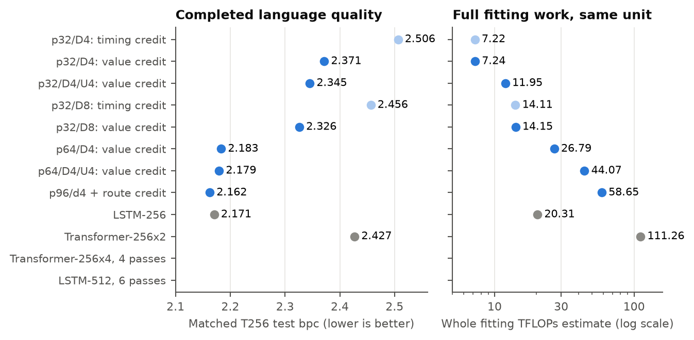

# Sleeping Machines — Part I: The science

A trainable computing substrate that computes through time

Tero Keski-Valkama and Karoliina Salminen · Research report, Part I · 6 October 2026

This is the reader-facing report: the ambition, the model family and its theory, what the evidence shows on each front, and the experiments that decide the next step. Two companion parts hold the rest. [Part II — Methods and machinery](II_METHODS.md) collects protocols, metric definitions, compute accounting, numerical contracts and implementation checks. [Part III — Experiment record](III_RECORD.md) preserves every experiment entry and the earlier narrative chapters verbatim. `REPORT.md` remains the complete combined record; Parts II and III are generated from it by `report/split_report.py`.

## 1. The ambition

Sleeping Machines aims to make intelligence composable within **one trainable computing substrate**. Language and reasoning, multimodal world models, embodied action, event-native analytics over interleaved process streams, and typed tables become different forms of experience available to the same learner. The ambition extends through continual and on-device learning, learned communication and self-designing models to the hardware that executes them: globally clockless, memory-local event hardware that learns on chip.

An observation enters through an interface that respects its meaning: a token, a sensory event, a typed comparison or an action. It becomes an addressed message that interacts with persistent memory. Learned delays and temporal races decide which evidence meets and which computation happens. Small messages carry new evidence into deeper state; separate keys and values distinguish where evidence goes from what it says. Counterfactual credit teaches the routes and writes that could have happened. Available memory and skill can grow beyond the activity recruited for any one observation.

Each benchmark below is evidence for one front of this program. None of them defines the project.

### Wins and advances at a glance (9 October 2026)

**Nine public leaderboard wins**, each on the official splits with a sealed test scored once per run, 40 of 41 independent
runs ahead of the best published result:

| Benchmark | Ours | Best published | At what cost |
| --- | --- | --- | --- |
| EasyTPP Taxi (mobility events) | 0.525 ± 0.001 | 0.522 (S2P2, NeurIPS 2025) | 1/12 of the leader's parameters and compute; **reproduced independently on separate hardware** |
| EasyTPP Taobao (shopping) | 1.399 ± 0.003 | 1.318 (IFTPP) | 0.92× the leader's compute; largest margin (+0.081) |
| EasyTPP StackOverflow (Q&A activity) | −2.153 ± 0.005 | −2.163 (S2P2) | **matched size and compute**; all 5 seeds ahead |
| EasyTPP Retweet (social cascades) | −6.326 ± 0.001 | −6.348 (NHP) | **1/15** of S2P2's parameters and compute |
| EasyTPP Amazon (shopping reviews) | 0.803 ± 0.001 | 0.781 (S2P2) | 0.29× the leader's compute |
| P19 ICU sepsis prediction | AUPRC 0.639, AUROC 0.916 | 0.583 / 0.903 (MTM) | temporal memory adds +0.072 AUPRC on every split beyond summary statistics; reproduced |
| PAM wearable activity recognition | accuracy 0.978, F1 0.980 | 0.975 / 0.976 (MTM) | 46K parameters vs MTM's 873K |
| **TGB tgbn-trade** (temporal graph: node affinity, world trade) | NDCG@10 0.868 ± 0.0005 | 0.863 (NAVIS, ICLR 2026) | 2,107 parameters, 4 CPU-minutes; **a new domain**: interaction graphs, where heuristics beat every temporal GNN |
| **TGB tgbl-wiki** (temporal graph: link prediction, Wikipedia edits) | MRR 0.835 ± 0.0003 | 0.827 (TPNet) | 7,995 parameters; exact per-event state; 4.5 ms per query on one CPU thread |

**Rigor:** pre-registered reporting rules; the benchmark's own scorer agrees; a recording-grid audit every win passes; a
one-command kit for third-party reproduction. **One configuration wins all five:** a single configuration with no per-dataset tuning is ahead of the best
published result on all five EasyTPP datasets under a pre-registered protocol (24 of 25 seeds ahead): Taobao 1.397,
Taxi 0.526, StackOverflow −2.144, Retweet −6.324, Amazon 0.802.

**Advances beyond the leaderboards:**
- **Tokenized language:** 6.009 ± 0.010 nats per token vs a Kneser–Ney trigram's 6.537 on GPT-2-tokenized FineWeb (3 seeds);
  at 4× the data 5.510 vs 6.100, so the lead grows with data.
- **Binding and recall:** associative recall across irregular gaps 97.5% (3 seeds) vs a 14% baseline, 91.6% at twice the
  training length (seed 0; three-seed mean 90.2 ± 1.2%); **learning through the race alone** (no backpropagation into the network) reaches 77%.
- **Learning without a backward sweep or weight transport:** a race-of-clocks event model learns from each event as it
  arrives, with exact memory credit carried forward. On Taxi development data, at the same 20 data passes, it scores
  0.4805 nats/event against 0.4557 for backpropagation through time (3 seeds).
  On Taxi it matches backpropagation run to convergence (0.4774 after 100 passes) with one fifth of
  the data passes. Across three datasets it leads at equal passes on Taxi (+0.025) and StackOverflow (+0.046) and is level
  on Amazon (+0.002), while backpropagation run to 100 passes ends ahead on StackOverflow and Amazon. With two memory layers, exact
  per-event traces score 0.4770 (seed spread 0.0009) against 0.4418 for backpropagation through time, at 66× its wall time. Its backward weights can be separate
  from the forward ones when trained by the forward pass's own updates: they align to the exact dual (cosine 1.000) and
  learn as well as shared weights (0.4715 vs 0.4736), where fixed random feedback fails (0.17). This is a fully local
  learner, the learning half of clockless hardware. ([theory note 160](../experiments/theory/160_forward_backward_duality_and_credit.md))
- **Generative mode:** the same race-of-clocks model samples realistic event streams exactly (no rejection), for simulation,
  what-if analysis and synthetic data; taxi streams match real timing (gap KS 0.014 vs 0.063 naive) and event-to-event
  structure (0.024 vs 0.53).
- **Exact training signal and measured speed:** the closed-form likelihood removes the Monte Carlo gradient noise that
  sampled-intensity models carry (18% relative noise at the common 10-sample setting, measured); a streaming per-event
  update runs at about 1,500 events per second on one CPU core in plain PyTorch (Taxi; 20.7K multiply-adds per event vs
  the leader's 250K). A race of clocks provably approximates any continuous inter-event density, confirmed numerically; likelihood saturates once the number of clocks covers the data's gap modes (predicted, then confirmed), so model size follows from the data.
- **Reasoning from few examples:** temporal event chains 99.7% vs Transformers 33–41%; race retrieval 100% at 4× context.
- **Character language:** beats tuned Transformers at equal or lower compute (text8, 10M characters).
- **Learning signal and capacity:** credit to unchosen routes cuts error by 0.14 bits per character for 0.3% more work;
  doubling memory slots lowers error with the same eight writes per input.
- **Generality:** one shared temporal core serves four event domains; anonymous interleaved process logs (FAS v1) beat six
  generic detectors across three seeds.
- **Theory:** a race of clocks contains softmax attention and Mamba-style selective state spaces exactly.

**New event domains (9 October):**
- **Temporal Graph Benchmark, node affinity: won** (table). Pre-registered sealed test, 3 seeds: 0.8683 / 0.8674 /
  0.8683, every seed above NAVIS's 0.863; persistent forecast 0.855. Validation 0.874 vs 0.860 had predicted it.
- **Temporal Graph Benchmark, link prediction: won** (table). Exact per-event state lifted our model from 0.776 to
  0.852 validation MRR (theory note 159 predicted at least +0.03); three pre-registered sealed seeds score 0.8353 /
  0.8350 / 0.8356 on test, every one above TPNet's 0.827, with 7,995 parameters. On tgbl-review a training-free decayed
  event state already reaches 0.344 validation MRR, above TGN, TGAT and TNCN (0.313–0.325); GraphMixer leads at 0.428.
- **Second neural-TPP benchmark** (Bosser & Ben Taieb; 7 datasets × 5 fixed splits; total NLL per sequence, lower is
  better): the frozen one-configuration EasyTPP model, with no tuning, has seven completed verdicts, all
  losses against the composite bar (best published time + best published mark NLL). **Wikipedia lost** under the
  pre-registered repair rule: split 0's original run ended with NaN weights, and its guarded rerun scores +58,218 on
  TEST because two of 118 test sequences receive astronomically confident hazards (millions of nats; median sequence
  3.9), so the five-split mean is +11,421.66 vs −122.62. The other four splits average −277.54, and the **marks are the
  strongest result in this benchmark**: 27.65 vs 144.79 best published, because our addressed mark memory copies pages
  never seen in training (10–27% of test edits), which per-mark embeddings cannot do. Bounding the hazards is the
  development fix. **MOOC lost:** −226.85 ±
  2.83 SE vs −239.7; timing carries the gap (recording-grid analysis in the B4 loss analysis). **Stack Overflow lost:** 12.714 ± 0.874 SE vs 11.9; its time NLL beats the
  published time component (−91.598 vs −91.1), while mark NLL trails (104.312 vs 103.0). **MIMIC2 lost** (7.01 vs
  2.42; its mark path overfits ~100-sequence training sets). **Github lost by 2.3 nats:** −270.62 ± 48.69 SE vs the bar
  −272.90, yet below every single published model's total (best LNM++ −269.7) and ahead on time (−390.93 vs −382.4);
  marks carry the gap (120.30 vs 109.5). Splits 1–4 are guarded reruns after a numerical failure: padding the batch of
  the longest training sequences overflows an exponent at masked positions, so that batch (59–68% of Github's training
  events) is skipped in most epochs; the model trained mainly on the shorter sequences. **Retweets lost:** −515.16 ± 3.24 SE vs −538.70; marks are level with the best published (83.65 vs 82.63), and timing carries the gap (−598.81 vs −621.33) on a one-second grid with 4% zero gaps (recording-grid analysis in the B4 loss analysis). **LastFM lost:** −774.64 ± 48.38 SE vs −849.65, below every single published model's total (−697.5, LNM++) and ahead on time (−1380.05 vs −1363.78); marks carry the gap (605.41 vs 514.13). These are
  frozen-configuration transfer results; mark-path development continues outside the sealed protocol.

**B4 development:** Github split 1, seed 0 numerical repair completes 75 TRAIN passes with zero skips and improves selected DEV total loss by 2.607 nats per sequence. Added per-event mark memory improves selected marks by 1.820 and total by 2.193, but fails its registered stability gate: common-window mark gain 0.687 versus required 1.000. Frozen-checkpoint read ablation shows 13.822 mark nats per sequence of direct benefit on 28 of 34 DEV sequences, with timing unchanged. Frozen-core residual fitting also fails its gain gate (selected 0.169; last-20 mean −0.536). A TRAIN-only confidence fit over two saved native mark predictors gives DEV mark loss 65.203 versus 67.237 baseline, with timing unchanged; three fixed-recipe seeds confirm mean mark gain1.979±0.537 sample SD. A TRAIN-distilled one-core readout passes in all three seeds: mean gain1.788±0.578, retaining89.6% of teacher gain on average, with2.23–2.28× faster conditional-density evaluation than the teacher pair and35.2% fewer parameters. Teacher quality is higher; prerequisite fits are charged. Teacher-free bundles reproduce scores exactly. A fixed10% observed-TRAIN-label anchor then improves all three compact readouts by mean0.367 mark nats per sequence (sample SD0.253), exceeding teacher mark quality in two seeds at unchanged model size/time density. A prospective Github split2 five-pass numerical pilot has zero skips and improves fifth-pass total DEV loss by5.346; its full original-budget repaired fit completes with selected DEV total gain 8.314. These are development results; frozen TEST verdicts are unchanged.

**Where we are behind** (stated with the numbers in the report): large-scale character language (90M), tuned LSTMs at 10M
characters, P12 mortality AUROC, real-world tables, FAS v2 (sealed-test tie: native 0.70366 vs time-encoded Transformer 0.70432 AUROC, three seeds; mean AUROC difference −0.00066; native ahead of the best classical detector's 0.68223).

## 2. The model family

Every message carries **content, an arrival time and an address**. Receivers hold persistent memories that decay and rotate with the real time elapsed between events. Candidate routes **race through learned delays**: the winner updates state and sends the next message, and the routes that did not win still receive **counterfactual credit**. Arrival order decides which memories meet and which computation happens, so delays perform computation rather than label it. Dense synchronous layers are a special case; one model can compute densely where a task needs it and selectively elsewhere.

The four architectural bets, and the mechanisms each one keeps explicit:

| Bet | Mechanisms | Why it matters |
| --- | --- | --- |
| **Time performs computation** | Learned delays, temporal races including race attention, decay and rotation by elapsed time | Selection and combination happen in the timing itself; waiting is part of the computation |
| **Hard routes learn through counterfactual credit** | Winner-only forward execution; credit to unrealized alternatives and optional routes | Discrete sparse routing is a long-standing training problem; crediting alternatives trains it without dense inference |
| **Deep persistent event representations** | Sparse addressed state updates; small messages mixing incoming content with persistent memory; separate keys and values | Memory is addressed and retained, not a buffer rescanned at every step |
| **Capacity beyond activity** | Large receiver pools, few selected writes per event | Stored skill can grow faster than the work spent per observation |

Supervision is silence-aware where the objective depends on waiting: the absence of an event until a real clock deadline is an observation, not missing data. Work is accounted separately for available capacity, scored keys, selected state updates, value deliveries and counterfactual learning work, so a dormant receiver is never reported as free to score or train. Part II gives the accounting conventions.

## 3. The theory

### 3.1 Foundational principles

The foundational calculus ([THEORY.md](../experiments/THEORY.md), §§1–25) reduces to five principles. Later notes extend each.

| | Principle | Consequence |
| --- | --- | --- |
| P1 | **Inference is tropical; unrealized futures are its dequantization.** A race computes minimums over event times (min-plus); at temperature σ the possible histories form a recombining forest weighted by e^(−cost/σ). | Near-miss weighting is the derivative of the soft minimum; credit is conserved at each collapse; holistic backpropagation is inside–outside. |
| P2 | **Weaving closes the past.** Collapses are stopping times; later inputs cannot affect them. | When to commit is an optimal-stopping problem; woven and unwoven counterfactuals differ. |
| P3 | **A race neuron is a weighted mean in time.** Within a piece, T = θ/ρ + Σ uᵢtᵢ. | Exact time-shift equivariance; urgency (ρ) and evidence (u) separate; learning must recruit absent evidence additively. |
| P4 | **Credit must reach what did not happen.** Along the realized history credit reaches only nodes that fired; the blind spot compounds with depth. | Counterfactual credit matters from depth 2; routing networks share the same boundary term. |
| P5 | **Thresholds are prices.** Homeostasis is the dual update of a capacity constraint; a race layer with homeostasis is an online entropic optimal-transport solver. | Target rates are capacities; log-ratio updates balance faster. |

### 3.2 Temporal algebra and attention

**An exponential race selects route i with probability softmax(score)ᵢ exactly, and delay-coded aggregation reproduces softmax attention exactly over the delivered keys** (theory notes [08](../experiments/theory/08_vector_memory_and_deep_stacks.md) and [151](../experiments/theory/151_normalized_clock_noise_and_precision_credit.md)). The family therefore contains a Transformer-capable function class. **Selective state-space models (Mamba) are also exact members:** each token is an event delivered after a learned, content-dependent delay, memories decay over the elapsed time, and writes and reads are content-addressed; this reproduces Mamba-1 and Mamba-2 selective scans to 4e−13, and rotating memories extend it ([note](../experiments/theory/MAMBA_CONTAINMENT_20261007.md)). A winner-only race delivers the sampled winner's value instead of the weighted average and skips the value-aggregation half of attention arithmetic. One winner is a sample, not the average: averaging m independent winners has mean-square error variance/m.

With width d, depth L, N historical keys, feed-forward expansion r and shared projection work B = (8 + 4r)d² per layer, S extra evolving-state work per layer, P updated parameters and U targets per Adam update (two FLOPs per multiply-add):

| Per token / target | Transformer | Race substitution |
| --- | --- | --- |
| Inference | L(B + 4Nd) | L(B + 2Nd + S) |
| Training, approximate | 3LB + 12LNd + 19P/U | 3L(B + S) + 10LNd + 20P/U |
| Logical value reads (FP32) | 4LNd bytes | 4Ld bytes |
| Logical key + value reads | 8LNd bytes | 4L(N + 1)d bytes |

The race training term charges admitted losing-value credit; it is not winner-only training. At fixed width the attention-only arithmetic limit is about 2× at inference and 1.2× during counterfactual training, and total key/value access improves by at most about 2×. Larger gains require richer temporal computation to reach the same quality at smaller width αd and depth βL: projection work scales by βα² and context work by βα. These are logical counts, not measured off-chip traffic or joules.

### 3.3 Keys, values, credit and depth

- **Key/value separation** ([note 22](../experiments/theory/22_key_value_separation_and_race_boundaries.md), §§194–196) isolates harmful winner changes, preserves actual routing during smooth value learning, and derives joint key/value/clock counterfactual policy credit with its reachability requirements.
- **Statistic-valued race memory** ([note 59](../experiments/theory/59_statistic_valued_race_memory.md), §§382–392): learned keys with sufficient-statistic values give zero-variance counterfactual route credit and closed-form write credit. Hierarchical count backoff is an exact cascade of escape races ([note 58](../experiments/theory/58_sufficient_statistic_state_and_count_references.md)).
- **Capacity, trainability and inductive bias** ([note 158](../experiments/theory/158_capacity_trainability_inductive_bias.md), §§449–456): a race of exponential and defective delayed clocks approximates any continuous inter-event density on compact gap ranges, and hazard-weighted mark mixtures give any continuous time-dependent mark law; memory fades in real time, not position. Training is on an exact likelihood in which every silent clock is taught through its survival. The family assumes that relevance fades with elapsed time, that each event is the first of several competing processes, that silence is informative and that types update their own memory, which is why it wins on event data and predicts where dense models keep an edge. Its predictions were tested: likelihood saturates once the number of delayed clocks covers the gap distribution's components (2 components: saturated at 2 clocks; 6 components: at 8; confirmed), so clock count is chosen from the data's modes; the exact likelihood removes the 18% Monte Carlo gradient noise of sampled-intensity training (confirmed); the race's timing advantage *shrinks* as more independent processes are merged (0.99 → 0.21 nats per event from 1 to 8 processes, by the Palm–Khintchine theorem), so on superposed streams the value lies in binding (prediction revised); and elapsed-time memory matters where relevance decays in calendar time (StackOverflow −0.057 without it) but not on Taobao (prediction revised). Binding needs the predecessor's message ([note 156](../experiments/theory/156_predecessor_message_binding.md)); interleaved processes need duration-matched predecessor attention ([note 157](../experiments/theory/157_deinterleaving_by_duration_matched_attention.md)).
- **Depth** ([notes 04, 08c](../experiments/theory/08c_sparse_attention_and_depth_bounds.md)): residual depth and temporal gauges, sparse-attention depth bounds, and the conditional depth bounds of causal context bridges. Counterfactual credit matters from depth 2 because the realized-history blind spot compounds with depth (P4).
- **Compute allocation**: the useful quantity is prediction quality at a fully counted budget of fitting, inference and learning work, including candidate discovery and losing-value credit. Capacity, activity and teaching work are separate axes (§§299–302, [note 46](../experiments/theory/46_integrated_sparse_temporal_language.md)).
- **Typed semantics** ([TYPED_SEMANTICS_AND_RACE_COMPOSITION](../experiments/theory/TYPED_SEMANTICS_AND_RACE_COMPOSITION_20261006.md)): type-respecting comparisons (numeric, ordinal, categorical, missingness) enter before neural mixing, with the equivariance conditions learning must satisfy. 39 mathematical/interface contracts pass.

## 4. Evidence, front by front

Conventions for every table in this section: single seed unless a seed count is stated; native fitting work is traced (and extrapolated from traced windows for long fits), dense references use shape estimates; "train compute" counts the complete fit including counterfactual credit and optimizer work. Every number comes from a completed result file; pending cells say pending.

### 4.0 Public benchmark: temporal point processes (EasyTPP)

Marked event streams with continuous times, on the official EasyTPP splits and the per-event log-likelihood protocol of the published state of the art (S2P2, NeurIPS 2025; [B1 dossier](../experiments/B1_EASYTPP.md)). Our model is a race of delayed clocks over persistent temporal memory: after each event, exponential clocks and delayed clocks that may stay silent race, and the first to fire sets the next event's time and mark. The likelihood is exact; losing clocks are credited through the survival term. Clocks may not resolve time below the data's recording resolution. Five seeds; TEST scored once per seed at the best DEV checkpoint.

**One configuration wins all five datasets (pre-registered unified protocol, 8 October 2026).** A single model
configuration, with no per-dataset tuning, is ahead of the best published result on every EasyTPP dataset. Two rules are
read from the data: window clocks are used only when the training gap distribution separates into two or more components
(Amazon, Retweet), and each dataset's timestamp resolution sets the recording cell. Five seeds, sealed test, every
checkpoint scored once after exact reproduction of its development score:

| Unified model (nats/event, higher is better) | Ours | Best published | Seeds ahead | Per-event compute vs S2P2 |
| --- | --- | --- | --- | --- |
| Taobao | **1.3967 ± 0.0031** | 1.318 (IFTPP) | 5/5 | 1.03× |
| Taxi | **0.5262 ± 0.0034** | 0.522 (S2P2) | 4/5 | **0.09×** |
| StackOverflow | **−2.1436 ± 0.0029** | −2.163 (S2P2) | 5/5 | 1.015× |
| Retweet | **−6.3242 ± 0.0021** | −6.348 (NHP) | 5/5 | **0.07×** |
| Amazon | **0.8017 ± 0.0006** | 0.781 (S2P2) | 5/5 | **0.24×** |

24 of 25 runs are ahead (Taxi seed 2: 0.521). The single configuration exceeds our own dedicated models on Taxi (0.5250),
StackOverflow (−2.1444) and Retweet (−6.3262). Retweet recording-grid audit drops 0.007–0.009 nats/event on every seed,
about a third of the margin. EasyTPP's own Monte Carlo estimator agrees with the exact scores on all 25 checkpoints within its sampling noise.

| Taxi (nats/event, higher is better) | Total | Time | Mark | Parameters | Inference MACs/event |
| --- | --- | --- | --- | --- | --- |
| Best published (S2P2) | 0.522 ± 0.004 | 0.733 | −0.211 | 251,850 | 249,856 |
| **Ours, single model** | **0.5250 ± 0.0010** | 0.733 | **−0.208** | **20,504** | **20,708** |
| **Ours, 5-seed predictive mixture** | **0.5363** | **0.740** | **−0.204** | 102,520 | 103,540 |

| Taobao (nats/event) | Total | Time | Mark | Parameters | Inference MACs/event |
| --- | --- | --- | --- | --- | --- |
| Best published (IFTPP) | 1.318 ± 0.017 | 2.708 | −1.391 | — | — |
| S2P2 | 1.304 ± 0.039 | 2.719 | −1.415 | 26,801 | 26,016 |
| **Ours, single model** | **1.3991 ± 0.0025** | **2.753** | **−1.353** | **24,046** | **24,362** |

| StackOverflow (nats/event) | Total | Time | Mark | Parameters | Inference MACs/event |
| --- | --- | --- | --- | --- | --- |
| Best published (S2P2) | −2.163 ± 0.009 | −0.641 | −1.521 | 30,166 | 29,216 |
| **Ours, single model (with continuous-time state clock)** | **−2.1444 ± 0.0037** | −0.643 | **−1.501** | 36,183 | 36,732 |
| **Ours, matched size (2 layers)** | **−2.1525 ± 0.0045** | −0.646 | **−1.506** | **29,191** | **29,660** |

| Amazon (nats/event) | Total | Time | Mark | Parameters | Inference MACs/event |
| --- | --- | --- | --- | --- | --- |
| Best published (S2P2) | 0.781 ± 0.011 | 2.652 | −1.871 | 127,056 | 125,568 |
| **Ours, single model (anchored delay windows)** | **0.8028 ± 0.0007** | **2.657** | **−1.854** | **35,000** | **35,936** |

| Retweet (nats/event) | Total | Time | Mark | Parameters | Inference MACs/event |
| --- | --- | --- | --- | --- | --- |
| Best published (NHP) | −6.348 | −5.584 | −0.764 | — | — |
| S2P2 | −6.365 | — | — | 298,627 | 297,600 |
| **Ours, single model (every clock held below the 1 s recording cell)** | **−6.3262 ± 0.0009** | −5.558 | −0.768 | **19,654** | **19,850** |

**Win on StackOverflow, confirmed over 5 seeds:** +0.019 nats per event over the best published model, with the best mark log-likelihood and time level with the best, at 1.26× S2P2's per-event work; **a matched-size model (fewer parameters than S2P2, 1.015× its per-event work) also wins, with all five seeds above S2P2**. The gain comes from a state clock: a persistent memory that keeps evolving through the silent interval drives part of the hazard.

**Win on Taobao, confirmed over 5 seeds:** +0.081 nats per event over the best published model, with the best time and mark log-likelihoods, at 0.92× S2P2's per-event work.

**Win on Amazon, confirmed over 5 seeds:** +0.022 nats per event over S2P2, every seed ahead (0.8021 to 0.8036), with the best published time and mark log-likelihoods, at 0.29× S2P2's per-event work and 3.6× fewer parameters, one run per seed and no restarts. The earlier protocol (0.784 ± 0.027 with three restarts per seed) had one seed in a low optimization basin; free delay windows drifted beyond every observed gap, and anchoring each window to its gap component removed the basin. EasyTPP's Monte Carlo estimator gives 0.8037 to 0.8060. Amazon's times have no recording grid (281K distinct gaps, no zero gaps).

**Win on Retweet, confirmed over 5 seeds:** +0.022 nats per event over the best published model (NHP) and +0.039 over S2P2, every seed ahead (−6.3250 to −6.3272), with the best time log-likelihood, at 1/15 of S2P2's parameters and per-event work. Retweet times are recorded in whole seconds; every clock holds its one-cell hazard below the cell, and the recording-grid audit moves the score by 0.004, a fifth of the margin. Under EasyTPP's own Monte Carlo estimator the seeds score −6.3252 to −6.3277.

**Win on Taxi, confirmed over 5 seeds:** the 5-seed mixture beats every published model on total, time (best published 0.735) and mark log-likelihood at 0.41× S2P2's per-event inference work; a single model leads S2P2 on the mean at 1/12 of its parameters and per-event work. The earlier StackOverflow model (v5, without the state clock) was 0.018 behind S2P2 (−2.181 vs −2.163), its 5-seed mixture ahead (−2.154) at 4.6× compute; the state-clock model above supersedes it.  The Taxi win reproduces on independent hardware (curie desktop CPU, separately downloaded data, frozen driver, five seeds): 0.5252 ± 0.0007 vs 0.5250 ± 0.0010 on AWS, every seed above S2P2's mean. All winning results pass a recording-grid audit (scores unchanged when event times are dequantized within their recording resolution; Retweet within 0.004 nats). S2P2 parameters and MACs are counted from its released layer definitions at its published configuration.

### 4.0b Public benchmark: irregular clinical time series (P19 sepsis)

PhysioNet 2019 sepsis prediction on the five official Raindrop splits (38,803 ICU stays, 34 irregularly sampled channels, 4.2% positive). Our event-native classifier treats each time step as an event; addressed channel memories carry sufficient statistics (count, mean, min, max, first, last, trend, staleness) and decay with elapsed time; values enter through typed comparisons; silence (time since a channel was last measured) is an input ([B2 dossier](../experiments/B2_IRREGULAR_TS.md)).

| P19, 5 official splits | TEST AUROC | TEST AUPRC |
| --- | --- | --- |
| Best published (MTM, 2025) | 0.903 ± 0.020 | 0.583 ± 0.053 |
| **Ours (62,681 parameters; MTM reports 873K for its PAM configuration)** | **0.916 ± 0.022** | **0.639 ± 0.039** |

**Win on P19 over the best published model**, with AUPRC — the clinically relevant metric at 4% prevalence — ahead by more than either model's split spread. **Where the margin comes from** (paired five-split tests, 8 Oct): removing the model's temporal memory (same network reading only its statistic slots) drops it to 0.900 / 0.572 on every split (paired ΔAUPRC +0.072, t = 31), and gradient-boosted trees on the same statistics score 0.914 / 0.618: the temporal memory carries signal the statistics lack, and the model leads the trees on AUPRC on every split (+0.026, paired t = 4.2; AUROC level). The result reproduces from scratch on separate hardware (AUROC within 0.0004 on all five splits). A rank blend of the model and the trees scores 0.925 / 0.671, above both on every split: the model holds information the summaries lack. On P12 (in-hospital mortality, five official splits) the same configuration reaches TEST AUROC 0.871 ± 0.011 and AUPRC 0.585: behind MTM on AUROC (0.880), level on AUPRC (0.586), ahead of every other published model. PAM is in development.

**Win on PAM** (wearable activity recognition, five official splits, sealed test): accuracy **0.978 ± 0.007**, F1 **0.980 ± 0.008** vs MTM 0.975 ± 0.002 / 0.976 ± 0.002, with 46,316 parameters; four of five splits ahead (0.979, 0.981, 0.981, 0.981; split 4 0.964).

### 4.0c One family across data types

The same construction — persistent memories that decay and rotate with elapsed time, addressed memory written sparsely, typed comparisons, silence as information, and temporal races — wins public benchmarks of different kinds. The P19 classifier imports the very temporal memory layer of the EasyTPP model, at the same size (32 wide, 16 modes, 2 layers).

| Data type | Benchmark | Result |
| --- | --- | --- |
| Generative event streams (when and what happens next) | EasyTPP, 5 datasets | **Wins on all 5** (Taxi, Taobao, StackOverflow, Retweet, Amazon), **including with one configuration for all five** |
| Irregular clinical records (classification) | P19 sepsis, official splits | **Win**, AUPRC 0.639 vs 0.583 |
| Wearable sensors (activity recognition) | PAM, official splits | **Win**, accuracy 0.978 vs 0.975 (4 of 5 splits ahead) |
| Anonymous interleaved process logs | FAS v1, 3 seeds | **Win** vs six generic controls, 0.592 vs 0.559 AUROC |
| Character language | text8, 10M characters | **Win** vs tuned Transformers at ≤ equal compute; **loss** to tuned LSTMs; **loss** at 90M |
| Temporal reasoning from few examples | synthetic, 5 runs | 99.7% vs Transformers 33–41% |
| Mixed-type tables | synthetic; banknote | learns the synthetic interaction; **trees lead** on banknote |

**One shared core across four event domains (G2, development data, one seed).** A single temporal memory (14,080 parameters) trained on Taxi, Taobao, StackOverflow and Amazon at once, with dataset-specific mark embeddings and clock heads (68,910 parameters in total, against about 111,000 for four separate models), matches or beats the separate models on three of four: Taxi DEV 0.4899 vs 0.4872, Taobao 1.2895 vs 1.284, StackOverflow −2.186 vs −2.177 (same design without the state clock). Amazon trails (0.683 vs 0.69–0.77 across seeds) and was still improving at the last epoch, while the other three peaked by epoch 40; per-dataset schedules in the joint run are the next test. Mobility, shopping and Q&A timing share one learned temporal dynamics.

**Positioning.** The EasyTPP leader S2P2 (NeurIPS 2025) is demonstrated on one task type, event likelihood. Its parent family, deep state-space models, is general on dense sequences and language. Our claim is specific: one family, with one shared core, wins public benchmarks on both generative event modelling and sparse clinical classification, with further evidence on process logs, language and reasoning. The tests that make this a transfer claim — self-supervised event pretraining for clinical prediction, one model across five event datasets — are track G ([plan](../experiments/GENERALITY_PLAN.md)).

### 4.0d Public benchmarks: temporal interaction graphs (TGB)

The Temporal Graph Benchmark asks which entity interacts with which, and when. On its node-affinity task, simple
heuristics (persistent forecast, moving average) beat every temporal graph neural network, and the leader NAVIS (ICLR
2026) is a gated linear state-space model whose output is always a convex combination of past affinity vectors.

| tgbn-trade (world trade, test NDCG@10) | Score | Parameters |
| --- | --- | --- |
| **Ours** (race over destinations, multi-timescale decayed affinities, reciprocity, global share and growth) | **0.8680 ± 0.0005** (3 seeds, every seed ahead) | 2,107 |
| NAVIS (leader) | 0.863 ± 0.001 | 1,280 |
| Persistent forecast | 0.855 | 0 |
| Moving average / TGNv2 / DyGFormer | 0.823 / 0.735 / 0.388 | — |

Official loader and evaluator, configuration fixed before the test, test scored once per seed; about four minutes of
fitting on one CPU thread and 0.22 ms per prediction (measured, one thread). Theory note 159 explains the margin: our readout contains persistent forecast and moving
averages as special cases and can extrapolate a rising partner, which a convex combination of past vectors cannot
(Proposition 3). Ablations bear this out in part: removing the history-shape features gives back half of the gain over
persistent forecast (validation 0.8677 vs 0.8747; persistent forecast 0.8604), while removing reciprocity costs nothing. On link prediction (tgbl-wiki), updating the state exactly at every event,
as the family does natively, lifted validation MRR from 0.776 to 0.852 against TPNet's 0.842 with 7,995 parameters; its
three pre-registered sealed seeds score **0.8353 ± 0.0003 on test against TPNet's 0.827**, every seed ahead: a second TGB
win. One query, with the exact state update and all 1,000 candidates scored, takes 4.5 ms on one CPU thread.

### 4.1 Learned temporal computation (synthetic, multi-run)

| Task | Ours | Reference | Verdict |
| --- | --- | --- | --- |
| Depth-3 event chains, 2,000 examples seen once (5 runs) | **99.73–99.93%** | Transformers 33.25–40.80% (same distinct examples, repeated fitting) | **Win** |
| Race retrieval at 4× training context (5 runs) | **100%** within 4,000 examples | Best of seven Transformer configurations, lower | **Win** |
| Unseen mod-17 triples via a learned phase rule | **100%** of 3,440 | — | Solved |
| Timing-only discrimination (identical marks, addresses, order) | **95.31%** | Order-only control 50.00% (exact ceiling) | **Win** |
| 16-source order, shared rules with private memories | **75.39%**, 14,180 parameters | Private rules 44.14%, 157,940 parameters | **Win** (11.1× fewer parameters) |

These are structured tasks with declared priors; they establish that the mechanisms learn order, timing and retrieval from few examples. Elapsed time is used as information: clearing persistent state drops the timing task to 50%.

### 4.2 Hard-route credit and capacity beyond activity (text8, 10M characters, one pass)

| Change | Test bpc | Cost |
| --- | --- | --- |
| Value-informed alternative credit, p32/D4 | 2.507 → **2.371** | +0.3% fitting work; forward unchanged |
| Same credit at depth 8 | 2.456 → **2.326** | |
| Double the receiver pool at 8 selected writes/char | 2.371 → **2.345** | 1.65× fitting work; inference arithmetic flat (0.163 → 0.164 MFLOPs/position) |

Counterfactual credit to unrealized alternatives works, at depth, for almost no extra work, and stored capacity improves quality without raising inference arithmetic.

### 4.3 Character language (text8)

Same test interval text8[95M:96M]; native and Transformers score reset T256 windows, LSTMs carry state; budgets are complete training compute.

| Data | Budget | Ours | Tuned LSTM | Tuned Transformer | Verdict |
| --- | --- | --- | --- | --- | --- |
| 10M | ≤ 352 TF | **1.888** (p96/d4, 6 passes) | 1.826 (LSTM-512) | 1.996 (TF128×4) | Win vs Transformers; **loss** vs LSTM |
| 10M | ≤ 107 TF | **1.955** (p64/d4, 4 passes) | 1.915 (LSTM-384) | 2.215 (TF128×4) | Win vs Transformers; **loss** vs LSTM |
| 10M | 888.8 TF (TF) | 1.888 at 352 TF (0.40×) and 0.18× inference | — | 1.908 (TF256×4, 4 passes) | **Win**: better quality at 0.40× training, 0.18× inference compute |
| 90M | C, ≈ 0.96 PF | 1.800 (p64/d4, 0.97 PF) | 1.729 (LSTM-512, 0.91 PF) | 1.780 (TF192×4, 0.95 PF) | **Loss** to both |
| 90M | D, ≈ 2.1 PF | 1.783 (p96/d4, 2.11 PF) | — | 1.704 (TF192×4, 2.07 PF); 1.811 (TF256×4, 2.00 PF) | **Win** vs TF256×4 at near-equal compute (1.06×); **loss** to TF192×4 |

At 10M characters the native model beats tuned Transformers at equal or lower compute; tuned LSTMs lead. At 90M both dense families lead, and the gap to the best dense reference is wider than at 10M (0.07–0.08 bpc versus 0.04–0.06). The direction of that trend is the central problem for the language front.

### 4.4 Properly tokenized language (FineWeb, GPT-2 BPE)

Shared development protocol for every member: 8,192 FineWeb validation targets in disjoint 1,024-token windows, nats per token ([placement](../experiments/results/diagnostics/curie_cross_member_language_protocol_20261015_v1.json), [episodic store](../experiments/EPISODIC_MEMORY_SCALING_20261015.md)).

| Member | Training tokens | NLL |
| --- | --- | --- |
| **Keyed temporal-memory member** (3.33M parameters, §4.5), seeds 1 / 0 | 4M, repeated epochs | **5.601 / 5.624** |
| **P24 race core + episodic pointer store** (6,248 memory parameters) | 5.978 parent + 2M fresh | **5.634** |
| P24 race core (allocated counterfactual credit) | ~15M fresh | 5.978 |
| Keyed member, 3 seeds | 1M, repeated epochs | 6.112–6.134 |
| Keyed member without the keyed read | 1M | 6.234 |

**Addressed memory is the lever.** The P24 core uses almost no history older than 64 tokens (cutting it costs 0.004–0.008 nats, flat with 16× more data): its 16-token credit window never rewards long retention ([theory](../experiments/theory/CREDIT_HORIZON_AND_ADDRESSED_MEMORY.md)). A persistent episodic store read with read-time credit improves the same learner by 0.345 nats and raises the value of history older than 64 tokens to 0.227 nats; on the identical extra data without the store, the value stays at −0.001. The keyed member's identity-addressed read gives it 0.117.

**Where the prediction problem is** ([measurement](../experiments/results/diagnostics/curie_part_whole_structure_20261015_v1.json)): 77.8% of targets start a word and carry 84% of the keyed member's loss. The next-word choice is constrained by clause, sentence and document context, and no member uses it yet: history older than 64 tokens is worth 0.023 nats on those targets.

**Depth needs the right composition.** Stacking token-clock race stages does not help: on 1M fresh targets the residual race stack scores 6.556 / 6.590 / 6.690 at depth 2 / 8 / 16, and per-stage reads (6.472 at depth 2) make every stage useful without making depth win; its deep stages add at most 0.001 nats on word-initial targets. With full-lane credit and an addressed read in every layer, depth pays monotonically: the keyed member scores 5.957 / 5.899 / 5.874 with 2 / 4 / 8 layers on the 65,528-target slice at 1M tokens (AWS), the extra layers adding 0.41M parameters to 3.42M. The next decisive test builds depth from the data's part-whole structure ([theory](../experiments/theory/PART_WHOLE_COMPOSITION.md)): word, clause and sentence levels on observed boundaries, each composing its parts in order and training on its own future horizon, against its two-layer base on the same 4M fresh tokens.

### 4.5 Anonymous interleaved processes (FAS v1)

Early fault detection from anonymous interleaved event logs; test 2,000 clean and 2,000 faulty runs; references are six generic controls fitted on the same anonymous inputs.

| Native seed | AUROC at 256 events | AUROC at 512 events |
| --- | --- | --- |
| 6 | **0.5998** | **0.7422** |
| 7 | **0.5910** | **0.7360** |
| 8 | **0.5864** | **0.7329** |
| Best generic control | 0.5587 | 0.7272 |

**Replicated win: all three seeds beat the best generic control at both horizons**, by +0.028 to +0.041 at 256 events and +0.006 to +0.015 at 512. FIFO and timing-aware de-interleaving learn their routes from hidden training identities; they are oracle-assisted diagnostics and are excluded from the comparison.

**FAS v2 (B3, sealed confirmation complete): TIE.** Two production lines merge into an anonymous log with 2% of events dropped, scored at 512 events per line. Native seeds 6/7/8 score AUROC 0.70204 / 0.69557 / 0.71336, mean **0.70366**. The time-encoded Transformer reference scores **0.70432** over three seeds; LSTM 0.67374, best classical detector 0.68223. Native minus strongest reference is −0.00066, paired bootstrap of seed-averaged ranks 95% [−0.00834, 0.00747] (the margin uses mean per-seed AUROC). This is a tie under the pre-registered 0.02-margin rule. Neural references were admitted under the explicit FAS exception; all fits/selection used TRAIN/VAL before once-only TEST scoring. Identity-trained de-interleaving remains an oracle-assisted diagnostic, excluded from reference selection. Completed scorer, ledger and decision evidence are retained; the original TEST is not a development set. [Registered decision](../experiments/results/fas/curie_b3_sealed_v4_20261010T0220Z_decision.json).

The model being developed for it follows from the theory of interleaving:
- A merged log of timed processes is a superposition. Its next event is the earliest pending event of the hidden processes, which is a race.
- A race readout gives each memory slot its own clock and own-duration law, and scores the next event by the exact superposition likelihood.
- Writing each event to the slot whose race most likely produced it is a particle filter: it trains a lower bound on the likelihood marginalised over all interleavings, with no learned write credit (theory §§432–436).
- In a small integrated fit on synthetic interleaved processes, binding purity rose from chance (0.27) to 0.81 against a Bayes-greedy ceiling of 0.91.

### 4.6 Typed tables

| Task | Ours | Reference | Verdict |
| --- | --- | --- | --- |
| Synthetic mixed-type interaction, 64 FIT rows | **100%** on 256 DEV rows, 6,370 parameters | — | Mechanism learns (fixed predicates, one seed) |
| Banknote, reserved test, 3 seeds | 91.8% | Boosted trees 94.0%; logistic regression 94.7% | Behind; first-pass variant |

### 4.7 Public benchmarks, speech and adaptation

Attempt levels follow [WIN_CRITERIA.md](../experiments/WIN_CRITERIA.md). A first-pass variant is an existing member with at most knob-level tuning and no task-specific design; its result describes that variant, not the family. These benchmarks are not current battles.

| Benchmark | Ours | Reference | Verdict |
| --- | --- | --- | --- |
| NeuroBench Mackey-Glass, τ 17, 30 repeats (sMAPE) | 14.84, 57.6 KB | LSTM 13.37 (490 KB), ESN 14.79 | Behind; first-pass variant; smallest footprint |
| NeuroBench primate reaching, 5 of 6 official sessions (R²) | 0.619 paired mean | tinyRSNN 0.643, bigRSNN 0.683; leaderboard 0.71 | Behind; first-pass variant |
| Spiking speech, 512 private held-speaker utterances | 79.69% | Published SHD official test: 94–96% (different partition) | Official comparison pending |
| Online adaptation to a new character stream | 3.191 → 3.096 bpc | — | Adapts during use |

### 4.8 Learning dynamics: grokking

On a harder modular task (train fraction 0.25), larger pools grok later (untied pool 2: 4,750 steps; pool 8: 8,000), and **asymmetric memory decay — private decay 10× shared — groks 1.7× sooner** (4,750 versus 8,250 steps for tied pool 8), as theory §427.3 predicted. Single seed.

### 4.5 Binding: the predecessor message (R1 recall gate and tokenized language)

**Recall with irregular gaps** (R1 gate 1; [dossier](../experiments/R1_RECALL.md), [theory note 156](../experiments/theory/156_predecessor_message_binding.md)): 8 key–value pairs then 8 queries drawn with replacement, inter-pair gaps spanning three decades, 32 keys / 32 values; the set baseline guesses among the shown values. Model: the B1 race-of-clocks event model with a keyed mark memory whose written keys carry the predecessor's message. TEST, 1,000 sequences.

| Model | Recall, 8 pairs | Recall, 2× length |
| --- | --- | --- |
| **Keyed read + predecessor message, 3 seeds** | **97.5 ± 1.7%** | 73.8 ± 14.7% |
| Same, trained on mixed lengths (4–16 pairs), seed 0 | **99.2%** | **91.6% at 32 pairs** (held out) |
| Same mixed-length configuration, 3 seeds | **99.0 ± 0.3%** | **90.2 ± 1.2% at 32 pairs** (held out; set baseline 4.9%) |
| Predecessor message + normalized match, local credit, 3 seeds | **90.0 ± 5.5%** | **41.9 ± 32.4% at 16 pairs** |
| Same, **local race credit only** (no gradient from the read into the network), 3 seeds | 77.4 ± 5.4% | 57.4 ± 5.2% |
| Keyed read without the predecessor message | 21.6% | 12.4% |
| B1 model without keyed read | 21.6% | 12.3% |
| Set baseline | 14.1% | 7.9% |

**Credit development:** an initialized two-layer optional-write contract matches the complete route/path gradient decomposition to 4.44e−16 and the conditional route-gradient mean to 1.81e−15 over 1,614 parameters. Its constructed improved predictor reduces audit variance 16-fold. That diagnostic introduces an optional write; current R1 writes are deterministic. [Theory note 163](../experiments/theory/163_sparse_continuous_producer_credit.md) instead targets the actual local-mode detachments: forward predicted cotangents plus full-support residual producer audits preserve the full raw-gradient mean. The native continuous-producer contract passes for plain and normalized keys: full-gradient decomposition error ≤1.12e−16 and audited conditional-mean error ≤6.67e−16 across 1,587 parameters. Reciprocal credit/update execution and version-bound symmetry gates also pass at depths 2, 4 and 8. A fixed 64-step frozen-teacher pilot with coarse coordinate features did not improve held-out credit calibration in most cases; development now replaces that interface with addressed state cotangents and exact elapsed-time transport. Its numerical gate passes at depths 2/4/8 (maximum cotangent error 1.39e−17). Three fixed-teacher future-intervention pilots learn TRAIN structure and choose beneficial held-out actions; connected transfer is weak in two seeds, and learned proposals add almost no coverage. The larger-data diagnostic completes: neither arm passes the three-seed conditional calibration-and-utility gate against a TRAIN-fitted fixed action. Conditional-noise diagnostics find context-dependent mean advantage accounts for 29–43% of raw advantage energy across three seeds, with exact cached-response parity. The crossed continuation-label/history diagnostic completes: averaged labels improve DEV calibration in both encoders across three seeds; connected/averaged beats the TRAIN-mean action on calibration and utility in every seed (utility gains 0.0000725/0.0000040/0.0031615 nats per future target). Seed170 utility uncertainty includes zero. Bounded frozen-actor depth-4/8 interface transfer completes: value calibration improves, but utility fails the replicated gate at depth 4; the fixed action is already optimal on 87.5%/98.4% of evaluated contexts in two depth-8 seeds. The structured-response critic completes three depth-four pilots: unseen-direction calibration improves versus a nearly parameter-matched free critic in two seeds, and augmented-pool action utility improves in all three. Exact local value/action derivatives and versioned write-policy contracts pass at depths 2/4/8. Saved critics now propose continuous native key writes on fresh prefixes; the uniform gradient-error certificate and online forward-weight learning remain separate integration tests. This is not actor-learning efficiency with depth. Exact CPU recurrence execution preserves losses, full gradients and Adam state: complete native-step speedups increase from 2.47× at depth 2 to 5.95× at depth 8 (128 events), and 2.89× to 7.79× (512 events), in one-thread synthetic throughput measurements. The decisive comparison measures complete learning work to reach matched quality as depth grows, including receiver, producer, replay, audits, credit fitting and optimizer work. Credit state and structural parameters may both adapt causally across regimes; actual event-time asynchronous learning is an integration target.

**AWS block-credit adoption:** Three-seed 20-pass quality gate passes: mean final DEV 0.475946 versus saved dense traces 0.476956, paired gains [0.00012975473122811554, -0.001880899851400275, -0.001279497908354743]. Adopt economical exact reference for further integration. Mean whole fit 37.7 minutes. No TEST or new leaderboard claim.

**Real online-learning bridge:** on 1,024 chronological TRAIN targets per domain, online native BPTT improves market NLL 12.97808→12.59141 and token NLL 5.28992→5.26495 beyond stateful frozen controls. Market uses context-only initialization; language uses a 4M-token pretrained keyed member. Arm wall increases 1.36→4.18 s and 5.04→35.30 s. This short development bridge establishes adaptation headroom; the next comparison develops the model and learned credit together on longer episodes with complete work accounting. Neither official TEST nor reserved language scoring intervals are touched. The real learned-credit follow-up now co-adapts actor and state-credit parameters: seed181 calibrated replay gains0.00485 nats/event over equal-budget untrained audits on8192 TRAIN targets, but seed182 loses0.02874 and seed183 is unstable across every arm. The replicated gate fails. Observer replay identifies extreme clock parameters at ordinary gaps; log-compressed positive memory values at the clock readout remove that measured catastrophe (seed183 all arms about12.795 NLL). A feedback-conditioned recurrent credit function with learned time decay reduces matched-label audited cotangent MSE by8.18% (0.000744 vs0.000810) on47 real packets, while forward NLL12.796736 trails untrained audits12.795328. A version-bound producer-metric follow-up gains0.000186 nats/event over untrained audits and trails BPTT by0.000563 on that seed; its Jacobian/Gram work is charged. A shared receiver-conditioned critic now generalizes beyond its counterfactual training pool in three frozen native depth-four synthetic runs. Training labels cover receivers0–5 only; at never-labelled inactive receivers6/7, structured prediction error is0.361/0.181/0.267 of zero-credit error. Expanded-pool selection improves future loss by0.002245/0.002171/0.002226 nats per target; each fitted-seed prefix-bootstrap interval is positive. Native optional key-write replay agrees within4.1e-16. All eight receiver queries and both critic fits are charged. Shared-prefix encoding now retains93–100% of the saved critic’s gain at28% of its supported query FLOPs across three seeds; wall-speed and whole-fit gains are separate measurements. Causal branch-local readout Adam replay also passes, extending the target to learning-mediated route effects. A paired-effect head reduces that effect’s prediction error by34% in one development run, but selected task utility trails the saved critic, which stays the current choice. TRAIN-only cross-fitting now selects zero correction and preserves baseline utility on32 fresh synthetic prefixes; full correction trails by0.000324 nats/target. Algebraic context reuse preserves gradients and AdamW updates while cutting this correction kernel’s supported forward FLOPs89.3% and forward/backward FLOPs88.8%. A combined task-valued correction now gives a positive fresh diagnostic point gain0.000694 nats/target (interval crosseszero), versus−0.001869 for matched MSE; TRAIN selection still retains the baseline. A sparse changed-policy audit passes native mean reconstruction at two-action support, but its current predictor increases sampling variance. Causal offset calibration then fails its independent-history gate. A stronger paired observation cancels the no-op branch and lowers fresh route-credit variance60.7% at equal measured two-world replay FLOPs. Its conditional variance dominance is proved for fixed two-route comparisons; one actor seed, four readout Adam updates per continuation. Connected paired credit now trains with a same-sized10584-parameter route controller. Corrected512-episode acquisition trails fixed sparse credit by0.004418 nats/target (signed gain interval−0.006999–−0.001914); held-out contrast error is4.62x fixed although retained TRAIN error falls87%. Acquired-frozen versus reset credit gives no clear benefit. Original512 clones shared optimizer/history storage; that reuse comparison is invalid and replaced by independent-state results. Exact fixed-carrier paired replay is3.34x faster with69.3% fewer supported kernel FLOPs, preserving scores, gradients, weights and Adam moments to3e-15 at depths2/4/8; whole fitting costs include acquisition. [Audit work frontier](../experiments/theory/CREDIT_AUDIT_WORK_FRONTIER.md) and [reference geometry](../experiments/theory/COUNTERFACTUAL_REFERENCE_GEOMETRY.md) derive sensitivity-weighted gradient risk, predictable audit allocation and useful teaching-route selection. The revealed-future neural critic fails its DEV generalization gate (MSE0.001110 versus prefix0.000385). [Forward-derived learner credit](../experiments/theory/FORWARD_DERIVED_LEARNER_CREDIT.md) succeeds in the next diagnostic: exact frozen-forward MSE0.000005317 falls to0.000000252 when a causal reference readout learns from dense observations,95.26% less error beyond static with a positive paired interval. This reuses256 DEV labels and one saved model; it measures credit estimates with the actor unchanged. Shared72-world replay uses88.64% less supported arithmetic (2.917→0.331MFLOPs),82→76ms against cached replay. The matched512 controller test gains0.001101 nats/target over prefix credit at1.65% more cumulative wall time; paired64-prefix/eight-future DEV interval−0.000033–+0.002309 crosseszero, so the utility gate fails. All trained controllers are below the saved baseline point estimate. A fixed-policy TRAIN diagnostic reduces route-controller action-gradient variance99.92% and estimated total variance94.14% versus prefix; corrected means match exact autograd within5.6e-17 (12 prefixes/16 futures). Future variation now forms98.79% of remaining variance. Post-run full-route analysis finds stochastic-policy gain+0.000997 over prefix (paired95%0.000431–0.001559), while the original greedy gate stays false. The prospective fresh-cohort confirmation passes: stochastic reference over prefix+0.000730 nats/target, paired stream/context95%[+0.000317,+0.001217], positive in all three continuation streams; versus acquired starting policy+0.002497. These streams share actorseed170/128 acquisition. Static forward over prefix+0.000682 also passes; reference over static+0.000048 has an interval crossingzero. Greedy confirmation remains inconclusive. Next measured gate is sparse model-query work/variance before task-sized persistent integration. Kernel savings exclude inherited teacher/pretraining and whole-fit work. [Shared world model of acting and learning](../experiments/theory/SHARED_WORLD_MODEL_AND_RECIPROCAL_CREDIT.md).

**Forward-taught credit and native learning (12 October):** Connected native temporal world credit and actor share trainable causal memory with independent races/reads/writes. Latest fixed fresh-system confirmation, actor195: exact NLL0.421718, learned NLL0.421739, prior NLL0.421722, persistence NLL0.421714. Four-control gate fails; learned gains exact -0.000021, prior -0.000017, persistence -0.000025. stop repeat acquisitions; diagnose learned outcome information versus generic smoothing and native forward-response correction. The original eight-system point passed its additional persistence-credit test (+0.000406NLL overall; positive at generating depths4/8), while the original neutral-smoothing depth test failed. Scope:1024issued-before-feedback targets per arm on fixed fresh8/16-factor4/8-generating-depth systems, same incoming source/Adam within each actor,4096source acquisition presentations charged. All controls fit the same native world and share memory capability; only source-choice teaching differs. Completed stages [194, 195]. Three stages must pass for confirmation; stop on a failed stage. Native outcome/read/future-task gradients and causal receipts are retained; generating depth is not neural depth. Complete stage seconds: exact 1395.628, learned 1383.481, prior 1398.818, persistence 1403.796. No publicTEST or quality-matched efficiency claim. Proposed forward-response residual member remains separate from this unchanged recipe.

**Real-market online credit learning (12 October):** Native prospective guidance with full exact actor credit wins the five-arm development quality comparison on4096BTCUSDT Aug25forecasts. Online NLL6.964593, ordinary online BPTT6.964682, frozen guidance6.964646, local-only6.964755, fully frozen6.985292. Online gains BPTT:+0.000089, frozen:+0.000052nats/event. Common acquired state/optimizers; Aug24TRAIN continuation2048targets. Reuse online81.364s/BPTT24.158s, shared acquisition41.459s and original predictor development5750.687s. Full18164parameter saved actor,33232parameter native hard-race critic; AWS causal history, forward-response inputs and actual next-window clipped-Adam teaching integrated. One initialization/reused DEV, no TEST/profit/hardware claim. Small quality win with higher learning cost; BPTT and frozen guidance lead in the second half. Earlier sampled-anchor native credit improves frozen but trails BPTT; its zero-predictor residual-audit arm was not local-only. Longer chronological development follows before confirmation.

**Longer real-market online credit (12 October):** Unchanged native prospective guidance on16384Aug25DEV forecasts fails the five-control quality gate. Online NLL5.740795, BPTT5.738457, frozen guidance5.742597, local-only5.738483, fully-frozen5.752864; learned gains BPTT-0.002338/frozen+0.001801nats/event. All first4096forecast losses replay within8.88e-16. Complete online continuation395.636s, BPTT137.554s, plus shared5750.687s original predictor development. One initialization/reused development stream, no sealedTEST, profitability, measured regime shift or hardware claim. The completed4096target small quality win remains scoped to that prefix; the longer result measures its persistence.

[Two explanatory diagrams: ordinary Transformer training and the closed forward-teaching loop](LEARNED_CREDIT_DIAGRAMS.md).

The conditional opportunity is economical continual adaptation, more capable local machines and event systems, and reusable learned credit for the general-purpose substrate. Depth needs connected credit representations trained on downstream outcomes, with direct anchors and amplification control. [Depth/compression formal target](../experiments/theory/LEARNED_DEPTH_CREDIT_REPRESENTATIONS.md). Hardware memory/traffic/energy and cross-domain transfer are separate promotion tests.
**Proper-token credit calibration:** the available native two-layer GPT-2 model now supplies learned reference credit over its full50,257-token vocabulary. With256-token context and64 fresh TRAIN targets, evolving-reference contrast MSE4.157e−8 versus static6.336e−8 is34.4% lower. This is calibration with independent64-dimensional fast readout/Adam states, not trained route-policy quality. Full native-world/EOS/gradient/moment contracts pass; persistent carry preserves earlier hard writes and optimizer state. Dense vocabulary work is charged with the repaired matrix-vector counter. Continuous128-target execution with carried keys/readout/Adam takes6.90s vs15.98s with vectorized transport (2.32x), identical predictions and optimizer state;5.815 supportedGFLOPs each. This is one TRAIN execution comparison. A bounded proper-token integration now trains a connected29,057-parameter hard-route controller with zero/static/reference credit: four8-target windows per arm,65 candidates every window, persistent factual keys/readout/Adam,6.46s/360MiB. Fixed64-update development now compares those policies by exhaustive expected costs on eight fresh held-out TRAIN-tail prefixes. Raw and forward-geometry controllers have no confirmed reference-over-static utility gain; useful route headroom0.00152–0.01068 motivates longer causal influence analysis and improved controller learning. Four fresh native TRAIN probes show learning influence after direct addressed-output effects vanish: later40-target consequences oppose the first8 in three cases, including a30% offset. A connected history-conditioned downstream critic and its required factual correction are formalized in [boundary credit](../experiments/theory/STATE_INFLUENCE_BOUNDARY_CRITIC.md). [Integration and causal contract](../experiments/credit/R1_FORWARD_DERIVED_CREDIT_INTEGRATION.md). [Learned credit geometry](../experiments/theory/LEARNED_FEATURE_GEOMETRY_OF_CREDIT.md) derives how forward features and optimizer metrics carry credit to other future classes, with future-loss teaching of the metric.

**AWS exact-credit execution:** structural blocks reduce stored two-layer traces from 301,056 to 167,072 values per stream (44.5%) and accelerate four complete Taxi TRAIN batches by 2.50×, including forward, deep credit, local backward and Adam. Fixed-weight gradient error is 9.56e−16; a same-incoming-state real-batch audit gives 5.38e−15 gradient error. The three-seed 20-pass DEV adoption gate passes: mean final loss0.475946 versus saved dense traces0.476956, mean whole fit37.7minutes. Structural blocks are adopted as the economical exact reference for learned-credit integration. [Execution evidence and acceptance rule](../experiments/credit/ONLINE_DEEP_BLOCKS.md).

**The predecessor message is what makes binding learnable.** Without it the stored state carries the previous key only inside a time-weighted sum (linearly decodable at 3.9% against 3.1% chance) and the read learns nothing; with it the match ranks the right value first in 99.8% of queries, flat across pair age and elapsed time. The race's own error at the read, applied with time-decaying slot traces, learns the binding without backpropagation.

**Tokenized language** (R1 gate 2; GPT-2 BPE FineWeb, 1M TRAIN tokens; selection on a disjoint validation slice; the 65,528-target slice scored once per seed; nats per token):

| Model | 65,528-target slice |
| --- | --- |
| **Temporal-memory token model with the keyed predecessor read** (3.3M parameters), 3 seeds | **6.009 ± 0.010** |
| Same without the keyed read (seed 0) | 6.193 |
| Kneser–Ney trigram, same 1M tokens | 6.537 |
| Kneser–Ney trigram, 4M tokens | 6.100 |
| **Same model at 4M TRAIN tokens**, 2 seeds | **5.510 ± 0.016** |

The model beats the trigram at equal data by 0.53 nats per token on every seed and the trigram fitted on four times the data by 0.09, and **the margin grows with data**: at 4M tokens the model scores 5.510 ± 0.016 against the trigram's 6.100 (0.590; 2 seeds); the keyed read contributes 0.175 of the margin (seed-0 ablation). The next language reference is a published small Transformer under the same protocol.

### 4.9 Online market forecasting (B10): confirmed on a new month

Markets change, so a forecaster must keep learning while it predicts. On Binance BTCUSDT public trades every model adapts its weights after each 32 revealed outcomes and is scored before an outcome can change it. Native temporal and LSTM state persist; the Transformer keeps 2,048 events of history, cached or re-encoded after each update. All choices were fixed from August evidence and preregistered before the 1 October data were acquired; each learner carries its full August memory and optimizer state across the five-week gap.

| Model (all adapt online) | 1 Oct NLL, 65,536 forecasts | Aug 25 NLL, 65,536 forecasts | Scored-stream arithmetic, GF |
| --- | --- | --- | --- |
| **Native temporal learner** | **8.0785** | **5.1759** | **8.51** |
| LSTM | 8.1027 | 5.1967 | 9.51 |
| Transformer, cached history | 8.1792 | 5.2804 | 124.68 |
| Transformer, re-encoded history | 8.1764 | 5.2797 | 7,963.12 |

**Win (single seed), passed the preregistered October confirmation:** native leads in all 16 of 16 consecutive 4,096-trade windows, by 0.024 nats/event over LSTM and 0.10 over the Transformers, with 14.7x less arithmetic than the cached Transformer and 16x fewer retained bytes of weights plus prediction state. Two-layer width-32 models, seed 0; September TEST sealed. Next: seeds 1 and 2 on the same frozen protocol for the three-seed B10 criterion ([packet](../investment/online_market_evidence.json)).

### 4.10 Industrial fault detection (FAS): binding through time wins the sealed test

FAS interleaves the anonymous events of two assembly lines; a fault is one module whose step durations grow with use. Earlier native models modelled the normal logs at 1.02 nats/event against the Transformer's 2.01 but tied it at detection (0.7037 vs 0.7043, 10 October), because they never bound events to their items: attention on the true predecessor was 4–6%. The native delay-race binding member learns each step's delay clock from anonymous clean logs (1% timing noise makes the modes sharp), binds every event to the earlier candidate whose age wins the race against its clock, and accumulates standardized residuals in addressed per-step CUSUM slots. Weights stay fixed during scoring, because adapting inside a run would learn the fault as normal.

| Detector, fresh sealed draw (2,000 + 2,000 runs), AUROC at 512 events per line | AUROC |
| --- | --- |
| **Native delay-race binding** (three disjoint-TRAIN fits) | **0.8009** |
| Time-encoded Transformer d128 (three seeds) | 0.7044 |
| Best classical (order-3) | 0.6763 |
| LSTM d128 (three seeds) | 0.6672 |

**Win (confirmed, preregistered):** +0.0965, bootstrap 95% [+0.088, +0.121], every native fit above every reference; wear 0.772 vs 0.650, retry 0.829 vs 0.758. The test draw was generated after the committed preregistration ([FAS_V21_CONFIRMATION.md](../experiments/FAS_V21_CONFIRMATION.md)). Next: put the binding clocks inside the neural native model, so prediction and detection share one learned representation.

### Native representational hierarchy

Eight abstraction levels with four native race stages each now integrate child events and query responses from persistent lower learned memories. On 12 FIT prefixes, 64 updates reduce raw NLL 2.5480→2.4827. Frozen prior-centred readout exposes useful learned content: **1.9258 NLL / 37.5% accuracy**, versus constant-prior **2.3694 / 16.7%**. Removing lower-memory contents removes this gain; the trained core works with the original readout. Calibration is fitted/scored on the same FIT inputs and two common race tapes, so this is learnability evidence. The next test is unfamiliar part combinations with training-only calibration and content/pose interventions. A forward-identical timer-credit improvement is implemented; no quality gain is claimed for it. [Evidence, costs and next decision](../experiments/hierarchy/CURRENT_FINDINGS.md).

A new composition construction separates local memory writes from upward transmission: children integrate evidence, then native races emit composed views for their parents. On one32-event resource fixture, deliveries fall349→125 and native candidate scores11,168→4,000; timer scores rise2→188. Both retain32native stages and the same acquired weights; equal quality is a future measurement. The bounded three-level composition fit fails unseen-combination DEV (50% accuracy; scalar-calibrated NLL2.508 vs prior0.693). Frozen-readout and cached-feature diagnosis find strong nuisance domination: final feature displacement from nuisance changes is about353x the displacement from the label-changing root relation. A frozen coordinate/timing factorial localizes the failure to translation. World-indexed pixel memory plus scene-relative parent composition now gives exact translation equality on the native fixture; combined nuisance displacement falls0.4162→0.00316. The repaired128-update fit completes at prior-level50%DEV accuracy after TRAIN-only calibration; a fixed affine readout also fails transfer. Cached features now guide part/role binding and credit repair; no larger unchanged fit follows.

**Paired role-memory result.** frame: NLL0.728851, accuracy46.88%; relational: NLL0.694245, accuracy51.56%. No arm clears the transfer gate. Reuse cached features and diagnosed interaction/support/credit paths;no unchanged larger fit or depth sweep. Scope: one native seed,64paired updates/128scene presentations per arm,TRAIN-only ridge.01 affine head,64reused synthetic DEV scenes and observed-geometry clustered uncertainty;TEST not model-scored. Equal presentations do not mean equal parameters/arithmetic. Source: `experiments/results/hierarchy/aws_g_hier_paired_decision_20261015_v1.json`.

## 5. What the evidence says

**What works.** The temporal mechanisms learn order, timing and retrieval from few examples where Transformers fail; time is used as information. Counterfactual route credit improves language at depth for 0.3% extra work. Stored capacity improves quality at flat inference arithmetic. On anonymous interleaved processes the native model beats every generic control across three seeds. At 10M characters it beats tuned Transformers at equal or lower compute.

**What does not work yet.** Three measured problems explain most of the losses.

1. **Language models do not yet use slow context.** The P24 race core (5.978 on the shared protocol, §4.4) gets 0.004–0.008 nats from history older than 64 tokens because its 16-token credit window never rewards long retention; an episodic store with read-time credit lifts it to 5.634 and that history value to 0.227. The keyed member (5.601 / 5.624) uses nearby repeats, but on word-initial targets, 84% of its loss, history older than 64 tokens is worth 0.023 nats. Clause, sentence and document context are not represented; stacking token-clock stages did not create them. The part-whole hierarchy (§4.4) is the test.
2. **The implemented route credit is nearly blind on long horizons.** An exact audit on FAS (one race forced to each alternative, all other noise shared) finds correlation −0.08 and 0.29 between the implemented credit and the true consequence of each routing choice, with 60–64% sign agreement. Most of a choice's effect lies after the next prediction, and with long memories beyond the training segment. The proposed transported write credit scored worse (0.18 on R8) and was not promoted. This is why weight decay, extra write bandwidth, larger tied pools and a longer credit window all failed to move the language gap: the signal that would teach binding barely exists.
3. **Throughput.** Training runs at 480–860 tokens/s on one CPU thread. A 100M-token fit takes days; GPT-2-scale data is out of reach for the current implementation. This is an implementation limit, not a property of the family.

The gap to dense models widening from 10M to 90M characters is consistent with problems 1 and 2: dense models convert additional data into context use, and ours does not yet.

## 6. The plan: owned battles where the mathematics favours us

A race of exponential clocks over memory that decays with elapsed time is a temporal point process. The first clock to finish gives the next event's type and time; the waiting time without events enters the likelihood as a survival term, which is our silence-aware supervision. Timed, irregular event data is therefore the family's home field, and it has public leaderboards. Each battle is an owned development project: study the task and the leading methods, design the model for the task within the family, iterate on development data with error analysis, then run the sealed protocol ([PRODUCT_ORDERS.md](../experiments/PRODUCT_ORDERS.md)).

| Battle | Benchmark | Pass criterion | What it settles |
| --- | --- | --- | --- |
| **B1 (lead)** | EasyTPP: Retweet, Taxi, StackOverflow, Amazon, Taobao | Best published log-likelihood on ≥ 2 of 5 datasets, type and time accuracy no worse; 5 seeds; measured inference work | **Taxi, Taobao, StackOverflow and Retweet won** (§4.0); pass criterion exceeded; Amazon continues |
| **B2** | Irregular clinical and sensor series: P12, P19, PAM (Raindrop protocol) | Best published AUROC / accuracy on official splits | **P19 and PAM won** (§4.0b); P12 in development |
| **B3** | FAS v2 sealed confirmation (FAS_V2_CONFIRMATION_PROTOCOL.md, v2.1 fresh draw), then public release of FAS with a leaderboard | Native seed mean ≥ strongest eligible reference + 0.02 AUROC, paired bootstrap lower bound > 0 | **Won (v2.1, sealed fresh draw):** native delay-race binding 0.8009 (three fits 0.793/0.804/0.806) vs time-encoded Transformer 0.7044, LSTM 0.6672, best classical 0.6763; margin +0.0965, bootstrap 95% [+0.088, +0.121]. Earlier v2 sealed test (C10): tie, 0.7037 vs 0.7043 |
| **B4** | Second neural-TPP benchmark (Bosser & Ben Taieb, TMLR 2023/2025): LastFM, MOOC, Github, Stack Overflow, Wikipedia, MIMIC2, Retweets; 5 fixed splits | The frozen one-configuration EasyTPP model, no tuning, below the best published time + mark NLL on a dataset (pre-registered) | Frozen configuration: all six completed verdicts lost (Wikipedia after its guarded split-0 rerun: two test sequences with exploding hazards; marks 27.7 vs 144.8); Github lost by 2.3 (time ahead); Stack Overflow time component ahead; Retweets lost (−515.2 vs −538.7; marks level); LastFM lost (−774.6 vs −849.7; time ahead) |
| **B5** | Temporal Graph Benchmark: dynamic link prediction (tgbl-wiki-v2, tgbl-review-v2) and node affinity (tgbn-trade, then genre/reddit/token) | Test MRR / NDCG@10 above the leaderboard leader (TPNet 0.827 on wiki; NAVIS 0.863 on trade) on 3 seeds, official loaders and evaluators | **tgbn-trade won** (0.868 ± 0.0005 vs NAVIS 0.863, 3 sealed seeds); **tgbl-wiki won** (0.835 ± 0.0003 vs TPNet 0.827, 3 sealed seeds) |
| **R1** | Language research (one slot) | Solve associative recall/induction with irregular gaps; beat KN trigram on the large DEV slice | **Gate 1 met** (3 seeds, §4.5); **gate 2 met** (6.009 ± 0.010 vs KN trigram 6.537, 3 seeds); on the 8,192-target 1024-window development protocol the keyed temporal-memory member scores **5.601/5.624** (4M tokens, 2 seeds) and uses 15–30× more long-range history than the P24 race-core learner, whose best is 5.978 (shared lane clocks +0.011, corpus-EOS training boundary +0.018; grown depth −0.030 until branch learning is repaired); D8 32M acquisition running |
| **B10** | Crypto market event streams, chronological online learning (Binance BTCUSDT) | Better log-likelihood than every reference on a preregistered prequential month, 3 seeds | **Seed 0 passed** the preregistered 1 October confirmation against online LSTM and Transformers (§4.9); seeds 1–2 and Hawkes/neural-TPP references next |

High-fidelity route credit (exact forced-lane credit at small pools, then a low-variance multi-step estimator) is developed inside B1, B3 and R1, where model sizes make it affordable. Parallel-scan training of the linear decay/rotation core follows when a battle's fitting time requires it. Every result reports measured inference work beside quality. New Transformer and LSTM training is retired: comparisons use published scores under the exact matching protocol and the dense results already completed.

## 7. Where to read further

- [Part II — Methods and machinery](II_METHODS.md): metric definitions, evaluation protocols, compute and work accounting, numerical contracts, admission gates, replay drivers and the hardware cost model.
- [Part III — Experiment record](III_RECORD.md): every experiment entry, wins and losses, and the earlier narrative chapters as published.
- [Model family overview](model_family_overview.md) → [formal core](model_family_specification.md) → [design rationale](model_family_design.md) → [composition rules](model_family_composition.md); [visual atlas](architecture_atlas.html); [claims and evidence map](architecture_evidence.md).
- [THEORY.md](../experiments/THEORY.md) and its numbered notes; [FINDINGS.md](../experiments/FINDINGS.md) for the dated results log; [WIN_CRITERIA.md](../experiments/WIN_CRITERIA.md) for win definitions.

### Constructive learned-credit integration

Direct forward-taught audit allocation reduces conditional correction variance in all27 seed/depth/data-size cases against uniform and credit-magnitude allocation:52.4–84.2% and31.6–66.1%, respectively. Three seeds; frozen native actor and learned fields; fresh128 private TRAIN contexts per case and16 expected audits. This is a measured allocation-component win. The next integrated endpoint is future prediction loss per complete learning work.

The [constructive theory](../experiments/theory/RECIPROCAL_CREDIT_TRANSFER_STABILITY_FUTURE_LEARNING.md) ([PDF](reciprocal_credit_theory.pdf)) supplies the design: transport reusable influence through current forward geometry; preserve intervention effects in the representation; stabilize credit error with audits while retaining forward memory; allocate observations by future-demand-weighted information gain. Metric-weighted noise reduction gives exact expected future-loss improvement for the declared quadratic learning model. Native integration will use measured future curvature and paired intervention outcomes to train the expensive influence and demand estimates.

The native one-step test separates allocation from learning: lower raw variance at all three depths gives better future NLL in1/9 depth/step cases. Measured negative future-loss curvature explains the small-step losses at depths2/4. The next development intervention therefore learns causal future-loss contrasts and is judged on matched-quality complete learning work; further raw-variance proxy experiments stop.

Three-seed whole-native future-loss training improves final DEV prediction NLL in all nine seed/depth comparisons, with mean gains0.012136/0.007631/0.005258nats per target atdepth2/4/8 against fixedAdam. The registered coarse-checkpoint matched-quality wall ratios are0.909–0.932; the learned update currently pays more wall work. All1400TaxiTRAIN sequences cropped32events,threepasses,128DEV sequences,allnativeparameters and180-parameter update controller. Acquired-policy reuse is now tested against both fixedAdam and TRAIN-acquired static group scales on a fresh actor seed, with fine work-to-quality checkpoints and inherited acquisition charged. [Protocol](../experiments/credit/NATIVE_UPDATE_TRANSFER_PLAN.md).

Current AWS acquired native update transfer completes seed5: depth2: gain+0.008275, matched-work ratio1.094x; depth4: gain+0.018955, matched-work ratio1.067x; depth8: gain+0.009272, matched-work ratio1.173x. The frozen source-seed0 controller transfers to a fresh actor; static acquired group scales are the conditioning control. Source acquisition is charged separately; work ratios describe incremental reuse. All1400TaxiTRAIN sequences cropped32events,threepasses,128DEV sequences, complete fit/validation wall. Dense-write development stage; no publicTEST or architectural supremacy claim. Evidence aws_native_update_transfer_20261012_s5_decision. Next: use completed quality/work and multiplier drift to choose the next integrated development change.

Frozen update-policy reuse improves final DEV quality in all nine fresh seed/depth comparisons against both fixedAdam and TRAIN-acquired static group scales. It saves incremental work to Adam quality in8/9 cases. Against static final quality it saves work1/9, with1.6–2.7%additional work in the other eight; source acquisition is additionally charged. The current cross-domain test freezes the Taxi controller on StackOverflow with no target policy refit and judges quality/work against the stronger static reference. [Protocol](../experiments/credit/NATIVE_UPDATE_DOMAIN_PLAN.md).

Current AWS native cross-domain update transfer completes seed6: depth2: gain vs Adam+0.013982, gain vs static+0.001901, static/matched-work ratio0.975x; depth4: gain vs Adam+0.016768, gain vs static+0.001538, static/matched-work ratio0.976x; depth8: gain vs Adam+0.010474, gain vs static+0.001865, static/matched-work ratio0.978x. The frozen Taxi source-seed0 controller transfers to StackOverflow with no target policy fitting; static groups are the stronger quality/work reference. Source acquisition is charged separately; work ratios describe incremental reuse. All1400StackOverflowTRAIN sequences cropped32events,threepasses,128DEV sequences, complete fit/validation wall. Dense-write development stage; no publicTEST or architectural supremacy claim. Evidence aws_native_update_domain_20261012_s6_decision. Next: use completed quality/work and multiplier drift to choose the next integrated development change.

The next scaling test uses12800distinct Retweet TRAIN sequences and396800scored targets in one prequential pass, with controlled timing, mark-identity and timing/mark-dependency changes. FixedAdam, static/frozen acquired updates and an online-acquired update function share the target stream. Actor, optimizer and controller state carry through changes; cumulative loss, post-change adaptation and complete learning work are the endpoints, with source acquisition charged. Depths4/8 are in progress. [Protocol](../experiments/credit/NATIVE_SHIFTING_STREAM_PLAN.md).

Current AWS native changing-stream learning completes seed9: depth4: cumulative online NLL5.106411, gain vs frozen+0.006907; depth8: cumulative online NLL5.052196, gain vs frozen+0.031985. Score before feedback on identical unique targets. Online acquired policy compared with frozen/static/fixedAdam; source acquisition separately charged and exact actor backprop retained. Onepass over12800distinct RetweetTRAIN sequences cropped32events/396800targets, four constructed timing/mark-dependency regimes; complete measured fitting wall. No natural-chronology claim. Dense-write development stage; no publicTEST or architectural supremacy claim. Evidence aws_native_shifting_stream_20261012_s9_decision. Next: use completed quality/work and multiplier drift to choose the next integrated development change.

Current AWS distinct-experience language development. Larger common-state cohort complete, seeds 6/7/8: fresh versus best post-branch replay gain 0.579613 ± 0.053133 NLL; fresh versus shared-branch stopping gain 0.472784 ± 0.006677 (sample SD). Quality/work gate PASS. Each pair shares its first 262144-token prior and exact 512-update learner fingerprint; total 524272 fitting targets / 1024 updates. Replay/fresh have equal training targets; stopping uses fewer updates. All completed per-seed results are preserved. Integrated P24D2H2U4/credit16 retained. Next intervention-policy acquisition must include changing regimes and competing useful actions: these homogeneous contrasts do not train when to replay. Public validation and reserved 4M remain untouched; Curie owns compact/deep credit. Within-family development, no fitted scaling exponent.

Current AWS integrated language depth/exposure development. First-pass P24D4H2U4 depth/exposure development completed. At 131056 targets, selected DEV depth2/depth4 7.587435/7.622248; final 7.587435/7.622248; complete training 149.399/256.173s. At 524272 targets, selected DEV depth2/depth4 7.263107/7.410791; final 7.263107/7.410791; complete training 607.069/1024.438s. Same proper tokens/prior/update counts; depth4 doubles selected writes and core receivers. One seed, full factual BP and temporal/counterfactual mechanisms retained. Source-bound aws_integrated_depth_exposure_20261012_v1. This member comparison is not a family verdict or learned-credit efficiency claim. Public validation and reserved4M untouched. Next engineering decision follows the completed quality/work and depth error analysis.

**Native market optimizer teaching (12 October, completed):** Regularizing next-window utility with 0.05 normalized deviation from the exact Adam step removes the uncontrolled amplification: online multiplier mean 1.007, range 0.977–1.050, versus unregularized mean 2.249. On 4096 prequential Aug25 development forecasts, regularized online NLL 6.964974, ordinary BPTT 6.964566, frozen guidance 6.964389, online field-only 6.965015. Online trails BPTT by 0.000408 and frozen guidance by 0.000585 nats/event; the quality gate fails. Online reuse 85.498s versus BPTT 24.239s; shared acquisition and original predictor fitting are additionally charged. Stability improved; prediction advantage did not. Full actor and native event critic retained, actual Adam parity <=2.23e-16. One initialization, development stream; sealed test untouched. Next diagnosis is whether producer-state-only counterfactual inputs expose the forecast-head responses needed by optimizer control, before further fitting.

Current AWS exact-window credit replay. Exact cached credit-window replay completes 6 source-bound quality/work comparisons. At131056targets seed6, complete training 149.399→138.557s (7.26% reduction), DEV NLL unchanged7.587435. Exact recorded learning/teacher/gradient curves: 6/6; quality/time gates PASS: 6/6. Retains temporal races, key/value separation, persistent state, hard writes, factual BP and counterfactual objective; replay begins at cloned factual window state/RNG. Same data/settings against saved full-prefix fits; CPU wall measurements, no new dense controls, public/reserved scoring or external-model claim. Bounded continuation covers seeds6/7/8 at131056and524272targets, admits the next fit only after exact-learning/lower-time gate PASS; pending points are absent from the evidence table. Curie retains native learned-credit ownership; this is an exact own-model execution improvement.

**Predictive-law-conditioned native credit (12 October, completed):** Added factual/counterfactual clock-law inputs to the same native event critic through a zero-initialized162-to16 adapter. On4096Aug25development forecasts the seven-arm quality gate fails: online NLL6.964872, ordinary BPTT6.964484, frozen guidance6.964257, online field-only6.964706, response-masked online6.964757. Online gains BPTT-0.000388/frozen-0.000615/masked-0.000115nats/event. Mean Adam multiplier1.0060; adapter parameter change0.030955. Online reuse88.396s versus BPTT25.184s; shared acquisition43.964s plus original5750.687s fitting charged to every arm. Full exact32-event actor credit retained: information/quality experiment, not backprop replacement or efficiency win. Common acquired state/capacity; masked arm tests deployment-input usefulness, not independent acquisition. One initialization/reused DEV; sealedTEST untouched.

Current AWS addressed-capacity acquisition. First-pass addressed-capacity development completes at two acquisition sizes. At131056targets, pool4/8 selected DEV7.587435/7.568964; complete training138.557/139.567s. At524272targets, pool4/8 selected DEV7.263107/7.293910; complete training559.974/564.826s. Selected writes stay4/target, scored keys16→32 and available receivers16→32. First-pass own-model pool8 development at two acquired-data sizes, seed6. Same proper tokens, TRAIN prior, updates and DEV opportunities; architecture-dependent initialization differs. Selected writes unchanged, scored keys and core receivers doubled. Full factual BP and sampled actual alternative replay retained. Complete CPU training/process wall, no FLOP/energy/external-model or family verdict. Small quality deficit did not veto the reserved larger point. Use quality/work and receiver specialization to select the next member; no first-pass family verdict.

Current AWS capacity-clock calibration. Cardinality-normalized pool8 clocks complete both acquisition sizes. At131056targets, pool4/raw8/calibrated8 selected DEV7.587435/7.568964/7.560355, complete training138.557/139.567/139.220s. At524272targets, pool4/raw8/calibrated8 selected DEV7.263107/7.293910/7.281989, complete training559.974/564.826/564.324s. First-pass seed6 own-model development at two acquired-data sizes. Same proper-token data, TRAIN priors, updates, credit16 and DEV opportunities. Raw8/calibrated8 initialize the same model parameters; calibrated8 changes computational clocks using reference pool4. Pool4 initialization differs with topology. Selected writes4/target, scored keys16or32. Complete measured CPU training wall; no external-model, iso-compute, FLOP, energy or family verdict. Small quality did not veto the registered larger point. The contract preserves pool4 execution and calibrated cached/full-prefix gradients; common-clock finite-difference error9.91e-13. Retain the strongest completed quality/work member; no pending seed score or extrapolated exponent.

Current AWS fresh-acquisition scaling. Fixed-prior fresh-acquisition scaling completed. Pool4, 8388352targets: final DEV6.620663, selected DEV6.620663; final-NLL improvement over previous acquisition+0.485188; complete training9128.563s, 1.0882ms/target. Recorded acquisition prefix agrees exactly. Selected pool4. Seed6 fixed-prior GPT2 FineWeb fresh-acquisition development. Same initial TRAIN262144-token prior, credit16, lane/block boundaries and DEV interval; every256 updates evaluated. Recorded earlier acquisition prefixes must agree exactly within each member. Final NLL is the acquisition-curve measure; selected NLL also shown with its increasing selection opportunities. NLL gain per data doubling is the measured interval slope, not a power-law exponent or an extrapolation. Pool-dependent initialization differs between members. Complete measured CPU fitting wall, all-key scoring and optimizer included. Public validation/reserved4M untouched; no fitted exponent or external-model comparison.

**Bounded native market credit (12 October, completed):** One aggregate timed receipt per32-target update plus future teaching every16updates reduces deployment overhead. On4096Aug25DEV forecasts online NLL6.964475, ordinary BPTT6.964428, frozen guidance6.964501, local-only6.964502, input-masked online6.964451. Online gains BPTT-0.000047/frozen+0.000026/masked-0.000024nats/event; seven-arm quality gate fails. Reuse online26.475s/BPTT23.197s, common acquisition23.430s plus original5750.687s predictor fitting. Exact actor credit retained; one reused DEV stream/initialization, TEST untouched. Original512-target optimistic cost gate passed0.373<0.807s. Exact joint parameter/cotangent extraction then reproduces all source/512block scores with0error, reduces BP/learned reuse wall27.1%/22.5%, and tightens the remaining transport/proposal budget to0.071s against added learned work0.425s: replacement budget fails. This is an exact implementation improvement, not a learned-credit efficiency win. Next integration targets inside-history graph work using exact local-clock eligibility plus learned cross-leg credit.

**Streaming temporal credit quality win (13 October):** On16,384causal market-development forecasts, own-leg temporal traces achieve5.737492nats/event versus exactBPTT5.738462, a0.000970quality win. Both share the saved actor,2048TRAIN acquisition/Adam state,32event update windows and inference architecture. Own reuse79.712s versus exact62.950s; no efficiency win. Four-direction shared-path credit also beats exact (5.737697), but loses to own-leg; it helps the first two quarters and hurts the last two. Every4096prefix score replays exactly. This isolates unlearned temporal credit before native learned admission; one reusedDEV stream, sealedTEST untouched. Next owned integration teaches context-dependent remote-credit admission using delayed actual-update utility.

**Native learned credit-function transfer (13 October):** Acquired-frozen event-race guidance achieves5.737391nats/event over16384market forecasts, beating own traces5.737492 by0.000101 and matched savedBPTT5.738462 by0.001071. The controller learns actual delayedAdam utility on earlierTRAIN data; its weights remain frozen duringDEV while its native memory evolves. Online controller updates produce5.737637 and lose to frozen guidance. Selected-value execution preserves every forecast/admission and halves frozen candidatevalue work (8192to4096), retaining8192key scores. Frozen reuse105.382s (previous108.381) versus standalone own79.712s/BPTT62.950s; no efficiency win. Exact shorter-run score/admission replay and matched endpoint trajectories pass. One reusedDEV/initialization, sealedTEST untouched. Retain frozen learned guidance as current strongest rule; prioritize useful teacher horizons/calibration and admission before computing remote sensitivities.

**Activity-matched attribution audit:** Frozen native guidance also beats three predeclared random schedules, each applying57remote updates: mean5.737596/sampleSD0.000069 versus native5.737391. This supports useful timing of the learned credit policy in the same development episode, beyond the mere number of corrections; one trained-controller initialization, activity calibrated from completedDEV.

**Causal early credit activity (13 October):** Native requests made before observing a window achieve5.737456nats/event versus own traces5.737492 and always-on remote credit5.737697. Only257of512windows compute remote banks, including teacher audits. Their matrix arithmetic falls49.8%,1.762→0.884GFLOPs (107.52→53.97kFLOPs per scored target); logical bank read/update-write activity falls by at least5.745million scalar accesses. This is an ASIC-relevant component reduction alongside a quality gain, not complete-work supremacy: native controller/history, actor/own traces, non-matrix operations, optimizer and future teachers are additionally charged. Native event races have local readiness joins; the prototype retains32-target optimizer boundaries. One reused16384target DEV episode/common2048TRAINactor acquisition, sealedTESTuntouched. Completed post-window guidance5.737391remains quality leader. [Logical accounting](../experiments/results/market/curie_b10_early_hardware_20261013_v1.json); [information/work derivation](../experiments/theory/EARLY_CREDIT_REQUEST_VALUE_OF_INFORMATION.md).

**Forward feedback improves actual online updates (13 October):** three independently initialized native critics, taught by forward forecast contrasts, achieve mean NLL5.756302±0.000289 on16,384 chronological forecasts. Each beats exact eight-event factual BPTT in the same restored actor (5.758147) and matched own-trace/refresh learning (5.756963); mean gains are0.001845 and0.000662nats/event. Native credit weights stay frozen while private memory evolves and actor weights update online. This is a win across critic initializations on one shared actor/reused development stream, under a new producer8/future8 schedule; the established32-target5.737391result stays the headline. Extra compute is permitted for quality: measured512-prefix arithmetic is88.999M for learned credit versus56.380M for BP, plus source acquisition. Four passes over the same credit receipts improve component prediction but worsen actual update utility; the full optimizer/direct-parameter/refreshed-state objective is the next design. [Completed confirmation](../experiments/results/market/curie_b10_future_credit_confirmation_20261013_v1.json), [actual-update theory](../experiments/theory/STATE_REFRESH_AND_ACTUAL_UPDATE_CREDIT.md).

**Addressed credit development (13 October):** the fixed three-parent native cohort achieves mean16384DEV NLL5.756409218±0.000083050, mean gain-0.000107716over own parent and+0.000031423over the uniform energy-bound control. Mixed cohort outcomes; keep per-parent evidence, no universal promotion.64available/4selected clock residuals, native temporal races/private memory;256TRAINreceipts perfit. One sharedactor/reuseddata, sampleSD across critic parents; actor/parent and512extra teacher worlds perfit additionally charged. Maximum residual L2bound matched, not realized updates/headcapacity. Exact selected-row output/gradient/RNG contract cuts readout component arithmetic/operands16fold, not whole training work. [Completed cohort](../experiments/results/market/curie_b10_addressed_clock_20261013_confirmation_v1.json).

**Whole-prefix learning work and local updates (13 October):** The executed512-target Torch+NumPy audit preserves every forecast/request exactly and charges actor derivatives, native guidance, future teachers, proposals, clipping and Adam. Deployment arithmetic is112.939MFLOPs for own traces,184.578for always-on remote credit,131.700for frozen early guidance and148.441for online guidance. Standalone actor preparation costs288.973MFLOPs; compact guided preparation costs793.655MFLOPs after the completed22.33%execution repair. Guidance therefore costs more on the512-target continuation once its preparation is paid. Counts use declared arithmetic formulas; special functions and scalar Python/math/random internals stay separate, and logical operand bytes are not physical traffic. The512-prefix is not a whole16384fit. Shared versioned local optimizer banks now accept actual own/projected eligibility gradients: three8-target updates each,129packets,0parameter error versus ordinary Adam, strict stale rejection. Global clipping and window-version prediction boundary remain. [Complete probe](../experiments/results/market/curie_b10_complete_work_20261013_v2_probe.json), [required preparation](../experiments/results/market/curie_b10_actor_boundary_20261013_v1.json), [local credit/update theory](../experiments/theory/EVENT_LOCAL_CREDIT_AND_VERSIONED_UPDATE_BANKS.md).

**Preparation-cost repair contract:** A compact128-float own-clock trace reproduces the four native guidance context projections formerly extracted from7280own-parameter traces, within5.551e-17. Exact actor gradients and forecasts are unchanged over three32-target acquisition updates. Integrated full16384-target replay preserves every forecast/request and exact actor/Adam state. Executed2048-target preparation arithmetic falls22.33%,1021.878to793.655MFLOPs; additional guidance cost beyond actor acquisition falls31.14%,732.905to504.682MFLOPs. Audited proposal gradients and factual actor BPTT remain; special functions separately priced, no total-lifetime/ASIC-energy claim. [Compact-context derivation](../experiments/theory/COMPACT_CLOCK_CONTEXT_FOR_NATIVE_GUIDANCE.md).

Current AWS native training work. 8192-target exact-learning instrumentation records8.067129GFLOPs as registered fitting-phase subtotal; full Torch operation/payload ledger retains unsupported and unclassified work. Parameter bytes12659368, gradient bytes12091020, optimizer bytes24182152;16global clipping/backward/Adam boundaries. Rank diagnostic rounding1.78e-14, learner fingerprints exact. Independent leaf and receiver-bank update contracts match three un-clipped ordinary-Adam updates exactly. Private/tied/shared mapping{'shared_interface_or_readout': 19, 'receiver_private': 176, 'head_shared': 4}; independent versions, stale rejection and isolated receiver update pass. Credit generation remains factual window BP; these are accounting/update-placement contracts, not learned-credit replacement or measured ASIC energy. Tensor operands are logical payload exposures, semantic deliveries exclude placement/fanout/handshakes; no complete-FLOP comparison to BPTT is claimed.

Current AWS acquisition confirmation. Completed3independent seeds at8388352targets. Final DEV6.632646±0.021186; paired final-NLL gain over2M0.489993±0.011585, over512k0.644488±0.010137. Complete training9219.304±104.614s; 1.0991ms/target. Independent seeds, same fixed262144-token TRAIN prior corpus, GPT2 FineWeb fresh data, integrated P24D2H2U4/credit16 and DEV2048 interval. Each earlier acquired512k trajectory matches exactly. Final DEV at512k/2M/8M measures acquisition; selected DEV has increasing checkpoint-selection opportunities. Complete whole-fit CPU training measured; sample SD. Public/reserved data untouched; no external comparison, exponent or nonstationarity claim.

Current AWS frozen acquisition transfer. Frozen final weights scored on32640new development targets across three seeds. Paired512k-to8M acquired-data NLL gain +0.721743±0.008665 (sampleSD across seeds). Frozen final weights, three seeds, unseen development interval at25165824,16contiguous2048-token panels. Each panel uses eight lanes and the original inference protocol/reset/RNG policy. Same panels within each acquired-state pair; original final DEV must reproduce exactly. Analytic TRAIN unigram uses smoothing0.1. Frozen-head zero-feature intervention diagnoses feature-dependent prediction, not persistent-history contribution alone; current content and history are both in the factual features. Acquisition gain decomposes exactly into zero-feature gain and increased feature-conditioned gain. Diagnostic wall includes factual inference and additional readout scoring, not inference-only latency. Panels are contiguous, not independent replicates; sample SD is across seeds. No fitting or checkpoint selection on the new interval. Public validation and reserved scaling protocol remain untouched; within-family acquired-data transfer, no external-model claim.

**Factual prediction teaches credit without replay:** Online native teaching now reuses the next32-target losses already observed under the selected actualAdam proposal. Exact selected-proposal parameter/state identity is checked; only the unchosen world is replayed. All16384forecasts/requests and32delayed utilitylabels are unchanged. Futureworldreplays64→32,2048→1024targets; remaining alternate replay39.176MFLOPs under declared arithmetic conventions. Sourceacquisition still paysbothworlds because its actor usesBPTT. This is exact execution reuse of forward feedback for learning credit, not a fullyclockless/energy claim. [Causal reuse contract](../experiments/theory/FACTUAL_FORECASTS_TEACH_CREDIT_WITHOUT_REPLAY.md).

Current AWS integrated learning and native-credit structure. Three8.39M fresh-token seeds complete: final DEV6.632646±0.021186, paired gain over2.1M0.489993±0.011585. Frozen final checkpoints improve on32640separate DEV targets by0.721743±0.008665 over512k acquisition; the increased feature-conditioned contribution outweighs worsened zero-feature output biases. This diagnoses current-content/history-dependent prediction together, not persistent history alone. Ordered content-gradient aggregation preserves the complete131056-target learning curve and reduces measured CPU training138.557→120.705s(12.88%); Its same8192-target accounting removes2.431252billion counted scalar operations and9.876201GB logical backward-output payload, with registered matrix work and optimizer storage unchanged. WindowBP/globalclip/denseAdam remain. Optimized baseline implementations remain required for architectural comparisons. Native delayed-credit factorization through4real state coordinates passes rank4/adjoint error5.55e-17 on a two-event temporal-layer contract. The formal state-interface bound and update/cotangent-weighted rank objective guide future-facing credit representation; complete learner-state cuts include parameter/optimizer effects. Receiver-bank/storage/version contracts pass exact Adam parity, while credit-generation replacement remains Curie-owned. Completed own-model development/contracts; public validation sealed. Theory STATE_INTERFACE_CREDIT_RANK.md; source-bound results in the appendices.

Current AWS ordered execution confirmation. Ordered content-gradient execution now passes all six exact-learning/lower-time gates across seeds6/7/8 at131056 and524272 targets. Complete training-time reductions: 128k: mean13.56%, range12.88–13.92%; 512k: mean14.07%, range13.90–14.32%. Entire recorded learning/teacher/gradient curves identical against saved cached fits. Same-source own-model CPU execution evidence; arithmetic/payload reduction is measured separately in the8192-target operator probe. Next R1 diagnostic scores frozen512k/8M acquired weights with16/64-token persistent-history resets on8160 existing transfer DEV targets, three seeds; full-history scores must reproduce exactly before interpreting signed history value. No training or public-test selection.

Current AWS acquired persistent history. History reset every16tokens: mean signed reset NLL penalty512k+0.033889,8M+0.041279; acquisition/history interaction+0.007390±0.005093 (sampleSD). History reset every64tokens: mean signed reset NLL penalty512k+0.005707,8M+0.005736; acquisition/history interaction+0.000028±0.002615 (sampleSD). Three seeds, frozen 512k/8M weights, same first four existing transfer DEV panels (8160 targets). Reset complete stored receiver/content/arrival/context state every16 or64 observed tokens, retain stream position and same explicit route RNG. Full-history factual panels must reproduce exactly. Reset is a distribution intervention, not an independently trained short-history control; signed loss differences measure reliance on this history under the intervention, not isolated memory capacity or a scaling exponent. Public validation sealed; no fitting or selection.

Current AWS acquired short history. History reset every1tokens: mean signed reset NLL penalty512k+0.408135,8M+0.504005; acquisition/history interaction+0.095871±0.081373 (sampleSD). History reset every4tokens: mean signed reset NLL penalty512k+0.141744,8M+0.177566; acquisition/history interaction+0.035822±0.026713 (sampleSD). Three seeds, frozen 512k/8M weights, same first four existing transfer DEV panels (8160 targets). Reset complete stored receiver/content/arrival/context state every1 or4 observed tokens, retain stream position and same explicit route RNG. Full-history factual panels must reproduce exactly. Reset is a distribution intervention, not an independently trained short-history control; signed loss differences measure reliance on this history under the intervention, not isolated memory capacity or a scaling exponent. Public validation sealed; no fitting or selection.

Current AWS causal teacher admission. exact gatePASS: final DEV delta+0.000000nats/target; full training8.516→7.340s; teacher16/16updates, replayed1920tokens, scored456targets. 128k gatePASS: final DEV delta-0.076848nats/target; full training120.705→116.365s; teacher65/256updates, replayed7760tokens, scored1904targets. 512k gatePASS: final DEV delta-0.074847nats/target; full training482.166→470.531s; teacher248/1024updates, replayed29760tokens, scored7184targets. Single-seed development. Probability1 requires exact recorded learning except nondifferentiable SVD rounding. Sparse teacher gate allows at most0.01nats final DEV degradation and requires lower complete CPU training time; replay work counted directly, not full FLOPs or ASIC energy. Clipping/Adam can change trajectories despite conditional unbiased raw teacher gradients. Retains integrated temporal races, persistent state, hard writes and actual alternative suffix teaching. Probability0.25 uses inverse-probability weighting; future-learning admission remains the next estimator integration, not a claim from this sampling pilot.

Current AWS quality-priority acquisition. 128k,3seeds: mean finalDEV gain+0.069572±0.011873nats/target; mean complete time reduction+1.65%, range-0.03–+3.60%; teacher187/768updates. 512k,3seeds: mean finalDEV gain+0.082863±0.011195nats/target; mean complete time reduction+2.44%, range+2.23–+2.69%; teacher738/3072updates. 2m,1seeds: mean finalDEV gain+0.087683nats/target; mean complete time reduction+15.24%, range+15.24–+15.24%; teacher1054/4096updates. 8m,1seeds: mean finalDEV gain+0.092792nats/target; mean complete time reduction+15.27%, range+15.27–+15.27%; teacher4137/16384updates. The128k/512k reference already uses ordered aggregation;2M/8M references use saved cached full teaching, so larger-point time savings combine both repairs. User13October quality-priority rule: accept≥0.01nats improvement with≤1% extra complete time. Negative time reduction means a measured time increase, not an efficiency win. Original strict-wall receipts preserved. Same acquisition/optimizer/evaluation budgets, fixedprobability0.25 importance-weighted actual alternative teaching, native persistent/race model, sampleSD acrossseeds. CPU time, not ASIC energy or full-FLOP claim; public validation sealed. Current completed stage: 8m.

Current AWS multi-depth language development: **the reserved8M member improves long-history DEV6.160183→6.099337 nats/token**, with complete training7734.249→8657.820s and3.165M→3.821Mparameters. At512k and2M the same interface had lagged: long-history512k6.814035 vs6.813951;2M6.455753 vs6.440696. Acquisition changes the useful member ranking. Scope: single-seed, same8192targets/1024history, temporally aligned all-depth selected-output interface48→96, fixed probability0.25 teacher,4selectedwrites/16scoredkeys; extrahead/transports and fulllearningwork paid. This is a development quality gain with11.94%moretrainingtime. CurrentD8/D16/8M/32M acquisitions test actual deep temporal paths; no public validation scored. [Completed source-bound comparison](../experiments/results/diagnostics/aws_multidepth_8m_error_buckets_20261013_v1.json).

Current Curie deep language development: D8 completes8,388,352targets with final long-history DEV **6.289904** and fixed short-DEV-selected **6.261858 nats/token**, on8192targets/1024history. Successful-trajectory training is42,123.048s; whole process work is at least45,822.127s because one interruption has an unknown tail. Saved D2 final weights score6.160183 with7,734.249trainingseconds on the same data/slice; depth, allocated versus uniform teaching and evaluation cadence differ. D8 is in development; D16/8M is running and D8/32M follows. Native replay, longer-horizon and contained-decoder contracts pass. A route intervention changes predictions beyond the16tokencredit boundary, supporting the queued longer-horizon learning comparison. Full-stream stage cuts all collapse to the same intercept prediction and do not distinguish stage utility; populated-memory cut code is prepared but not queued. [Completed D8 evidence](../experiments/results/diagnostics/curie_allocated_deep_d8_8m_20261013_s6_resume2_v1_quality.json).

**Completed language quality/work reference (14 October).** Source-bound `experiments/results/diagnostics/aws_language_quality_work_frontier_20261014_v1.json` combines completed identical8192DEV/1024history evaluations, seed6 and8,388,352 properly tokenized FineWeb acquired targets. Richer D2 scores6.099337 versus basic D2 6.160183: improvement0.060846 at8657.820 versus7734.249 complete training seconds (+11.941%). D8 scores6.275280 at26115.095s, trailing the stronger reference by0.175943. Both D2 configurations lie on the measured quality/CPU-training-time frontier; D8 does not. Readout capacity and evaluation cadence differ as recorded in source arguments. The richer readout lost at512k/2M before improving at8M. Compare incoming deep results with both D2 references, preserving final-stage prediction and completing reserved larger acquisitions. This is saved-evidence re-analysis, with no new scoring, fitting or public validation. It makes no FLOP or hardware-energy claim.

**Current deep-language development (14 October).** The completed D8/8M member scores6.275280 versus retainedD2 6.160183 on the same8192 development targets with1024-token histories: D8 is worse by0.115097nats/target and uses3.3766× complete training time(26115.095 versus7734.249s). All four token-frequency bins worsen. Both use properGPT2 FineWeb, seed6,8,388,352 acquired targets, the same701,962-parameter final-stage readout and creditwindow16; evaluation cadence differs256/1024. D8 selects16writes and scores64keys pertarget versusD2 4/16. This first deep member is not promoted at8M. The reservedD16/8M andD8/32M tests continue; their quality and per-stage content interventions will guide the next repair. Nonzero gradients in every layer establish numerical coverage; useful depth requires predictive improvement. Public validation remains sealed.

**Exploratory successor progress (14 October).** Revisiting unified Taxi seed2, preserved-depth continuation scores0.523773 TEST LL versus saved parent0.521049 and ordinary continuation0.523577; published reference0.522. Prediction and original-gradient parity errors0; both continuations select epoch9 on DEV. Successor adds0.000196nats/event beyond ordinary continuation at17.9% more incremental training time(70.842 versus60.098s), with slightly worse RMSE/accuracy than that control. Most improvement comes from continued training. This known-seed comparison leaves the original24/25 confirmatory record unchanged. Compatible temporal-depth preservation and exact cached packet are integrated; the learned horizon critic is still pending.
