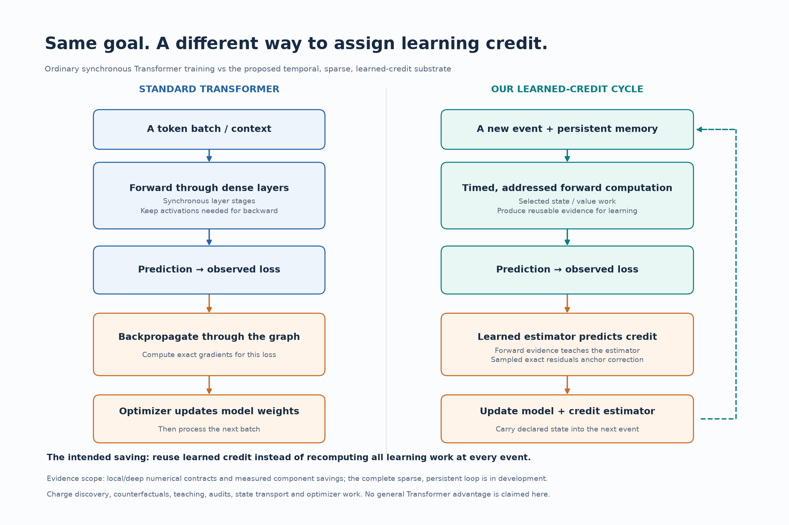
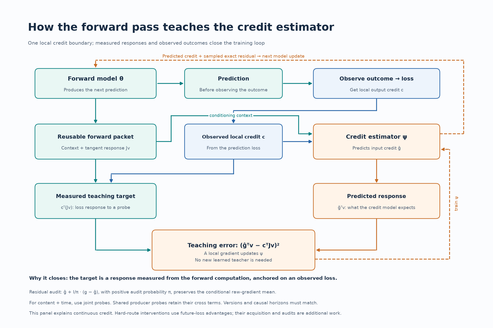

# Learned credit, explained visually

The general-purpose substrate aims to compute through time and sparse events across language, reasoning, world models and continual learning. These diagrams explain its credit-learning construction. They contrast an ordinary synchronous Transformer training cycle with the proposed integrated cycle; component results are not a general Transformer advantage.

Ordinary backpropagation calculates how the current loss depends on the model's parameters by reversing the computation graph. A learned credit function predicts part of that responsibility from the forward context and observed feedback. The intended benefit is to reuse acquired credit structure across events and interventions. Discovery, state, estimator training, counterfactuals and residual audits remain charged work.

At one local boundary, **v** is a probe direction, **Jv** is the measured forward response, and **c** is the observed loss's local output cotangent. The scalar **cᵀJv** says how that probe would change the loss to first order. The credit estimator predicts **ĝᵀv**. Their squared difference supplies an ordinary local training loss for the estimator. Positive-support probes identify the relevant credit directions; restricted probes identify only their supported subspace.

This closes the teaching loop on measured computation and observed outcomes. Local differentiation trains the estimator; it does not require a new learned teacher to certify the previous one. Exact residual audits anchor model gradients. An unbiased raw-gradient correction does not imply an unbiased Adam update or guarantee useful learning.

For a shared content/time producer, use the same parameter-space probe for both branches. Their residuals have cross terms that separate error estimates omit. Hard-route policies and exploration use a distinct target: future learning advantage against a declared alternative. Those targets, causal horizons and their acquisition costs require their own observations and audits.

The numerical joint-credit contracts pass at depths 2, 4 and 8. Fused joint teaching acquisition is measured through depth 32. End-to-end learned deep credit and better held-out prediction per complete learning cost are the next integration tests.

[Two-page vector PDF](learned_credit_explained.pdf) · [Comparison SVG](figures/learned_credit_comparison.svg) · [Teaching-loop SVG](figures/learned_credit_teaching_loop.svg)

Regenerate with `.venv-docker/bin/python report/draw_learned_credit.py`. Scientific sources: [shared-clock packet](../experiments/credit/NATIVE_TEMPORAL_TEACHING_PACKET.md), [forward-observed risk](../experiments/theory/FORWARD_OBSERVED_CREDIT_RISK.md), and [sparse continuous-producer credit](../experiments/theory/163_sparse_continuous_producer_credit.md).
